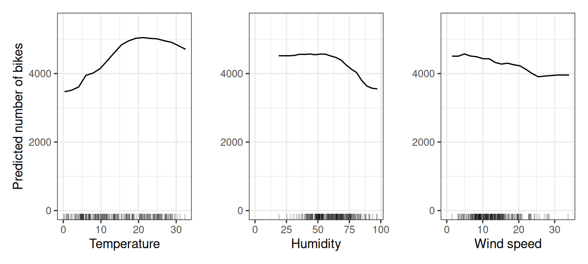
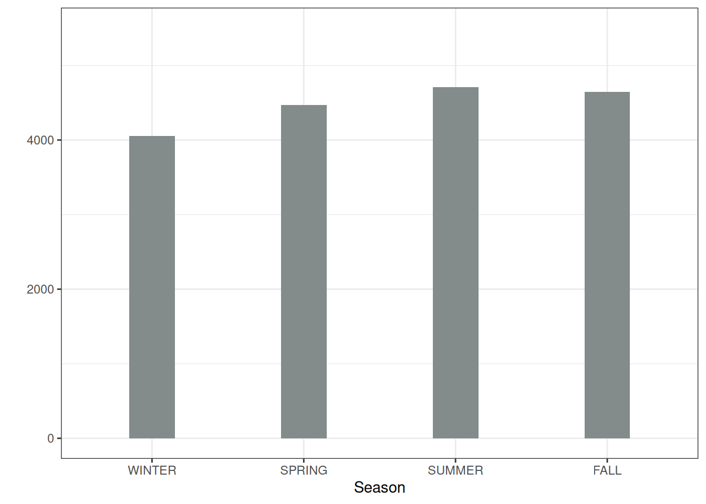
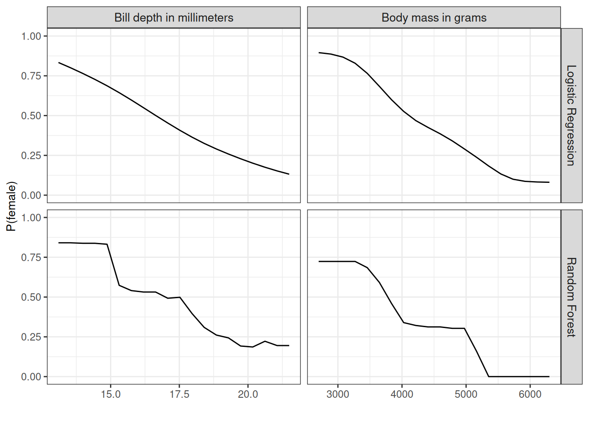
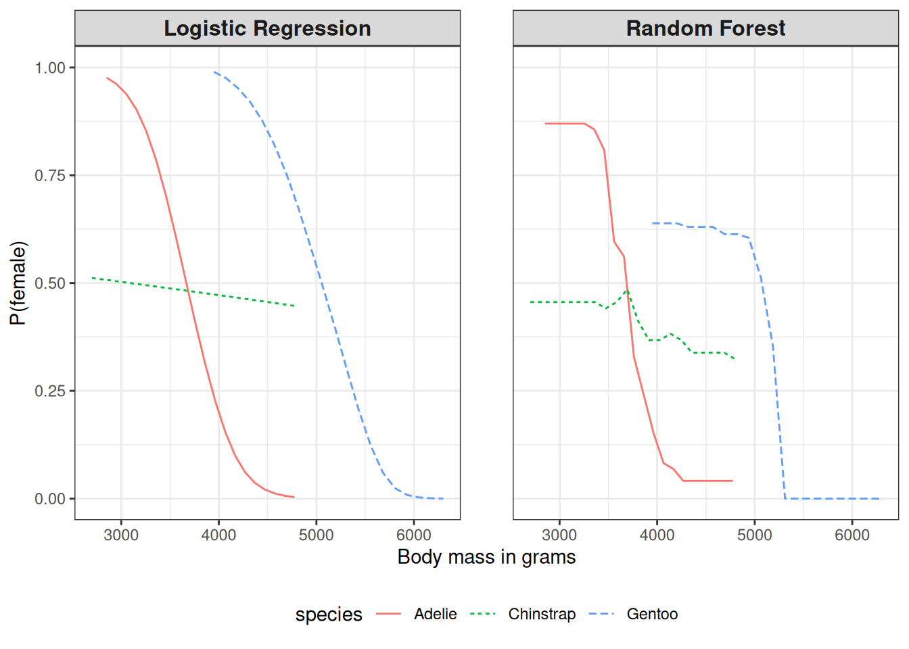
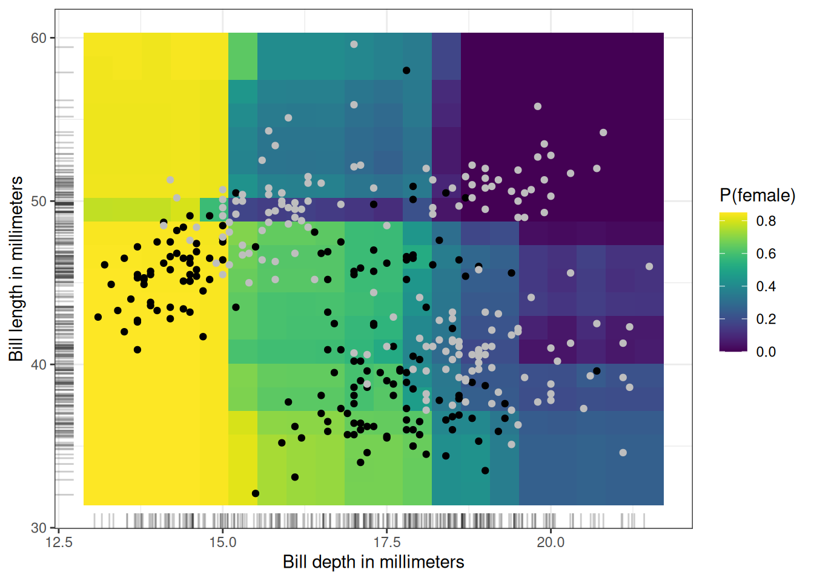

# فصل ۱۹: نمودار وابستگی جزئی (PDP)

> **عنوان اصلی:** Partial Dependence Plot (PDP)  
> **منبع:** [https://christophm.github.io/interpretable-ml-book/pdp.html](https://christophm.github.io/interpretable-ml-book/pdp.html)  
> **نویسنده:** Christoph Molnar  
> **مترجم:** مریم محمودی

---

نمودار وابستگی جزئی (partial dependence plot؛ به اختصار PDP یا PD plot) اثر حاشیه‌ای (marginal effect) یک یا دو ویژگی را بر خروجی پیش‌بینی‌شدهٔ یک مدل یادگیری ماشین نشان می‌دهد ([Friedman (۲۰۰۱)](appendix-D-references.md)).
نمودار وابستگی جزئی می‌تواند نشان دهد که رابطهٔ میان هدف و یک ویژگی خطی است، یکنواخت (monotonic) است، یا پیچیده‌تر.
برای مثال، وقتی نمودار وابستگی جزئی روی یک مدل رگرسیون خطی اعمال می‌شود، همیشه یک رابطهٔ خطی را نشان می‌دهد.

> **توضیح مترجم:** «اثر حاشیه‌ای» در این فصل یعنی اثر یک ویژگی بر پیش‌بینی پس از آنکه اثر ویژگی‌های دیگر با میانگین‌گیری «کنار گذاشته» شده باشد؛ نه اثر آن ویژگی در یک نمونهٔ خاص. «یکنواخت» یعنی با افزایش مقدار ویژگی، پیش‌بینی یا همواره افزایش می‌یابد یا همواره کاهش می‌یابد (بدون تغییر جهت). نام‌های PDP و PD plot در متن به‌صورت Latin می‌آیند.

## تعریف و برآورد

تابع وابستگی جزئی (partial dependence function) برای رگرسیون به این صورت تعریف می‌شود:

$$\hat{f}\_S(\mathbf{x}\_S) = \mathbb{E}\_{\mathbf{X}\_C}\left[\hat{f}(\mathbf{x}\_S, X\_C)\right] = \int \hat{f}(\mathbf{x}\_S, X\_C) d\mathbb{P}(\mathbf{X}\_C)$$

$\mathbf{x}\_S$ ویژگی‌هایی هستند که قرار است تابع وابستگی جزئی برای آن‌ها رسم شود، و $X\_C$ ویژگی‌های دیگری هستند که در مدل یادگیری ماشین $\hat{f}$ به کار رفته‌اند و در اینجا متغیرهای تصادفی در نظر گرفته می‌شوند.
معمولاً در مجموعهٔ $S$ فقط یک یا دو ویژگی وجود دارد.
ویژگی‌(های) موجود در $S$ همان‌هایی هستند که می‌خواهیم اثرشان را بر پیش‌بینی بدانیم.
بردارهای ویژگی $\mathbf{x}\_S$ و $\mathbf{x}\_C$ با هم دادهٔ کل $\mathbf{X}$ را تشکیل می‌دهند.
وابستگی جزئی با حاشیه‌ای‌سازی (marginalizing) خروجی مدل یادگیری ماشین روی توزیع ویژگی‌های مجموعهٔ $C$ کار می‌کند، به‌طوری که تابع حاصل رابطهٔ میان ویژگی‌های مجموعهٔ $S$ که به آن‌ها علاقه‌مندیم و خروجی پیش‌بینی‌شده را نشان دهد.
با حاشیه‌ای‌سازی روی ویژگی‌های دیگر، تابعی به دست می‌آوریم که فقط به ویژگی‌های $S$ وابسته است و برهم‌کنش‌ها (interactions) با ویژگی‌های دیگر در آن لحاظ شده‌اند.

تابع جزئی $\hat{f}\_S$ با محاسبهٔ میانگین‌ها در داده‌های آموزشی برآورد می‌شود، که به آن روش مونت‌کارلو (Monte Carlo) نیز گفته می‌شود:

$$\hat{f}\_S(\mathbf{x}\_S) = \frac{1}{n} \sum\_{i=1}^n \hat{f}(\mathbf{x}\_S, \mathbf{x}^{(i)}\_{C})$$

این معادل میانگین‌گیری از همهٔ [منحنی‌های ICE](13-ice.md) یک مجموعه‌داده است.
تابع جزئی به ما می‌گوید برای مقدار(های) داده‌شدهٔ ویژگی‌های مجموعهٔ $S$، اثر حاشیه‌ایِ میانگین بر پیش‌بینی چقدر است.
در این فرمول، $\mathbf{x}^{(i)}\_{C}$ مقادیر واقعی ویژگی‌ها در مجموعه‌داده برای ویژگی‌هایی هستند که به آن‌ها علاقه‌ای نداریم، و $n$ تعداد نمونه‌های مجموعه‌داده است.
PDP ویژگی‌های مجموعهٔ $C$ را صرف‌نظر از همبستگی‌شان با ویژگی‌های مجموعهٔ $S$ در نظر می‌گیرد.
در صورت وجود همبستگی، میانگین‌هایی که برای نمودار وابستگی جزئی محاسبه می‌شوند نقاط داده‌ای را هم شامل می‌شوند که بسیار نامحتمل یا حتی غیرممکن‌اند (بخش معایب را ببینید).

> **برای درک بهتر (توضیح مترجم):** فرض کنید مدلی ساده به‌صورت $\hat{f}(\text{temp}, \text{hum}) = 100 + 10 \cdot \text{temp} - 2 \cdot \text{hum}$ داریم و فقط سه نمونه در داده‌ها هست که رطوبتشان $40$، $60$ و $80$ است. می‌خواهیم وابستگی جزئی را برای $S = \lbrace \text{temp} \rbrace$ و $C = \lbrace \text{hum} \rbrace$ در $\text{temp} = 20$ بیابیم. دمای هر سه نمونه را $20$ قرار می‌دهیم و پیش‌بینی می‌گیریم: $\hat{f}(20, 40) = 220$، $\hat{f}(20, 60) = 180$ و $\hat{f}(20, 80) = 140$. میانگین این سه عدد $\hat{f}\_S(20) = \frac{220 + 180 + 140}{3} = 180$ است. همین کار را برای $\text{temp} = 10$ تکرار می‌کنیم: $120$، $80$ و $40$ که میانگین‌شان $\hat{f}\_S(10) = 80$ است. با رسم این نقاط (و نقاط دیگر دما) منحنی PDP ساخته می‌شود. چون مدل خطی است، منحنی هم خطی است و شیب آن ($\frac{180 - 80}{20 - 10} = 10$) دقیقاً ضریب $\text{temp}$ در مدل است؛ این همان جملهٔ متن است که PDP روی مدل خطی همیشه رابطهٔ خطی را نشان می‌دهد.

> **⚠️ هشدار — ویژگی‌های همبسته مشکل‌ساز هستند**
>
> هنگام تفسیر PDP برای ویژگی‌های (به‌شدت) همبسته احتیاط کنید: در این حالت، نمودار وابستگی جزئی شامل نمونه‌های دادهٔ غیرواقع‌گرایانه می‌شود.

برای طبقه‌بندی، آنجا که مدل یادگیری ماشین احتمال‌ها را خروجی می‌دهد، نمودار وابستگی جزئی احتمال یک کلاس معین را به ازای مقادیر مختلف ویژگی‌(های) مجموعهٔ $S$ نشان می‌دهد.
یک راه ساده برای برخورد با چند کلاس این است که برای هر کلاس یک خط یا یک نمودار رسم کنیم.

نمودار وابستگی جزئی یک روش سراسری (global) است:
این روش همهٔ نمونه‌ها را در نظر می‌گیرد و دربارهٔ رابطهٔ سراسری یک ویژگی با خروجی پیش‌بینی‌شده اظهارنظر می‌کند.

**ویژگی‌های طبقه‌ای**

تا اینجا فقط ویژگی‌های عددی را در نظر گرفتیم.
برای ویژگی‌های طبقه‌ای (categorical)، وابستگی جزئی بسیار ساده محاسبه می‌شود.
برای هر یک از دسته‌ها (categories)، یک برآورد PDP به دست می‌آوریم، به این صورت که همهٔ نمونه‌های داده را مجبور می‌کنیم همان دسته را داشته باشند.
برای مثال، اگر به مجموعه‌دادهٔ [اجارهٔ دوچرخه](05-data.md) نگاه کنیم و به نمودار وابستگی جزئی برای فصل (season) علاقه‌مند باشیم، چهار عدد به دست می‌آوریم، یکی برای هر فصل.
برای محاسبهٔ مقدار «تابستان»، فصلِ همهٔ نمونه‌های داده را با «تابستان» جایگزین می‌کنیم و میانگین پیش‌بینی‌ها را می‌گیریم.

> **برای درک بهتر (توضیح مترجم):** فرض کنید فقط سه روز در داده‌ها داریم: روز اول زمستان و دمای ۵، روز دوم بهار و دمای ۱۵، و روز سوم تابستان و دمای ۲۵. برای «تابستان» فصل هر سه روز را به تابستان تغییر می‌دهیم و مدل را سه بار با ترکیب‌های (تابستان، ۵)، (تابستان، ۱۵) و (تابستان، ۲۵) اجرا می‌کنیم؛ میانگین این سه پیش‌بینی مقدار وابستگی جزئی برای «تابستان» است. همین کار را با بقیهٔ فصل‌ها تکرار می‌کنیم. هر دسته یک عدد دارد و در نتیجه نمودار معمولاً به‌صورت نمودار میله‌ای رسم می‌شود (مانند شکل ۱۹.۲). دمای هر نمونه در تمام این محاسبات همان مقدار واقعی‌اش می‌ماند.

## مثال‌ها

در عمل، مجموعهٔ ویژگی‌های $S$ معمولاً فقط شامل یک ویژگی یا حداکثر دو ویژگی است، چون یک ویژگی نمودارهای دوبعدی تولید می‌کند و دو ویژگی نمودارهای سه‌بعدی.
هر چیزی فراتر از این کاملاً دشوار است.

بیایید به مثال رگرسیون برگردیم که در آن [تعداد دوچرخه‌هایی را که در یک روز معین اجاره می‌شوند](05-data.md) پیش‌بینی می‌کنیم.
ابتدا یک مدل یادگیری ماشین برازش می‌دهیم، سپس وابستگی‌های جزئی را تحلیل می‌کنیم.
در این مورد، یک جنگل تصادفی (random forest) را برای پیش‌بینی تعداد دوچرخه‌ها برازش داده‌ایم و از نمودار وابستگی جزئی برای مصورسازی روابطی که مدل آموخته است استفاده کرده‌ایم، شکل ۱۹.۱ را ببینید.
تأثیر ویژگی‌های آب‌وهوایی بر تعداد پیش‌بینی‌شدهٔ دوچرخه‌ها در شکل زیر مصور شده است.
بزرگ‌ترین تفاوت‌ها در دما دیده می‌شود.
هرچه هوا گرم‌تر باشد، دوچرخه‌های بیشتری اجاره می‌شود.
این روند تا ۲۰ درجهٔ سلسیوس رو به بالاست، سپس صاف می‌شود و حدود ۳۰ درجه اندکی کاهش می‌یابد.

> **توضیح مترجم (متن داخل تصویر):** تصویر سه نمودار کنار هم است که همگی محور y یکسانی با برچسب `Predicted number of bikes` (تعداد پیش‌بینی‌شدهٔ دوچرخه‌ها) دارند. برچسب محور x نمودار اول `Temperature` (دما)، نمودار دوم `Humidity` (رطوبت) و نمودار سوم `Wind speed` (سرعت باد) است. خط‌های ریز و تیره روی محور x (به‌اصطلاح rug) محل نقاط داده‌اند و در جاهایی که این خط‌ها پراکنده‌اند داده کم است. نوشته‌های انگلیسی تصویر بدون تغییر ماندند.

رطوبت هنگامی که از ۶۰٪ بیشتر شود، دوچرخه‌سواران بالقوه را هرچه بیشتر از اجارهٔ دوچرخه بازمی‌دارد.
افزون بر این، هرچه باد بیشتر باشد، افراد کمتری دوست دارند دوچرخه‌سواری کنند، که منطقی است.
جالب اینجاست که تعداد پیش‌بینی‌شدهٔ اجاره‌ها با افزایش سرعت باد از ۲۵ به ۳۵ کیلومتر بر ساعت کاهش نمی‌یابد، اما داده‌های آموزشی زیادی در این بازه نیست، پس مدل یادگیری ماشین احتمالاً نتوانسته پیش‌بینی معناداری برای این بازه یاد بگیرد.
دست‌کم از نظر شهودی، انتظار دارم با افزایش سرعت باد تعداد دوچرخه‌ها کاهش یابد، به‌ویژه وقتی سرعت باد بسیار زیاد است.

> **توضیح مترجم:** متن منبع واحد دما را سلسیوس و واحد سرعت باد را کیلومتر بر ساعت ذکر می‌کند؛ خود تصویر برای محورها واحدی نشان نمی‌دهد. جملهٔ پایانی دربارهٔ انتظار نویسنده یک قضاوت شخصی است و ادعایی دربارهٔ نتیجهٔ مدل نیست؛ خود نویسنده تأکید می‌کند که ثابت‌ماندن منحنی در بازهٔ ۲۵ تا ۳۵ نتیجهٔ کمبود داده است و نباید به‌عنوان اثر واقعی باد تفسیر شود.

برای نمایش یک نمودار وابستگی جزئی با ویژگی طبقه‌ای، اثر ویژگی فصل را بر اجارهٔ پیش‌بینی‌شدهٔ دوچرخه بررسی می‌کنیم، شکل ۱۹.۲ را ببینید.
همهٔ فصل‌ها اثر مشابهی بر پیش‌بینی‌های مدل دارند؛ فقط برای زمستان مدل اجارهٔ کمتری پیش‌بینی می‌کند، و برای بهار کمی کمتر.

> **توضیح مترجم (متن داخل تصویر):** محور x با برچسب `Season` (فصل) چهار میله دارد: `WINTER` (زمستان)، `SPRING` (بهار)، `SUMMER` (تابستان) و `FALL` (پاییز). محور y برچسبی ندارد (بر اساس کد منبع همان تعداد پیش‌بینی‌شدهٔ دوچرخه است و بین ۰ تا حدود ۵۵۰۰ رسم شده) و مقدارهای ۰، ۲۰۰۰ و ۴۰۰۰ روی آن نشان داده شده است. نوشته‌های انگلیسی تصویر بدون تغییر ماندند.

همچنین وابستگی جزئی را برای [دسته‌بندی پنگوئن‌ها](05-data.md) (نر/ماده) محاسبه می‌کنیم.
برای اینکه کمی تنوع ایجاد کنیم، هم رویکرد جنگل تصادفی و هم رگرسیون لجستیک را تحلیل می‌کنیم.
هر دو $\mathbb{P}(Y^{(i)} = \text{female})$ را بر پایهٔ اندازه‌گیری‌های بدن پیش‌بینی می‌کنند.
وابستگی جزئیِ احتمال ماده‌بودن را بر پایهٔ توده بدنی (body mass) و عمق منقار (bill depth) برای جنگل تصادفی محاسبه و مصور می‌کنیم (شکل ۱۹.۳).
هرچه پنگوئن سنگین‌تر باشد، احتمال ماده‌بودن آن کمتر است.
الگوی مشابهی را برای عمق منقار می‌بینیم.
PDP جنگل تصادفی به‌دلیل پایهٔ درخت تصمیمی‌اش بسیار ناهموارتر (rugged) است.

> **توضیح مترجم (متن داخل تصویر):** تصویر یک شبکهٔ ۲×۲ از نمودارهاست. برچسب ستون‌ها بالای شبکه `Bill depth in millimeters` (عمق منقار بر حسب میلی‌متر) و `Body mass in grams` (توده بدنی بر حسب گرم) است و برچسب سطرها در سمت راست `Logistic Regression` (رگرسیون لجستیک، سطر بالا) و `Random Forest` (جنگل تصادفی، سطر پایین). محور y همه `P(female)` (احتمال ماده‌بودن) با مقدارهای ۰٫۰۰ تا ۱٫۰۰ است. منحنی‌های رگرسیون لجستیک هموارند و منحنی‌های جنگل تصادفی پله‌پله‌اند؛ این همان «ناهمواری» متن است. متن منبع در این‌جا از «عمق منقار» و «توده بدنی» نام می‌برد که با برچسب‌های تصویر یکی است. نوشته‌های انگلیسی تصویر بدون تغییر ماندند.

شکل ۱۹.۳ مشکل بزرگی دارد: همهٔ گونه‌های پنگوئن را با هم مخلوط می‌کند.
اما می‌توانیم به‌سادگی PDP را به تفکیک گونه محاسبه کنیم.
برای این کار فقط باید PDPهای جداگانه را با زیرمجموعه‌گرفتن از داده‌ها محاسبه کنیم و منحنی‌ها را در یک نمودار رسم کنیم، همان‌طور که در شکل ۱۹.۴ انجام دادم.
تفسیری دقیق‌تر پدیدار می‌شود.
برای Adelie، وزن بیشتر یعنی احتمال ماده‌بودن کمتر.
برای Chinstrap، وزن چندان بر احتمال اثر نمی‌گذارد.
پنگوئن‌های Gentoo به‌طور کلی سنگین‌ترند، اما آن‌ها نیز الگوی «نرها سنگین‌ترند» را نشان می‌دهند.
همچنین رگرسیون لجستیک، تعجبی ندارد، هموارتر است و احتمال‌های جنگل تصادفی به سمت میانگین کشیده می‌شوند.

> **توضیح مترجم:** عبارت «surprise, surprise» در متن اصلی لحنی طنزآمیز است و یعنی «این هیچ جای شگفتی ندارد»؛ علت این است که رگرسیون لجستیک ذاتاً تابعی هموار (سیگموید) از ترکیب خطی ویژگی‌هاست. عبارت «احتمال‌ها به سمت میانگین کشیده می‌شوند» توصیف نویسنده از شکل ۱۹.۴ است: برای Chinstrap و Gentoo، منحنی جنگل تصادفی در بازه‌ای از وزن تقریباً افقی و در سطحی میانی می‌ماند، در حالی که منحنی لجستیک دامنهٔ بیشتری را می‌پیماید.

> **توضیح مترجم (متن داخل تصویر):** دو نمودار کنار هم‌اند با عنوان‌های `Logistic Regression` (رگرسیون لجستیک، چپ) و `Random Forest` (جنگل تصادفی، راست). برچسب محور x `Body mass in grams` (توده بدنی بر حسب گرم) و محور y `P(female)` (احتمال ماده‌بودن) است. راهنمای زیر تصویر با عنوان `species` (گونه) سه خط را نشان می‌دهد: `Adelie` (خط پر قرمز)، `Chinstrap` (خط نقطه‌چین سبز) و `Gentoo` (خط خط‌چین آبی). منحنی‌های Gentoo در بازهٔ وزنی بالاتری (تقریباً از ۴۰۰۰ تا ۶۳۰۰ گرم) و منحنی‌های Adelie و Chinstrap در بازهٔ وزنی پایین‌تر قرار دارند، چون PDP هر گونه فقط روی داده‌های همان گونه محاسبه شده است. نوشته‌های انگلیسی تصویر بدون تغییر ماندند.

همچنین می‌توانیم وابستگی جزئی دو ویژگی را همزمان مصور کنیم (شکل ۱۹.۵): در اینجا عمق منقار و طول منقار (bill length).
مدل تحلیل‌شده جنگل تصادفی است.
میان این دو برهم‌کنشی وجود دارد، زیرا در عمق‌های کم منقار، طول منقار تفاوتی ایجاد نمی‌کند، اما برای منقارهای بلندتر $\mathbb{P}(\text{female})$ کوچک‌تر می‌شود.

> **توضیح مترجم (متن داخل تصویر):** برچسب محور x `Bill depth in millimeters` (عمق منقار بر حسب میلی‌متر) و برچسب محور y `Bill length in millimeters` (طول منقار بر حسب میلی‌متر) است. راهنمای رنگ سمت راست با عنوان `P(female)` (احتمال ماده‌بودن) از ۰٫۰ (بنفش تیره) تا ۰٫۸ (زرد) را نشان می‌دهد. خط‌های ریز کنار هر دو محور (rug) توزیع داده‌ها را نشان می‌دهند. در ناحیهٔ زرد سمت چپ (عمق منقار کم) رنگ با طول منقار تغییر نمی‌کند و در سمت راست و بالای نمودار (عمق و طول زیاد) رنگ به بنفش تیره، یعنی احتمال ماده‌بودن نزدیک صفر، می‌رود؛ این همان برهم‌کنش متن است. نوشته‌های انگلیسی تصویر بدون تغییر ماندند.

> **برای درک بهتر (توضیح مترجم):** برای PDP دوبعدی، شبکه‌ای از جفت‌مقدارها $(a, b)$ برای (عمق منقار، طول منقار) می‌سازیم. برای هر جفت، عمق و طول منقار همهٔ پنگوئن‌های مجموعه‌داده را به $a$ و $b$ تغییر می‌دهیم، $\mathbb{P}(\text{female})$ را برای هر کدام پیش‌بینی می‌کنیم و میانگین می‌گیریم: $\hat{f}\_S(a, b) = \frac{1}{n}\sum\_{i=1}^n \hat{f}(a, b, \mathbf{x}\_C^{(i)})$. هر سلول رنگی در شکل ۱۹.۵ یکی از این میانگین‌هاست. ویژگی‌های دیگر (مثلاً توده بدنی) برای هر پنگوئن همان مقدار واقعی‌شان می‌مانند. به همین دلیل نقطه‌های سیاه و خاکستری (دادهٔ واقعی) برای مقایسه با ناحیه‌های رنگی رسم شده‌اند: در ناحیه‌هایی که نقطه‌ای نیست (مثلاً عمق ۱۵ همراه با طول ۶۰)، رنگ حاصل به نمونه‌های ساختگی تکیه دارد که ممکن است غیرواقعی باشند؛ نکته‌ای که با هشدار مربوط به ویژگی‌های همبسته مرتبط است.

> **💡 نکته — کاهش برهم‌کنش‌ها، بهبود تفسیرپذیری PDP**
>
> هرچند PDP روشی مستقل از مدل (model-agnostic) است، داشتن مدلی با برهم‌کنش‌های کمتر و اثرهای همگن‌تر تفسیر PDP را ساده‌تر می‌کند و (بعضی) خطرهای تفسیر نادرست را کاهش می‌دهد.
> راه‌های انجام این کار کاهش عمق درخت هنگام استفاده از روش‌های مبتنی بر درخت یا افزودن قیدهای یکنوایی (monotonicity constraints) است.
> به‌طور جایگزین می‌توانید به شیوه‌ای مستقل از مدل برای برهم‌کنش‌های کمتر، تنکی (sparsity) و اثرهای کم‌پیچیده‌تر در یک مدل بهینه‌سازی کنید؛ [Molnar و همکاران (۲۰۲۰b)](appendix-D-references.md) را ببینید.

## اهمیت ویژگی مبتنی بر PDP

[Greenwell و همکاران (۲۰۱۸)](appendix-D-references.md) یک معیار اهمیت ویژگی ساده مبتنی بر وابستگی جزئی پیشنهاد کردند.
انگیزهٔ اصلی این است که یک PDP تخت نشان می‌دهد ویژگی مهم نیست، و هرچه PDP بیشتر تغییر کند، ویژگی مهم‌تر است.
برای ویژگی‌های عددی، اهمیت به‌صورت انحراف هر مقدار یکتای ویژگی از منحنی میانگین تعریف می‌شود:

$$I(\mathbf{x}\_S) =  \sqrt{\frac{1}{K-1}\sum\_{k=1}^K(\hat{f}\_S(\mathbf{x}^{(k)}\_S) - \frac{1}{K}\sum\_{k=1}^K \hat{f}\_S(\mathbf{x}^{(k)}\_S))^2}$$

توجه کنید که در اینجا $\mathbf{x}^{(k)}\_S$ همان $K$ مقدار یکتای (unique) ویژگی $X\_S$ هستند.
برای ویژگی‌های طبقه‌ای داریم:

$$I(X\_S) = \frac{\max\_k(\hat{f}\_S(\mathbf{x}^{(k)}\_S)) - \min\_k(\hat{f}\_S(\mathbf{x}^{(k)}\_S))}{4}$$

این همان دامنهٔ مقادیر PDP برای دسته‌های یکتا تقسیم بر چهار است.
این شیوهٔ عجیب برای محاسبهٔ انحراف «قاعدهٔ دامنه» (range rule) نامیده می‌شود.
این قاعده وقتی فقط دامنه را می‌دانید به برآوردی تقریبی از انحراف کمک می‌کند.
و مخرج چهار از توزیع نرمال استاندارد می‌آید:
در توزیع نرمال، ۹۵٪ داده‌ها در بازهٔ منفی دو تا مثبت دو انحراف معیار پیرامون میانگین‌اند.
پس دامنه تقسیم بر چهار برآوردی تقریبی می‌دهد که احتمالاً واریانس واقعی را کمتر از مقدار حقیقی برآورد می‌کند.

> **توضیح مترجم:** در فرمول عددی، $\hat{f}\_S(\mathbf{x}\_S^{(k)})$ مقدار PDP در $k$-امین مقدار یکتاست و $\frac{1}{K}\sum\_k \hat{f}\_S(\mathbf{x}\_S^{(k)})$ میانگین این مقادیر؛ پس $I$ در واقع انحراف معیار نمونه‌ای (با مخرج $K-1$) مقادیر منحنی PDP است. در متن منبع جملهٔ «۹۵٪ داده‌ها میان منفی دو و مثبت دو انحراف معیار هستند» تقریبی است؛ برای توزیع نرمال این ناحیه دقیقاً حدود ۹۵٫۴٪ را پوشش می‌دهد. چون این بازه چهار انحراف معیار پهناست، «دامنه ÷ ۴» به انحراف معیار نزدیک می‌شود. نویسنده خود می‌گوید این برآورد احتمالاً کمتر از مقدار واقعی است؛ دلیل شهودی آن این است که دامنهٔ مشاهده‌شدهٔ نمونهٔ کوچک معمولاً از دامنهٔ کل توزیع کوتاه‌تر است.

> **برای درک بهتر (توضیح مترجم):** فرض کنید PDP برای ویژگی «فصل» چهار مقدار دارد: زمستان ۴۰۰۰، بهار ۴۴۰۰، تابستان ۴۷۰۰ و پاییز ۴۶۰۰. اهمیت آن $\frac{4700 - 4000}{4} = 175$ است. حالا برای ویژگی عددی با $K = 3$ مقدار یکتا و PDP برابر $3500$، $4500$ و $5500$: میانگین $4500$ و $I = \sqrt{\frac{(-1000)^2 + 0^2 + 1000^2}{3 - 1}} = \sqrt{1000000} = 1000$. هر چه منحنی «تخت‌تر» باشد، $I$ به صفر نزدیک‌تر است (مثلاً اگر هر سه مقدار $4500$ باشند، $I = 0$).

این اهمیت ویژگی مبتنی بر PDP را باید با احتیاط تفسیر کرد.
این معیار فقط اثر اصلی (main effect) ویژگی را می‌گیرد و برهم‌کنش‌های ممکن ویژگی‌ها را نادیده می‌گیرد.
ممکن است ویژگی‌ای بر پایهٔ روش‌های دیگر مانند [اهمیت ویژگی جایگشتی](23-feature-importance.md) بسیار مهم باشد، اما PDP آن تخت باشد، چون ویژگی عمدتاً از راه برهم‌کنش با ویژگی‌های دیگر بر پیش‌بینی اثر می‌گذارد.
عیب دیگر این معیار آن است که روی مقادیر یکتا تعریف شده است.
در محاسبهٔ اهمیت، به مقدار یکتایی که فقط یک نمونه دارد همان وزنی داده می‌شود که به مقداری با نمونه‌های بسیار.

## نقاط قوت

محاسبهٔ نمودارهای وابستگی جزئی **شهودی** است:
تابع وابستگی جزئی در یک مقدار ویژگی معین، میانگین پیش‌بینی را نشان می‌دهد اگر همهٔ نقاط داده را مجبور کنیم آن مقدار ویژگی را بپذیرند.
در تجربهٔ من، افراد غیرمتخصص معمولاً ایدهٔ PDPها را سریع می‌فهمند.

اگر ویژگی‌ای که PDP را برایش محاسبه کرده‌اید با ویژگی‌های دیگر همبسته نباشد، PDPها کاملاً نشان می‌دهند ویژگی به‌طور میانگین چگونه بر پیش‌بینی اثر می‌گذارد.
در حالت ناهمبسته، **تفسیر روشن است**:
نمودار وابستگی جزئی نشان می‌دهد وقتی ویژگی $j$-ام تغییر می‌کند، میانگین پیش‌بینی در مجموعه‌داده چگونه تغییر می‌کند.
وقتی ویژگی‌ها همبسته‌اند، پیچیده‌تر می‌شود؛ معایب را نیز ببینید.

> **توضیح مترجم:** در متن منبع «ویژگی $j$-ام» بدون تعریف صریح آمده است؛ از زمینه برمی‌آید که منظور ویژگی‌ای است که PDP برایش رسم شده (همان $X\_S$ با $S = \lbrace j \rbrace$ در تعریف ابتدای فصل).

نمودارهای وابستگی جزئی **پیاده‌سازی آسانی** دارند.

محاسبهٔ نمودارهای وابستگی جزئی **تفسیر علّی** (causal interpretation) دارد.
ما روی یک ویژگی مداخله می‌کنیم و تغییرات پیش‌بینی‌ها را اندازه می‌گیریم.
با این کار رابطهٔ علّی میان ویژگی و پیش‌بینی را تحلیل می‌کنیم ([Zhao و Hastie (۲۰۱۹)](appendix-D-references.md)).
این رابطه برای مدل علّی است ــ چون نتیجه را صریحاً تابعی از ویژگی‌ها مدل می‌کنیم ــ اما لزوماً برای دنیای واقعی علّی نیست!

> **برای درک بهتر (توضیح مترجم):** فرض کنید مدل برای پیش‌بینی قیمت خانه آموزش دیده و PDP مساحت نشان می‌دهد با بزرگ‌ترشدن مساحت، قیمت پیش‌بینی‌شده بالا می‌رود. این یعنی «اگر در این مدل مساحت را تغییر دهیم، خروجی مدل چنین تغییر می‌کند»؛ ادعا نمی‌کند که ساختن اتاق اضافه در دنیای واقعی همین مقدار قیمت خانه را بالا می‌برد، چون ممکن است مدل مساحت را به‌جای عاملی پنهان (مثلاً محله) به کار برده باشد. این همان تفاوت «علّی برای مدل» و «علّی برای دنیای واقعی» در متن است.

## محدودیت‌ها

**حداکثر واقع‌بینانهٔ تعداد ویژگی‌ها** در یک تابع وابستگی جزئی که بتوان آن را معنادار مصور کرد، دو است.
این تقصیر PDPها نیست، بلکه تقصیر نمایش دوبعدی (کاغذ یا صفحه) و نیز ناتوانی ما در تصور بیش از ۳ بعد است.
با این حال، هنوز می‌توان PDPهای مرتبهٔ بالاتر را محاسبه کرد.

برخی نمودارهای PD **توزیع ویژگی** را نشان نمی‌دهند.
حذف توزیع می‌تواند گمراه‌کننده باشد، چون ممکن است ناحیه‌هایی را که تقریباً داده‌ای ندارند بیش‌ازحد تفسیر کنید.
این مشکل به‌سادگی با نمایش یک rug (نشانگرهای نقاط داده روی محور x) یا یک هیستوگرام حل می‌شود.

**فرض استقلال** بزرگ‌ترین مسئلهٔ نمودارهای PD است.
فرض می‌شود ویژگی‌(های) مورد محاسبهٔ وابستگی جزئی با ویژگی‌های دیگر همبسته نیستند.
برای مثال، فرض کنید می‌خواهید پیش‌بینی کنید یک فرد با چه سرعتی راه می‌رود، با داشتن وزن و قد او.
برای وابستگی جزئی یکی از ویژگی‌ها، مثلاً قد، فرض می‌کنیم ویژگی‌های دیگر (وزن) با قد همبسته نیستند، که آشکارا فرضی نادرست است.
برای محاسبهٔ PDP در یک قد معین (مثلاً ۲۰۰ سانتی‌متر)، روی توزیع حاشیه‌ای وزن میانگین می‌گیریم، که ممکن است شامل وزنی زیر ۵۰ کیلوگرم باشد، و این برای فردی با قد ۲ متر غیرواقع‌گرایانه است.
به عبارت دیگر:
وقتی ویژگی‌ها همبسته‌اند، نقاط داده‌ای تازه‌ای در نواحی از توزیع ویژگی می‌سازیم که احتمال واقعی آن‌ها بسیار کم است (مثلاً بعید است کسی ۲ متر قد داشته باشد اما کمتر از ۵۰ کیلوگرم وزن داشته باشد).
یک راه‌حل این مشکل [نمودارهای اثر محلی انباشته (Accumulated Local Effect)](20-ale.md) یا به اختصار نمودارهای ALE است که به‌جای توزیع حاشیه‌ای با توزیع شرطی کار می‌کنند.

**اثرهای ناهمگن (heterogeneous effects) ممکن است پنهان بمانند**، چون نمودارهای PD فقط اثرهای حاشیه‌ایِ میانگین را نشان می‌دهند.
فرض کنید برای یک ویژگی، نیمی از نقاط داده با پیش‌بینی رابطهٔ مثبت دارند ــ هرچه مقدار ویژگی بزرگ‌تر، پیش‌بینی بزرگ‌تر ــ و نیمهٔ دیگر رابطهٔ منفی دارند ــ هرچه مقدار ویژگی کوچک‌تر، پیش‌بینی بزرگ‌تر.
منحنی PD می‌تواند یک خط افقی باشد، چون اثر دو نیمهٔ مجموعه‌داده می‌تواند یکدیگر را خنثی کند.
آنگاه نتیجه می‌گیرید که ویژگی بر پیش‌بینی اثری ندارد.
با رسم [منحنی‌های انتظار شرطی فردی](13-ice.md) به‌جای خط تجمیعی، می‌توانیم اثرهای ناهمگن را آشکار کنیم.
با این حال، نمودارهای ICE نمی‌توانند نشان دهند **چه زمانی** اثر مثبت یا منفی است ــ جنبه‌ای کلیدی برای تفسیر.
فرض کنید جهت اثر (مثبت یا منفی) به ویژگی دیگری بستگی دارد ــ وقتی مقدار ویژگی دیگر بالای آستانه‌ای معین باشد اثر مثبت است و برعکس.
نمودارهای اثر ویژگی منطقه‌ای (regional feature effect plots) ([Herbinger و همکاران (۲۰۲۴)](appendix-D-references.md)؛ [Herbinger، Bischl و Casalicchio (۲۰۲۲)](appendix-D-references.md)؛ [Britton (۲۰۱۹)](appendix-D-references.md)؛ Gkolemis و همکاران (۲۰۲۴)) با افراز داده‌ها بر پایهٔ ویژگی شرطی‌کننده و محاسبهٔ PDPهای مخصوص هر زیرگروه به این موضوع می‌پردازند.
این رویکرد به‌روشنی نشان می‌دهد **در چه شرایطی** اثر مثبت یا منفی است و ناهمگنی کلی را کاهش می‌دهد.

> **توضیح مترجم:** مرجع Gkolemis و همکاران (۲۰۲۴) در منبع انگلیسی با کلید `gkolemis2024fast` ذکر شده، اما در پیوست د این کتاب فقط مقالهٔ RHALE از Gkolemis و همکاران (۲۰۲۳) آمده است و ورودی دقیق ۲۰۲۴ در آنجا نیست؛ به همین دلیل بدون پیوند، فقط به‌صورت نام و سال آمد و ورودی حدسی به پیوست اضافه نشد. «ویژگی شرطی‌کننده» (conditioning feature) ویژگی‌ای است که داده‌ها بر اساس مقدار آن به زیرگروه‌ها تقسیم می‌شوند.

> **برای درک بهتر (توضیح مترجم):** فرض کنید مدلی پیش‌بینی می‌کند چه مقدار یک دارو فشار خون را تغییر می‌دهد و «دوز دارو» ویژگی مورد نظر است. برای نیمی از بیماران (گروه A) هرچه دوز بیشتر، فشار پیش‌بینی‌شده ۱۰ واحد به‌ازای هر واحد دوز کاهش می‌یابد، و برای نیمهٔ دیگر (گروه B) به همان اندازه افزایش می‌یابد. میانگین این دو اثر صفر است، پس PDP یک خط افقی است و نتیجه می‌گیریم دوز بی‌اثر است. منحنی‌های ICE دو دسته شیب متضاد را نشان می‌دهند. اگر گروه بر اساس ویژگی دیگری مثل «سن بالای ۶۰» مشخص شود، PDP منطقه‌ای دو منحنی جدا می‌سازد: یکی برای سن زیر ۶۰ با شیب منفی و یکی برای سن بالای ۶۰ با شیب مثبت؛ و روشن می‌شود **در چه شرایطی** اثر مثبت یا منفی است. (اعداد این مثال فقط برای توضیح ایده‌اند و از منبع نیستند.)

## نرم‌افزار و جایگزین‌ها

چند بستهٔ R وجود دارد که PDPها را پیاده‌سازی می‌کنند.
من برای مثال‌ها از بستهٔ `iml` استفاده کردم، اما `pdp` و `DALEX` هم هستند.
در Python، نمودارهای وابستگی جزئی در `scikit-learn`، `PDPBox` و [`effector`](https://github.com/givasile/effector) تعبیه شده‌اند.
یا می‌توانید از [کتابخانهٔ Python Interpretable Machine Learning (PiML)](https://selfexplainml.github.io/PiML-Toolbox/_build/html/index.html) استفاده کنید.
[`effector`](https://github.com/givasile/effector) نمودارهای PDP منطقه‌ای را نیز پیاده‌سازی می‌کند.

جایگزین‌های PDP که در این کتاب ارائه شده‌اند [نمودارهای ALE](20-ale.md) و [منحنی‌های ICE](13-ice.md) هستند.
