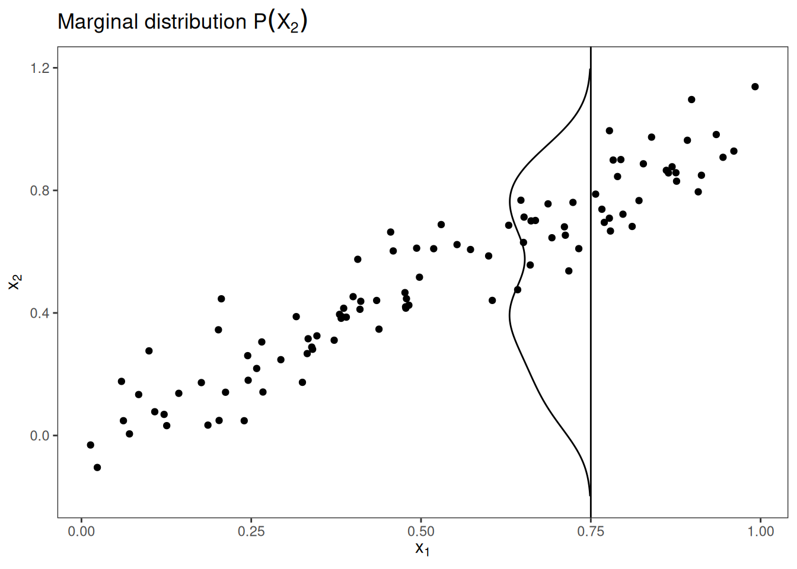
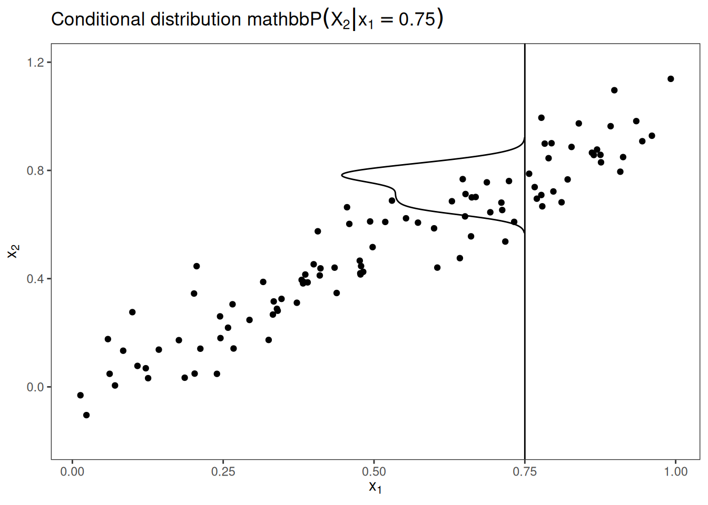
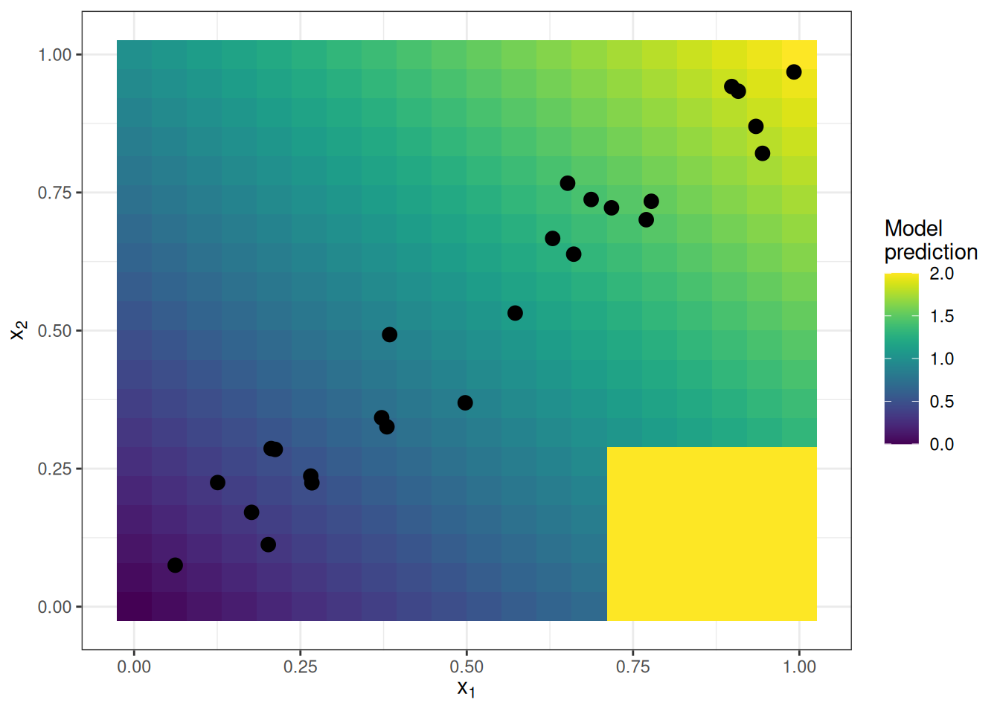
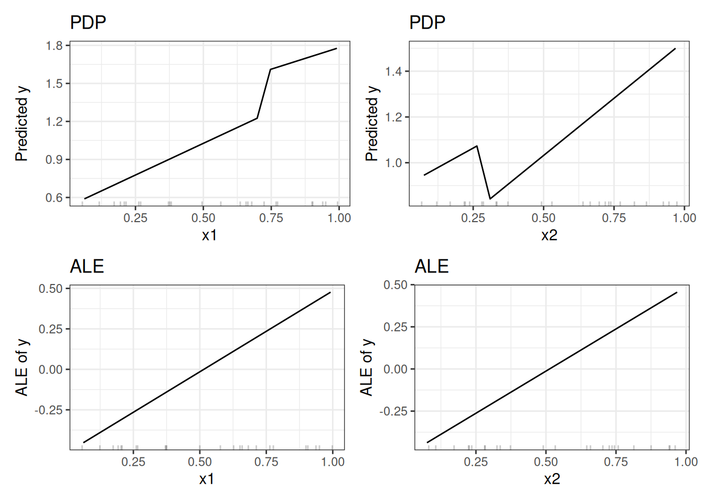
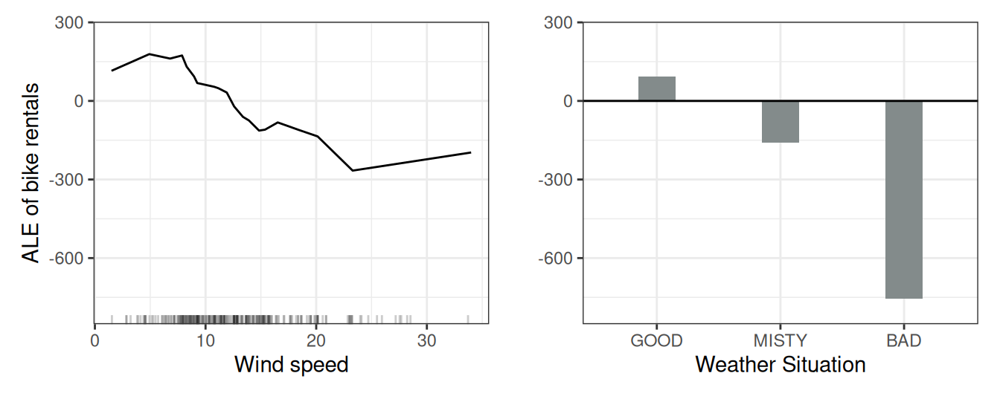
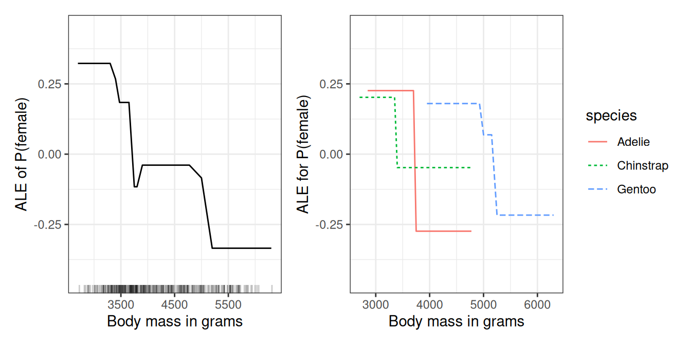

# فصل ۲۰: اثرات محلی انباشته (ALE)

> **عنوان اصلی:** Accumulated Local Effects (ALE)  
> **منبع:** [https://christophm.github.io/interpretable-ml-book/ale.html](https://christophm.github.io/interpretable-ml-book/ale.html)  
> **نویسنده:** Christoph Molnar  
> **مترجم:** مریم محمودی

---

اثرات محلی انباشته (Accumulated Local Effects؛ [Apley و Zhu (۲۰۲۰)](appendix-D-references.md)) توصیف می‌کنند که ویژگی‌ها به‌طور میانگین چگونه بر پیش‌بینی یک مدل یادگیری ماشین اثر می‌گذارند.
نمودارهای ALE جایگزینی سریع‌تر و بدون تورش (unbiased) برای [نمودارهای وابستگی جزئی](19-pdp.md) (PDPها) هستند.

پیشنهاد می‌کنم ابتدا [فصل نمودارهای وابستگی جزئی](19-pdp.md) را بخوانید، چون فهمیدنشان آسان‌تر است و هر دو روش هدف یکسانی دارند:
هر دو توصیف می‌کنند که یک ویژگی به‌طور میانگین چگونه بر پیش‌بینی اثر می‌گذارد.
در بخش بعد می‌خواهم شما را قانع کنم که نمودارهای وابستگی جزئی وقتی ویژگی‌ها همبسته‌اند مشکل جدی دارند.

> **توضیح مترجم:** «بدون تورش» در این فصل یعنی برآورد اثر ویژگی در حضور همبستگی ویژگی‌ها دچار خطای سیستماتیک نمی‌شود (برخلاف PDP که در این حالت داده‌های غیرواقعی را در میانگین وارد می‌کند). «همبسته» (correlated) یعنی ویژگی‌ها با هم تغییر می‌کنند، مثلاً مساحت و تعداد اتاق. نام ALE، PDP و M-Plot در متن به‌صورت Latin می‌آیند.

## انگیزه و شهود

اگر ویژگی‌های یک مدل یادگیری ماشین همبسته باشند، نمی‌توان به نمودار وابستگی جزئی اعتماد کرد.
محاسبهٔ نمودار وابستگی جزئی برای ویژگی‌ای که با ویژگی‌های دیگر به‌شدت همبسته است، میانگین‌گیری از پیش‌بینی‌های نمونه‌های دادهٔ مصنوعی‌ای را شامل می‌شود که در واقعیت بعید هستند.
این می‌تواند تخمین اثر ویژگی را به‌شدت دچار تورش کند.
تصور کنید نمودارهای وابستگی جزئی را برای مدلی یادگیری ماشین محاسبه می‌کنیم که ارزش یک خانه را بر اساس تعداد اتاق‌ها و اندازهٔ سطح زیربنا پیش‌بینی می‌کند.
به اثر سطح زیربنا بر ارزش پیش‌بینی‌شده علاقه‌مندیم.
برای یادآوری، دستورالعمل نمودارهای وابستگی جزئی این است: ۱) ویژگی را انتخاب کنید.
۲) شبکه (grid) را تعریف کنید.
۳) به ازای هر مقدار شبکه: الف) ویژگی را با مقدار شبکه جایگزین کنید و ب) پیش‌بینی‌ها را میانگین بگیرید.
۴) منحنی را رسم کنید.
برای محاسبهٔ نخستین مقدار شبکهٔ PDP — مثلاً ۳۰ متر مربع — سطح زیربنای **همهٔ** نمونه‌ها را با ۳۰ متر مربع جایگزین می‌کنیم، حتی برای خانه‌هایی با ۱۰ اتاق.
به نظر من این خانه‌ای بسیار غیرعادی است.
نمودار وابستگی جزئی این خانه‌های غیرواقع‌گرایانه را در تخمین اثر ویژگی وارد می‌کند و وانمود می‌کند همه‌چیز درست است.
شکل ۲۰.۱ دو ویژگی همبسته را نشان می‌دهد و اینکه چگونه روش نمودار وابستگی جزئی از پیش‌بینی‌های نمونه‌های بعید میانگین می‌گیرد.

> **توضیح مترجم (متن داخل تصویر):** عنوان تصویر `Marginal distribution P(X₂)` یعنی «توزیع حاشیه‌ای $\mathbb{P}(X\_2)$» است. محور x با برچسب $x\_1$ از ۰٫۰۰ تا ۱٫۰۰ و محور y با برچسب $x\_2$ است. هر نقطه یک نمونهٔ داده است و نقاط روی یک روند صعودی (همبستگی مثبت) قرار دارند. خط عمودی در $x\_1 = 0.75$ جایی است که PDP محاسبه می‌شود، و منحنی سمت چپ آن توزیع حاشیه‌ایِ $X\_2$ روی کل دامنهٔ $x\_2$ است (از حدود ۰٫۲- تا ۱٫۲). نوشته‌های انگلیسی تصویر بدون تغییر ماندند.

> **برای درک بهتر (توضیح مترجم):** در داده‌های شکل ۲۰.۱، نمونه‌هایی که $x\_1$ آن‌ها نزدیک ۰٫۷۵ است، مقدار $x\_2$ آن‌ها تقریباً بین ۰٫۵ و ۱٫۰ است. اما PDP در $x\_1 = 0.75$ به‌ازای هر نمونه فقط $x\_1$ را جایگزین می‌کند و $x\_2$ همان مقدار اصلی نمونه می‌ماند؛ در نتیجه نمونه‌ای با $x\_2 = 0.2$ را هم به $x\_1 = 0.75$ می‌رساند و جفت $(0.75,\ 0.2)$ می‌سازد که در ابر نقاط وجود ندارد. مدل را در چنین جفتی ارزیابی می‌کنیم، هرچند در واقعیت هرگز چنین جفتی دیده نمی‌شود.

برای به دست آوردن تخمینی از اثر ویژگی که همبستگی ویژگی‌ها را رعایت کند، چه می‌توانیم بکنیم؟
می‌توانیم روی توزیع شرطی (conditional distribution) ویژگی میانگین بگیریم، یعنی در یک مقدار شبکهٔ $X\_1$، پیش‌بینی‌های نمونه‌هایی را که مقدار مشابهی برای $X\_1$ دارند میانگین بگیریم.
راه‌حل محاسبهٔ اثر ویژگی‌ها با استفاده از توزیع شرطی، نمودارهای حاشیه‌ای (Marginal Plots) یا M-Plots نام دارد (نامی گیج‌کننده، چون بر پایهٔ توزیع شرطی‌اند، نه توزیع حاشیه‌ای).
صبر کنید، مگر قول نداده بودم دربارهٔ نمودارهای ALE صحبت کنم؟
M-Plots راه‌حلی نیستند که دنبالش هستیم.
چرا M-Plots مشکل ما را حل نمی‌کنند؟
اگر پیش‌بینی‌های همهٔ خانه‌های حدوداً ۳۰ متر مربعی را میانگین بگیریم، به‌دلیل همبستگی آن‌ها، اثر **ترکیبی** سطح زیربنا و تعداد اتاق‌ها را تخمین می‌زنیم.
فرض کنید سطح زیربنا بر ارزش پیش‌بینی‌شدهٔ خانه هیچ اثری ندارد و فقط تعداد اتاق‌ها دارد.
M-Plot باز هم نشان می‌دهد اندازهٔ سطح زیربنا ارزش پیش‌بینی‌شده را افزایش می‌دهد، چون تعداد اتاق‌ها با سطح زیربنا زیاد می‌شود.
شکل ۲۰.۲ برای دو ویژگی همبسته نشان می‌دهد M-Plots چگونه کار می‌کنند.

> **برای درک بهتر (توضیح مترجم):** فرض کنید مدل قیمت خانه فقط از تعداد اتاق استفاده می‌کند: $\hat{f} = 50 \cdot \text{rooms}$ (مساحت اصلاً در فرمول نیست). اگر در داده‌ها خانهٔ حدود ۳۰ متری معمولاً ۱ اتاق و خانهٔ حدود ۹۰ متری معمولاً ۳ اتاق داشته باشد، M-Plot در ۳۰ متر میانگین پیش‌بینی ۵۰ و در ۹۰ متر ۱۵۰ را نشان می‌دهد؛ یعنی «مساحت ۱۰۰ واحد قیمت را بالا می‌برد»، هرچند مدل مساحت را نمی‌بیند. این اثر در واقع اثر اتاق‌هاست که از راه همبستگی به مساحت نسبت داده شده است. (اعداد برای توضیح ایده‌اند و از منبع نیستند.)

> **توضیح مترجم (متن داخل تصویر):** داده‌ها و محورها مانند شکل ۲۰.۱ هستند ($x\_1$ در محور x و $x\_2$ در محور y). عنوان تصویر `Conditional distribution mathbbP(X₂|x₁ = 0.75)` است، یعنی «توزیع شرطی $\mathbb{P}(X\_2 \mid x\_1 = 0.75)$». نوشتهٔ `mathbbP` در تصویر یک خطای نمایش در نسخهٔ منبع است (فرمان LaTeX به‌جای نماد $\mathbb{P}$ چاپ شده) و عیناً حفظ شد. منحنی کنار خط عمودی در $x\_1 = 0.75$ فقط روی مقادیر $x\_2$ نمونه‌های نزدیک به $x\_1 = 0.75$ ساخته شده و برخلاف شکل ۲۰.۱ دامنهٔ باریکی (حدود ۰٫۶ تا ۰٫۸) دارد. نوشته‌های انگلیسی تصویر بدون تغییر ماندند.

M-Plots از میانگین‌گیری روی پیش‌بینی‌های نمونه‌های دادهٔ بعید پرهیز می‌کنند، اما اثر یک ویژگی را با اثر همهٔ ویژگی‌های همبسته با آن درهم می‌آمیزند.
نمودارهای ALE این مشکل را حل می‌کنند، به این صورت که — همچنین بر پایهٔ توزیع شرطی ویژگی‌ها — **تفاضل پیش‌بینی‌ها را به‌جای میانگین‌ها** محاسبه می‌کنند.
برای اثر سطح زیربنا در ۳۰ متر مربع، روش ALE از همهٔ خانه‌های حدوداً ۳۰ متر مربعی استفاده می‌کند، پیش‌بینی مدل را به‌شرطی که وانمود کنیم این خانه‌ها ۳۱ متر مربع بودند می‌گیرد و پیش‌بینی را به‌شرطی که وانمود کنیم ۲۹ متر مربع بودند از آن کم می‌کند.
این اثر خالص سطح زیربنا را به ما می‌دهد و اثر را با اثر ویژگی‌های همبسته نمی‌آمیزد.
استفاده از تفاضل‌ها اثر ویژگی‌های دیگر را مسدود می‌کند.
شکل ۲۰.۳ شهودی دربارهٔ نحوهٔ محاسبهٔ نمودارهای ALE می‌دهد.

> **توضیح مترجم (متن داخل تصویر):** محور x با برچسب $x\_1$ با نشانه‌های $z\_{0,1}, z\_{1,1}, \ldots, z\_{5,1}$ مشخص شده است: این‌ها مرزهای بازه‌ها (نقاط شبکه) برای ویژگی ۱ هستند و خطوط عمودی نقطه‌چین از آن‌ها می‌گذرند. محور y با برچسب $x\_2$ است. برچسب‌های `N1(1)` تا `N1(5)` بازه‌ها را نشان می‌دهند، یعنی همسایگی $N\_1(k)$ که در بخش «تخمین» تعریف می‌شود (نمونه‌هایی که $x\_1$ آن‌ها در بازهٔ $k$-ام است). پیکان‌های افقی دوطرفه در بازهٔ چهارم، از $z\_{3,1}$ تا $z\_{4,1}$، همان جایگزینی ویژگی با کران پایین و بالای بازه‌اند و به ازای هر نمونهٔ آن بازه یک پیکان رسم شده است. نوشته‌های انگلیسی تصویر بدون تغییر ماندند.

> **برای درک بهتر (توضیح مترجم):** فرض کنید در بازهٔ چهارم سه نمونه داریم و مدل برای هر نمونه، وقتی $x\_1$ از کران پایین به کران بالا می‌رود، تغییر پیش‌بینی‌های $+4$، $+6$ و $+5$ را می‌دهد. اثر محلی این بازه میانگین این سه عدد، یعنی $+5$، است. چون $x\_2$ برای هر نمونه ثابت می‌ماند و فقط $x\_1$ تغییر می‌کند، اثر $x\_2$ در تفاضل حذف می‌شود، همان «مسدودشدن اثر ویژگی‌های دیگر» در متن.

برای جمع‌بندی اینکه هر نوع نمودار (PDP، M، ALE) اثر یک ویژگی را در یک مقدار شبکهٔ معین $v$ چگونه محاسبه می‌کند:

- **نمودارهای وابستگی جزئی**: «بگذار نشانت دهم مدل به‌طور میانگین چه پیش‌بینی می‌کند وقتی هر نمونهٔ داده برای آن ویژگی مقدار $v$ را دارد. اهمیتی نمی‌دهم که مقدار $v$ برای همهٔ نمونه‌های داده معنادار است یا نه.»
- **M-Plots**: «بگذار نشانت دهم مدل به‌طور میانگین برای نمونه‌هایی که برای آن ویژگی مقادیری نزدیک به $v$ دارند چه پیش‌بینی می‌کند. اثر می‌تواند ناشی از آن ویژگی باشد، اما ناشی از ویژگی‌های همبسته هم هست.»
- **نمودارهای ALE**: «بگذار نشانت دهم پیش‌بینی‌های مدل در یک «پنجره»ٔ کوچک از ویژگی پیرامون $v$ برای نمونه‌های داده در آن پنجره چگونه تغییر می‌کنند.»

## نظریه

PDP، M-plot و نمودار ALE از نظر ریاضی چه تفاوتی دارند؟
وجه مشترک هر سه روش این است که تابع پیش‌بینی پیچیدهٔ $\hat{f}$ را به تابعی کاهش می‌دهند که فقط به یک (یا دو) ویژگی وابسته است.
هر سه روش این کاهش را با میانگین‌گیری از اثر ویژگی‌های دیگر انجام می‌دهند، اما در اینکه میانگین پیش‌بینی‌ها محاسبه شود یا میانگین **تفاضل پیش‌بینی‌ها**، و در اینکه میانگین‌گیری روی توزیع حاشیه‌ای انجام شود یا شرطی، با هم تفاوت دارند.

نمودارهای وابستگی جزئی پیش‌بینی‌ها را روی توزیع حاشیه‌ای میانگین می‌گیرند.

$$\hat{f}\_{S,PDP}(\mathbf{x}\_S) = \mathbb{E}\_{X\_C}[\hat{f}(\mathbf{x}\_S,X\_C)] = \int\_{X\_C}\hat{f}(\mathbf{x}\_S,X\_C)d\mathbb{P}(X\_C)$$

این مقدار تابع پیش‌بینی $f$ در مقدار (یا مقادیر) ویژگی $\mathbf{x}\_S$ است، که روی همهٔ ویژگی‌های $X\_C$ (که در اینجا متغیر تصادفی در نظر گرفته می‌شوند) میانگین‌گیری شده است.
میانگین‌گیری یعنی محاسبهٔ امید ریاضی حاشیه‌ای $\mathbb{E}$ روی ویژگی‌های مجموعهٔ $C$، که همان انتگرال پیش‌بینی‌ها با وزن توزیع احتمال است.
پیچیده به نظر می‌رسد، اما برای محاسبهٔ امید ریاضی روی توزیع حاشیه‌ای، به‌سادگی همهٔ نمونه‌های داده را می‌گیریم، مجبورشان می‌کنیم برای ویژگی‌های مجموعهٔ $S$ یک مقدار شبکهٔ معین داشته باشند، و پیش‌بینی‌های این مجموعه‌دادهٔ دست‌کاری‌شده را میانگین می‌گیریم.
این روش تضمین می‌کند که روی توزیع حاشیه‌ای ویژگی‌ها میانگین گرفته‌ایم.

M-plotها پیش‌بینی‌ها را روی توزیع شرطی میانگین می‌گیرند.

$$\hat{f}\_{S,M}(\mathbf{x}\_S) = \mathbb{E}\_{X\_C|X\_S}\left[\hat{f}(X\_S,X\_C)|X\_S=\mathbf{x}\_S\right]$$

$$= \int\_{X\_C}\hat{f}(x\_S, X\_C)d\mathbb{P}(X\_C|X\_S = \mathbf{x}\_S)$$

تنها چیزی که در مقایسه با PDPها تغییر می‌کند این است که پیش‌بینی‌ها را به‌شرط هر مقدار شبکهٔ ویژگی مورد علاقه میانگین می‌گیریم، به‌جای اینکه در هر مقدار شبکه توزیع حاشیه‌ای را فرض کنیم.
در عمل این یعنی باید یک همسایگی تعریف کنیم؛ مثلاً برای محاسبهٔ اثر ۳۰ متر مربع بر ارزش پیش‌بینی‌شدهٔ خانه، می‌توانیم پیش‌بینی‌های همهٔ خانه‌های بین ۲۸ تا ۳۲ متر مربع را میانگین بگیریم.

نمودارهای ALE تغییرات پیش‌بینی‌ها را میانگین می‌گیرند و آن‌ها را روی شبکه انباشته می‌کنند (دربارهٔ محاسبه بعداً بیشتر می‌گوییم).

$$\hat{f}\_{S,ALE}(\mathbf{x}\_S) = \int\_{\mathbf{z}\_{0,S}}^{\mathbf{x}\_S} \mathbb{E}\_{X\_C|X\_S = \mathbf{x}\_S} \left[\hat{f}^S(X\_S,X\_C)|X\_S = \mathbf{z}\_S\right] d \mathbf{z}\_S - \text{constant}$$

$$= \int\_{\mathbf{z}\_{0,S}}^{\mathbf{x}\_S}\left(\int\_{\mathbf{x}\_C}\hat{f}^S(\mathbf{z}\_S,X\_C)d\mathbb{P}(X\_C|X\_S = \mathbf{z}\_S)\right) d \mathbf{z}\_S - \text{constant}$$

> **توضیح مترجم:** منبع این سه فرمول را در قالب چندخطی (`align`) می‌نویسد و برای نسخهٔ EPUB به‌صورت دو معادلهٔ پشت‌سرهم؛ در اینجا از همان شکل دوخطی استفاده شد و معنا تغییری نکرده است. در فرمول‌ها، اندیس $S$ ویژگی(های) مورد علاقه و $C$ بقیهٔ ویژگی‌هاست؛ $\mathbf{z}\_S$ متغیر انتگرال‌گیری روی مقادیر ویژگی $S$ و $\mathbf{z}\_{0,S}$ نقطهٔ شروع انباشتن است (منبع آن را تعریف نمی‌کند؛ معمولاً در کران پایین دامنهٔ ویژگی است). در منبع، در عبارت امید شرطی ALE، «$X\_S = \mathbf{x}\_S$» در زیرنویس آمده است در حالی که داخل کروشه «$X\_S = \mathbf{z}\_S$» است؛ از زمینه (که انتگرال روی $\mathbf{z}\_S$ است) برمی‌آید که شرط داخلی همان $\mathbf{z}\_S$ است و عیناً ترجمه شد.

این فرمول سه تفاوت با M-plotها نشان می‌دهد.
اول، تغییرهای پیش‌بینی را میانگین می‌گیریم، نه خود پیش‌بینی‌ها را.
تغییر به‌صورت مشتق جزئی تعریف می‌شود (اما بعداً، برای محاسبهٔ واقعی، با تفاضل پیش‌بینی‌ها روی یک بازه جایگزین می‌شود).

$$\hat{f}^S(\mathbf{x}\_S,\mathbf{x}\_C)=\frac{\partial\hat{f}(\mathbf{x}\_S,\mathbf{x}\_C)}{\partial \mathbf{x}\_S}$$

تفاوت دوم انتگرال اضافه روی $\mathbf{z}$ است.
مشتق‌های جزئی محلی را روی دامنهٔ ویژگی‌های مجموعهٔ $S$ انباشته می‌کنیم، که اثر ویژگی را بر پیش‌بینی به ما می‌دهد.
برای محاسبهٔ واقعی، $z$ها با شبکه‌ای از بازه‌ها جایگزین می‌شوند که تغییرهای پیش‌بینی را روی آن‌ها محاسبه می‌کنیم.
به‌جای اینکه مستقیماً پیش‌بینی‌ها را میانگین بگیریم، روش ALE تفاضل پیش‌بینی‌ها را به‌شرط ویژگی‌های $S$ محاسبه می‌کند و برای تخمین اثر، مشتق را روی ویژگی‌های $S$ انتگرال می‌گیرد.
خب، این احمقانه به نظر می‌رسد.
مشتق‌گیری و انتگرال‌گیری معمولاً یکدیگر را خنثی می‌کنند، مثل اینکه ابتدا عددی را کم کنیم و سپس همان عدد را اضافه کنیم.
چرا اینجا معنا دارد؟
مشتق (یا تفاضل بازه‌ای) اثر ویژگی مورد علاقه را جدا می‌کند و اثر ویژگی‌های همبسته را مسدود می‌کند.

تفاوت سوم نمودارهای ALE با M-plotها این است که یک ثابت را از نتایج کم می‌کنیم.
این گام نمودار ALE را مرکزی (centered) می‌کند، به‌طوری که میانگین اثر روی داده‌ها صفر باشد.

یک مشکل باقی می‌ماند: همهٔ مدل‌ها گرادیان ندارند؛ برای مثال جنگل‌های تصادفی گرادیان صریح ندارند.
اما همان‌طور که خواهید دید، محاسبهٔ واقعی بدون گرادیان کار می‌کند و از بازه‌ها استفاده می‌کند.
بیایید کمی عمیق‌تر به تخمین نمودارهای ALE بپردازیم.

> **برای درک بهتر (توضیح مترجم):** «چرا انتگرال مشتق معنا دارد؟» را با یک مدل ساده ببینید: $\hat{f}(x\_1, x\_2) = 2x\_1 + x\_2$. مشتق جزئی نسبت به $x\_1$ برابر $\hat{f}^S = 2$ است و $x\_2$ در آن اصلاً ظاهر نمی‌شود؛ پس هر مقدار $x\_2$ و هر همبستگی میان $x\_1$ و $x\_2$ اثری بر آن ندارد. انتگرال این مقدار از $z\_0$ تا $x\_1$ برابر $2(x\_1 - z\_0)$ است که اثر خالص $x\_1$ است. اگر به‌جای آن میانگین خود پیش‌بینی را به‌شرط $x\_1$ بگیریم (M-plot) و $x\_2$ تقریباً برابر $x\_1$ باشد، $2x\_1 + x\_1 = 3x\_1$ به دست می‌آید که اثر $x\_2$ را هم در خود دارد.

## تخمین

ابتدا توضیح می‌دهم نمودارهای ALE برای یک ویژگی عددی چگونه تخمین زده می‌شوند، سپس برای دو ویژگی عددی، و در پایان برای یک ویژگی طبقه‌ای.
برای تخمین اثرهای محلی، ویژگی را به بازه‌های زیادی تقسیم می‌کنیم و تفاضل پیش‌بینی‌ها را محاسبه می‌کنیم.
این روش مشتق‌ها را تقریب می‌زند و برای مدل‌هایی که مشتق ندارند نیز کار می‌کند.

ابتدا اثر مرکزی‌نشده (uncentered) را تخمین می‌زنیم:

$$\hat{\tilde{f}}\_{j,ALE}(\mathbf{x}) = \sum\_{k=1}^{k\_j(\mathbf{x})} \frac{1}{n\_j(k)} \sum\_{i: x\_j^{(i)} \in N\_j(k)} \left[\hat{f}(z\_{k,j}, \mathbf{x}^{(i)}\_{-j}) - \hat{f}(z\_{k-1,j}, \mathbf{x}^{(i)}\_{-j})\right]$$

بیایید این فرمول را از سمت راست تجزیه کنیم.
نام **اثرات محلی انباشته** (Accumulated Local Effects) همهٔ اجزای این فرمول را به‌خوبی بازتاب می‌دهد.
در هستهٔ خود، روش ALE تفاضل پیش‌بینی‌ها را محاسبه می‌کند، که در آن ویژگی مورد علاقه را با مقادیر شبکهٔ $z$ جایگزین می‌کنیم.
تفاضل پیش‌بینی همان **اثر** (Effect) است که ویژگی برای یک نمونهٔ منفرد در یک بازهٔ معین دارد.
مجموع سمت راست اثرهای همهٔ نمونه‌های درون یک بازه را جمع می‌زند، که در فرمول به‌صورت همسایگی $N\_j(k)$ ظاهر می‌شود.
این مجموع را بر تعداد نمونه‌های این بازه تقسیم می‌کنیم تا میانگین تفاضل پیش‌بینی‌ها برای این بازه به دست آید.
این میانگین درون بازه را واژهٔ **محلی** (Local) در نام ALE پوشش می‌دهد.
نماد مجموع سمت چپ یعنی اثرهای میانگین را در همهٔ بازه‌ها انباشته می‌کنیم.
ALE (مرکزی‌نشده) یک مقدار ویژگی که مثلاً در بازهٔ سوم قرار دارد، مجموع اثرهای بازه‌های اول، دوم و سوم است.
واژهٔ **انباشته** (Accumulated) در ALE این را بازتاب می‌دهد.

> **توضیح مترجم:** در فرمول، $z\_{k,j}$ و $z\_{k-1,j}$ کران بالا و پایین بازهٔ $k$-ام برای ویژگی $j$ هستند، $\mathbf{x}^{(i)}\_{-j}$ مقادیر همهٔ ویژگی‌های نمونهٔ $i$ به‌جز ویژگی $j$ است (که ثابت نگه داشته می‌شوند)، $n\_j(k)$ تعداد نمونه‌های بازهٔ $k$-ام، $N\_j(k)$ مجموعهٔ نمونه‌های آن بازه، و $k\_j(\mathbf{x})$ شمارهٔ بازه‌ای است که مقدار $x\_j$ در آن قرار دارد. منبع این نمادها را جدا تعریف نمی‌کند و از توضیح متن برداشت شده است.

> **برای درک بهتر (توضیح مترجم):** فرض کنید ویژگی را به سه بازه تقسیم کرده‌ایم و میانگین تفاضل پیش‌بینی‌ها در بازه‌ها به‌ترتیب $2$، $5$ و $-1$ است. مقدار مرکزی‌نشدهٔ ALE در انتهای بازهٔ اول $2$، در انتهای بازهٔ دوم $2 + 5 = 7$ و در انتهای بازهٔ سوم $7 + (-1) = 6$ است؛ یعنی هر مقدار مجموع اثرهای بازه‌های قبلی و خود آن است.

سپس این اثر را مرکزی می‌کنیم تا میانگین اثر صفر شود.

$$\hat{f}\_{j,ALE}(\mathbf{x}) = \hat{\tilde{f}}\_{j,ALE}(\mathbf{x}) - \frac{1}{n} \sum\_{i=1}^{n} \hat{\tilde{f}}\_{j,ALE}(x\_j^{(i)})$$

مقدار ALE را می‌توان به‌صورت اثر اصلی ویژگی در یک مقدار معین، در مقایسه با میانگین پیش‌بینی داده‌ها، تفسیر کرد.
برای مثال، تخمین ALE برابر ۲- در $x^{(i)}\_j = 3$ یعنی وقتی ویژگی $j$-ام مقدار ۳ دارد، پیش‌بینی نسبت به میانگین پیش‌بینی ۲ واحد کمتر است.

> **برای درک بهتر (توضیح مترجم):** ادامهٔ مثال بالا: فرض کنید در هر سه بازه تعداد نمونه‌ها برابر است و نمونه‌ها در انتهای بازه‌ها هستند. میانگین مقادیر مرکزی‌نشده $\frac{2 + 7 + 6}{3} = 5$ است. با کم‌کردن آن، مقادیر مرکزی‌شده $2 - 5 = -3$، $7 - 5 = 2$ و $6 - 5 = 1$ می‌شوند. میانگین این سه مقدار صفر است، و مثلاً $-3$ یعنی در بازهٔ اول پیش‌بینی ۳ واحد کمتر از میانگین پیش‌بینی است. (در محاسبهٔ واقعی مقدار هر نمونه به‌صورت درون‌یابی در بازه خودش گرفته می‌شود؛ اینجا برای سادگی از آن صرف‌نظر شد.)

از چندک‌های (quantiles) توزیع ویژگی به‌عنوان شبکه‌ای که بازه‌ها را تعریف می‌کند استفاده می‌شود.
استفاده از چندک‌ها تضمین می‌کند که در هر یک از بازه‌ها تعداد نمونه‌های داده برابر باشد.
چندک‌ها این عیب را دارند که بازه‌ها می‌توانند طول‌های بسیار متفاوتی داشته باشند.
اگر ویژگی مورد علاقه بسیار چوله (skewed) باشد، مثلاً مقادیر پایین زیاد و فقط چند مقدار بسیار بالا، این می‌تواند به نمودارهای ALE عجیب منجر شود.

**نمودارهای ALE برای برهم‌کنش دو ویژگی**

نمودارهای ALE می‌توانند اثر برهم‌کنش (interaction effect) دو ویژگی را نیز نشان دهند.
اصول محاسبه مانند یک ویژگی است، اما به‌جای بازه با سلول‌های مستطیلی کار می‌کنیم، چون باید اثرها را در دو بعد انباشته کنیم.
افزون بر تعدیل برای میانگین اثر کلی، برای اثرهای اصلی هر دو ویژگی نیز تعدیل می‌کنیم.
این یعنی ALE برای دو ویژگی اثر مرتبهٔ دوم (second-order effect) را تخمین می‌زند که اثرهای اصلی ویژگی‌ها را شامل نمی‌شود.
به عبارت دیگر، ALE برای دو ویژگی فقط اثر برهم‌کنش افزوده‌شدهٔ دو ویژگی را نشان می‌دهد.
فرمول‌های ALE دوبعدی را برایتان نمی‌آورم، چون طولانی و ناخوشایند برای خواندن‌اند.
اگر به محاسبه علاقه‌مندید، شما را به مقالهٔ [Apley و Zhu (۲۰۲۰)](appendix-D-references.md)، فرمول‌های (۱۳) تا (۱۶)، ارجاع می‌دهم.
برای ساختن شهود دربارهٔ محاسبهٔ ALE مرتبهٔ دوم به تجسم‌ها تکیه می‌کنم.

> **توضیح مترجم (متن داخل تصویر):** محور x با برچسب $x\_1$ و محور y با برچسب $x\_2$ است. خطوط نقطه‌چین افقی و عمودی شبکه را می‌سازند و یک سلول با کادر ضخیم مشخص شده است. چهار گوشهٔ این سلول با برچسب‌های `a` (پایین‌چپ)، `b` (پایین‌راست)، `c` (بالاچپ) و `d` (بالاراست) علامت خورده‌اند. نقطه‌های درشت‌تر داخل این سلول همان نمونه‌هایی‌اند که در محاسبهٔ این سلول به کار می‌روند. نوشته‌های انگلیسی تصویر بدون تغییر ماندند.

> **برای درک بهتر (توضیح مترجم):** فرض کنید برای یک نمونهٔ داخل سلول، پیش‌بینی در چهار گوشه $a = 10$، $b = 14$، $c = 13$ و $d = 19$ باشد. تفاضل مرتبهٔ دوم $(d - c) - (b - a) = (19 - 13) - (14 - 10) = 6 - 4 = 2$ است. یعنی اثر افزودن $x\_1$ (از چپ به راست) وقتی $x\_2$ بالاتر است ($d - c = 6$) با وقتی $x\_2$ پایین‌تر است ($b - a = 4$) متفاوت است و این تفاوت $2$ همان اثر برهم‌کنش این نمونه است. اگر دو ویژگی برهم‌کنش نداشتند، این دو تفاضل برابر بودند و نتیجه صفر می‌شد.

در شکل قبلی، بسیاری از سلول‌ها به‌دلیل همبستگی خالی‌اند.
در نمودار ALE می‌توان این را با یک کادر خاکستری یا تیره‌شده نشان داد.
به‌طور جایگزین، می‌توانید تخمین ALE گمشدهٔ یک سلول خالی را با تخمین ALE نزدیک‌ترین سلول غیرخالی جایگزین کنید.

از آنجا که تخمین‌های ALE برای دو ویژگی فقط اثر مرتبهٔ دوم ویژگی‌ها را نشان می‌دهند، تفسیر نیازمند توجه ویژه است.
اثر مرتبهٔ دوم همان اثر برهم‌کنشِ افزوده‌شده است، پس از اینکه اثرهای اصلی ویژگی‌ها را در نظر گرفته‌ایم.
فرض کنید دو ویژگی برهم‌کنش ندارند، اما هر کدام اثر خطی بر نتیجهٔ پیش‌بینی‌شده دارند.
در نمودار ALE یک‌بعدی هر ویژگی، یک خط راست را به‌عنوان منحنی ALE تخمین‌زده‌شده می‌بینیم.
اما وقتی تخمین‌های ALE دوبعدی را رسم می‌کنیم، باید نزدیک صفر باشند، چون اثر مرتبهٔ دوم فقط اثر افزودهٔ برهم‌کنش است.
نمودارهای ALE و PD در این مورد با هم فرق دارند: PDPها همیشه اثر کل را نشان می‌دهند، در حالی که نمودارهای ALE اثر مرتبهٔ اول یا دوم را.
این‌ها تصمیم‌های طراحی‌اند که به ریاضیات زیربنایی وابسته نیستند.
می‌توانید در یک نمودار وابستگی جزئی اثرهای مرتبهٔ پایین‌تر را کم کنید تا اثرهای اصلی یا مرتبهٔ دوم خالص را به دست آورید، یا با خودداری از کم‌کردن اثرهای مرتبهٔ پایین‌تر، تخمینی از نمودارهای ALE کل به دست آورید.

> **توضیح مترجم:** جملهٔ آخر پاراگراف بالا در منبع دقیقاً همین‌طور آمده است: «کم‌کردن اثرهای مرتبهٔ پایین‌تر» به PDP و «خودداری از کم‌کردن» به ALE کل نسبت داده شده است. معنای مقصود نویسنده این است که فرق PDP و ALE در این مورد انتخاب طراحی است و با تغییر آن می‌توان از هر کدام اثر کل یا اثر خالص را گرفت؛ ترجمه عیناً با منبع آمده و تغییر داده نشد.

> **برای درک بهتر (توضیح مترجم):** فرض کنید مدل $\hat{f} = 3x\_1 + 2x\_2$ است (بدون جملهٔ برهم‌کنش). ALE یک‌بعدی $x\_1$ خط راستی با شیب ۳ و ALE یک‌بعدی $x\_2$ خط راستی با شیب ۲ است. اما ALE دوبعدی $(x\_1, x\_2)$ تقریباً همه‌جا صفر است، چون هیچ اثر افزوده‌ای فراتر از دو اثر اصلی وجود ندارد. اگر مدل جملهٔ $x\_1 x\_2$ داشت، همین نمودار دوبعدی فقط سهم آن جمله را نشان می‌داد.

اثرات محلی انباشته را می‌توان برای مرتبه‌های بالاتر دلخواه نیز محاسبه کرد (برهم‌کنش سه ویژگی یا بیشتر)، اما همان‌طور که در [فصل PDP](19-pdp.md) استدلال شد، فقط تا دو ویژگی معنا دارد، چون برهم‌کنش‌های مرتبهٔ بالاتر را نمی‌توان تجسم کرد یا حتی به‌طور معنادار تفسیر کرد.

**ALE برای ویژگی‌های طبقه‌ای**

روش اثرات محلی انباشته — بنا بر تعریف — نیاز دارد مقادیر ویژگی ترتیب داشته باشند، چون این روش اثرها را در یک جهت معین انباشته می‌کند.
ویژگی‌های طبقه‌ای هیچ ترتیب طبیعی ندارند.
برای محاسبهٔ نمودار ALE برای یک ویژگی طبقه‌ای، باید به‌نحوی ترتیبی بسازیم یا بیابیم.
ترتیب دسته‌ها بر محاسبه و تفسیر اثرات محلی انباشته تأثیر می‌گذارد.

یک راه‌حل این است که دسته‌ها را بر پایهٔ شباهتشان، بر اساس ویژگی‌های دیگر، مرتب کنیم.
فاصلهٔ دو دسته مجموع فاصله‌های هر ویژگی است.
فاصلهٔ هر ویژگی یا توزیع تجمعی (cumulative distribution) را در هر دو دسته مقایسه می‌کند، که فاصلهٔ کولموگروف–اسمیرنوف (Kolmogorov-Smirnov) نیز نامیده می‌شود (برای ویژگی‌های عددی)، یا جدول‌های فراوانی نسبی را (برای ویژگی‌های طبقه‌ای).
پس از اینکه فاصله‌های میان همهٔ دسته‌ها را داشتیم، از مقیاس‌بندی چندبعدی (multi-dimensional scaling) برای کاهش ماتریس فاصله به یک معیار فاصلهٔ یک‌بعدی استفاده می‌کنیم.
این یک ترتیب مبتنی بر شباهت برای دسته‌ها به ما می‌دهد.

برای اینکه این کمی روشن‌تر شود، یک مثال می‌زنیم:
فرض کنید دو ویژگی طبقه‌ای «فصل» و «وضعیت هوا» و یک ویژگی عددی «دما» داریم.
برای ویژگی طبقه‌ای اول (فصل) می‌خواهیم ALE را محاسبه کنیم.
این ویژگی دسته‌های «بهار»، «تابستان»، «پاییز» و «زمستان» را دارد.
محاسبهٔ فاصله میان دسته‌های «بهار» و «تابستان» را آغاز می‌کنیم.
فاصله مجموع فاصله‌ها روی ویژگی‌های دما و وضعیت هواست.
برای دما، همهٔ نمونه‌های با فصل «بهار» را می‌گیریم، تابع توزیع تجمعی تجربی (empirical cumulative distribution function) را محاسبه می‌کنیم، همین کار را برای نمونه‌های فصل «تابستان» انجام می‌دهیم و فاصلهٔ آن‌ها را با آمارهٔ کولموگروف–اسمیرنوف می‌سنجیم.
برای ویژگی وضعیت هوا، برای همهٔ نمونه‌های «بهار» احتمال هر نوع وضعیت هوا را محاسبه می‌کنیم، همین کار را برای نمونه‌های «تابستان» می‌کنیم و فاصله‌های مطلق توزیع احتمال را جمع می‌زنیم.
اگر «بهار» و «تابستان» دما و وضعیت هوای بسیار متفاوتی داشته باشند، فاصلهٔ کل دسته‌ها بزرگ است.
این رویه را با دیگر جفت‌های فصلی تکرار می‌کنیم و ماتریس فاصلهٔ حاصل را با مقیاس‌بندی چندبعدی به یک بعد کاهش می‌دهیم.

> **توضیح مترجم:** آمارهٔ کولموگروف–اسمیرنوف بیشترین فاصلهٔ عمودی میان دو تابع توزیع تجمعی تجربی است؛ هرچه دو نمونه از توزیع‌های متفاوتی آمده باشند بزرگ‌تر می‌شود. مقیاس‌بندی چندبعدی روشی است که از ماتریس فاصله‌ها مختصاتی با ابعاد کمتر (اینجا یک بعد) می‌سازد که فاصله‌ها را تا حد ممکن حفظ کند؛ مرتب‌کردن دسته‌ها روی این محور یک‌بعدی ترتیبی برای انباشتن ALE می‌دهد. منبع برای این دو روش ارجاع نمی‌دهد.

> **برای درک بهتر (توضیح مترجم):** فرض کنید فاصله‌های دو‌به‌دوی چهار فصل در جدول زیر آمده باشد (اعداد فرضی): بهار–تابستان ۱، بهار–پاییز ۲، بهار–زمستان ۴، تابستان–پاییز ۳، تابستان–زمستان ۵، پاییز–زمستان ۲. مقیاس‌بندی چندبعدی هر فصل را روی یک محور قرار می‌دهد، مثلاً به ترتیب «تابستان، بهار، پاییز، زمستان». ALE آن‌گاه اثر رفتن از هر دسته به دستهٔ بعدی در همین ترتیب را انباشته می‌کند. اگر ترتیب را عوض کنیم (مثلاً «بهار، تابستان، زمستان، پاییز») نمودار ALE نیز عوض می‌شود، و به همین دلیل منبع می‌گوید ترتیب دسته‌ها بر تفسیر اثر می‌گذارد.

> **💡 نکته — از ترتیب طبیعی دسته‌ها استفاده کنید**
>
> اگر ترتیب معناداری برای دسته‌های یک ویژگی طبقه‌ای وجود دارد، از همان ترتیب برای ALE استفاده کنید.

## ALE در برابر PDP

بیایید نمودارهای ALE را در عمل ببینیم.
سناریویی ساخته‌ام که در آن نمودارهای وابستگی جزئی شکست می‌خورند.
سناریوی نشان‌داده‌شده در شکل ۲۰.۵ شامل یک مدل پیش‌بینی و دو ویژگی به‌شدت همبسته است.
مدل پیش‌بینی بیشتر یک مدل رگرسیون خطی است، اما در یک ترکیب از دو ویژگی که برایش هرگز نمونه‌ای ندیده‌ایم کار عجیبی می‌کند.
این ناحیهٔ «عجیب» از توزیع داده‌ها (ابر نقاط) دور است و بر عملکرد مدل اثر نمی‌گذارد و، قابل بحث است که، نباید بر تفسیر آن نیز اثر بگذارد.

> **توضیح مترجم (متن داخل تصویر):** محور x با برچسب $x\_1$ و محور y با برچسب $x\_2$ است. نقاط سیاه ۲۵ نمونهٔ داده‌اند که حول یک خط صعودی قرار دارند (همبستگی شدید). رنگ پس‌زمینه پیش‌بینی مدل است و راهنمای رنگ با عنوان `Model prediction` (پیش‌بینی مدل) از ۰٫۰ (بنفش تیره) تا ۲٫۰ (زرد) را نشان می‌دهد. مستطیل زرد یکدست در پایین‌راست ($x\_1 > 0.7$ و $x\_2 < 0.3$) همان ناحیهٔ «عجیب» است و هیچ نمونه‌ای در آن نیست. نوشته‌های انگلیسی تصویر بدون تغییر ماندند.

آیا این یک سناریوی واقع‌بینانه و مرتبط است؟
وقتی مدلی را آموزش می‌دهید، الگوریتم یادگیری زیان را برای نمونه‌های دادهٔ آموزشی موجود کمینه می‌کند.
خارج از توزیع دادهٔ آموزشی ممکن است چیزهای عجیبی رخ دهد، چون مدل برای رفتار عجیب در این نواحی جریمه نمی‌شود.
خارج‌شدن از توزیع داده را برون‌یابی (extrapolation) می‌نامند، که می‌تواند برای فریب‌دادن مدل‌های یادگیری ماشین نیز به کار رود، همان‌طور که در [فصل مثال‌های خصمانه](30-adversarial.md) شرح داده شده است.
شکل ۲۰.۶ را ببینید تا بفهمید نمودارهای وابستگی جزئی در مقایسه با نمودارهای ALE چگونه رفتار می‌کنند.
تخمین‌های PDP تحت تأثیر رفتار عجیب مدل خارج از توزیع داده قرار می‌گیرند (جهش‌های تند در نمودارها).
نمودارهای ALE به‌درستی تشخیص می‌دهند که مدل یادگیری ماشین رابطهٔ خطی میان ویژگی‌ها و پیش‌بینی‌ها دارد و نواحی بدون داده را نادیده می‌گیرند.

> **توضیح مترجم (متن داخل تصویر):** چهار نمودار در دو ردیف: ستون چپ برای ویژگی `x1` و ستون راست برای `x2`. عنوان ردیف بالا `PDP` و برچسب محور y در آن `Predicted y` (پیش‌بینی $y$) است؛ عنوان ردیف پایین `ALE` و برچسب محور y در آن `ALE of y` (ALE ی $y$) است. در ردیف بالا، منحنی PDP برای `x1` حدود ۰٫۷ تا ۰٫۷۵ یک جهش تند دارد و منحنی PDP برای `x2` حدود ۰٫۳ یک افت تند؛ این‌ها همان رفتار عجیب مدل در ناحیهٔ بدون داده‌اند. در ردیف پایین، منحنی‌های ALE هر دو خط راست صعودی‌اند و حدوداً از ۰٫۴- تا ۰٫۵ می‌روند (مرکزی‌شده، میانگین صفر). خط‌های ریز روی محور x (rug) محل نمونه‌های داده‌اند. نوشته‌های انگلیسی تصویر بدون تغییر ماندند.

> **برای درک بهتر (توضیح مترجم):** برای PDP در $x\_1 = 0.8$ همهٔ نمونه‌ها را با $x\_1 = 0.8$ می‌سازیم؛ نمونه‌هایی که $x\_2$ آن‌ها کمتر از ۰٫۳ است (که در داده‌ها با $x\_1 \approx 0.8$ دیده نمی‌شوند) وارد ناحیهٔ «عجیب» می‌شوند و مدل برایشان همیشه ۲ پیش‌بینی می‌کند؛ این میانگین را بالا می‌کشد و باعث جهش می‌شود. ALE فقط از نمونه‌های واقعی هر بازه و تفاضل‌های محلی استفاده می‌کند و به این ناحیه هرگز نمی‌رسد، پس خط راست درست را نشان می‌دهد.

اما آیا جالب نیست که مدل ما در $x\_1 > 0.7$ و $x\_2 < 0.3$ رفتار عجیبی دارد؟
خب، هم بله و هم نه.
از آنجا که این‌ها نمونه‌های دادهٔ ممکن است از نظر فیزیکی غیرممکن یا دست‌کم بسیار بعید باشند، معمولاً بررسی این نمونه‌ها بی‌ربط است.
اما اگر گمان می‌کنید توزیع آزمون شما ممکن است کمی متفاوت باشد و برخی نمونه‌ها در واقع در این بازه باشند، آنگاه جالب خواهد بود که این ناحیه را در محاسبهٔ اثرهای ویژگی بگنجانید.
اما گنجاندن نواحی‌ای که هنوز داده‌ای در آن‌ها مشاهده نکرده‌ایم باید تصمیمی آگاهانه باشد و نباید اثر جانبی روش انتخاب‌شده‌ای مانند PDP باشد.
اگر گمان می‌کنید مدل بعداً با داده‌هایی با توزیع متفاوت به کار خواهد رفت، توصیه می‌کنم از نمودارهای ALE استفاده کنید و توزیع داده‌ای را که انتظار دارید شبیه‌سازی کنید.

> **💡 نکته — هر دو نمودار PDP و ALE را تولید کنید**
>
> مشاهدهٔ موردی (anecdotal): در کاربردهای من، نمودارهای ALE و PDP با وجود همبستگی کاملاً شبیه به هم بودند.
> همبستگی می‌تواند تفسیرپذیری را خراب کند، اما لازم نیست چنین شود.
> اگر ALE و PDP شما برای یک ویژگی همبسته همان منحنی را نشان می‌دهند، فقط PDP را تفسیر کنید، چون تفسیر ساده‌تری دارد.

> **توضیح مترجم:** «مشاهدهٔ موردی» یعنی تجربهٔ شخصی نویسنده، نه یک نتیجهٔ آماری عمومی؛ این توصیه با قاعدهٔ سرانگشتی انتهای بخش محدودیت‌ها هم‌سو است (اگر ویژگی‌ها همبسته‌اند ولی PDP و ALE یکسان‌اند، PDP ساده‌تر را بپذیرید). در متن منبع در این کادر جملهٔ «If you ALE and PDP show…» غلط تایپی دارد (احتمالاً «If your ALE and PDP…»)؛ معنا همان است که ترجمه شد.

## مثال‌ها

به یک مجموعه‌دادهٔ واقعی می‌پردازیم و [تعداد دوچرخه‌های اجاره‌شده](05-data.md) را بر پایهٔ آب‌وهوا و روز پیش‌بینی می‌کنیم و بررسی می‌کنیم آیا نمودارهای ALE واقعاً به همان خوبی که وعده داده شد کار می‌کنند یا نه.
یک جنگل تصادفی را برای پیش‌بینی تعداد دوچرخه‌های اجاره‌شده آموزش می‌دهیم و از نمودارهای ALE برای تحلیل اینکه سرعت باد و وضعیت هوا چگونه بر پیش‌بینی‌ها اثر می‌گذارند استفاده می‌کنیم.

شکل ۲۰.۷ (چپ) نشان می‌دهد که افزایش سرعت باد اثر منفی بر اجارهٔ دوچرخه دارد.
برای وضعیت هوا (راست)، می‌بینیم به‌ویژه هوای بد اثر منفی قوی بر تعداد دوچرخه‌های اجاره‌شده دارد.
هر دو اثر با دانش حوزه هم‌خوانند، که نشانهٔ خوبی است.

> **توضیح مترجم (متن داخل تصویر):** نمودار چپ: محور x با برچسب `Wind speed` (سرعت باد) و محور y با برچسب `ALE of bike rentals` (ALE ی اجارهٔ دوچرخه) است؛ منحنی از حدود ۱۵۰+ شروع می‌شود، تقریباً از سرعت ۱۰ پایین‌تر از صفر می‌رود و به حدود ۲۷۰- می‌رسد. نمودار راست: محور x با برچسب `Weather Situation` (وضعیت هوا) سه میله دارد: `GOOD` (خوب، اندکی بالای صفر)، `MISTY` (مه‌آلود، پایین‌تر از صفر) و `BAD` (بد، بسیار پایین‌تر از صفر، حدود ۷۵۰-). خط افقی سیاه صفر یعنی میانگین پیش‌بینی است. نوشته‌های انگلیسی تصویر بدون تغییر ماندند.

> **برای درک بهتر (توضیح مترجم):** مقدار ALE یک انحراف نسبت به میانگین پیش‌بینی است، نه خود پیش‌بینی. برای نمونه، اگر میانگین پیش‌بینی مدل ۴۰۰۰ دوچرخه در روز باشد، میلهٔ حدود ۷۵۰- برای `BAD` یعنی در روز با هوای بد، مدل به‌طور متوسط حدود ۷۵۰ دوچرخهٔ کمتر از میانگین (حدود ۳۲۵۰) پیش‌بینی می‌کند، با فرض ثابت‌ماندن اثر بقیهٔ ویژگی‌ها. (میانگین ۴۰۰۰ فقط برای توضیح فرض شده است.)

در ادامه، اثرهای رطوبت و دما و برهم‌کنش آن‌ها را بر تعداد پیش‌بینی‌شدهٔ دوچرخه‌ها بررسی می‌کنیم.
به یاد داشته باشید که اثر مرتبهٔ دوم همان اثر برهم‌کنشِ افزودهٔ دو ویژگی است و اثرهای اصلی را شامل نمی‌شود.
این یعنی مثلاً اثر اصلی اینکه رطوبت بالا به‌طور میانگین به تعداد پیش‌بینی‌شدهٔ کمتر دوچرخه منجر می‌شود را در نمودار ALE مرتبهٔ دوم نخواهید دید.
شکل ۲۰.۸ هم اثرهای اصلی دما و رطوبت و هم برهم‌کنش آن‌ها را نشان می‌دهد.
نمودار یک برهم‌کنش را آشکار می‌کند: هوای سرد و مرطوب پیش‌بینی را افزایش می‌دهد.
به یاد داشته باشید که هر دو اثر اصلی رطوبت و دما می‌گویند تعداد پیش‌بینی‌شدهٔ دوچرخه‌ها در هوای بسیار سرد و مرطوب کاهش می‌یابد.
بنابراین در هوای سرد و مرطوب، اثر ترکیبی دما و رطوبت مجموع اثرهای اصلی نیست، بلکه بزرگ‌تر از مجموع است.

> **توضیح مترجم (متن داخل تصویر):** نمودار چپ دو پنل دارد با عنوان‌های `hum` (رطوبت) و `temp` (دما) و برچسب محور y `ALE effect` (اثر ALE)؛ این‌ها اثرهای اصلی‌اند: ALE رطوبت تا حدود ۶۰ تقریباً بالاتر از صفر است و بعد به‌شدت (تا حدود ۹۰۰-) می‌افتد، و ALE دما از حدود ۸۰۰- در دمای نزدیک صفر تا حدود ۵۵۰+ در حدود ۲۰ درجه بالا می‌رود و بعد سقوط می‌کند. نمودار راست نقشهٔ گرمایی مرتبهٔ دوم است: محور x با برچسب `Relative Humidity` (رطوبت نسبی) و محور y با برچسب `Temperature` (دما)، و راهنمای رنگ بالای آن با عنوان `.ale` از ۲۵۰- (بنفش تیره) تا بیش از ۵۰۰ (زرد) است. خط‌های ریز کنار محورها (rug) توزیع داده‌ها را نشان می‌دهند. نوشته‌های انگلیسی تصویر بدون تغییر ماندند.

> **توضیح مترجم:** متن منبع می‌گوید «هوای سرد و مرطوب پیش‌بینی را افزایش می‌دهد»؛ در تصویر، روشن‌ترین ناحیه (زرد) در بالای نقشه، یعنی دمای حدود ۳۰ درجه و رطوبت حدود ۹۰، است و یک نوار روشن‌تر دیگر در دمای حدود ۱۰ تا ۱۳ با رطوبت بالای ۷۵ دیده می‌شود. این تفاوت جزئی میان متن و تصویر عیناً از منبع آمده و چیزی در متن تغییر داده نشد؛ مقادیر دقیق را باید از خود شکل خواند. همچنین نمودار PDP دوبعدی دما و رطوبت در کد منبع وجود دارد ولی با `eval: false` اجرا نمی‌شود و در صفحه نمایش داده نمی‌شود، پس ترجمه‌ای برایش لازم نبود.

> **برای درک بهتر (توضیح مترجم):** فرض کنید در رطوبت بالا و دمای پایین، اثر اصلی رطوبت $-300$ و اثر اصلی دما $-200$ باشد؛ اگر برهم‌کنشی نبود، اثر کل $-500$ می‌شد. حالا اگر ALE مرتبهٔ دوم در همان ناحیه $+150$ باشد، اثر کل $-300 - 200 + 150 = -350$ است: «بزرگ‌تر از مجموع اثرهای اصلی» (کمتر منفی). نقشهٔ مرتبهٔ دوم فقط همین $+150$ را نشان می‌دهد، نه $-350$ را. (اعداد برای توضیح‌اند و از منبع نیستند.)

می‌توانید اثر کل برهم‌کنش را نیز با جمع‌کردن دو اثر اصلی و میانگین پیش‌بینی روی آن به دست آورید.
اگر فقط به برهم‌کنش علاقه‌مندید، باید به اثرهای مرتبهٔ دوم نگاه کنید، چون اثر کل اثرهای اصلی را در نمودار می‌آمیزد.
اما اگر می‌خواهید اثر ترکیبی ویژگی‌ها را بدانید، باید به اثر کل نگاه کنید.
با این حال، در سناریویی که دو ویژگی برهم‌کنش ندارند، اثر کل دو ویژگی می‌تواند گمراه‌کننده باشد، چون احتمالاً چشم‌انداز پیچیده‌ای نشان می‌دهد که برهم‌کنشی را القا می‌کند، اما صرفاً حاصل‌ضرب دو اثر اصلی است.
اثر مرتبهٔ دوم خالص بلافاصله نشان می‌دهد که برهم‌کنشی وجود ندارد.

> **توضیح مترجم:** «حاصل‌ضرب دو اثر اصلی» در متن منبع (product) آمده است، در حالی که در مدل‌های جمعی بدون برهم‌کنش اثر کل مجموع اثرهای اصلی است؛ احتمالاً منظور نویسنده این است که چشم‌انداز اثر کل، حاصل ترکیب دو اثر اصلی است نه برهم‌کنش واقعی. ترجمه عیناً با منبع آمد.

فعلاً دوچرخه بس است؛ بیایید به یک مسئلهٔ طبقه‌بندی برویم.
یک جنگل تصادفی را برای پیش‌بینی $\mathbb{P}(Y = \text{female})$ بر پایهٔ اندازه‌گیری‌های بدن آموزش می‌دهیم.
وزن بدن چگونه بر احتمال ماده‌بودن یک پنگوئن اثر می‌گذارد؟
شکل ۲۰.۹ (چپ) نمودار ALE برای توده بدنی (body mass) را نشان می‌دهد.
هرچه پنگوئن سنگین‌تر باشد، احتمال ماده‌بودن آن کمتر است.
اما وقتی نمودارهای ALE را به تفکیک گونه مصور کنیم (شکل ۲۰.۹ راست)، تصویر بهتری به دست می‌آوریم.
هر یک از گونه‌ها یک نقطهٔ برش روشن دارد که بالاتر از آن توده بدنی برای پنگوئن‌های نر معمول‌تر است.
به‌طور کلی، اثرها کاملاً شبیه PDPها در [فصل PDP](19-pdp.md) هستند.

> **توضیح مترجم (متن داخل تصویر):** نمودار چپ: محور x با برچسب `Body mass in grams` (توده بدنی بر حسب گرم) و محور y با برچسب `ALE of P(female)` (ALE ی احتمال ماده‌بودن) با دامنهٔ حدود ۰٫۴۵- تا ۰٫۴۵ است؛ منحنی از حدود ۰٫۳۲+ به حدود ۰٫۳۳- می‌افتد. نمودار راست: برچسب محور x همان `Body mass in grams` و برچسب محور y `ALE for P(female)` است، و راهنمای کنار آن با عنوان `species` (گونه) سه خط را نشان می‌دهد: `Adelie` (خط پر قرمز)، `Chinstrap` (نقطه‌چین سبز) و `Gentoo` (خط‌چین آبی). برای هر گونه یک پرش پله‌ای روشن در وزن مشخصی دیده می‌شود (حدود ۳۷۰۰ برای Adelie، ۳۴۰۰ برای Chinstrap و ۵۰۰۰ تا ۵۲۰۰ برای Gentoo) که همان «نقطهٔ برش» متن است. نوشته‌های انگلیسی تصویر بدون تغییر ماندند.

> **برای درک بهتر (توضیح مترجم):** چرا نمودار تفکیک‌شده بهتر است؟ چون گونه‌ها وزن‌های متفاوتی دارند (Gentoo سنگین‌تر است). در نمودار چپ، افتی که حول ۳۶۰۰ و ۵۰۰۰ گرم دیده می‌شود نتیجهٔ ترکیب گونه‌هاست، اما در نمودار راست برای هر گونه فقط یک افت در وزن مخصوص همان گونه دیده می‌شود. مقدار ALE ۰٫۲+ برای Adelie در وزن‌های کم یعنی احتمال ماده‌بودن ۰٫۲ بیشتر از میانگین است و مقدار ۰٫۲۷- در وزن‌های بالاتر از برش یعنی ۰٫۲۷ کمتر از میانگین. (اعداد تقریبی و خوانده‌شده از شکل‌اند.)

## نقاط قوت

**نمودارهای ALE بدون تورش‌اند**، یعنی وقتی ویژگی‌ها همبسته‌اند هم کار می‌کنند.
نمودارهای وابستگی جزئی در این سناریو شکست می‌خورند، چون روی ترکیب‌های بعید یا حتی از نظر فیزیکی غیرممکن مقادیر ویژگی حاشیه‌ای‌سازی می‌کنند.

**نمودارهای ALE سریع‌تر از PDPها محاسبه می‌شوند** و با $O(n)$ مقیاس می‌گیرند، چون بیشترین تعداد ممکن بازه‌ها برابر تعداد نمونه‌هاست، با یک بازه برای هر نمونه.
PDP به $n$ برابر تعداد نقاط شبکه برآورد نیاز دارد.
برای ۲۰ نقطهٔ شبکه، PDPها ۲۰ برابر پیش‌بینی بیشتر از بدترین حالت نمودار ALE نیاز دارند، که در آن به تعداد نمونه‌ها بازه استفاده می‌شود.

> **برای درک بهتر (توضیح مترجم):** فرض کنید ۱۰۰۰ نمونه و ۲۰ نقطهٔ شبکه داریم. PDP هر نقطهٔ شبکه را با اجرای مدل روی هر ۱۰۰۰ نمونه محاسبه می‌کند: $20 \times 1000 = 20000$ پیش‌بینی. در بدترین حالت ALE هر نمونه یک بازه است و برای هر نمونه فقط روی بازهٔ خودش (کران بالا و پایین) پیش‌بینی می‌شود، یعنی تعداد پیش‌بینی‌ها از مرتبهٔ $n = 1000$ است (در عمل با ضریب ثابت کوچک مثل ۲)؛ در نتیجه حدود ۲۰ برابر کمتر، همان مقایسهٔ متن. برای داده‌های بزرگ یا مدل‌های کند، این تفاوت چشمگیر است.

**تفسیر** (محلی) **نمودارهای ALE روشن است**: به‌شرط یک مقدار معین، اثر نسبی تغییر ویژگی بر پیش‌بینی را می‌توان از نمودار ALE خواند.
**نمودارهای ALE حول صفر مرکزی‌اند.**
این تفسیرشان را خوشایند می‌کند، چون مقدار هر نقطه از منحنی ALE تفاضل با میانگین پیش‌بینی است.
**نمودار ALE دوبعدی فقط برهم‌کنش را نشان می‌دهد**:
اگر دو ویژگی برهم‌کنش نداشته باشند، نمودار چیزی نشان نمی‌دهد.

کل **تابع پیش‌بینی را می‌توان** به مجموعی از توابع ALE با ابعاد پایین‌تر **تجزیه کرد**، همان‌طور که در فصل [تجزیهٔ تابعی](22-decomposition.md) توضیح داده شده است.

در مجموع، در اکثر موقعیت‌ها **نمودارهای ALE را به PDPها ترجیح می‌دهم**، چون ویژگی‌ها معمولاً تا حدی همبسته‌اند.

## محدودیت‌ها

اگر ویژگی‌ها به‌شدت همبسته باشند، **تفسیر اثر در بازه‌های مختلف مجاز نیست**.
حالتی را در نظر بگیرید که ویژگی‌های شما بسیار همبسته‌اند و به انتهای چپ یک نمودار ALE یک‌بعدی نگاه می‌کنید.
منحنی ALE ممکن است تفسیر نادرست زیر را وسوسه کند:
«منحنی ALE نشان می‌دهد وقتی مقدار ویژگی مربوطه را برای یک نمونهٔ داده به‌تدریج تغییر می‌دهیم و مقادیر ویژگی‌های دیگر آن نمونه را ثابت نگه می‌داریم، پیش‌بینی به‌طور میانگین چگونه تغییر می‌کند.»
اثرها برای هر بازه (به‌صورت محلی) محاسبه می‌شوند و بنابراین تفسیر اثر فقط می‌تواند محلی باشد.
برای راحتی، اثرهای بازه‌به‌بازه انباشته می‌شوند تا یک منحنی هموار نشان داده شود، اما به یاد داشته باشید که هر بازه با نمونه‌های دادهٔ متفاوتی ساخته شده است.

> **برای درک بهتر (توضیح مترجم):** فرض کنید مساحت و تعداد اتاق به‌شدت همبسته‌اند و ALE مساحت در دو بازه $[30, 40]$ و $[90, 100]$ به‌ترتیب اثرهای محلی $+5$ و $+20$ دارد. نمودار انباشته می‌گوید «از ۳۰ تا ۱۰۰ به‌طور کلی قیمت بالا می‌رود»، اما این مقدار از جمع اثرهای دو بازه با نمونه‌های متفاوت (خانه‌های کوچک در بازهٔ اول و بزرگ در بازهٔ دوم) به دست آمده است. هیچ خانه‌ای را در عمل از ۳۰ تا ۱۰۰ متر گسترش نداده‌ایم؛ پس نمی‌توان گفت «اگر مساحت یک خانهٔ مشخص را از ۳۰ به ۱۰۰ ببریم، قیمت چنین تغییری می‌کند».

اثرهای ALE ممکن است **با ضرایب مشخص‌شده در یک مدل رگرسیون خطی متفاوت باشند**، وقتی ویژگی‌ها برهم‌کنش دارند و همبسته‌اند.
[Grömping (۲۰۲۰)](appendix-D-references.md) نشان داد که در یک مدل خطی با دو ویژگی همبسته و یک جملهٔ برهم‌کنش اضافی ($\hat{f}(x) = \beta\_0 + \beta\_1 x\_1 + \beta\_2 x\_2 + \beta\_3 x\_1 x\_2$)، نمودارهای ALE مرتبهٔ اول خط راست نشان نمی‌دهند.
در عوض، اندکی خمیده‌اند، چون بخش‌هایی از برهم‌کنش ضربی ویژگی‌ها را در خود دارند.
برای فهمیدن آنچه در اینجا رخ می‌دهد، خواندن فصل [تجزیهٔ تابعی](22-decomposition.md) را توصیه می‌کنم.
خلاصه اینکه ALE اثرهای مرتبهٔ اول (یا یک‌بعدی) را متفاوت با شیوه‌ای که فرمول خطی توصیفشان می‌کند تعریف می‌کند.
این الزاماً غلط نیست، چون وقتی ویژگی‌ها همبسته‌اند، انتساب برهم‌کنش‌ها چندان روشن نیست.
اما قطعاً غیرشهودی است که ALE و ضرایب خطی با هم نمی‌خوانند.

> **توضیح مترجم:** «جملهٔ برهم‌کنش» در این مدل همان $\beta\_3 x\_1 x\_2$ است. اگر $\beta\_3 = 0$ باشد، مدل بدون برهم‌کنش است و ALE مرتبهٔ اول هر ویژگی خط راستی با شیب ضریب همان ویژگی خواهد بود. فقط وقتی $\beta\_3 \neq 0$ و ویژگی‌ها همبسته‌اند، خمیدگی ALE و ناهم‌خوانی با ضرایب رخ می‌دهد؛ در مدل جمعی، مشتق جزئی نسبت به هر ویژگی ثابت (همان ضریب) است، پس ALE آن خطی می‌شود؛ ادعای مربوط به حالت $\beta\_3 \neq 0$ از منبع و مقالهٔ Grömping است و در اینجا اثبات نشده است.

نمودارهای ALE با تعداد بالای بازه‌ها **می‌توانند کمی لرزان** شوند (بالا و پایین‌های کوچک بسیار).
در این حالت، کاهش تعداد بازه‌ها تخمین‌ها را پایدارتر می‌کند، اما بخشی از پیچیدگی واقعی مدل پیش‌بینی را نیز هموار و پنهان می‌کند.
**راه‌حل کاملی برای تعیین تعداد بازه‌ها وجود ندارد.**
اگر تعداد خیلی کم باشد، نمودارهای ALE ممکن است چندان دقیق نباشند.
اگر تعداد خیلی زیاد باشد، منحنی می‌تواند لرزان شود.
برای مصالحه میان هموارسازی و دقت، [Gkolemis و همکاران (۲۰۲۳)](appendix-D-references.md) رویکردی خودکار برای تقسیم بازه‌ها پیشنهاد دادند که تا زمانی که اثرهای محلی درون آن‌ها نسبتاً ثابت می‌مانند (برای حفظ پیچیدگی واقعی مدل)، بازه‌ها را به‌تدریج بزرگ‌تر می‌کند (برای تخمین‌های پایدارتر).

> **برای درک بهتر (توضیح مترجم):** فرض کنید ۲۰۰ نمونه داریم. با ۱۰۰ بازه، هر بازه ۲ نمونه دارد و اثر محلی هر بازه به همان دو نمونه حساس است، پس منحنی بالا و پایین می‌رود. با ۵ بازه، هر بازه ۴۰ نمونه دارد و منحنی هموار و پایدار است، اما یک پیچ مهم در رفتار مدل (مثلاً یک پله در یک بازهٔ باریک) ممکن است درون یک بازهٔ بزرگ محو شود. روش RHALE بازه‌ها را در جاهایی که اثر تقریباً ثابت است بزرگ می‌کند و در جاهایی که اثر تغییر می‌کند کوچک نگه می‌دارد. (مثال فقط برای توضیح است.)

برخلاف PDPها، **نمودارهای ALE با منحنی‌های ICE همراه نیستند**.
برای PDPها، منحنی‌های ICE عالی‌اند چون می‌توانند ناهمگنی در اثر ویژگی را آشکار کنند، یعنی اینکه اثر یک ویژگی برای زیرمجموعه‌های مختلف داده متفاوت به نظر می‌رسد.
برای نمودارهای ALE، فقط می‌توانید در هر بازه بررسی کنید که آیا اثر میان نمونه‌ها متفاوت است یا نه، اما هر بازه نمونه‌های متفاوتی دارد، پس با منحنی‌های ICE یکسان نیست.

**تخمین‌های ALE مرتبهٔ دوم در فضای ویژگی پایداری متفاوتی دارند، که به هیچ شکلی مصور نمی‌شود.**
دلیل این است که هر تخمین اثر محلی در یک سلول از تعداد متفاوتی نمونهٔ داده استفاده می‌کند.
در نتیجه همهٔ تخمین‌ها دقت متفاوتی دارند (اما همچنان بهترین تخمین‌های ممکن‌اند).
این مشکل در نسخهٔ خفیف‌تری برای نمودارهای ALE اثر اصلی نیز وجود دارد.
تعداد نمونه‌ها به‌لطف استفاده از چندک‌ها به‌عنوان شبکه، در همهٔ بازه‌ها یکسان است، اما در برخی نواحی بازه‌های کوتاه زیادی وجود خواهد داشت و منحنی ALE از تخمین‌های بسیار بیشتری ساخته می‌شود.
اما برای بازه‌های بلند، که می‌توانند بخش بزرگی از کل منحنی را بسازند، نمونه‌ها نسبتاً کمترند.

> **توضیح مترجم:** «بازه‌های کوتاه زیاد» جایی پیش می‌آید که چگالی داده بالاست (چندک‌ها فشرده‌اند) و «بازه‌های بلند» جایی که داده کم است. عبارت «تعداد نمونه‌ها در همهٔ بازه‌ها یکسان است» یعنی هر بازه تعداد برابری نمونه دارد، اما چون طول بازه‌ها فرق دارد، سهم هر بازه از دامنهٔ محور x متفاوت است.

**تفسیر نمودارهای اثر مرتبهٔ دوم می‌تواند کمی آزاردهنده باشد**، چون همیشه باید اثرهای اصلی را در ذهن داشته باشید.
وسوسه‌انگیز است که نقشه‌های گرمایی را به‌عنوان اثر کل دو ویژگی بخوانید، اما فقط اثر افزودهٔ برهم‌کنش است.
اثر مرتبهٔ دوم خالص برای کشف و کاوش برهم‌کنش‌ها جالب است، اما برای تفسیر اینکه اثر چه شکلی دارد، فکر می‌کنم منطقی‌تر است اثرهای اصلی را در نمودار بگنجانیم.

**پیاده‌سازی نمودارهای ALE بسیار پیچیده‌تر** و در مقایسه با نمودارهای وابستگی جزئی کمتر شهودی است.

با اینکه نمودارهای ALE در حالت ویژگی‌های همبسته بدون تورش‌اند، **تفسیر وقتی ویژگی‌ها به‌شدت همبسته‌اند دشوار می‌ماند**.
چون اگر همبستگی بسیار قوی باشد، فقط تحلیل اثر تغییر هر دو ویژگی با هم معنا دارد و نه جداگانه.
این عیب مختص نمودارهای ALE نیست، بلکه مسئله‌ای عمومی در ویژگی‌های به‌شدت همبسته است.

اگر ویژگی‌ها ناهمبسته باشند و زمان محاسبه مسئله نباشد، PDPها کمی ترجیح داده می‌شوند، چون فهمیدنشان آسان‌تر است و می‌توان آن‌ها را همراه منحنی‌های ICE رسم کرد.

فهرست معایب بسیار طولانی شده است، اما فریب تعداد کلماتی را که به کار می‌برم نخورید.
به‌عنوان یک قاعدهٔ سرانگشتی: اگر ویژگی‌ها همبسته نیستند، از PDP استفاده کنید.
اگر ویژگی‌ها همبسته‌اند، اما PDP و ALE کم‌وبیش منحنی‌های یکسانی نشان می‌دهند، به سراغ تفسیر ساده‌تر PDP بروید.
اگر ویژگی‌ها همبسته‌اند و PDP و ALE با هم تفاوت دارند، نمودار ALE را بپذیرید.

> **برای درک بهتر (توضیح مترجم):** سه حالت قاعدهٔ سرانگشتی را با یک مثال ببینید. مساحت و تعداد اتاق همبسته‌اند. ۱) اگر ویژگی ناهمبسته (مثلاً سن خانه) را بررسی می‌کنید، PDP را (به‌همراه ICE) بکشید. ۲) اگر مساحت را بررسی می‌کنید و PDP و ALE هر دو تقریباً یک منحنی صعودی یکسان نشان می‌دهند، همان PDP را گزارش کنید. ۳) اگر PDP مساحت صعودی است اما ALE تقریباً تخت است، یعنی بخشی از اثر PDP از ترکیب‌های غیرواقعی آمده است؛ در این حالت به ALE اعتماد کنید.

## نرم‌افزار و جایگزین‌ها

آیا گفتم که [نمودارهای وابستگی جزئی](19-pdp.md) و [منحنی‌های انتظار شرطی فردی](13-ice.md) جایگزین‌اند؟
=)

نمودارهای ALE در R در [بستهٔ R با نام ALEPlot](https://cran.r-project.org/web/packages/ALEPlot/index.html) به‌دست خود مبتکر روش، و یک بار هم در [بستهٔ iml](https://cran.r-project.org/web/packages/iml/index.html) پیاده‌سازی شده‌اند.
ALE چند پیاده‌سازی در Python هم دارد: [`effector`](https://github.com/givasile/effector)، [ALEPython](https://github.com/blent-ai/ALEPython)، [Alibi](https://docs.seldon.io/projects/alibi/en/stable/index.html) و [PiML](https://selfexplainml.github.io/PiML-Toolbox/_build/html/index.html).
