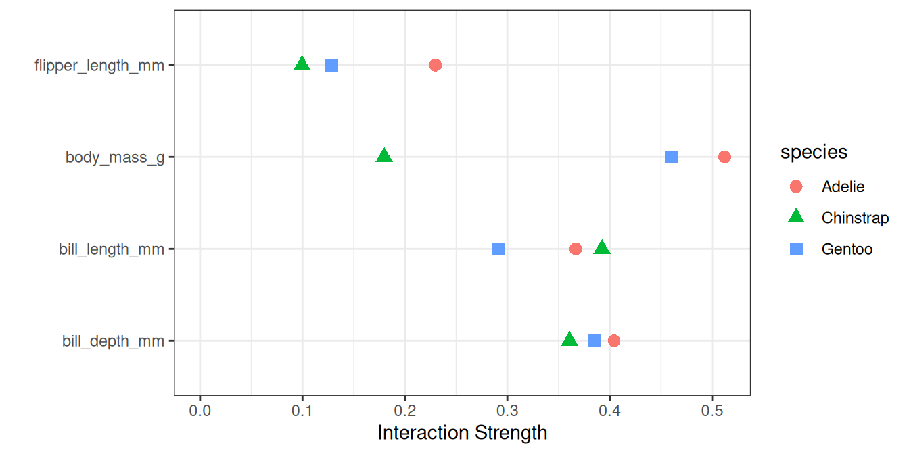

# فصل ۲۱: تعامل ویژگی‌ها

> **عنوان اصلی:** Feature Interaction  
> **منبع:** [https://christophm.github.io/interpretable-ml-book/interaction.html](https://christophm.github.io/interpretable-ml-book/interaction.html)  
> **نویسنده:** Christoph Molnar  
> **مترجم:** مریم محمودی

---

وقتی ویژگی‌ها در یک مدل پیش‌بینی با یکدیگر تعامل (interaction) دارند، پیش‌بینی را نمی‌توان به‌صورت مجموع اثرهای ویژگی‌ها بیان کرد، چون اثر یک ویژگی به مقدار ویژگی دیگر بستگی دارد.
گزارهٔ ارسطو که می‌گوید «کل بزرگ‌تر از مجموع اجزای آن است» در حضور تعامل‌ها صدق می‌کند.

> **توضیح مترجم:** در این کتاب واژهٔ «تعامل» (interaction) به همان معنایی به کار می‌رود که در آمار «اثر متقابل» یا «برهم‌کنش» گفته می‌شود: اثر مشترک دو (یا چند) ویژگی که با جمع اثرهای تک‌تک آن‌ها توضیح داده نمی‌شود. در فصل ALE همین مفهوم «برهم‌کنش» ترجمه شده بود؛ در این فصل برای هماهنگی با عنوان فصل از «تعامل» استفاده می‌کنیم.

## تعامل ویژگی‌ها چیست؟

اگر یک مدل یادگیری ماشین پیش‌بینی را بر پایهٔ دو ویژگی انجام دهد، می‌توانیم پیش‌بینی را به چهار جمله تجزیه کنیم:
یک جملهٔ ثابت، یک جمله برای ویژگی اول، یک جمله برای ویژگی دوم، و یک جمله برای تعامل میان دو ویژگی.
تعامل میان دو ویژگی، تغییری در پیش‌بینی است که پس از در نظر گرفتن اثرهای تک‌تک ویژگی‌ها، از تغییر دادن ویژگی‌ها پدید می‌آید.

برای مثال، مدلی ارزش یک خانه را با استفاده از اندازهٔ خانه (بزرگ یا کوچک) و موقعیت (خوب یا بد) به‌عنوان ویژگی پیش‌بینی می‌کند، که چهار پیش‌بینی ممکن می‌دهد؛ جدول ۲۱.۱ را ببینید.

| موقعیت | اندازه | پیش‌بینی |
|-------:|-------:|---------:|
| خوب    | بزرگ   | ۳۰۰,۰۰۰  |
| خوب    | کوچک   | ۲۰۰,۰۰۰  |
| بد     | بزرگ   | ۲۵۰,۰۰۰  |
| بد     | کوچک   | ۱۵۰,۰۰۰  |

*جدول ۲۱.۱: نمونه پیش‌بینی‌های قیمت خانه بدون تعامل*

پیش‌بینی مدل را به بخش‌های زیر تجزیه می‌کنیم:
یک جملهٔ ثابت (۱۵۰,۰۰۰)، یک اثر برای ویژگی اندازه (۱۰۰,۰۰۰+ اگر بزرگ باشد؛ ۰+ اگر کوچک باشد)، و یک اثر برای موقعیت (۵۰,۰۰۰+ اگر خوب باشد؛ ۰+ اگر بد باشد).
این تجزیه پیش‌بینی‌های مدل را به‌طور کامل توضیح می‌دهد.
هیچ اثر تعاملی وجود ندارد، چون پیش‌بینی مدل مجموع اثرهای تک‌تک ویژگی‌های اندازه و موقعیت است.
وقتی یک خانهٔ کوچک را بزرگ می‌کنید، پیش‌بینی همیشه ۱۰۰,۰۰۰ افزایش می‌یابد، صرف‌نظر از موقعیت.
همچنین، تفاوت پیش‌بینی میان موقعیت خوب و بد ۵۰,۰۰۰ است، صرف‌نظر از اندازه.

حال یک مثال با تعامل را در جدول ۲۱.۲ ببینیم.

| موقعیت | اندازه | پیش‌بینی |
|-------:|-------:|---------:|
| خوب    | بزرگ   | ۴۰۰,۰۰۰  |
| خوب    | کوچک   | ۲۰۰,۰۰۰  |
| بد     | بزرگ   | ۲۵۰,۰۰۰  |
| بد     | کوچک   | ۱۵۰,۰۰۰  |

*جدول ۲۱.۲: نمونه پیش‌بینی‌های قیمت خانه با تعامل*

جدول پیش‌بینی را به بخش‌های زیر تجزیه می‌کنیم:
یک جملهٔ ثابت (۱۵۰,۰۰۰)، یک اثر برای ویژگی اندازه (۱۰۰,۰۰۰+ اگر بزرگ باشد؛ ۰+ اگر کوچک باشد)، و یک اثر برای موقعیت (۵۰,۰۰۰+ اگر خوب باشد؛ ۰+ اگر بد باشد).
برای این جدول به یک جملهٔ اضافی برای تعامل نیاز داریم: ۱۰۰,۰۰۰+ اگر خانه بزرگ و در موقعیت خوب باشد.
بنابراین برای یک خانهٔ بزرگ در موقعیت خوب داریم: ۱۵۰,۰۰۰ (پایه) + ۵۰,۰۰۰ (موقعیت خوب) + ۱۰۰,۰۰۰ (بزرگ) + ۱۰۰,۰۰۰ (تعامل) = ۴۰۰,۰۰۰.
این یک تعامل میان اندازه و موقعیت است، چون در این حالت تفاوت پیش‌بینی میان خانهٔ بزرگ و کوچک به موقعیت بستگی دارد.

> **برای درک بهتر (توضیح مترجم):** همین تفاوت را مستقیم از جدول ۲۱.۲ می‌توان دید. در موقعیت خوب، بزرگ‌شدن خانه پیش‌بینی را از ۲۰۰,۰۰۰ به ۴۰۰,۰۰۰ می‌برد، یعنی ۲۰۰,۰۰۰+. در موقعیت بد، همین تغییر پیش‌بینی را از ۱۵۰,۰۰۰ به ۲۵۰,۰۰۰ می‌برد، یعنی فقط ۱۰۰,۰۰۰+. چون اثر «بزرگ‌شدن» بسته به موقعیت متفاوت است ($200000 \neq 100000$)، مدل تعامل دارد. در جدول ۲۱.۱ این دو تفاوت برابر ($100000$ و $100000$) بودند و تعاملی وجود نداشت. اختلاف این دو ($200000 - 100000 = 100000$) دقیقاً همان جملهٔ تعامل است.

یک راه برای تخمین قدرت تعامل، اندازه‌گیری این است که چه سهمی از تغییرپذیری پیش‌بینی به تعامل ویژگی‌ها وابسته است.
این اندازه‌گیری آمارهٔ H (H-statistic) نام دارد که [Friedman و Popescu (۲۰۰۸)](appendix-D-references.md) آن را معرفی کردند.

## آمارهٔ H فریدمن

با دو حالت سروکار خواهیم داشت:
اول، یک معیار تعامل دوطرفه (two-way) که به ما می‌گوید آیا دو ویژگی در مدل با هم تعامل دارند و تا چه حد؛
دوم، یک معیار تعامل کل (total) که به ما می‌گوید آیا یک ویژگی در مدل با همهٔ ویژگی‌های دیگر تعامل دارد و تا چه حد.
در نظریه می‌توان تعامل‌های دلخواه میان هر تعداد ویژگی را اندازه گرفت، اما این دو جالب‌ترین حالت‌اند.

اگر دو ویژگی با هم تعامل نداشته باشند، می‌توانیم [تابع وابستگی جزئی](19-pdp.md) را به این صورت تجزیه کنیم (با فرض اینکه توابع وابستگی جزئی حول صفر مرکزی شده‌اند):

$$PD\_{jk}(\mathbf{x}\_j, \mathbf{x}\_k) = PD\_j(\mathbf{x}\_j) + PD\_k(\mathbf{x}\_k)$$

که در آن $PD\_{jk}(\mathbf{x}\_j, \mathbf{x}\_k)$ تابع وابستگی جزئی دوطرفهٔ هر دو ویژگی است، و $PD\_j(\mathbf{x}\_j)$ و $PD\_k(\mathbf{x}\_k)$ توابع وابستگی جزئی تک‌تک ویژگی‌ها هستند.

همین‌طور، اگر یک ویژگی با هیچ‌یک از ویژگی‌های دیگر تعامل نداشته باشد، می‌توانیم تابع پیش‌بینی $\hat{f}(\mathbf{x})$ را به‌صورت مجموع توابع وابستگی جزئی بیان کنیم، که جملهٔ اول فقط به $j$ و جملهٔ دوم به همهٔ ویژگی‌های دیگر جز $j$ وابسته است:

$$\hat{f}(\mathbf{x}) = PD\_j(x\_j) + PD\_{-j}(\mathbf{x}\_{-j})$$

که در آن $PD\_{-j}(\mathbf{x}\_{-j})$ تابع وابستگی جزئی‌ای است که به همهٔ ویژگی‌ها به‌جز ویژگی $j$-ام وابسته است.

> **توضیح مترجم:** در این فرمول‌ها زیرنویس $-j$ یعنی «همهٔ ویژگی‌ها به‌جز $j$»، و «مرکزی‌شده حول صفر» یعنی میانگین هر تابع وابستگی جزئی روی داده‌ها از آن کم شده تا میانگینش صفر باشد (مانند مرکزی‌کردن در ALE)؛ بدون این فرض، جمع بالا یک ثابت اضافه نیاز دارد. منبع این نمادها را جداگانه تعریف نمی‌کند.

این تجزیه تابع وابستگی جزئی (یا تابع پیش‌بینی کامل) را بدون تعامل‌ها بیان می‌کند (میان ویژگی‌های $j$ و $k$، یا به‌ترتیب $j$ و همهٔ ویژگی‌های دیگر).
در گام بعد، تفاوت میان تابع وابستگی جزئی مشاهده‌شده و تابع تجزیه‌شدهٔ بدون تعامل را اندازه می‌گیریم.
واریانس خروجی وابستگی جزئی (برای اندازه‌گیری تعامل میان دو ویژگی) یا کل تابع (برای اندازه‌گیری تعامل میان یک ویژگی و همهٔ ویژگی‌های دیگر) را محاسبه می‌کنیم.
مقدار واریانسی که تعامل آن را توضیح می‌دهد (تفاوت میان PD مشاهده‌شده و PD بدون تعامل) به‌عنوان آمارهٔ قدرت تعامل به کار می‌رود.
اگر هیچ تعاملی وجود نداشته باشد آماره ۰ است، و اگر کل واریانس $PD\_{jk}$ یا $\hat{f}$ با مجموع توابع وابستگی جزئی توضیح داده شود، ۱ است.
آمارهٔ تعامل ۱ میان دو ویژگی یعنی هر تابع PD تکی ثابت است و اثر بر پیش‌بینی فقط از راه تعامل می‌آید.
آمارهٔ H می‌تواند بزرگ‌تر از ۱ نیز باشد، که تفسیرش دشوارتر است.
این می‌تواند وقتی رخ دهد که واریانس تعامل دوطرفه از واریانس نمودار وابستگی جزئی دوبعدی بزرگ‌تر باشد.

> **توضیح مترجم:** متن منبع در جملهٔ «۰ اگر هیچ تعاملی نباشد و ۱ اگر همهٔ واریانس با مجموع توابع وابستگی جزئی توضیح داده شود» ظاهراً دو چیز را جابه‌جا بیان می‌کند: بر پایهٔ فرمول زیر، آماره وقتی ۱ است که همهٔ واریانس با **تعامل** توضیح داده شود (یعنی PDهای تکی بی‌اثر باشند)، که با جملهٔ بعدی («هر تابع PD تکی ثابت است») هم‌خوان است. این ناهمخوانی در جملهٔ منبع عیناً حفظ شد و خوانندهٔ دقیق باید فرمول را مبنا بگیرد.

از نظر ریاضی، آمارهٔ H که Friedman و Popescu برای تعامل میان ویژگی $j$ و $k$ پیشنهاد کردند چنین است:

$$H^2\_{jk} = \frac{\sum\_{i=1}^n\left[PD\_{jk}(x\_{j}^{(i)},x\_k^{(i)})-PD\_j(x\_j^{(i)}) - PD\_k(x\_{k}^{(i)})\right]^2}{\sum\_{i=1}^n\left({PD}\_{jk}(x\_j^{(i)},x\_k^{(i)})\right)^2}$$

همین برای اندازه‌گیری اینکه آیا ویژگی $j$ با هر ویژگی دیگری تعامل دارد صدق می‌کند:

$$H^2\_{j} = \frac{\sum\_{i=1}^n\left[\hat{f}(\mathbf{x}^{(i)}) - PD\_j(x^{(i)}\_j) - PD\_{-j}(\mathbf{x}\_{-j}^{(i)})\right]^2}{\sum\_{i=1}^n \left(\hat{f}(\mathbf{x}^{(i)})\right)^2}$$

ارزیابی آمارهٔ H پرهزینه است، چون روی همهٔ نقاط داده پیمایش می‌کند و در هر نقطه باید وابستگی جزئی ارزیابی شود، که خود با همهٔ $n$ نقطهٔ داده انجام می‌شود.
در بدترین حالت، برای محاسبهٔ آمارهٔ H دوطرفه ($j$ در برابر $k$) به $2n^2$ فراخوانی تابع پیش‌بینی مدل یادگیری ماشین و برای آمارهٔ H کل ($j$ در برابر همه) به $3n^2$ فراخوانی نیاز داریم.
برای تسریع محاسبه، می‌توانیم از $n$ نقطهٔ داده نمونه بگیریم.
این عیب را دارد که واریانس برآوردهای وابستگی جزئی را افزایش می‌دهد و آمارهٔ H را ناپایدار می‌کند.
پس اگر برای کاهش بار محاسباتی از نمونه‌گیری استفاده می‌کنید، مطمئن شوید نقاط داده‌ٔ کافی نمونه می‌گیرید.

> **برای درک بهتر (توضیح مترجم):** با $n = 1000$ نمونه، آمارهٔ H دوطرفه در بدترین حالت به $2 \times 1000^2 = 2{,}000{,}000$ فراخوانی مدل نیاز دارد و آمارهٔ H کل به $3 \times 1000^2 = 3{,}000{,}000$. اگر فقط $100$ نمونه نمونه‌گیری کنیم، هزینه به $2 \times 100^2 = 20{,}000$ می‌رسد، یعنی ۱۰۰ برابر کمتر، اما برآورد با واریانس بیشتری همراه است.

Friedman و Popescu یک آمارهٔ آزمون نیز پیشنهاد می‌کنند تا ارزیابی شود آیا آمارهٔ H به‌طور معناداری با صفر تفاوت دارد.
فرض صفر نبود تعامل است.
برای تولید آمارهٔ تعامل تحت فرض صفر، باید بتوانید مدل را طوری تنظیم کنید که میان ویژگی $j$ و $k$ یا همهٔ ویژگی‌های دیگر تعاملی نداشته باشد.
این برای همهٔ انواع مدل‌ها ممکن نیست.
بنابراین این آزمون مختص مدل است، نه مستقل از مدل (model-agnostic)، و به همین دلیل در اینجا پوشش داده نمی‌شود.

آمارهٔ قدرت تعامل را می‌توان در تنظیم طبقه‌بندی نیز اعمال کرد، اگر پیش‌بینی یک احتمال باشد.

## مثال‌ها

ببینیم تعامل‌های ویژگی‌ها در عمل چگونه‌اند!
تعامل‌های میان ویژگی‌ها را در یک جنگل تصادفی تحلیل می‌کنیم که برای پیش‌بینی [جنسیت پنگوئن](05-data.md) بر پایهٔ اندازه‌گیری‌های بدن آموزش دیده است؛ شکل ۲۱.۱ را در بالا ببینید.
توده بدنی (body mass) بیشترین قدرت تعامل را دارد.
پس از نگاه به تعامل‌های هر ویژگی با همهٔ ویژگی‌های دیگر، می‌توانیم یکی از ویژگی‌ها را انتخاب کنیم و عمیق‌تر به همهٔ تعامل‌های دوطرفهٔ میان ویژگی انتخاب‌شده و ویژگی‌های دیگر بپردازیم.
توده بدنی قوی‌ترین تعامل را دارد، پس در شکل ۲۱.۱ در پایین نگاه عمیق‌تری به آن بیندازیم.
نمودار نشان می‌دهد توده بدنی بیشتر با عمق منقار و گونه تعامل دارد.

> **توضیح مترجم:** نسخهٔ محلی این تصویر در مخزن موجود نیست و در زمان ترجمه نیز سایت منبع از محیط کار قابل دسترسی نبود؛ بنابراین نمی‌شد تصویر را دانلود کرد یا نوشته‌های داخلش را خواند، و آدرس بالا بر اساس الگوی نام‌گذاری شکل‌های همین کتاب است و راستی‌آزمایی نشده. به همین دلیل ترجمهٔ برچسب‌های داخل این شکل (محورها و نام ویژگی‌ها) ثبت نشد و این مورد در گزارش پوشش «مسدود» است. بر اساس متن و زیرنویس منبع می‌دانیم: نمودار بالا قدرت تعامل هر ویژگی را با همهٔ ویژگی‌های دیگر نشان می‌دهد و توده بدنی (`body_mass_g`) در آن بیشترین است؛ نمودار پایین تعامل‌های دوطرفهٔ توده بدنی را با ویژگی‌های دیگر نشان می‌دهد و بیشترین‌شان با عمق منقار (`bill_depth_mm`) و گونه (`species`) است.

> **برای درک بهتر (توضیح مترجم):** دو نمودار شکل ۲۱.۱ دو سطح تحلیل‌اند. نمودار بالا «کل» است ($H\_j$ هر ویژگی با همهٔ دیگران) و به ما می‌گوید کدام ویژگی بیشتر درگیر تعامل است. نمودار پایین «دوطرفه» است ($H\_{jk}$ برای ویژگی منتخب با هر ویژگی دیگر) و می‌گوید تعامل با چه کسی است. این رویهٔ دو‌مرحله‌ای (اول کل، سپس دوطرفه) همان گردش کار پیشنهادی نویسنده در بخش محدودیت‌هاست که پس از آن برای تعامل‌های جالب نمودارهای وابستگی جزئی دوبعدی رسم می‌شود.

جایزه: به همهٔ تعامل‌ها به تفکیک گونه علاقه‌مندیم که آن‌ها را در شکل ۲۱.۲ مصور کرده‌ام.
به‌ویژه برای توده بدنی، قدرت‌های تعامل میان گونه‌ها متفاوت‌اند.

> **توضیح مترجم (متن داخل تصویر):** محور x با برچسب `Interaction Strength` (قدرت تعامل) از ۰٫۰ تا حدود ۰٫۵ است و محور y چهار ویژگی را فهرست می‌کند: `flipper_length_mm` (طول بال بر حسب میلی‌متر)، `body_mass_g` (توده بدنی بر حسب گرم)، `bill_length_mm` (طول منقار) و `bill_depth_mm` (عمق منقار). راهنمای سمت راست با عنوان `species` (گونه) سه نماد را نشان می‌دهد: `Adelie` (دایرهٔ قرمز)، `Chinstrap` (مثلث سبز) و `Gentoo` (مربع آبی). متغیر `species` از نمودار حذف شده است (در کد منبع حذف می‌شود). توده بدنی برای Adelie (حدود ۰٫۵۱) و Gentoo (حدود ۰٫۴۶) قدرت تعامل بالا و برای Chinstrap (حدود ۰٫۱۸) پایین دارد، و همین تفاوت میان گونه‌ها همان جملهٔ متن است. مقادیر از روی شکل تقریبی خوانده شده‌اند. نوشته‌های انگلیسی تصویر بدون تغییر ماندند.

## نقاط قوت

آمارهٔ H تعامل از طریق تجزیهٔ وابستگی جزئی **نظریهٔ زیربنایی** دارد.

آمارهٔ H **تفسیر معناداری** دارد:
تعامل به‌صورت سهم واریانسی تعریف می‌شود که با تعامل توضیح داده می‌شود.

چون این آماره **بی‌بُعد** (dimensionless) است، میان ویژگی‌ها و حتی میان مدل‌ها قابل مقایسه است.

این آماره **همهٔ انواع تعامل‌ها** را، صرف‌نظر از شکل خاصشان، تشخیص می‌دهد.

با آمارهٔ H می‌توان **تعامل‌های مرتبهٔ بالاتر** دلخواه را نیز تحلیل کرد، مانند قدرت تعامل میان ۳ ویژگی یا بیشتر.

> **برای درک بهتر (توضیح مترجم):** «بی‌بعد» یعنی چون آماره نسبت دو واریانس است، واحد (مثلاً دلار یا کیلوگرم) حذف می‌شود. بنابراین می‌توان قدرت تعامل «توده بدنی» را با «عمق منقار» مقایسه کرد، حتی اگر واحدهایشان متفاوت باشد، و حتی می‌توان عدد را میان دو مدل متفاوت مقایسه کرد؛ البته با احتیاط‌هایی که در بخش محدودیت‌ها (مثل بزرگ‌تر از ۱ شدن) آمده است.

## محدودیت‌ها

اولین چیزی که متوجه خواهید شد:
آمارهٔ H تعامل زمان زیادی برای محاسبه می‌برد، چون **از نظر محاسباتی پرهزینه** است.

محاسبه شامل تخمین توزیع‌های حاشیه‌ای است.
اگر از همهٔ نقاط داده استفاده نکنیم، این **تخمین‌ها نیز واریانس مشخصی دارند**.
این یعنی با نمونه‌گیری از نقاط، تخمین‌ها از اجرایی به اجرای دیگر تغییر می‌کنند و **نتایج می‌توانند ناپایدار باشند**.
توصیه می‌کنم محاسبهٔ آمارهٔ H را چند بار تکرار کنید تا ببینید آیا داده‌های کافی برای نتیجه‌ای پایدار دارید یا نه.

روشن نیست که آیا یک تعامل به‌طور معناداری بزرگ‌تر از ۰ است یا نه.
باید یک آزمون آماری انجام دهیم، اما این **آزمون (هنوز) در نسخهٔ مستقل از مدل در دسترس نیست**.

در ارتباط با مسئلهٔ آزمون، دشوار است بگوییم آمارهٔ H چه زمانی آن‌قدر بزرگ است که تعامل را «قوی» بدانیم.

همچنین، **آمارهٔ H می‌تواند بزرگ‌تر از ۱ باشد**، که تفسیر را دشوار می‌کند.

وقتی اثر کل دو ویژگی ضعیف است اما عمدتاً از تعامل‌ها تشکیل شده، آمارهٔ H بسیار بزرگ می‌شود.
این تعامل‌های کاذب (spurious) به مخرج کوچک آمارهٔ H نیاز دارند و وقتی ویژگی‌ها همبسته باشند بدتر می‌شوند.
**یک تعامل کاذب می‌تواند بیش‌ازحد تفسیر شود** و تعامل قوی به نظر برسد، در حالی که در واقع هر دو ویژگی نقش کوچکی در مدل دارند.
یک راه‌حل ممکن، مصورسازی نسخهٔ نرمال‌نشدهٔ آمارهٔ H است، که ریشهٔ دوم صورت آمارهٔ H است ([Inglis و همکاران (۲۰۲۲)](appendix-D-references.md)).
این کار آمارهٔ H را دست‌کم برای رگرسیون هم‌مقیاس با پاسخ می‌کند و تأکید کمتری بر تعامل‌های کاذب می‌گذارد.

$$H^{*}\_{jk} = \sqrt{\sum\_{i=1}^n\left[PD\_{jk}(x\_{j}^{(i)},x\_k^{(i)})-PD\_j(x\_j^{(i)}) - PD\_k(x\_{k}^{(i)})\right]^2}$$

> **برای درک بهتر (توضیح مترجم):** فرض کنید دو ویژگی تقریباً بی‌اثرند و واریانس $PD\_{jk}$ برابر $0{.}02$ است، اما تقریباً همهٔ آن را تعامل توضیح می‌دهد (صورت $0{.}015$). آنگاه $H^2 = 0{.}015 / 0{.}02 = 0{.}75$ و $H \approx 0{.}87$ بسیار بزرگ به نظر می‌رسد، هرچند اثر کل ناچیز است. نسخهٔ نرمال‌نشده $H^{*} = \sqrt{0{.}015} \approx 0{.}12$ است، یعنی به همان مقیاس خروجی مدل و کوچک؛ و نشان می‌دهد این تعامل از نظر عملی مهم نیست. (اعداد فرضی‌اند.)

آمارهٔ H قدرت تعامل‌ها را به ما می‌گوید، **اما نمی‌گوید تعامل‌ها چه شکلی دارند**.
برای این کار [نمودارهای وابستگی جزئی](19-pdp.md) هستند.
یک گردش کار معنادار این است که قدرت تعامل‌ها را اندازه بگیریم و سپس برای تعامل‌هایی که به آن‌ها علاقه‌مندیم نمودارهای وابستگی جزئی دوبعدی بسازیم.

آمارهٔ تعامل با این فرض کار می‌کند که می‌توانیم ویژگی‌ها را مستقل از هم جابه‌جا (shuffle) کنیم.
اگر ویژگی‌ها به‌شدت همبسته باشند، این فرض نقض می‌شود و **روی ترکیب‌هایی از ویژگی‌ها انتگرال می‌گیریم که در واقعیت بسیار بعیدند**.
این همان مشکلی است که نمودارهای وابستگی جزئی دارند.
ویژگی‌های همبسته می‌توانند به مقادیر بزرگ آمارهٔ H منجر شوند.

گاهی نتایج عجیب‌اند و در شبیه‌سازی‌های کوچک **نتایج مورد انتظار را نمی‌دهند**.
اما این بیشتر یک مشاهدهٔ موردی (anecdotal) است.

## نرم‌افزارها و جایگزین‌ها

برای مثال‌های این کتاب، از بستهٔ R به نام `iml` استفاده کرده‌ام که در CRAN و نسخهٔ در حال توسعهٔ آن در GitHub موجود است. پیاده‌سازی‌های دیگری نیز وجود دارند که بر مدل‌های خاص تمرکز دارند: بستهٔ R به نام `pre`، RuleFit و آمارهٔ H را پیاده‌سازی می‌کند. بستهٔ R به نام `gbm` مدل‌های بوست گرادیانی و آمارهٔ H را پیاده‌سازی می‌کند. در پایتون، می‌توانید پیاده‌سازی را در بستهٔ `PiML` پیدا کنید.

آمارهٔ H تنها راه اندازه‌گیری تعاملات نیست:

شبکه‌های تعامل متغیر (VIN) توسط هوکر (Hooker 2004) رویکردی است که تابع پیش‌بینی را به اثرات اصلی و تعاملات ویژگی‌ها تجزیه می‌کند. سپس تعاملات بین ویژگی‌ها به صورت یک شبکه مصورسازی می‌شوند. متأسفانه، هنوز نرم‌افزاری در دسترس نیست.

تعامل ویژگی مبتنی بر وابستگی جزئی توسط گرین‌ول، بومکه و مک‌کارتی (Greenwell, Boehmke, and McCarthy 2018) تعامل بین دو ویژگی را اندازه‌گیری می‌کند. این رویکرد اهمیت ویژگی (تعریف‌شده به عنوان واریانس تابع وابستگی جزئی) یک ویژگی را به شرط نقاط ثابت مختلف از ویژگی دیگر اندازه‌گیری می‌کند. اگر واریانس زیاد باشد، ویژگی‌ها با یکدیگر تعامل دارند؛ اگر صفر باشد، تعامل ندارند. بستهٔ R مربوطه به نام `vip` در GitHub در دسترس است. این بسته همچنین نمودارهای وابستگی جزئی و اهمیت ویژگی را پوشش می‌دهد.
