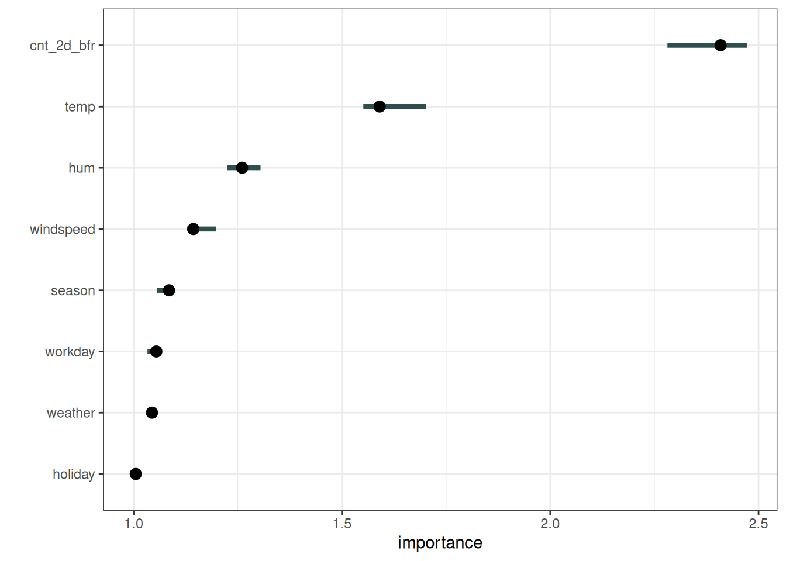
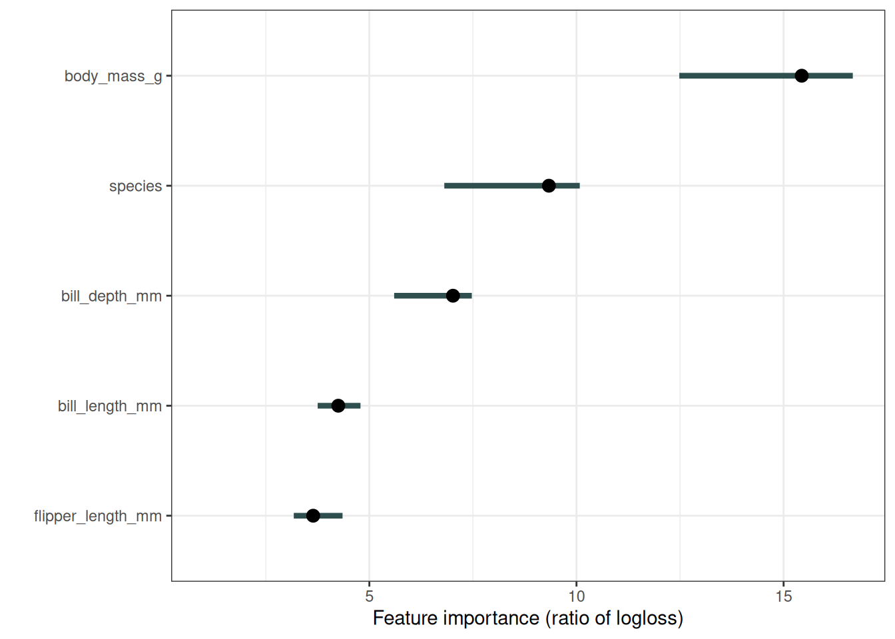
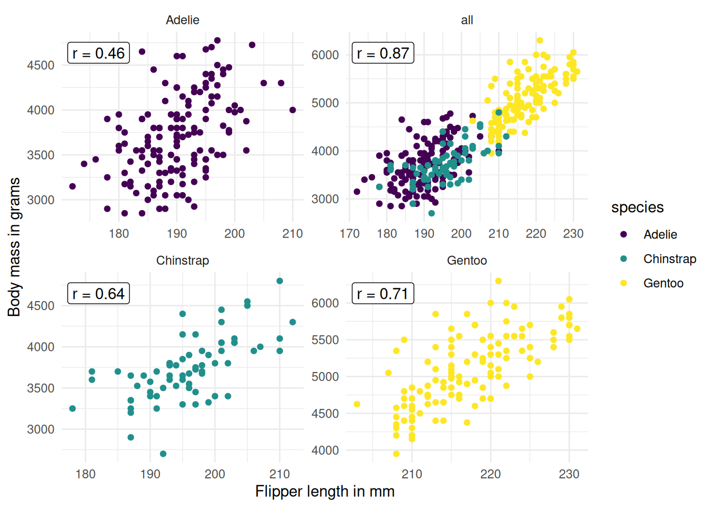
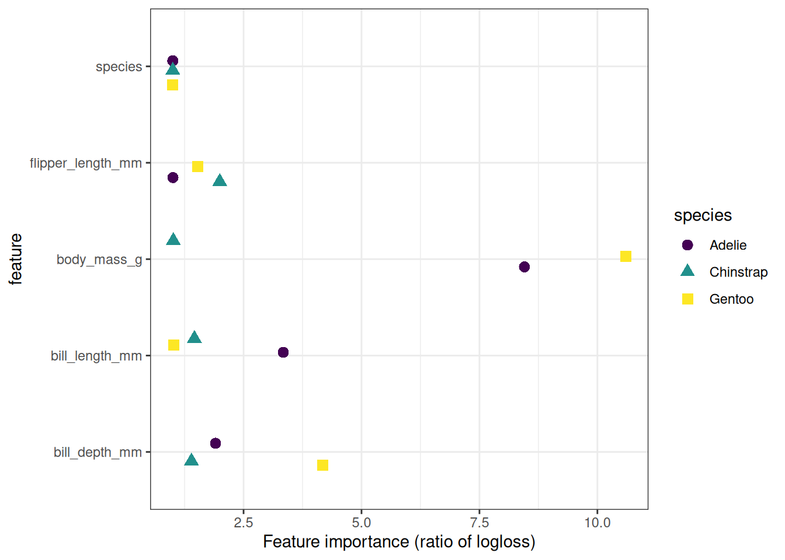

# فصل ۲۳: اهمیت ویژگی با جایگشت

> **عنوان اصلی:** Permutation Feature Importance  
> **منبع:** [https://christophm.github.io/interpretable-ml-book/feature-importance.html](https://christophm.github.io/interpretable-ml-book/feature-importance.html)  
> **نویسنده:** Christoph Molnar  
> **مترجم:** مریم محمودی

---

اهمیت ویژگی با جایگشت (permutation feature importance؛ PFI) افزایش خطای پیش‌بینی مدل را پس از جایگشت‌دادن (permute) مقادیر ویژگی اندازه می‌گیرد، که رابطهٔ میان ویژگی و نتیجهٔ واقعی را می‌شکند.

مفهوم واقعاً سرراست است:
یک ویژگی «مهم» است اگر درهم‌ریختن (shuffle) مقادیرش خطای مدل را افزایش دهد، چون در این حالت مدل برای پیش‌بینی به آن ویژگی تکیه کرده بود.
یک ویژگی «بی‌اهمیت» است اگر درهم‌ریختن مقادیرش خطای مدل را بدون تغییر بگذارد، چون در این حالت مدل آن ویژگی را برای پیش‌بینی نادیده گرفته بود.

> **توضیح مترجم:** «جایگشت‌دادن» ویژگی یعنی مقادیر یک ستون از داده را بین نمونه‌ها به‌صورت تصادفی جابه‌جا کنیم، به‌طوری که توزیع ستون همان بماند اما ارتباطش با هدف و با ستون‌های دیگر از بین برود. «خطای مدل» با یک تابع زیان (مثل میانگین مربعات خطا یا میانگین قدر مطلق خطا) سنجیده می‌شود. نام PFI در متن به‌صورت Latin می‌آید.

## نظریه

اندازه‌گیری اهمیت ویژگی با جایگشت را [Breiman (۲۰۰۱)](appendix-D-references.md) برای جنگل‌های تصادفی معرفی کرد.
بر پایهٔ این ایده، [Fisher و همکاران (۲۰۱۹)](appendix-D-references.md) نسخه‌ای مستقل از مدل (model-agnostic) از اهمیت ویژگی پیشنهاد کردند و آن را اتکای مدل (model reliance) نامیدند.
آن‌ها همچنین ایده‌های پیشرفته‌تری دربارهٔ اهمیت ویژگی معرفی کردند، برای مثال نسخه‌ای (مختص مدل) که در نظر می‌گیرد بسیاری از مدل‌های پیش‌بینی ممکن است داده‌ها را خوب پیش‌بینی کنند.
مقالهٔ آن‌ها ارزش خواندن دارد.

**الگوریتم اهمیت ویژگی با جایگشت بر پایهٔ [Fisher و همکاران (۲۰۱۹)](appendix-D-references.md):**

ورودی: مدل آموزش‌دیدهٔ $\hat{f}$، ماتریس ویژگی $\mathbf{X}$، بردار هدف $\mathbf{y}$، معیار خطای $L$.

1. خطای اصلی مدل را تخمین بزنید: $e\_{orig} = \frac{1}{n\_{test}} \sum\_{i=1}^{n\_{test}} L(y^{(i)}, \hat{f}(\mathbf{x}^{(i)}))$ (مثلاً میانگین مربعات خطا).
2. برای هر ویژگی $j \in \lbrace 1,...,p \rbrace$ انجام دهید:
    - ماتریس ویژگی $\mathbf{X}\_{perm,j}$ را با جایگشت‌دادن ویژگی $j$ در داده‌های $\mathbf{X}$ بسازید. این کار ارتباط میان ویژگی $j$ و نتیجهٔ واقعی $y$ را می‌شکند.
    - خطای $e\_{perm,j} = \frac{1}{n\_{test}} \sum\_{i=1}^{n\_{test}} L(y^{(i)},\hat{f}(\mathbf{x}\_{perm,j}))$ را بر پایهٔ پیش‌بینی‌های داده‌های جایگشت‌یافته تخمین بزنید.
    - اهمیت ویژگی با جایگشت را به‌صورت خارج‌قسمت $FI\_j= e\_{perm}/e\_{orig}$ یا تفاضل $FI\_j = e\_{perm,j}- e\_{orig}$ محاسبه کنید.
3. ویژگی‌ها را بر پایهٔ FI نزولی مرتب کنید.

> **توضیح مترجم:** در منبع در گام دوم برای خارج‌قسمت $e\_{perm}$ بدون اندیس $j$ نوشته شده است، در حالی که در سایر بخش‌ها $e\_{perm,j}$ آمده؛ منظور همان خطای جایگشت ویژگی $j$ است و نمادگذاری منبع عیناً حفظ شد. $n\_{test}$ تعداد نمونه‌های داده‌ای است که برای محاسبهٔ خطا به کار می‌روند.

> **برای درک بهتر (توضیح مترجم):** فرض کنید خطای اصلی مدل روی داده‌های آزمون $e\_{orig} = 10$ است. پس از جایگشت ویژگی «دما»، خطا $e\_{perm} = 25$ می‌شود و پس از جایگشت «روز تعطیل» $e\_{perm} = 10.5$. با خارج‌قسمت: اهمیت دما $25/10 = 2.5$ و اهمیت روز تعطیل $10.5/10 = 1.05$ است؛ با تفاضل: $15$ و $0.5$. در هر دو حالت دما بسیار مهم‌تر است. مقدار ۱ برای خارج‌قسمت (یا ۰ برای تفاضل) یعنی ویژگی هیچ اهمیتی نداشت.

> **💡 نکته — معیارهای مثبت را وارونه کنید**
>
> می‌توانید PFI را با معیارهایی که بزرگ‌تر بهتر است، مانند دقت (accuracy) یا AUC، نیز به کار ببرید.
> فقط مطمئن شوید نقش‌های $e\_{\text{perm}}$ و $e\_{\text{orig}}$ را در خارج‌قسمت/تفاضل جابه‌جا می‌کنید.

Fisher، Rudin و Dominici (۲۰۱۸) در مقالهٔ خود پیشنهاد می‌کنند مجموعه‌داده را به دو نیم تقسیم کنیم و مقادیر ویژگی $j$ را میان دو نیمه جابه‌جا کنیم، به‌جای اینکه ویژگی $j$ را جایگشت دهیم. اگر دقت کنید، این دقیقاً همان جایگشت ویژگی $j$ است.
اگر تخمین دقیق‌تری می‌خواهید، می‌توانید خطای جایگشت ویژگی $j$ را با جفت‌کردن هر نمونه با مقدار ویژگی $j$ هر نمونهٔ دیگر (به‌جز خودش) تخمین بزنید.
این کار مجموعه‌داده‌ای با اندازهٔ `n(n-1)` برای تخمین خطای جایگشت به شما می‌دهد و زمان محاسبهٔ زیادی می‌برد.
من فقط وقتی روش `n(n-1)` را توصیه می‌کنم که جداً به دنبال تخمین‌های بسیار دقیق باشید.

> **توضیح مترجم:** در این بند منبع سال مقالهٔ Fisher و همکاران را (۲۰۱۸) نوشته (سال نسخهٔ نخست مقاله)، در حالی که همین مقاله در جملات بالا و در پیوست د با سال ۲۰۱۹ آمده است؛ هر دو به یک مقاله اشاره دارند و متن منبع عیناً حفظ شد.

> **برای درک بهتر (توضیح مترجم):** با $n = 1000$ نمونه، روش `n(n-1)` برای هر ویژگی $1000 \times 999 = 999{,}000$ جفت می‌سازد و مدل را به همان تعداد بار اجرا می‌کند؛ در حالی که یک جایگشت تصادفی ساده فقط $1000$ پیش‌بینی نیاز دارد. این تفاوت هزینه‌ای است که «زمان محاسبهٔ زیاد» در متن اشاره می‌کند.

> **⚠️ احتیاط — از داده‌های دیده‌نشده برای PFI استفاده کنید**
>
> PFI را روی داده‌هایی تخمین بزنید که در آموزش مدل به کار نرفته‌اند تا از نتایج بیش‌ازحد خوش‌بینانه، به‌ویژه برای مدل‌های بیش‌برازش‌شده (overfitting)، جلوگیری شود.
> PFI روی داده‌های آموزش می‌تواند به‌دلیل بیش‌برازش مدل، ویژگی‌های نامرتبط را به‌اشتباه مهم نشان دهد.
>
> برای فهمیدن اینکه مدل **واقعاً** از کدام ویژگی‌ها استفاده کرده است، جایگزین‌هایی مانند [اهمیت SHAP](18-shap.md) یا [اهمیت PDP](19-pdp.md) را در نظر بگیرید که به معیارهای خطا تکیه نمی‌کنند.

در مثال‌ها، برای محاسبهٔ اهمیت ویژگی با جایگشت از داده‌های آزمون استفاده کردم.

> **برای درک بهتر (توضیح مترجم):** فرض کنید یک مدل بیش‌برازش‌شده روی داده‌های آموزش خطای تقریباً صفر دارد چون نویز یک ویژگی نامرتبط را «حفظ» کرده است. اگر روی همین داده‌ها PFI بگیریم، جایگشت آن ویژگی خطا را بالا می‌برد و ویژگی مهم دیده می‌شود. روی داده‌های آزمون این نویز دیگر کمکی به پیش‌بینی نمی‌کند، پس جایگشت آن ویژگی خطا را تغییر نمی‌دهد و اهمیتش حدود صفر (خارج‌قسمت ۱) می‌شود.

## مثال و تفسیر

برای مثال اول، مدل ماشین بردار پشتیبان (support vector machine) را توضیح می‌دهیم که برای پیش‌بینی [تعداد دوچرخه‌های اجاره‌شده](05-data.md) با داشتن شرایط آب‌وهوایی و اطلاعات تقویمی آموزش دیده است.
به‌عنوان اندازهٔ خطا از میانگین خطای مطلق (mean absolute error) استفاده می‌کنیم.
شکل ۲۳.۱ نتایج اهمیت ویژگی با جایگشت را نشان می‌دهد.
مهم‌ترین ویژگی `cnt_2d_bfr` و کم‌اهمیت‌ترین `holiday` بود.

> **توضیح مترجم (متن داخل تصویر):** محور عمودی ویژگی‌ها را به ترتیب اهمیت فهرست می‌کند: `cnt_2d_bfr` (تعداد دوچرخه‌های اجاره‌شده دو روز قبل)، `temp` (دما)، `hum` (رطوبت)، `windspeed` (سرعت باد)، `season` (فصل)، `workday` (روز کاری)، `weather` (وضعیت هوا) و `holiday` (تعطیلی). برچسب محور افقی `importance` (اهمیت) است و چون اهمیت به‌صورت خارج‌قسمت خطا محاسبه شده، مقدار ۱ یعنی بی‌اهمیت. مقدار `cnt_2d_bfr` حدود ۲٫۴، `temp` حدود ۱٫۶، `hum` حدود ۱٫۳ و `holiday` حدود ۱٫۰ است. نوشته‌های انگلیسی تصویر بدون تغییر ماندند. در متن منبع نام مهم‌ترین و کم‌اهمیت‌ترین ویژگی با کد R در لحظهٔ ساخت کتاب درج می‌شود؛ نام‌ها در اینجا از روی خود شکل نوشته شد.

> **برای درک بهتر (توضیح مترجم):** نقطهٔ سیاه میانگین اهمیت در چند بار جایگشت و خط پیرامون آن بازهٔ ۵٪ تا ۹۵٪ است. برای `cnt_2d_bfr` خط پهن‌تر است (حدود ۲٫۳ تا ۲٫۵)، یعنی اهمیت بین جایگشت‌ها بیشتر تغییر می‌کند؛ برای `holiday` خط عملاً دیده نمی‌شود. در عمل اگر دو ویژگی بازه‌های هم‌پوشان داشته باشند، رتبه‌بندی میان آن‌ها قطعی نیست و باید با احتیاط ترجیح داد.

در ادامه به پنگوئن‌ها نگاه می‌کنیم.
۳ مدل رگرسیون لجستیک را برای پیش‌بینی [جنسیت پنگوئن](05-data.md) آموزش دادم، با ۲/۳ داده برای آموزش و ۱/۳ برای محاسبهٔ اهمیت.
خطا را با زیان لگاریتمی (log loss) اندازه می‌گیرم.
ویژگی‌هایی که با افزایش خطای مدل به‌اندازهٔ ضریب ۱ (= بدون تغییر) همراه‌اند برای پیش‌بینی نر در برابر ماده بودن پنگوئن مهم نبودند، همان‌طور که شکل ۲۳.۲ نشان می‌دهد.

> **توضیح مترجم (متن داخل تصویر):** برچسب محور افقی `Feature importance (ratio of logloss)` یعنی «اهمیت ویژگی (نسبت زیان لگاریتمی)». ویژگی‌ها از بالا به پایین: `body_mass_g` (توده بدنی، حدود ۱۵٫۴)، `species` (گونه، حدود ۹٫۳)، `bill_depth_mm` (عمق منقار، حدود ۷٫۰)، `bill_length_mm` (طول منقار، حدود ۴٫۲) و `flipper_length_mm` (طول بال، حدود ۳٫۶). نقطه میانگین و خط پیرامونش بازهٔ تغییر است. مقادیر از روی شکل تقریبی خوانده شده‌اند. نوشته‌های انگلیسی تصویر بدون تغییر ماندند.

اهمیت هر یک از ویژگی‌ها برای پیش‌بینی جنسیت پنگوئن با مدل‌های رگرسیون لجستیک.
مهم‌ترین ویژگی `body_mass_g` بود.
جایگشت `body_mass_g` به افزایش خطای طبقه‌بندی به‌اندازهٔ ضریبی حدود ۱۵٫۴ منجر شد.
اما صبر کنید، چطور `species` می‌تواند ویژگی مهمی هم باشد، در حالی که من در واقع ۳ مدل را جداگانه آموزش دادم؟
من اینجا ۳ مدل را یک مدل جعبه‌سیاه واحد در نظر گرفتم.
برای این تابع کلی، `species` فقط یک ویژگی دیگر است.
در درون، این ویژگی داده‌ها را تقسیم می‌کند و به سه مدل رگرسیون لجستیک می‌فرستد.

> **توضیح مترجم:** اعداد ۱۵٫۴ و نام ویژگی مهم‌تر در متن منبع با کد R در زمان ساخت کتاب محاسبه می‌شوند (نه به‌صورت متن ثابت)؛ در اینجا مقدار ۱۵٫۴ از روی شکل ۲۳.۲ خوانده شده و دقیق‌ترین رقم نیست. ایدهٔ «سه مدل یک جعبه‌سیاه» یعنی PFI فقط تابع کلی ورودی-خروجی را می‌بیند و نمی‌داند داخلش چند مدل هست.

## اهمیت ویژگی شرطی

مانند همهٔ روش‌های مستقل از مدل، اهمیت ویژگی با جایگشت وقتی ویژگی‌ها وابسته‌اند مشکل دارد.
درهم‌ریختن نقاط داده‌ای غیرواقع‌گرایانه یا دست‌کم بعید تولید می‌کند، که سپس برای محاسبهٔ اهمیت ویژگی به کار می‌روند — چندان مطلوب نیست.
مشکل این است که نسخهٔ *حاشیه‌ای* (marginal) PFI وابستگی‌ها را نادیده می‌گیرد.
اما مفهوم اهمیت *شرطی* (conditional) نیز وجود دارد.
نسخهٔ شرطی به‌جای توزیع حاشیه‌ای $\mathbb{P}(X\_j)$ از توزیع شرطی $\mathbb{P}(X\_j | X\_{-j})$ نمونه می‌گیرد (درهم‌ریختن راهی برای نمونه‌گیری از توزیع حاشیه‌ای است).
با نمونه‌گیری شرطی، نقاط داده‌ای واقع‌گرایانه‌تر نمونه‌گیری می‌کنیم.

اما نمونه‌گیری از توزیع شرطی دشوار است.
این کار حتی از وظیفهٔ یادگیری ماشین اصلی ما دشوارتر است.
اما می‌توان آن را با فرض‌هایی ساده کرد، مثلاً اینکه فرض کنیم یک ویژگی فقط به‌صورت خطی با ویژگی‌های دیگر همبسته است.
چند گزینه برای نمونه‌گیری شرطی:

- PFI را در زیرگروه‌های داده محاسبه و تجمیع کنید. زیرگروه‌ها بر پایهٔ افراز بر حسب ویژگی‌های همبسته ساخته می‌شوند ([Molnar و همکاران (۲۰۲۳)](appendix-D-references.md)).
- از تکنیک‌های تطابق (matching) و جایگذاری (imputation) برای تولید نمونه از توزیع شرطی استفاده کنید ([Fisher و همکاران (۲۰۱۹)](appendix-D-references.md)).
- از ناک‌آف‌ها (knockoffs) استفاده کنید ([Watson و Wright (۲۰۲۱)](appendix-D-references.md)).
- برای جنگل‌های تصادفی، یک پیاده‌سازی مختص مدل وجود دارد ([Strobl و همکاران (۲۰۰۸)](appendix-D-references.md)، Debeer و Strobl (۲۰۲۰))، بر پایهٔ اهمیت اصلی جنگل تصادفی ([Breiman (۲۰۰۱)](appendix-D-references.md)).

> **توضیح مترجم:** مرجع Debeer و Strobl (۲۰۲۰) در منبع با کلید `debeer2020conditional` ذکر شده، اما در پیوست د این کتاب ورودی ندارد؛ به‌صورت نام و سال و بدون پیوند آمد و ورودی حدسی ساخته نشد (در گزارش پوشش ثبت شده است). «ناک‌آف» (knockoff) ویژگی ساختگی‌ای است که همان ساختار همبستگی ویژگی اصلی را با ویژگی‌های دیگر دارد اما با هدف رابطه‌ای ندارد؛ منبع آن را باز نمی‌کند.

اهمیت ویژگی شرطی تفسیری متفاوت از PFI حاشیه‌ای دارد:

- PFI افزایش زیان ناشی از از دست‌دادن اطلاعات ویژگی را اندازه می‌گیرد.
- اهمیت شرطی افزایش زیان ناشی از از دست‌دادن اطلاعات *یکتا* (unique) آن ویژگی را اندازه می‌گیرد، یعنی اطلاعاتی که در ویژگی‌های دیگر رمزگذاری نشده است.

تفسیر اهمیت شرطی می‌تواند کمی دشوارتر باشد، چون باید درک کنید ویژگی‌ها چگونه به هم وابسته‌اند.
به همین دلیل من طرفدار بزرگ رویکرد زیرگروه‌ها هستم (و دربارهٔ آن مقاله‌ای نوشته‌ام): محاسبهٔ PFI به‌صورت گروهی به شما اجازه می‌دهد تفسیر حاشیه‌ای را حفظ کنید.

> **⚠️ هشدار — ویژگی‌های همبسته اهمیت شرطی کمتری دارند**
>
> ویژگی‌های به‌شدت وابسته معمولاً اهمیت شرطی بسیار پایینی دارند، حتی وقتی مدل از آن‌ها استفاده می‌کند.

> **برای درک بهتر (توضیح مترجم):** فرض کنید «دما ساعت ۸ صبح» و «دما ساعت ۹ صبح» تقریباً یکسان‌اند و مدل هر دو را به کار می‌برد. PFI حاشیه‌ای هر کدام را جداگانه جایگشت می‌دهد و چون مدل می‌تواند به دیگری تکیه کند، خطا کمتر از انتظار بالا می‌رود (اما همچنان مقدار قابل‌توجهی دارد). اهمیت شرطی برای دمای ساعت ۸ فقط اطلاعاتی را اندازه می‌گیرد که در دمای ساعت ۹ نیست؛ چون این اطلاعات تقریباً صفر است، اهمیت شرطی هر دو ویژگی نزدیک صفر است، هرچند مدل از آن‌ها استفاده می‌کند. همین معنای هشدار بالاست.

## مثال PFI گروهی

بیایید به پنگوئن‌ها برگردیم.
چون PFI مثلاً توده بدنی با جایگشت در کل داده‌ها محاسبه می‌شود، توده‌های بدنی گونه‌های مختلف پنگوئن را با هم مخلوط می‌کنیم.
اما می‌توانیم PFI را به‌سادگی با تقسیم داده‌ها بر حسب گونه و جایگشت جداگانه برای هر زیرمجموعه تطبیق دهیم، به‌طوری که یک PFI برای هر ویژگی و هر گونه به دست آوریم.
شکل ۲۳.۳ نشان می‌دهد با زیرمجموعه‌گیری بر حسب گونه می‌توانیم همبستگی را کاهش دهیم.

> **توضیح مترجم (متن داخل تصویر):** چهار نمودار پراکندگی با محور x برابر `Flipper length in mm` (طول بال بر حسب میلی‌متر) و محور y برابر `Body mass in grams` (توده بدنی بر حسب گرم) هستند. عنوان هر نمودار نام زیرمجموعه است: `Adelie`، `Chinstrap`، `Gentoo` و `all` (همه). کادر گوشهٔ هر نمودار ضریب همبستگی پیرسون را نشان می‌دهد: `r = 0.87` برای همه، `r = 0.46` برای Adelie، `r = 0.64` برای Chinstrap و `r = 0.71` برای Gentoo. راهنمای رنگ `species` (گونه) سه گونه را با رنگ‌های بنفش (Adelie)، سبز-آبی (Chinstrap) و زرد (Gentoo) نشان می‌دهد. نوشته‌های انگلیسی تصویر بدون تغییر ماندند.

> **برای درک بهتر (توضیح مترجم):** وقتی همهٔ پنگوئن‌ها با هم هستند، Gentoo (سنگین و بال‌بلند) در بالا-راست و Adelie (سبک و بال‌کوتاه) در پایین-چپ قرار می‌گیرند و ابر نقاط یک خط پرشیب می‌سازد ($r = 0.87$). این همبستگی بخشی ناشی از تفاوت گونه‌هاست. درون هر گونه، همبستگی کمتر است ($0.46$ تا $0.71$)، پس جایگشت درون گونه نمونه‌هایی کمتر غیرواقعی می‌سازد.

پس اهمیت ویژگی با جایگشت را دوباره بر حسب گونه محاسبه می‌کنیم.
یعنی ویژگی‌ها را بر حسب گونه جایگشت می‌دهیم، به‌طوری که مثلاً نتواند رخ دهد که توده بدنی یک Gentoo سنگین به یک Adelie سبک‌وزن اختصاص داده شود.
گروه‌بندی مشکل همبستگی را کاهش می‌دهد، اما حل نمی‌کند، همان‌طور که در شکل ۲۳.۳ می‌بینیم.
برای مثال، هنوز ممکن است یک پنگوئن Gentoo با توده بدنی ۴۰۰۰ گرم طول بال ۲۳۰ میلی‌متر «اختصاص» بگیرد، که یک نقطهٔ داده غیرواقع‌گرایانه تولید می‌کند.
پس تفسیر هنوز با احتیاط همراه است.
نتایج در شکل ۲۳.۴ نمایش داده شده‌اند.
تصویر متفاوتی پدید می‌آید:
توده بدنی برای طبقه‌بندی جنسیت در Gentoo بسیار مهم است، در Adelie کمتر، و در Chinstrap بسیار کم‌اهمیت‌تر.
توجه کنید که برای سه مدل رگرسیون لجستیک طبیعی است آن‌ها را سه مدل پیش‌بینی ببینیم که می‌توانیم برایشان PFI جداگانه محاسبه کنیم.
با این حال، چون PFI مستقل از مدل است، می‌توانستیم همین کار را برای یک جنگل تصادفی انجام دهیم که صرفاً از گونه به‌عنوان یک ویژگی استفاده می‌کند.
یا می‌توانستیم بر حسب هر متغیر دیگری، در نظریه حتی بر حسب متغیرهایی که مدل از آن‌ها استفاده نکرده، به زیرگروه‌ها تقسیم کنیم.

> **توضیح مترجم (متن داخل تصویر):** محور افقی `Feature importance (ratio of logloss)` (اهمیت ویژگی، نسبت زیان لگاریتمی) و محور عمودی `feature` (ویژگی) است. ویژگی‌ها: `species`، `flipper_length_mm`، `body_mass_g`، `bill_length_mm` و `bill_depth_mm`. راهنمای `species` سه نماد را نشان می‌دهد: `Adelie` (دایرهٔ بنفش)، `Chinstrap` (مثلث سبز-آبی) و `Gentoo` (مربع زرد). برای `body_mass_g` مقدار Gentoo حدود ۱۰٫۶، Adelie حدود ۸٫۵ و Chinstrap حدود ۱٫۰ است؛ بقیهٔ ویژگی‌ها برای همهٔ گونه‌ها پایین‌اند و `species` برای همه ۱ است (چون درون هر زیرمجموعه فقط یک گونه هست). مقادیر از روی شکل تقریبی خوانده شده‌اند. نوشته‌های انگلیسی تصویر بدون تغییر ماندند.

> **توضیح مترجم:** زیرنویس شکل ۲۳.۴ در منبع می‌گوید نتایج «کاملاً شبیه PFI کلی‌اند و بر حسب گونه تفاوت زیادی ندارند»، در حالی که متن بالای شکل و خود شکل تفاوت چشمگیر توده بدنی میان گونه‌ها را نشان می‌دهند (حدود ۱۰٫۶ برای Gentoo در برابر حدود ۱ برای Chinstrap). زیرنویس عیناً ترجمه شد و این ناهمخوانی اینجا ثبت می‌شود. همچنین `species` درون هر زیرمجموعه ثابت است و بنابراین اهمیتش طبیعتاً ۱ است.

## نقاط قوت

**تفسیر زیبا**: اهمیت ویژگی افزایش خطای مدل است وقتی اطلاعات ویژگی نابود شود.

اهمیت ویژگی یک **بینش سراسری بسیار فشرده** از رفتار مدل می‌دهد.

**PFI برای بینش دربارهٔ داده‌ها مفید است.**
اگر هدف شما یادگرفتن دربارهٔ داده‌هاست و مدل فقط وسیله‌ای برای یادگیری دربارهٔ داده‌هاست، PFI عالی است، چون بر عملکرد پیش‌بینی (از راه زیان) تکیه دارد.
اگر ویژگی‌ای که PFI را برایش محاسبه کرده‌اید برای پیش‌بینی داده‌ها بی‌ربط باشد، اما مدل شما همچنان از آن استفاده کند، PFI باز هم، در امید ریاضی، اهمیتی حدود صفر برای آن ویژگی نشان خواهد داد.
سایر معیارهای اهمیت که بر خطاهای پیش‌بینی مبتنی نیستند، مانند اهمیت SHAP، برای ویژگی‌هایی که در بیش‌برازش به کار رفته‌اند اثر نشان می‌دهند.

یک جنبهٔ مثبت استفاده از نسبت خطا به‌جای تفاضل خطا این است که اندازه‌گیری‌های اهمیت ویژگی **میان مسائل مختلف قابل مقایسه‌اند**.

معیار اهمیت به‌طور خودکار **همهٔ تعامل‌ها** با ویژگی‌های دیگر را **در نظر می‌گیرد**.
با جایگشت ویژگی، اثرهای تعامل با ویژگی‌های دیگر را هم نابود می‌کنید.
این یعنی اهمیت ویژگی با جایگشت هم اثر اصلی ویژگی و هم اثرهای تعامل را بر عملکرد مدل در نظر می‌گیرد.
این یک عیب هم هست، چون اهمیت تعامل میان دو ویژگی در اندازه‌گیری‌های اهمیت هر دو ویژگی لحاظ می‌شود.
این یعنی اهمیت‌های ویژگی به افت کل عملکرد جمع نمی‌شوند، بلکه مجموعشان بزرگ‌تر است.
فقط اگر تعاملی میان ویژگی‌ها نباشد، مانند یک مدل خطی، اهمیت‌ها تقریباً جمع می‌شوند.

اهمیت ویژگی با جایگشت **نیازی به بازآموزی مدل ندارد**.
برخی روش‌های دیگر پیشنهاد می‌کنند یک ویژگی را حذف، مدل را بازآموزی و سپس خطای مدل را مقایسه کنیم.
چون بازآموزی یک مدل یادگیری ماشین می‌تواند زمان زیادی ببرد، «فقط» جایگشت یک ویژگی می‌تواند زمان زیادی صرفه‌جویی کند.

> **برای درک بهتر (توضیح مترجم):** فرض کنید دو ویژگی $A$ و $B$ فقط با تعامل بر پیش‌بینی اثر دارند و جایگشت هر یک خطا را از ۱۰ به ۱۶ می‌رساند (افزایش ۶). اهمیت هر دو ۶ است و مجموعشان ۱۲ می‌شود، در حالی که جایگشت هم‌زمان هر دو شاید خطا را فقط به ۱۷ برساند (افزایش ۷). مجموع اهمیت‌ها (۱۲) از افت کل (۷) بزرگ‌تر است چون اثر تعامل دو بار شمرده شده است. در مدل خطی که تعامل ندارد، این دو عدد تقریباً برابرند. (اعداد فرضی‌اند.)

## محدودیت‌ها

اهمیت ویژگی با جایگشت **به خطای مدل پیوند خورده است**.
این ذاتاً بد نیست، اما در برخی موارد آنچه نیاز دارید نیست.
در برخی موارد ممکن است ترجیح دهید بدانید خروجی مدل برای یک ویژگی چقدر تغییر می‌کند، بدون اینکه در نظر بگیرید این برای عملکرد چه معنایی دارد.
برای مثال، می‌خواهید بفهمید وقتی کسی ویژگی‌ها را دست‌کاری می‌کند خروجی مدل شما چقدر استوار است.
در این حالت، شما به اینکه عملکرد مدل با جایگشت ویژگی چقدر کم می‌شود علاقه‌مند نیستید، بلکه به اینکه چه مقدار از واریانس خروجی مدل با هر ویژگی توضیح داده می‌شود.
واریانس مدل (که با ویژگی‌ها توضیح داده می‌شود) و اهمیت ویژگی وقتی مدل خوب تعمیم می‌دهد (یعنی بیش‌برازش نمی‌شود) همبستگی قوی دارند.

اهمیت ویژگی **نمی‌گوید ویژگی چگونه بر پیش‌بینی اثر می‌گذارد**، فقط می‌گوید چقدر بر زیان اثر دارد.
حتی اگر اهمیت یک ویژگی را بدانید، نمی‌دانید:
آیا افزایش ویژگی پیش‌بینی را افزایش می‌دهد؟
آیا تعامل‌هایی با ویژگی‌های دیگر هست؟
اهمیت ویژگی فقط یک رتبه‌بندی است.

**نیاز به دسترسی به نتیجهٔ واقعی دارید.**
اگر کسی فقط مدل و داده‌های بدون برچسب را به شما بدهد — اما نتیجهٔ واقعی را نه — نمی‌توانید اهمیت ویژگی با جایگشت را محاسبه کنید.

اهمیت ویژگی با جایگشت به درهم‌ریختن ویژگی وابسته است، که به اندازه‌گیری تصادفی بودن اضافه می‌کند.
وقتی جایگشت تکرار شود، **نتایج ممکن است به‌شدت تغییر کنند**.
تکرار جایگشت و میانگین‌گیری از اندازه‌گیری‌های اهمیت روی تکرارها، معیار را پایدار می‌کند، اما زمان محاسبه را افزایش می‌دهد.

اگر ویژگی‌ها همبسته باشند، اهمیت ویژگی با جایگشت **می‌تواند با نمونه‌های دادهٔ غیرواقع‌گرایانه دچار تورش شود**.
مشکل همان مشکل [نمودارهای وابستگی جزئی](19-pdp.md) است:
جایگشت ویژگی‌ها وقتی دو ویژگی یا بیشتر همبسته‌اند نمونه‌های دادهٔ بعید تولید می‌کند.
وقتی آن‌ها همبستگی مثبت دارند (مانند قد و وزن یک فرد) و من یکی از ویژگی‌ها را درهم می‌ریزم، نمونه‌های جدیدی می‌سازم که بعید یا حتی از نظر فیزیکی غیرممکن‌اند (مثلاً فردی ۲ متری با وزن ۳۰ کیلوگرم)، اما همین نمونه‌های جدید را برای اندازه‌گیری اهمیت به کار می‌برم.
به عبارت دیگر، برای اهمیت ویژگی با جایگشت یک ویژگی همبسته، بررسی می‌کنیم عملکرد مدل وقتی ویژگی را با مقادیری که هرگز در واقعیت مشاهده نمی‌کنیم عوض می‌کنیم چقدر کاهش می‌یابد.
بررسی کنید ویژگی‌ها به‌شدت همبسته‌اند یا نه و اگر هستند، در تفسیر اهمیت ویژگی احتیاط کنید.
با این حال، همبستگی‌های دوبه‌دو ممکن است برای آشکار کردن مشکل کافی نباشند.

> **برای درک بهتر (توضیح مترجم):** دلیل اینکه همبستگی‌های دوبه‌دو کافی نیستند این است که ویژگی می‌تواند با ترکیبی از چند ویژگی دیگر همبسته باشد، بدون اینکه با هیچ‌کدام به‌تنهایی همبستگی بالایی داشته باشد. مثلاً اگر $x\_3 \approx x\_1 + x\_2$، همبستگی $x\_3$ با هر یک از $x\_1$ و $x\_2$ فقط حدود ۰٫۷ است، اما $x\_3$ تقریباً کاملاً از روی هر دو پیش‌بینی می‌شود؛ پس جایگشت $x\_3$ نمونه‌هایی می‌سازد که با رابطهٔ $x\_3 \approx x\_1 + x\_2$ ناسازگارند.

نکتهٔ ظریف دیگر:
**افزودن یک ویژگی همبسته می‌تواند اهمیت ویژگی مرتبط را کم کند**، چون اهمیت را میان هر دو ویژگی تقسیم می‌کند.
مثالی می‌زنم از آنچه با «تقسیم» اهمیت ویژگی می‌خواهم بگویم:
می‌خواهیم احتمال باران را پیش‌بینی کنیم و دمای ساعت ۸ صبح روز قبل را به‌عنوان یک ویژگی در کنار ویژگی‌های ناهمبستهٔ دیگر به کار می‌بریم.
یک جنگل تصادفی آموزش می‌دهم و معلوم می‌شود دما مهم‌ترین ویژگی است و همه‌چیز خوب است و شب بعد خوب می‌خوابم.
حالا سناریوی دیگری را تصور کنید که در آن علاوه بر آن دمای ساعت ۹ صبح را هم به‌عنوان ویژگی می‌گنجانم، که با دمای ساعت ۸ صبح به‌شدت همبسته است.
دمای ساعت ۹ صبح اگر دمای ساعت ۸ صبح را از قبل بدانم اطلاعات اضافی زیادی به من نمی‌دهد.
اما ویژگی بیشتر همیشه خوب است، درست است؟
یک جنگل تصادفی با دو ویژگی دما و ویژگی‌های ناهمبسته آموزش می‌دهم.
برخی درخت‌های جنگل تصادفی دمای ساعت ۸ صبح را برمی‌دارند، برخی دمای ساعت ۹ صبح را، برخی هر دو را و برخی هیچ‌کدام را.
دو ویژگی دما با هم کمی اهمیت بیشتری از ویژگی دمای تکی پیشین دارند، اما به‌جای اینکه در بالای فهرست ویژگی‌های مهم باشند، هر دما اکنون جایی در میانهٔ فهرست است.
با معرفی یک ویژگی همبسته، مهم‌ترین ویژگی را از بالای نردبان اهمیت به متوسط بودن انداختم.
از یک طرف، این مشکلی ندارد، چون صرفاً رفتار مدل یادگیری ماشین زیربنایی، اینجا جنگل تصادفی، را بازتاب می‌دهد.
دمای ساعت ۸ صبح صرفاً کم‌اهمیت‌تر شده است چون مدل اکنون می‌تواند به اندازه‌گیری دمای ساعت ۹ صبح هم تکیه کند.
از طرف دیگر، تفسیر اهمیت ویژگی را به‌مراتب دشوارتر می‌کند.
تصور کنید می‌خواهید ویژگی‌ها را از نظر خطای اندازه‌گیری بررسی کنید.
بررسی گران است و تصمیم می‌گیرید فقط ۳ ویژگی مهم‌ترین را بررسی کنید.
در حالت اول دما را بررسی می‌کنید؛ در حالت دوم هیچ ویژگی دمایی را شامل نمی‌کنید، فقط به این دلیل که اکنون اهمیت را تقسیم می‌کنند.
حتی اگر مقادیر اهمیت در سطح رفتار مدل معنا داشته باشند، اگر ویژگی‌های همبسته داشته باشید گیج‌کننده است.

> **برای درک بهتر (توضیح مترجم):** عددی ببینید. فرض کنید در حالت اول اهمیت دمای ساعت ۸ برابر ۳٫۰ است و بقیهٔ ویژگی‌ها ۱٫۵ تا ۲٫۰. بعد از افزودن دمای ساعت ۹، هر دو دما مثلاً ۱٫۸ می‌شوند (مجموع بیشتر از ۳٫۰، اما سهم هر کدام کمتر). حالا دما دیگر در بالای فهرست نیست. نتیجهٔ عملی همان است که متن می‌گوید: بررسی «سه ویژگی برتر» دیگر دما را شامل نمی‌شود. (اعداد فرضی‌اند.)

## نرم‌افزار و جایگزین‌ها

برای مثال‌ها از بستهٔ R با نام `iml` استفاده شد.
بسته‌های R با نام‌های `DALEX` و `vip`، و همچنین کتابخانه‌های Python با نام‌های `alibi`، `eli5`، `scikit-learn` و `rfpimp` نیز اهمیت ویژگی با جایگشت مستقل از مدل را پیاده‌سازی می‌کنند.

الگوریتمی به نام [PIMP](https://academic.oup.com/bioinformatics/article/26/10/1340/193348) الگوریتم اهمیت ویژگی با جایگشت را تطبیق می‌دهد تا برای اهمیت‌ها مقدار p (p-value) فراهم کند.
جایگزین مبتنی بر زیان دیگر [LOFO](24-lofo.md) است، که ویژگی را از داده‌های آموزش کنار می‌گذارد، مدل را بازآموزی می‌کند و افزایش زیان را اندازه می‌گیرد.
جایگشت یک ویژگی و اندازه‌گیری افزایش زیان تنها راه اندازه‌گیری اهمیت یک ویژگی نیست.
معیارهای اهمیت مختلف را می‌توان به روش‌های مختص مدل و مستقل از مدل تقسیم کرد.
اهمیت جینی (Gini) برای جنگل‌های تصادفی، یا ضرایب رگرسیون استانداردشده برای مدل‌های رگرسیون، نمونه‌هایی از معیارهای اهمیت مختص مدل‌اند.

یک جایگزین مستقل از مدل برای اهمیت ویژگی با جایگشت، معیارهای مبتنی بر واریانس است.
معیارهای اهمیت ویژگی مبتنی بر واریانس مانند شاخص‌های سوبول (Sobol) یا [آنالیز واریانس تابعی](22-decomposition.md) به ویژگی‌هایی که واریانس زیادی در تابع پیش‌بینی ایجاد می‌کنند اهمیت بیشتری می‌دهند.
همچنین [اهمیت SHAP](18-shap.md) شباهت‌هایی با یک معیار اهمیت مبتنی بر واریانس دارد.
اگر تغییر یک ویژگی خروجی را به‌شدت تغییر دهد، مهم است.
این تعریف اهمیت با تعریف مبتنی بر زیان، مانند اهمیت ویژگی با جایگشت، فرق دارد.
این در حالت‌هایی که مدل بیش‌برازش می‌شود آشکار است.
اگر مدلی بیش‌برازش شود و از ویژگی‌ای که به خروجی بی‌ربط است استفاده کند، اهمیت ویژگی با جایگشت اهمیت صفر به آن می‌دهد، چون این ویژگی به تولید پیش‌بینی‌های درست کمکی نمی‌کند.
یک معیار اهمیت مبتنی بر واریانس، در مقابل، ممکن است به ویژگی اهمیت زیادی بدهد، چون با تغییر ویژگی پیش‌بینی می‌تواند بسیار تغییر کند.

مروری خوب بر تکنیک‌های مختلف اهمیت در مقالهٔ [Wei و همکاران (۲۰۱۵)](appendix-D-references.md) آمده است.

> **برای درک بهتر (توضیح مترجم):** دو تعریف اهمیت را با یک مدل بیش‌برازش‌شده ببینید. مدل پیش‌بینی را بر اساس یک ویژگی نویز $z$ نیز تغییر می‌دهد، مثلاً خروجی با $z$ از ۰ به ۱ حدود ۵ واحد تغییر می‌کند. اهمیت مبتنی بر واریانس برای $z$ بالاست، چون خروجی با $z$ زیاد تغییر می‌کند. اهمیت با جایگشت روی داده‌های آزمون ≈ ۱ (بی‌اهمیت) است، چون $z$ هیچ‌وقت خطای واقعی را کم نمی‌کند و جایگشتش خطا را تغییر نمی‌دهد. هر دو درست‌اند، فقط دو پرسش متفاوت را پاسخ می‌دهند: «مدل به چه چیزی حساس است؟» در برابر «مدل برای پیش‌بینی درست به چه چیزی نیاز دارد؟»
