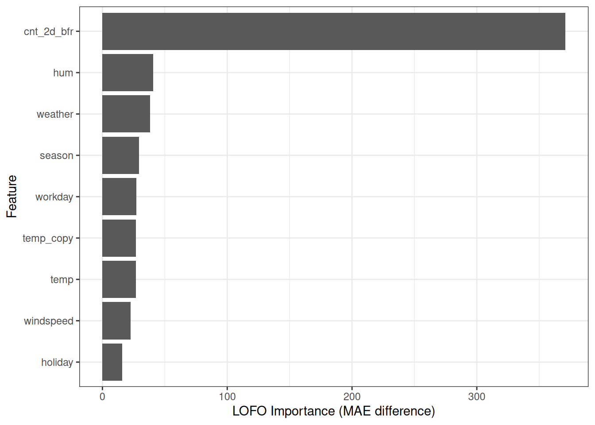
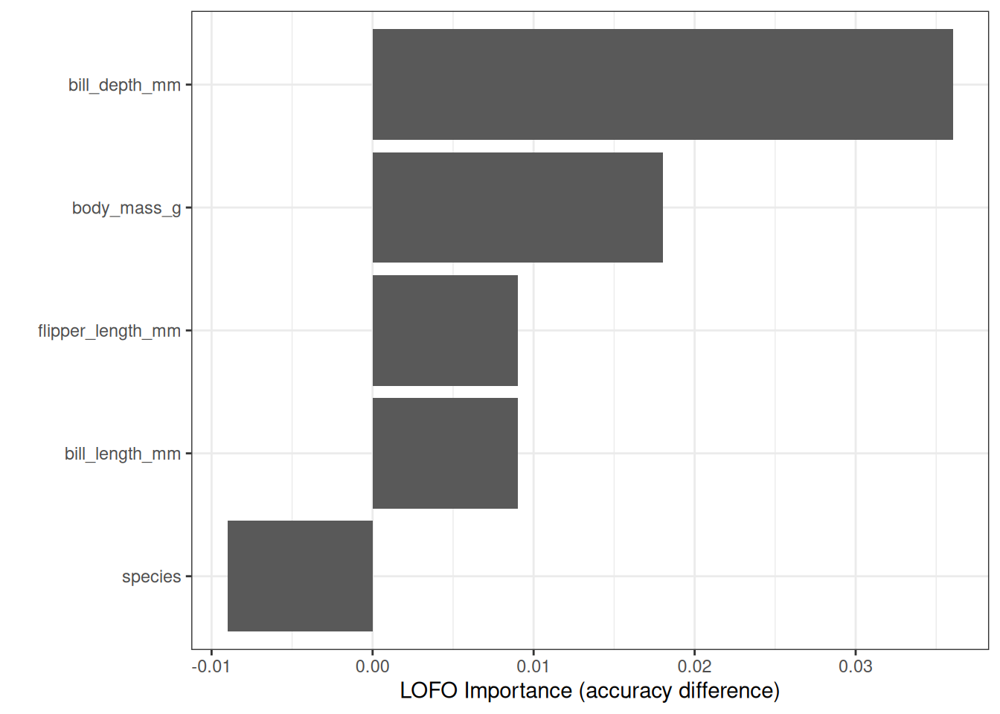

# فصل ۲۴: اهمیت حذف یک ویژگی (LOFO)

> **عنوان اصلی:** Leave One Feature Out (LOFO) Importance  
> **منبع:** [https://christophm.github.io/interpretable-ml-book/lofo.html](https://christophm.github.io/interpretable-ml-book/lofo.html)  
> **نویسنده:** Christoph Molnar  
> **مترجم:** مریم محمودی

---

اهمیت حذف یک ویژگی (Leave One Feature Out Importance؛ LOFO) اهمیت یک ویژگی را با بازآموزی مدل بدون آن ویژگی و مقایسهٔ عملکردهای پیش‌بینی اندازه می‌گیرد.[^loco]

[^loco]: نخستین توصیف رسمی LOFO که من می‌شناسم از [Lei و همکاران (۲۰۱۸)](appendix-D-references.md) است. آن‌ها آن را حذف یک هم‌متغیر (Leave One Covariate Out؛ LOCO) می‌نامند و مقاله بیشتر دربارهٔ آزمون بدون فرض توزیع (distribution-free) است.

شهود پشت اهمیت LOFO این است: اگر حذف یک ویژگی عملکرد پیش‌بینی را بدتر کند، آن ویژگی مهم بوده است.
اگر حذف ویژگی عملکرد را بدون تغییر نگه دارد، مهم نبوده است.
اهمیت LOFO حتی می‌تواند منفی باشد، وقتی حذف ویژگی عملکرد مدل را *بهبود* می‌دهد.
چون الگوریتم یک مدل تازه آموزش می‌دهد، افت عملکرد مشروط به ویژگی‌های دیگری است که در مدل باقی می‌مانند، همان‌طور که در مثال‌ها خواهیم دید.

برای به دست آوردن اهمیت LOCO برای هر $p$ ویژگی، باید مدل را $p$ بار بازآموزی کنیم، هر بار با یک ویژگی متفاوت که از داده‌های آموزش حذف شده است، و عملکرد مدل حاصل را روی داده‌های آزمون اندازه بگیریم.
این LOFO را الگوریتمی کاملاً ساده می‌کند.
بیایید الگوریتم را صورت‌بندی کنیم:

**ورودی:** مدل آموزش‌دیدهٔ $\hat{f}$، داده‌های آموزش $(\mathbf{X}\_{\text{train}}, \mathbf{y}\_{\text{train}})$، داده‌های آزمون $(\mathbf{X}\_{\text{test}}, \mathbf{y}\_{\text{test}})$ و معیار خطای $L$.  
**رویه:**  

1. **خطای مدل اصلی را اندازه بگیرید:**  
   $$e\_{\text{orig}} = \frac{1}{n\_{\text{test}}} \sum\_{i=1}^{n\_{\text{test}}} L\big(y\_{\text{test}}^{(i)}, \hat{f}(\mathbf{x}\_{\text{test}}^{(i)})\big)$$  

2. **برای هر ویژگی $j \in \lbrace 1, \ldots, p \rbrace$:**
   - ویژگی $j$ را از مجموعه‌داده حذف کنید و مجموعه‌دادهٔ تازهٔ $\mathbf{X}\_{\text{train},-j}$ و $\mathbf{X}\_{\text{test},-j}$ را بسازید.  
   - مدل تازهٔ $\hat{f}\_{-j}$ را روی $\left(\mathbf{X}\_{\text{train},-j}, \mathbf{y}\_{\text{train}}\right)$ آموزش دهید.  
   - خطای تازه را روی مجموعهٔ آزمون تغییریافته اندازه بگیرید:  
     $$e\_{-j} = \frac{1}{n\_{\text{test}}} \sum\_{i=1}^{n\_{\text{test}}} L\big(y\_{\text{test}}^{(i)}, \hat{f}\_{-j}(\mathbf{x}\_{\text{test},-j}^{(i)})\big)$$  

3. **اهمیت LOFO را برای هر ویژگی محاسبه کنید.**  
   - به‌صورت خارج‌قسمت:  
     $$LOFO\_j = \frac{e\_{-j}}{e\_{\text{orig}}}$$  
   - یا به‌صورت تفاضل:  
     $$LOFO\_j = e\_{-j} - e\_{\text{orig}}$$  

4. ویژگی‌ها را بر پایهٔ اهمیت $LOFO\_j$ نزولی **مرتب و مصور کنید**.

وقتی به‌جای معیارهای خطا از معیارهای عملکرد استفاده می‌کنید که بزرگ‌تر بهتر است، مانند دقت (accuracy)، مطمئن شوید تفاضل را در ۱- ضرب کنید، یا ترتیب خارج‌قسمت را عوض کنید.
برای آموزش و بازآموزی مدل از داده‌های آموزش و برای اندازه‌گیری عملکرد از داده‌های آزمون استفاده کنید.

> **توضیح مترجم:** در متن منبع در جملهٔ دوم بند بالای الگوریتم عبارت «اهمیت LOCO» آمده، در حالی که در همهٔ جاهای دیگر نام LOFO به کار می‌رود؛ هر دو یک روش‌اند (LOCO نام اصلی مقاله و LOFO نام رایج‌تر است) و متن عیناً حفظ شد. $\hat{f}\_{-j}$ مدلی است که بدون ویژگی $j$ آموزش دیده و $e\_{-j}$ خطای آن روی داده‌های آزمونِ بدون ستون $j$ است.

> **برای درک بهتر (توضیح مترجم):** فرض کنید با همهٔ ویژگی‌ها خطای میانگین قدر مطلق (MAE) روی داده‌های آزمون $e\_{\text{orig}} = 400$ باشد. مدل را بدون «دما» دوباره آموزش می‌دهیم و MAE آن ۵۱۰ می‌شود: $LOFO = 510 - 400 = 110$ (یا خارج‌قسمت $510/400 = 1.275$). بدون «روز تعطیل» مدل جدید ۳۸۰ می‌شود: $LOFO = 380 - 400 = -20$، یعنی حذف این ویژگی عملکرد را بهتر کرد، و اهمیت منفی است. این دو عدد همان چیزی است که شکل ۲۴.۱ نشان می‌دهد. (اعداد برای توضیح فرض شده‌اند.)

## مثال‌ها

تعداد اجارهٔ دوچرخه را بر پایهٔ اطلاعات آب‌وهوا و تقویم با یک جنگل تصادفی که روی ۲/۳ داده‌ها آموزش دیده پیش‌بینی می‌کنیم.
شکل ۲۴.۱ نشان می‌دهد دما و تعداد اجارهٔ دوچرخهٔ قبلی بر اساس LOFO مهم‌ترین ویژگی‌ها هستند.
ویژگی تعطیلی (holiday) اهمیت منفی دارد، که برای انتخاب ویژگی پیامد دارد:
به‌دلیل نحوهٔ کار الگوریتمی LOFO، اکنون می‌دانیم حذف ویژگی تعطیلی عملکرد مدل را افزایش می‌دهد.

> **توضیح مترجم (متن داخل تصویر):** نمودار میله‌ای افقی با برچسب محور افقی `LOFO Importance (MAE difference)` (اهمیت LOFO، تفاضل MAE) و برچسب محور عمودی `Feature` (ویژگی) است. ویژگی‌ها از بالا به پایین: `cnt_2d_bfr` (تعداد دوچرخهٔ دو روز قبل، حدود ۳۸۰)، `temp` (دما، حدود ۱۰۸)، `weather` (وضعیت هوا، کمی مثبت)، `hum` (رطوبت)، `windspeed` (سرعت باد)، `season` (فصل)، `workday` (روز کاری، اندکی منفی) و `holiday` (تعطیلی، حدود ۲۰- ، منفی). نوشته‌های انگلیسی تصویر بدون تغییر ماندند. **ناهمخوانی منبع:** زیرنویس این شکل در منبع از `temp_copy` سخن می‌گوید، اما تصویر ویژگی `temp_copy` ندارد؛ زیرنویس‌های شکل‌های ۲۴.۱ و ۲۴.۲ در منبع جابه‌جا شده‌اند (این تصویر مدل اصلی و شکل ۲۴.۲ مدل با دمای تکراری است). زیرنویس‌ها عیناً ترجمه شدند.

> **برای درک بهتر (توضیح مترجم):** «اهمیت منفی» یعنی مدل بدون آن ویژگی روی داده‌های آزمون بهتر بود. دلیل ممکن این است که ویژگی تقریباً نویز است و جنگل تصادفی گاهی با آن بیش‌برازش می‌کند؛ حذفش واریانس را کم می‌کند. چون LOFO بر اثر یک آموزش مجدد با تصادفی‌بودن الگوریتم هم سنجیده می‌شود، مقدارهای خیلی نزدیک صفر (مثل `windspeed` و `season`) را نباید دقیق تفسیر کرد.

بیایید چیزی را امتحان کنیم.
برای شبیه‌سازی یک نسخهٔ افراطی از ویژگی‌های همبسته، یک مجموعه‌دادهٔ دوچرخهٔ تازه ساختم که دو ستون دما دارد: `temp` و `temp_copy`.
و، حدس زدید، `temp_copy` دقیقاً همان مقادیر `temp` را دارد، یعنی همبستگی ۱۰۰٪.
دوباره یک جنگل تصادفی روی این مجموعه‌دادهٔ تازه آموزش دادم.
ببینیم بر سر اهمیت‌های LOFO چه می‌آید.

> **توضیح مترجم (متن داخل تصویر):** همان محورها و ترتیب شکل ۲۴.۱ با یک ویژگی اضافه: `cnt_2d_bfr` (حدود ۳۷۰)، `hum`، `weather`، `season`، `workday`، `temp_copy`، `temp`، `windspeed` و `holiday`. نکتهٔ شکل: هر دو `temp_copy` و `temp` تقریباً هم‌اندازه‌اند (حدود ۲۶ تا ۲۷) و به‌جای دومین ویژگی مهم در شکل ۲۴.۱ اکنون در میانهٔ فهرست‌اند؛ همین است که متن می‌گوید اهمیت LOFO هر دو تقریباً صفر (در مقایسه با `cnt_2d_bfr`) است. نوشته‌های انگلیسی تصویر بدون تغییر ماندند.

شکل ۲۴.۲ پدیدهٔ جالبی را نشان می‌دهد:
اهمیت‌های LOFO هر دو ویژگی دما اکنون تقریباً صفر است.[^not-same-lofo]
اما اگر مثلاً `temp_copy` را حذف کنیم، به مدل اصلی می‌رسیم، که می‌دانستیم `temp` مهم‌ترین ویژگی آن بود.
روشن است که نتیجه‌گیری اینکه این مدل تازه اصلاً به دما تکیه نمی‌کند اشتباه است.
هر دو `temp` و `temp_copy` اهمیت پایینی می‌گیرند، چون بنا به تعریف اهمیت LOFO، مهم نیستند.
وقتی ویژگی `temp` را حذف می‌کنیم، هیچ اطلاعاتی را از دست نمی‌دهیم.
دلیلش این است که LOFO تفسیری شرطی دارد: با داشتن ویژگی‌های دیگر، حذف یک ویژگی عملکرد پیش‌بینی مدل را چقدر بدتر می‌کند؟
نتیجه‌گیری‌ها:

- اهمیت LOFO ویژگی‌های به‌شدت همبسته همیشه پایین است، حتی احتمالاً منفی[^learner-ability]، چون اهمیت LOFO باید به‌صورت شرطی بر اطلاعات ارائه‌شده با ویژگی‌های دیگر تفسیر شود. و اگر از قبل یک ویژگی دما در داده‌ها دارید، نسخهٔ کاملاً یکسان همان ویژگی اطلاعات اضافی مهمی نیست.
- وقتی از اهمیت LOFO به‌عنوان اطلاعات برای انتخاب ویژگی استفاده می‌کنید، مراقب تفسیر باشید: LOFO فقط نشان می‌دهد عملکرد مدل با حذف *تک‌تک* ویژگی‌ها چگونه واکنش نشان می‌دهد. همان‌طور که شکل ۲۴.۲ نشان داد، LOFO دربارهٔ اینکه با حذف هم‌زمان ۲ ویژگی یا بیشتر عملکرد چگونه تغییر می‌کند اطلاعاتی نمی‌دهد.

[^not-same-lofo]: ویژگی‌های `temp` و `temp_copy` اهمیت‌های LOFO مشابه اما نه یکسان دارند، که به تصادفی‌بودن آموزش مدل برمی‌گردد.

[^learner-ability]: در اینجا باید فرض کنیم یادگیرنده می‌تواند حذف یک ویژگی را با تکیهٔ بیشتر بر ویژگی‌های دیگر جبران کند. اما من هیچ الگوریتم یادگیری ماشینی را نمی‌شناسم که چنین توانایی‌ای نداشته باشد.

> **برای درک بهتر (توضیح مترجم):** دلیل پایین‌بودن اهمیت را با عدد ببینید. مدل اصلی با `temp` خطای ۴۰۰ دارد. اگر `temp` را در مدل با دو ستون دما حذف کنیم، `temp_copy` هنوز همان اطلاعات را دارد و خطا تقریباً ۴۰۰ می‌ماند؛ پس $LOFO \approx 0$. اگر هر دو ستون دما را با هم حذف کنیم (که LOFO تک‌ویژگی نمی‌سنجد)، خطا مثلاً ۵۱۰ می‌شود. LOFO این افت واقعی را نمی‌بیند، همان نکتهٔ دوم فهرست بالا: برای حذف هم‌زمان دو ویژگی باید جداگانه آزمایش کرد (مثلاً با نسخهٔ LTFO در بخش نقاط قوت). (اعداد برای توضیح‌اند.)

با این دانش، بیایید LOFO را برای یک جنگل تصادفی که جنسیت پنگوئن را از روی اندازه‌گیری‌های بدن پیش‌بینی می‌کند امتحان کنیم.
برای این کار یک جنگل تصادفی را روی ۲/۳ داده‌ها آموزش دادم و ۱/۳ داده‌ها را برای تخمین خطا کنار گذاشتم.
شکل ۲۴.۳ نشان می‌دهد عمق منقار (bill depth) بر اساس LOFO مهم‌ترین ویژگی بود.

> **توضیح مترجم (متن داخل تصویر):** برچسب محور افقی `LOFO Importance (accuracy difference)` یعنی «اهمیت LOFO (تفاضل دقت)» و محور عمودی برچسب ندارد. ویژگی‌ها از بالا: `bill_depth_mm` (عمق منقار، حدود ۰٫۰۳۶)، `body_mass_g` (توده بدنی، حدود ۰٫۰۱۸)، `flipper_length_mm` (طول بال، حدود ۰٫۰۰۹)، `bill_length_mm` (طول منقار، حدود ۰٫۰۰۹) و `species` (گونه، حدود ۰٫۰۰۹- ، منفی). مقادیر از روی شکل تقریبی‌اند. نوشته‌های انگلیسی تصویر بدون تغییر ماندند.

توجه کنید که چون اینجا از دقت استفاده شده که بزرگ‌تر بهتر است، اهمیت را در منفی یک ضرب کردم.
LOFO همچنین به ما می‌گوید می‌توانیم ویژگی‌های `species` و `flipper_length` را با اطمینان حذف کنیم.
با این حال، می‌خواهیم `species` را نگه داریم، چون مدل باید بتواند میان گونه‌ها تمایز قائل شود.

> **توضیح مترجم:** در شکل ۲۴.۳ ویژگی `species` اهمیت منفی دارد (حذفش دقت را اندکی بالا می‌برد) اما `flipper_length_mm` اهمیت کوچک مثبت (حدود ۰٫۰۰۹، هم‌اندازهٔ `bill_length_mm`) دارد؛ بنابراین جملهٔ منبع دربارهٔ حذف‌پذیری `flipper_length` با شکل چندان هم‌خوان نیست و عیناً ترجمه شد. همچنین نام ویژگی در متن `flipper_length` و در شکل `flipper_length_mm` است. تعداد نمونه‌های آزمون کم است (حدود یک‌سوم ۳۴۴ پنگوئن)، پس تفاوت‌های حدود ۰٫۰۰۹ معادل تقریباً یک نمونه است و نباید زیاد تفسیر شود.

## LOFO در برابر PFI

LOFO با سایر روش‌های ارائه‌شده در این کتاب متفاوت است، زیرا اکثر روش‌های دیگر نیازی به بازآموزش مدل ندارند. می‌توان گفت LOFO یک روش پس‌از‌آموزش (post-hoc) و مدل‌آزاد (model-agnostic) است؛ چون روی هر مدلی قابل اعمال است و بازآموزش، مدل اصلی موردنظر را تغییر نمی‌دهد. اما به دلیل بازآموزش، تفسیر از تحلیل یک مدل واحد به تفسیر الگوریتم یادگیری و نحوه واکنش آموزش مدل به تغییرات ویژگی‌ها تغییر می‌کند.

به نظر من، بزرگ‌ترین سؤال این است: LOFO چه تفاوتی با PFI دارد و کِی باید از کدام استفاده کرد؟ ابتدا شباهت‌ها: هر دو PFI و LOFO معیارهای اهمیت مبتنی بر عملکرد هستند؛ هر دو اهمیت را با «حذف» اطلاعات یک ویژگی محاسبه می‌کنند، هرچند به روش‌های متفاوت؛ و هر دو در ساده‌ترین نسخه‌شان به صورت یک‌به‌یک عمل می‌کنند. اما در جنبه‌های دیگری با هم فرق دارند. همان‌طور که در شکل ۲۴.۲ دیدیم، LOFO تفسیر شرطی از اهمیت دارد و فقط ارزش پیش‌بینی اضافی یک ویژگی را نشان می‌دهد. این ویژگی، LOFO را از PFI حاشیه‌ای (marginal PFI) متمایز می‌کند. LOFO بیشتر شبیه PFI شرطی (conditional PFI) است و هر دو تفسیرهایی مشروط بر سایر ویژگی‌ها دارند.

اما از آنجا که PFI شرطی و LOFO به شیوه‌های متفاوتی کار می‌کنند، در تفسیرهایشان نیز تفاوت دارند. PFI شرطی تفسیری است که تنها مدل موردنظر را در بر می‌گیرد. اهمیت LOFO بیشتر بر الگوریتم یادگیری ماشین تمرکز دارد، زیرا شامل بازآموزش است و تفسیر حالا چندین مدل با آموزش‌های متفاوت را دربر می‌گیرد. این بدان معناست که اهمیت LOFO تحت تأثیر نحوه برخورد الگوریتم با یک مجموعه داده فاقد آن ویژگی قرار می‌گیرد. یک الگوریتم درخت تصمیم ممکن است درخت کاملاً متفاوتی تولید کند. بنابراین تفسیر LOFO هم درباره مدل موردنظر است و هم درباره الگوریتم یادگیری ماشین و نحوه واکنش آن به حذف یک ویژگی.

## نقاط قوت

**پیاده‌سازی LOFO ساده است.** مثال‌های این فصل دقیقاً با همین رویکرد ساخته شده‌اند. می‌توانید خودتان آن را پیاده‌سازی کنید و نیازی به هیچ بسته‌ای ندارید.

LOFO **برای انتخاب ویژگی مفید است:** یک ویژگی با اهمیت LOFO زیر صفر را می‌توان حذف کرد تا عملکرد مدل بهبود یابد؛ یک ویژگی با اهمیت صفر نیز بدون تأثیر بر عملکرد قابل حذف است. با این حال، توجه داشته باشید که LOFO تحت تأثیر تصادفی بودن فرآیند آموزش و نمونه داده قرار دارد. مطمئن شوید که هر بار تنها یک ویژگی را بر اساس نتایج LOFO حذف می‌کنید. اگر می‌خواهید دو ویژگی را حذف کنید، باید این کار را به صورت متوالی انجام دهید: اهمیت LOFO را محاسبه کنید، ویژگی کم‌اهمیت را حذف کنید، LOFO را دوباره محاسبه کنید، و دوباره کم‌اهمیت‌ترین را حذف کنید. همچنین می‌توانید LOFO را به LTFO (حذف دو ویژگی) گسترش دهید تا اهمیت مشترک را محاسبه کنید. سایر روش‌های اهمیت‌سنجی، مانند PFI یا اهمیت SHAP، مستقیماً اطلاعات کاربردی برای انتخاب ویژگی ارائه نمی‌دهند.

LOFO **برخلاف برخی روش‌ها مانند PFI حاشیه‌ای، داده‌های غیرواقع‌بینانه تولید نمی‌کند**؛ زیرا ویژگی را حذف می‌کند و مدل را با داده‌های نمونه‌برداری‌شده جدید آزمایش نمی‌کند.

LOFO **در مرحله مدل‌سازی به دلیل بینش‌های کاربردی برای انتخاب ویژگی مفید است.** همچنین وقتی تمرکز بیشتر بر **درک پدیده زیربنایی** باشد تا خود مدل، ارزش دارد. با این حال، توجه داشته باشید که نحوه واکنش الگوریتم خاص به حذف ویژگی‌ها نیز بر مقادیر اهمیت LOFO تأثیر می‌گذارد.

LOFO زمانی معنا می‌دهد که هدف تفسیر، فهمیدن پدیده (نه خود مدل) یا رفتار الگوریتم یادگیری باشد.

## محدودیت‌ها

**LOFO پرهزینه است:** برای محاسبه اهمیت LOFO همه ویژگی‌ها، باید مدل را $p$ بار بازآموزش دهید. این می‌تواند گران‌قیمت باشد، به‌ویژه در مقایسه با اهمیت ویژگی با جایگشت (PFI).

LOFO **بهترین روش برای درک یک مدل خاص نیست.** در سناریوی ممیزی مدل، LOFO مناسب نیست، زیرا تفسیر بر پایه آموزش مدل‌های جدید است. یعنی نتایج نه‌تنها بر مدل موردبررسی بلکه بر سایر مدل‌های تولیدشده توسط الگوریتم یادگیری ماشین نیز مبتنی‌اند و باید در قالب رفتار الگوریتم تفسیر شوند.

همچنین **کمی مبهم است که چگونه باید تنظیم هایپرپارامترها (hyperparameter tuning) را مدیریت کرد:** آیا باید با همان هایپرپارامترهای اولیه آموزش داد، یا بهینه‌سازی هایپرپارامترها را از نو اجرا کرد؟ ثابت نگه داشتن هایپرپارامترها از نظر محاسباتی ارزان‌تر است و تمرکز LOFO را بیشتر به سمت همان مدل می‌برد، زیرا مدل‌های جدید احتمالاً به آن شبیه‌تر خواهند بود. اجرای بهینه‌سازی هایپرپارامترها برای هر یک از $p$ مدل پرهزینه است، اما نتایج LOFO را برای انتخاب ویژگی و کشف روابط میان ویژگی‌ها و متغیر هدف اطلاعات‌رسان‌تر می‌کند، زیرا عدم‌قطعیت ناشی از خطاهای مدل کاهش می‌یابد.

**ویژگی‌های کاملاً همبسته اهمیت LOFO پایینی می‌گیرند.** این نتیجه طبیعی نحوه کار LOFO است، اما دامی است که هنگام نگاه به نمودارهای اهمیت به‌راحتی فراموش می‌شود. پیش از تفسیر اهمیت‌های LOFO، بررسی ساختار همبستگی داده‌ها ضروری است. همچنین می‌توانید ویژگی‌های کاملاً همبسته را گروه‌بندی کنید و آن‌ها را با هم حذف کنید تا تفسیر از شرطی به حاشیه‌ای تبدیل شود.

## نرم‌افزار و جایگزین‌ها

LOFO یک [پیاده‌سازی پایتون](https://github.com/aerdem4/lofo-importance) دارد. البته این الگوریتمی است که به‌راحتی می‌توانید خودتان پیاده‌سازی کنید.

جایگزین LOFO، PFI شرطی است. همچنین می‌توان به جای حذف ویژگی، نسخه جایگشت‌یافته آن را اضافه کرد و سپس مدل جدیدی آموزش داد. این رویکرد مزیت مقایسه دو مدل با تعداد ویژگی یکسان را دارد، اما منبع دیگری از عدم‌قطعیت معرفی می‌کند (زیرا خود جایگشت تصادفی است).

روش انتخاب ویژگی «انتخاب ویژگی متوالی رو به عقب» (backward sequential feature selection) اساساً همان LOFO است که با حذف متوالی ویژگی‌ها ترکیب شده است.

---

[^1]: اولین توصیف رسمی LOFO که از آن آگاهم، توسط Lei و همکاران (۲۰۱۸) ارائه شده است. آن‌ها این روش را Leave One Covariate Out (LOCO) می‌نامند و مقاله عمدتاً درباره آزمون توزیع‌آزاد (distribution-free testing) است.

[^2]: ویژگی‌های temp و temp_copy اهمیت‌های LOFO مشابه اما نه برابر دارند که به دلیل تصادفی بودن فرآیند آموزش مدل است.

[^3]: در اینجا باید فرض کنیم که الگوریتم یادگیری با تکیه بیشتر بر سایر ویژگی‌ها می‌تواند حذف یک ویژگی را جبران کند. از هیچ الگوریتم یادگیری ماشینی که این توانایی را نداشته باشد آگاه نیستم.
