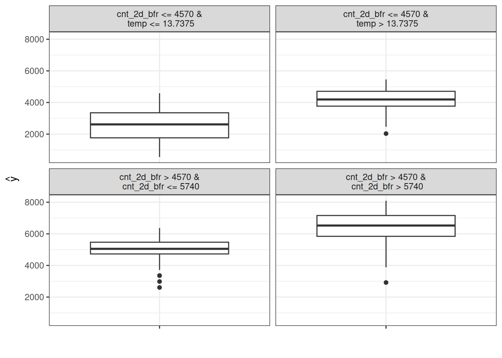
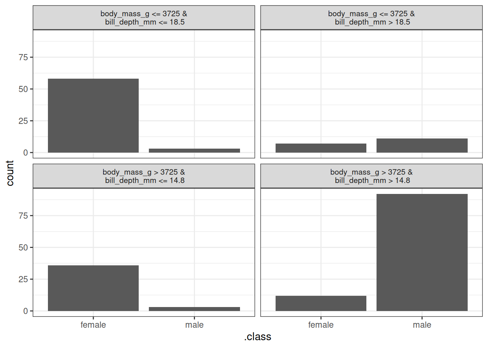

# فصل ۲۵: مدل‌های نیابتی (Surrogate Models)

> **عنوان اصلی:** Surrogate Models  
> **منبع:** [https://christophm.github.io/interpretable-ml-book/global.html](https://christophm.github.io/interpretable-ml-book/global.html)  
> **نویسنده:** Christoph Molnar  
> **مترجم:** مریم محمودی

---

یک مدل نیابتی سراسری (global surrogate model) یک مدل تفسیرپذیر است که برای تقریب پیش‌بینی‌های یک مدل جعبه‌سیاه آموزش داده می‌شود.
با تفسیر مدل نیابتی می‌توانیم دربارهٔ مدل جعبه‌سیاه نتیجه‌گیری کنیم.
حل تفسیرپذیری یادگیری ماشین با استفاده از یادگیری ماشین بیشتر!

> **توضیح مترجم:** «نیابتی» (surrogate) یعنی «جانشین»: مدلی ساده که به‌جای مدل پیچیده بررسی می‌شود. «جعبه‌سیاه» (black box) مدلی است که درونش را نمی‌توان مستقیم خواند، مثل جنگل تصادفی یا شبکهٔ عصبی. «سراسری» (global) یعنی تقریب روی همهٔ داده‌ها، نه برای یک نمونهٔ خاص.

## نظریه

مدل‌های نیابتی در مهندسی هم به کار می‌روند:
اگر نتیجهٔ مورد علاقه گران، زمان‌بر یا به‌طور دیگری اندازه‌گیری‌اش دشوار باشد (مثلاً چون از یک شبیه‌سازی رایانه‌ای پیچیده می‌آید)، می‌توان به‌جای آن از یک مدل نیابتی ارزان و سریع برای آن نتیجه استفاده کرد.
تفاوت مدل‌های نیابتی در مهندسی و در یادگیری ماشین تفسیرپذیر این است که مدل زیربنایی یک مدل یادگیری ماشین (نه یک شبیه‌سازی) است و مدل نیابتی باید تفسیرپذیر باشد.
هدف مدل‌های نیابتی (تفسیرپذیر) این است که پیش‌بینی‌های مدل زیربنایی را تا حد ممکن دقیق تقریب بزنند و هم‌زمان تفسیرپذیر باشند.
ایدهٔ مدل‌های نیابتی با نام‌های مختلفی یافت می‌شود:
مدل تقریبی (approximation model)، فرامدل (metamodel)، مدل سطح پاسخ (response surface model)، شبیه‌ساز (emulator) و غیره.

دربارهٔ نظریه:
در واقع برای فهمیدن مدل‌های نیابتی نظریهٔ زیادی لازم نیست.
می‌خواهیم تابع پیش‌بینی جعبه‌سیاه $f$ را تا حد ممکن با تابع پیش‌بینی مدل نیابتی $g$ تقریب بزنیم، با این قید که $g$ تفسیرپذیر باشد.
برای تابع $g$ می‌توان از هر مدل تفسیرپذیری استفاده کرد.

برای مثال، یک مدل خطی:

$$g(\mathbf{x}) = \beta\_0 + \beta\_1 x\_1 + \ldots + \beta\_p x\_p$$

یا یک درخت تصمیم:

$$g(\mathbf{x}) = \sum\_{m=1}^M c\_m I\lbrace \mathbf{x} \in R\_m \rbrace$$

آموزش یک مدل نیابتی روشی مستقل از مدل (model-agnostic) است، چون به هیچ اطلاعاتی دربارهٔ سازوکار درونی مدل جعبه‌سیاه نیاز ندارد؛ فقط دسترسی به داده‌ها و تابع پیش‌بینی لازم است.
اگر مدل یادگیری ماشین زیربنایی با مدل دیگری جایگزین شود، باز هم می‌توانید از روش نیابتی استفاده کنید.
انتخاب نوع مدل جعبه‌سیاه و نوع مدل نیابتی از هم جدا (decoupled) است.

> **توضیح مترجم:** در فرمول درخت، $R\_m$ ناحیهٔ $m$-ام (برگ $m$-ام) فضای ویژگی، $c\_m$ مقدار پیش‌بینی ثابت آن برگ، و $I\lbrace \cdot \rbrace$ تابع نشانگر است که اگر $\mathbf{x}$ در آن ناحیه باشد ۱ و در غیر این صورت ۰ می‌شود. منبع این نمادها را جداگانه تعریف نمی‌کند.

برای به دست آوردن یک مدل نیابتی این مراحل را انجام دهید:

1. یک مجموعه‌داده $\mathbf{X}$ را انتخاب کنید.
این می‌تواند همان مجموعه‌داده‌ای باشد که برای آموزش مدل جعبه‌سیاه به کار رفت یا یک مجموعه‌دادهٔ تازه از همان توزیع.
حتی می‌توانید بسته به کاربردتان زیرمجموعه‌ای از داده‌ها یا شبکه‌ای از نقاط را انتخاب کنید.
2. برای مجموعه‌دادهٔ انتخاب‌شدهٔ $\mathbf{X}$، پیش‌بینی‌های مدل جعبه‌سیاه را بگیرید.
3. یک نوع مدل تفسیرپذیر (مدل خطی، درخت تصمیم، ...) انتخاب کنید.
4. مدل تفسیرپذیر را روی مجموعه‌دادهٔ $\mathbf{X}$ و پیش‌بینی‌های آن آموزش دهید.
5. تبریک! اکنون یک مدل نیابتی دارید.
6. اندازه بگیرید مدل نیابتی پیش‌بینی‌های مدل جعبه‌سیاه را چقدر خوب بازتولید می‌کند.
7. مدل نیابتی را تفسیر کنید.

ممکن است رویکردهایی برای مدل‌های نیابتی بیابید که مراحل اضافه دارند یا اندکی فرق می‌کنند، اما ایدهٔ کلی معمولاً همان است که در اینجا شرح داده شد.

> **برای درک بهتر (توضیح مترجم):** مراحل را با یک مثال خیالی دنبال کنید. یک جنگل تصادفی داریم که قیمت خانه را پیش‌بینی می‌کند. ۱) همان ۱۰۰۰ خانهٔ آموزش را برمی‌داریم. ۲) از جنگل برای هر خانه پیش‌بینی قیمت می‌گیریم (۱۰۰۰ عدد). ۳) رگرسیون خطی را انتخاب می‌کنیم. ۴) رگرسیون خطی را روی ۱۰۰۰ خانه با این ۱۰۰۰ پیش‌بینی (نه قیمت واقعی) برازش می‌دهیم. ۶) $R^2$ را حساب می‌کنیم. ۷) ضرایب را می‌خوانیم؛ مثلاً «به ازای هر متر مربع، پیش‌بینی جنگل به‌طور میانگین ۲ واحد بالا می‌رود». نکتهٔ مهم: هدف رگرسیون، پیش‌بینی جنگل است و نه قیمت واقعی.

یک راه برای اندازه‌گیری اینکه نیابتی مدل جعبه‌سیاه را چقدر خوب بازتولید می‌کند، معیار R-مجذور (R-squared) است:

$$R^2=1 - \frac{SSE}{SST} = 1 - \frac{\sum\_{i=1}^n (\hat{y}\_\*^{(i)} - \hat{y}^{(i)})^2}{\sum\_{i=1}^n (\hat{y}^{(i)} - \bar{\hat{y}})^2}$$

که در آن $\hat{y}\_\*^{(i)}$ پیش‌بینی مدل نیابتی برای نمونهٔ $i$-ام، $\hat{y}^{(i)}$ پیش‌بینی مدل جعبه‌سیاه و $\bar{\hat{y}}$ میانگین پیش‌بینی‌های مدل جعبه‌سیاه است.
SSE مخفف مجموع مربعات خطا (sum of squares error) و SST مخفف مجموع مربعات کل (sum of squares total) است.
معیار R-مجذور را می‌توان به‌صورت درصد واریانسی تفسیر کرد که مدل نیابتی می‌گیرد.
اگر R-مجذور نزدیک ۱ باشد (= SSE پایین)، مدل تفسیرپذیر رفتار مدل جعبه‌سیاه را بسیار خوب تقریب می‌زند.
اگر مدل تفسیرپذیر بسیار نزدیک باشد، ممکن است بخواهید مدل پیچیده را با مدل تفسیرپذیر جایگزین کنید.
اگر R-مجذور نزدیک ۰ باشد (= SSE بالا)، مدل تفسیرپذیر نمی‌تواند مدل جعبه‌سیاه را توضیح دهد.

توجه کنید که دربارهٔ عملکرد مدل زیربنایی جعبه‌سیاه صحبت نکرده‌ایم، یعنی اینکه در پیش‌بینی نتیجهٔ واقعی چقدر خوب یا بد عمل می‌کند.
عملکرد مدل جعبه‌سیاه در آموزش مدل نیابتی نقشی ندارد.
تفسیر مدل نیابتی همچنان معتبر است، چون دربارهٔ مدل اظهار می‌کند و نه دربارهٔ دنیای واقعی.
اما البته اگر مدل جعبه‌سیاه بد باشد، تفسیر مدل نیابتی بی‌ربط می‌شود، چون در این صورت خود مدل جعبه‌سیاه بی‌ربط است.

> **برای درک بهتر (توضیح مترجم):** فرض کنید مدل جعبه‌سیاه برای ۴ نمونه پیش‌بینی $(10, 20, 30, 40)$ می‌دهد و مدل نیابتی $(12, 18, 33, 37)$. میانگین جعبه‌سیاه ۲۵ است، پس $SST = (10-25)^2 + (20-25)^2 + (30-25)^2 + (40-25)^2 = 225 + 25 + 25 + 225 = 500$. $SSE = (12-10)^2 + (18-20)^2 + (33-30)^2 + (37-40)^2 = 4 + 4 + 9 + 9 = 26$. بنابراین $R^2 = 1 - 26/500 = 0.948$: مدل نیابتی حدود ۹۵٪ از واریانس پیش‌بینی‌های جعبه‌سیاه را بازتولید می‌کند. اگر نیابتی پیش‌بینی ثابت ۲۵ می‌داد، $SSE = SST$ و $R^2 = 0$ می‌شد. (اعداد فرضی‌اند.)

می‌توانیم یک مدل نیابتی را بر پایهٔ زیرمجموعه‌ای از داده‌های اصلی هم بسازیم یا نمونه‌ها را وزن‌دهی مجدد کنیم.
به این ترتیب توزیع ورودی مدل نیابتی را تغییر می‌دهیم، که تمرکز تفسیر را تغییر می‌دهد (آنگاه دیگر واقعاً سراسری نیست).
اگر داده‌ها را به‌صورت محلی بر پایهٔ یک نمونهٔ مشخص از داده‌ها وزن‌دهی کنیم (هرچه نمونه‌ها به نمونهٔ انتخاب‌شده نزدیک‌تر باشند وزن بیشتری می‌گیرند)، یک مدل نیابتی محلی (local surrogate) به دست می‌آوریم که می‌تواند پیش‌بینی منفرد آن نمونه را توضیح دهد.

> **توضیح مترجم:** همین ایدهٔ وزن‌دهی محلی پایهٔ روش [LIME](14-lime.md) است که در فصل پیش‌تر دیدید. در منبع در این بند به نام LIME ارجاعی نیامده؛ این پیوند افزودهٔ مترجم برای کمک به خواننده است.

## مثال

برای نمایش مدل‌های نیابتی، یک مثال رگرسیون و یک مثال طبقه‌بندی را بررسی می‌کنیم.

ابتدا یک ماشین بردار پشتیبان (support vector machine) را برای پیش‌بینی [تعداد روزانهٔ دوچرخه‌های اجاره‌شده](05-data.md) با داشتن اطلاعات آب‌وهوا و تقویم آموزش می‌دهیم.
ماشین بردار پشتیبان چندان تفسیرپذیر نیست، پس یک مدل نیابتی با یک درخت تصمیم CART به‌عنوان مدل تفسیرپذیر، با استفاده از داده‌های آموزش اصلی، آموزش می‌دهیم تا رفتار ماشین بردار پشتیبان را تقریب بزند.
مدل نیابتی نشان‌داده‌شده در شکل ۲۵.۱ روی داده‌های آزمون R-مجذور (واریانس توضیح‌داده‌شده) برابر مقدار محاسبه‌شده در زمان ساخت کتاب دارد، که یعنی رفتار جعبه‌سیاه زیربنایی را کاملاً خوب اما نه کامل تقریب می‌زند.
اگر برازش کامل بود، می‌توانستیم ماشین بردار پشتیبان را کنار بگذاریم و به‌جای آن از درخت استفاده کنیم.
توزیع‌های درون گره‌ها نشان می‌دهند درخت نیابتی وقتی دما بالای ۱۳ درجهٔ سلسیوس است و وقتی تعداد دو روز قبل بیشتر بوده، تعداد دوچرخه‌های اجاره‌شدهٔ بیشتری پیش‌بینی می‌کند.

> **توضیح مترجم:** در منبع مقدار R-مجذور (و مقدار R-مجذور مثال پنگوئن) با کد R در زمان ساخت کتاب در متن درج می‌شود (`r rsq`) و در متن ثابت منبع عددی نیامده است؛ بنابراین عدد در ترجمه ذکر نشد و به‌جای حدس زدن آن، به همین توضیح بسنده شد. جملهٔ «درخت دما بالای ۱۳ درجه» در شکل ۲۵.۱ با آستانهٔ حدود ۱۳٫۷ درجه فقط در شاخهٔ تعداد کم دو روز قبل ($\le 4570$) دیده می‌شود.

> **توضیح مترجم (متن داخل تصویر):** چهار نمودار جعبه‌ای (boxplot)، یکی برای هر گره پایانی درخت. عنوان هر نمودار شرط مسیر درخت است: بالا-چپ `cnt_2d_bfr <= 4570 & temp <= 13.7375` (تعداد دوچرخهٔ دو روز قبل حداکثر ۴۵۷۰ و دما حداکثر ۱۳٫۷۳۷۵)؛ بالا-راست `cnt_2d_bfr <= 4570 & temp > 13.7375`؛ پایین-چپ `cnt_2d_bfr > 4570 & cnt_2d_bfr <= 5740`؛ پایین-راست `cnt_2d_bfr > 4570 & cnt_2d_bfr > 5740`. محور عمودی `ŷ` (پیش‌بینی ماشین بردار پشتیبان برای تعداد دوچرخه) است. میانهٔ جعبه‌ها حدود ۲۶۰۰ (بالا-چپ)، ۴۲۰۰ (بالا-راست)، ۵۰۰۰ (پایین-چپ) و ۶۵۰۰ (پایین-راست) است. مقادیر از روی شکل تقریبی خوانده شده‌اند. نوشته‌های انگلیسی تصویر بدون تغییر ماندند.

> **برای درک بهتر (توضیح مترجم):** چگونه با این درخت یک پیش‌بینی بگیریم؟ روزی را در نظر بگیرید که دو روز قبل ۳۰۰۰ دوچرخه اجاره شده و دما ۲۰ درجه است. شرط اول: $3000 \le 4570$ برقرار است. شرط دوم: دما $20 > 13.74$. پس به گرهٔ بالا-راست می‌رسیم و مدل نیابتی حدود ۴۲۰۰ دوچرخه (میانهٔ جعبه) پیش‌بینی می‌کند. همین پیش‌بینی را خود درخت از «قاعده‌ای ساده» می‌دهد، در حالی که ماشین بردار پشتیبان آن را با محاسبات پیچیده می‌دهد.

در مثال دوم، [جنسیت (ماده یا نر) پنگوئن](05-data.md) را با یک جنگل تصادفی طبقه‌بندی می‌کنیم، دوباره یک درخت تصمیم را روی مجموعه‌دادهٔ اصلی آموزش می‌دهیم، اما با پیش‌بینی جنگل تصادفی به‌عنوان نتیجه، به‌جای طبقه‌های واقعی (نر/ماده) داده‌ها.
مدل نیابتی نشان‌داده‌شده در شکل ۲۵.۲ R-مجذور (واریانس توضیح‌داده‌شده) برابر مقدار محاسبه‌شده در زمان ساخت کتاب دارد، که یعنی جنگل تصادفی را تا حدی تقریب می‌زند، اما نه کامل.

> **توضیح مترجم (متن داخل تصویر):** چهار نمودار میله‌ای، یکی برای هر گره پایانی (درخت با عمق ۲). عنوان‌ها: بالا-چپ `body_mass_g <= 3725 & bill_depth_mm <= 18.5`؛ بالا-راست `body_mass_g <= 3725 & bill_depth_mm > 18.5`؛ پایین-چپ `body_mass_g > 3725 & bill_depth_mm <= 14.8`؛ پایین-راست `body_mass_g > 3725 & bill_depth_mm > 14.8`. محور افقی `.class` (طبقه: `female` ماده، `male` نر) و محور عمودی `count` (تعداد) است. تقریباً: بالا-چپ ۵۸ ماده در برابر ۳ نر؛ بالا-راست ۷ ماده و ۱۱ نر؛ پایین-چپ ۳۶ ماده و ۳ نر؛ پایین-راست ۱۲ ماده و ۹۲ نر. نوشته‌های انگلیسی تصویر بدون تغییر ماندند.

> **برای درک بهتر (توضیح مترجم):** گرهٔ پایین-راست یعنی پنگوئن‌های سنگین (بالای ۳۷۲۵ گرم) با عمق منقار بالای ۱۴٫۸: جنگل تصادفی برای حدود ۹۲ نفر «نر» و برای حدود ۱۲ نفر «ماده» پیش‌بینی کرده، پس درخت نیابتی برای این گره «نر» را پیش‌بینی می‌کند، با اطمینان حدود $92/104 \approx 88\%$. گرهٔ بالا-راست که ۷ ماده و ۱۱ نر دارد دودل است ($11/18 \approx 61\%$)، و همین جا است که تقریب درخت و تصمیم جنگل می‌تواند ناهمخوان باشد. (اعداد از روی شکل تقریبی‌اند.)

## نقاط قوت

روش مدل نیابتی **انعطاف‌پذیر** است:
هر مدل تفسیرپذیری را می‌توان به کار برد.
این همچنین یعنی نه‌تنها مدل تفسیرپذیر را، بلکه مدل جعبه‌سیاه زیربنایی را هم می‌توانید عوض کنید.
فرض کنید یک مدل پیچیده می‌سازید و آن را به تیم‌های مختلف شرکتتان توضیح می‌دهید.
یک تیم با مدل‌های خطی آشناست و تیم دیگر درخت‌های تصمیم را می‌فهمد.
می‌توانید برای مدل جعبه‌سیاه اصلی دو مدل نیابتی (مدل خطی و درخت تصمیم) آموزش دهید و دو نوع توضیح ارائه کنید.
اگر مدل جعبه‌سیاه با عملکرد بهتری پیدا کردید، لازم نیست روش تفسیرتان را عوض کنید، چون می‌توانید از همان دستهٔ مدل‌های نیابتی استفاده کنید.

استدلال می‌کنم که این رویکرد بسیار **شهودی** و سرراست است.
این یعنی پیاده‌سازی‌اش آسان است، اما توضیح دادنش به افرادی که با علم داده یا یادگیری ماشین آشنا نیستند هم آسان است.

با **معیار R-مجذور** می‌توانیم به‌آسانی اندازه بگیریم مدل‌های نیابتی ما در تقریب پیش‌بینی‌های جعبه‌سیاه چقدر خوب‌اند.

> **برای درک بهتر (توضیح مترجم):** فرض کنید یک مدل جعبه‌سیاه برای احتمال بازپرداخت وام داریم. برای تیم مدیران یک درخت با سه شاخه می‌سازیم («اگر درآمد > X و سابقه > Y: ریسک پایین») و برای تیم آماری یک مدل خطی با ضرایب. هر دو را بر پایهٔ پیش‌بینی‌های همان جعبه‌سیاه آموزش می‌دهیم و $R^2$ هر یک را گزارش می‌کنیم، مثلاً ۰٫۷ برای درخت و ۰٫۸۵ برای مدل خطی. اگر فردا جعبه‌سیاه را عوض کنیم، فقط دو مدل نیابتی را دوباره برازش می‌دهیم و همان گزارش را می‌سازیم. (اعداد فرضی‌اند.)

## محدودیت‌ها

باید آگاه باشید که **دربارهٔ مدل نتیجه می‌گیرید و نه دربارهٔ داده‌ها**، چون مدل نیابتی هرگز نتیجهٔ واقعی را نمی‌بیند.

روشن نیست **بهترین آستانه برای R-مجذور** برای اطمینان از اینکه مدل نیابتی به‌اندازهٔ کافی به مدل جعبه‌سیاه نزدیک است چیست.
۸۰٪ واریانس توضیح‌داده‌شده؟
۵۰٪؟
۹۹٪؟

می‌توانیم اندازه بگیریم مدل نیابتی چقدر به مدل جعبه‌سیاه نزدیک است.
فرض کنیم خیلی نزدیک نیستیم، اما به‌اندازهٔ کافی نزدیکیم.
ممکن است اتفاق بیفتد که مدل تفسیرپذیر **برای یک زیرمجموعهٔ مجموعه‌داده بسیار نزدیک باشد، اما برای زیرمجموعهٔ دیگر بسیار متفاوت**.
در این حالت، تفسیر مدل ساده برای همهٔ نقاط داده به یک اندازه خوب نخواهد بود.

مدل تفسیرپذیری که به‌عنوان نیابتی انتخاب می‌کنید **همهٔ مزایا و معایب خودش را دارد**.

برخی افراد استدلال می‌کنند که به‌طور کلی **هیچ مدل ذاتاً تفسیرپذیری وجود ندارد** (حتی مدل‌های خطی و درخت‌های تصمیم)، و حتی خطرناک است که توهم تفسیرپذیری داشته باشیم.
اگر با این نظر هم‌عقیده‌اید، البته این روش برای شما نیست.

> **برای درک بهتر (توضیح مترجم):** «نزدیک برای یک زیرمجموعه، دور برای زیرمجموعهٔ دیگر» را با مثال ببینید. فرض کنید کل $R^2 = 0.9$ است، اما اگر فقط خانه‌های لوکس را بررسی کنیم، درخت نیابتی پیش‌بینی جنگل را فقط با $R^2 = 0.3$ بازتولید می‌کند، چون در داده‌ها کم‌اند و درخت آن‌ها را در یک برگ با بقیه می‌آمیزد. تفسیر درخت («هر متر مربع ۲ واحد») برای خانه‌های لوکس غلط است، هرچند میانگین کل خوب به نظر می‌رسد. راه عملی: $R^2$ را در زیرگروه‌های مهم هم محاسبه کنید.

## نرم‌افزار

من برای مثال‌ها از بستهٔ R با نام `iml` استفاده کردم.
اگر می‌توانید یک مدل یادگیری ماشین آموزش دهید، باید بتوانید مدل‌های نیابتی را خودتان پیاده‌سازی کنید.
فقط یک مدل تفسیرپذیر را آموزش دهید تا پیش‌بینی‌های مدل جعبه‌سیاه را پیش‌بینی کند.

> **برای درک بهتر (توضیح مترجم):** در Python یک نمونهٔ کوتاه با `scikit-learn` این است: `y_bb = black_box.predict(X)` پیش‌بینی‌های جعبه‌سیاه را می‌گیرد، سپس `tree = DecisionTreeRegressor(max_depth=3).fit(X, y_bb)` درخت نیابتی را روی همان پیش‌بینی‌ها (نه روی $y$ واقعی) برازش می‌دهد، و `r2_score(y_bb, tree.predict(X))` میزان وفاداری را می‌دهد. (این کد افزودهٔ مترجم است و در منبع نیست؛ نام‌ها فقط توضیحی‌اند.)
