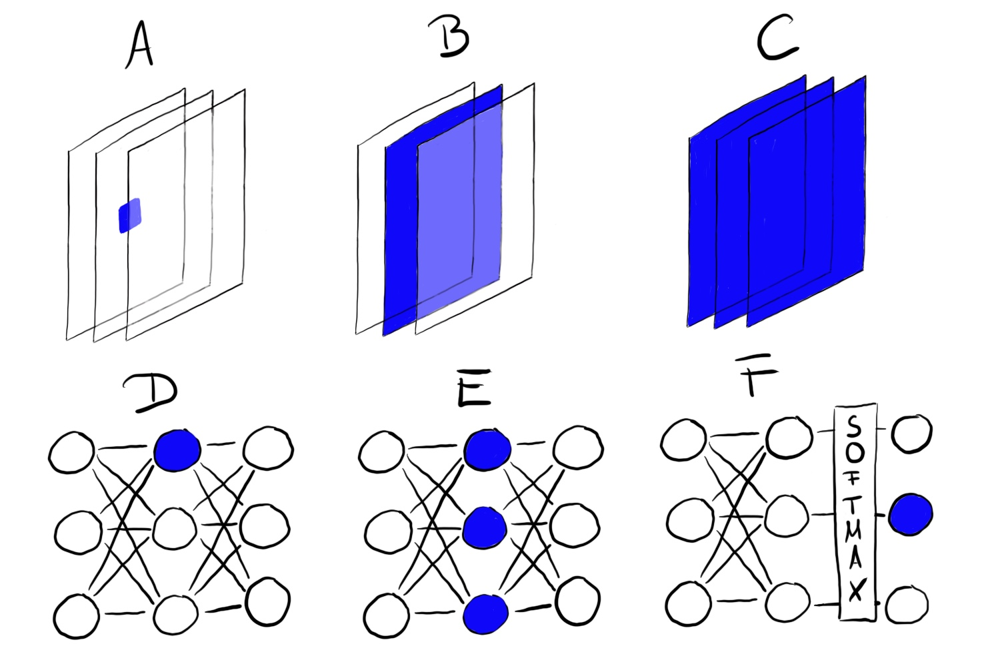
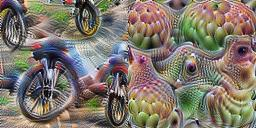
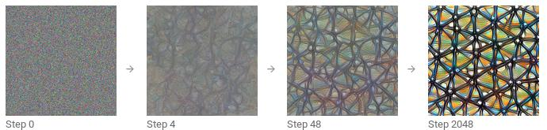
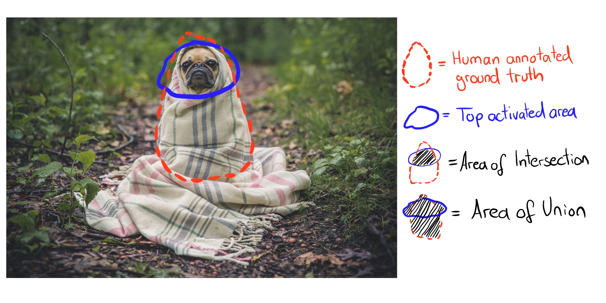
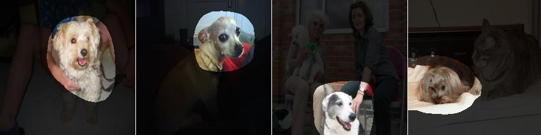

# فصل ۲۷: ویژگی‌های آموخته‌شده

> **عنوان اصلی:** Learned Features  
> **منبع:** [https://christophm.github.io/interpretable-ml-book/cnn-features.html](https://christophm.github.io/interpretable-ml-book/cnn-features.html)  
> **نویسنده:** Christoph Molnar  
> **مترجم:** مریم محمودی

---

شبکه‌های عصبی کانولوشنی (Convolutional Neural Networks یا CNN) ویژگی‌ها و مفاهیم انتزاعی را از پیکسل‌های خام تصویر می‌آموزند. [تجسم ویژگی](#تجسم-ویژگی) (Feature Visualization) ویژگی‌های آموخته‌شده را با بیشینه‌سازی فعال‌سازی (activation maximization) نمایان می‌کند. [تشریح شبکه](#تشریح-شبکه) (Network Dissection) واحدهای شبکهٔ عصبی (برای مثال کانال‌ها) را با مفاهیم انسانی برچسب‌گذاری می‌کند.

> **توضیح مترجم:** در این فصل «واحد» (unit) به هر جزء قابل‌بررسی شبکه می‌گویند: یک نورون، یک کانال (نقشهٔ ویژگی)، یک لایه یا نورون خروجی کلاس. «فعال‌سازی» (activation) عددی است که یک نورون یا کانال برای ورودی مشخص تولید می‌کند و هرچه بزرگ‌تر باشد، یعنی واحد آن الگو را قوی‌تر «دیده» است. «کانال» همان نقشهٔ ویژگی‌ای است که از اعمال یک فیلتر کانولوشنی روی لایهٔ قبل ساخته می‌شود. «تصویر» در این فصل هم ورودی شبکه است و هم گاهی خروجی روش (تصویر ساخته‌شده برای بیشینه‌کردن فعال‌سازی).

شبکه‌های عصبی عمیق ویژگی‌های سطح‌بالا را در لایه‌های پنهان می‌آموزند. این یکی از بزرگ‌ترین نقاط قوت آن‌هاست و نیاز به مهندسی ویژگی را کاهش می‌دهد. فرض کنید می‌خواهید با ماشین بردار پشتیبان (SVM) یک دسته‌بند تصویر بسازید. ماتریس‌های پیکسل خام بهترین ورودی برای آموزش SVM نیستند، پس ویژگی‌های جدیدی بر پایهٔ رنگ، حوزهٔ فرکانس، آشکارسازهای لبه و مانند آن می‌سازید. در شبکه‌های عصبی کانولوشنی، تصویر به شکل خام (پیکسل‌ها) وارد شبکه می‌شود. شبکه تصویر را چندین بار دگرگون می‌کند. ابتدا تصویر از لایه‌های کانولوشنی بسیاری می‌گذرد. در این لایه‌های کانولوشنی، شبکه ویژگی‌های جدید و پیچیده‌تر و پیچیده‌تری می‌آموزد، شکل ۲۷.۱ را ببینید. سپس اطلاعات تصویر دگرگون‌شده از لایه‌های کاملاً متصل می‌گذرد و به یک دسته‌بندی یا پیش‌بینی تبدیل می‌شود.

- لایه(های) کانولوشنی اول ویژگی‌هایی مانند لبه‌ها و بافت‌های ساده می‌آموزند.
- لایه‌های کانولوشنی بعدی ویژگی‌هایی مانند بافت‌ها و الگوهای پیچیده‌تر می‌آموزند.
- آخرین لایه‌های کانولوشنی ویژگی‌هایی مانند اشیا یا بخش‌هایی از اشیا می‌آموزند.
- لایه‌های کاملاً متصل یاد می‌گیرند که فعال‌سازی‌های ویژگی‌های سطح‌بالا را به کلاس‌های مجزایی که باید پیش‌بینی شوند وصل کنند.

عالی. اما چگونه واقعاً به آن تصاویر عجیب و رؤیاگونه می‌رسیم؟

> **توضیح مترجم (متن داخل تصویر):** از چپ به راست، برچسب‌های بالای پنج تصویر چنین‌اند: `Edges` (لبه‌ها)، `Textures` (بافت‌ها)، `Patterns` (الگوها)، `Parts` (بخش‌ها) و `Objects` (اشیا). تصاویر به ترتیب خطوط مایل، بافت دایره‌ای تکرارشونده، الگوی گل‌مانند، گل‌های کامل‌تر و در نهایت شکل‌های سگ‌مانند را نشان می‌دهند. نوشته‌های انگلیسی تصویر بدون تغییر ماندند.

## تجسم ویژگی

رویکردی که ویژگی‌های آموخته‌شده را آشکار می‌کند **تجسم ویژگی** (Feature Visualization) نام دارد. تجسم ویژگی برای یک واحد از شبکهٔ عصبی با یافتن ورودی‌ای انجام می‌شود که فعال‌سازی آن واحد را بیشینه کند. «واحد» به نورون‌های منفرد، کانال‌ها (که نقشه‌های ویژگی هم نامیده می‌شوند)، لایه‌های کامل، یا احتمال کلاس نهایی در دسته‌بندی (یا نورون متناظر پیش از softmax که توصیه می‌شود) اشاره دارد. شکل ۲۷.۲ امکان‌های مختلف را نشان می‌دهد. نورون‌های منفرد اجزای اتمی شبکه‌اند، پس با ساخت تجسم ویژگی برای هر نورون بیشترین اطلاعات را به دست می‌آوریم. اما مشکلی هست: شبکه‌های عصبی اغلب میلیون‌ها نورون دارند. نگاه کردن به تجسم ویژگی هر نورون بیش از حد زمان می‌برد. کانال‌ها (که گاهی نقشه‌های فعال‌سازی هم نامیده می‌شوند) به‌عنوان واحد انتخاب خوبی برای تجسم ویژگی‌اند. می‌توانیم یک گام جلوتر برویم و یک لایهٔ کانولوشنی کامل را تجسم کنیم. لایه‌ها به‌عنوان واحد در DeepDream گوگل به کار می‌روند که ویژگی‌های تجسم‌شدهٔ یک لایه را بارها به تصویر اصلی اضافه می‌کند و نسخه‌ای رؤیاگونه از ورودی می‌سازد.

> **توضیح مترجم (متن داخل تصویر):** حروف انگلیسی روی تصویر `A` تا `F` متناظر با حروف الف تا و در شرح شکل‌اند. در ردیف بالا سه پشتهٔ صفحه‌ای نمایندهٔ کانال‌های یک لایهٔ کانولوشنی هستند: در `A` فقط یک مربع کوچک آبی (یک نورون در یک کانال)، در `B` یک کانال کامل و در `C` هر سه کانال لایه پررنگ شده‌اند. در ردیف پایین، شبکهٔ کاملاً متصل نشان داده شده است: در `D` یک نورون، در `E` همهٔ نورون‌های یک لایهٔ پنهان و در `F` نورون خروجی یک کلاس پس از جعبهٔ `SOFTMAX` رنگی شده است.

### تجسم ویژگی از راه بهینه‌سازی

از نظر ریاضی، تجسم ویژگی یک مسئلهٔ بهینه‌سازی است. فرض می‌کنیم وزن‌های شبکهٔ عصبی ثابت‌اند، یعنی شبکه آموزش دیده است. به دنبال تصویر جدیدی هستیم که فعال‌سازی (میانگین) یک واحد، در اینجا یک نورون منفرد، را بیشینه کند:

$$\mathbf{x}^*=\arg\max\_{\mathbf{x}}h\_{n,u,v,z}(\mathbf{x})$$

تابع $h$ فعال‌سازی یک نورون خاص است، $\mathbf{x}$ ورودی شبکه (یک تصویر)، $u$ و $v$ موقعیت مکانی نورون را توصیف می‌کنند، $n$ لایه را مشخص می‌کند و $z$ شاخص کانال است. برای میانگین فعال‌سازی یک کانال کامل $z$ در لایهٔ $n$ این را بیشینه می‌کنیم:

$$\mathbf{x}^*=\arg\max\_{\mathbf{x}}\sum\_{u,v}h\_{n,u,v,z}(\mathbf{x})$$

در این فرمول، همهٔ نورون‌های کانال $z$ وزن برابر دارند. به‌جای آن می‌توانید جهت‌های تصادفی را بیشینه کنید، یعنی نورون‌ها در پارامترهای مختلف، از جمله جهت‌های منفی، ضرب شوند. به این ترتیب بررسی می‌کنیم نورون‌ها درون کانال چگونه با هم تعامل دارند. به‌جای بیشینه‌کردن فعال‌سازی می‌توانید آن را کمینه هم بکنید (که معادل بیشینه‌کردن جهت منفی است). شکل ۲۷.۳ هر دو را نشان می‌دهد. جالب است که وقتی جهت منفی را بیشینه می‌کنید، برای همان واحد ویژگی‌های بسیار متفاوتی به دست می‌آید. نورون با چرخ‌ها بیشینه فعال می‌شود، در حالی که چیزی که به نظر می‌رسد چشم دارد فعال‌سازی منفی ایجاد می‌کند.

> **توضیح مترجم:** در متن منبع، پس از «The function $h$» فعل جمله افتاده است (احتمالاً «نشان‌دهندهٔ» فعال‌سازی یک نورون خاص است)؛ در ترجمه معنای آشکار جمله آمده است. $\arg\max$ یعنی «آرگومانی که مقدار تابع را بیشینه می‌کند»؛ اینجا آرگومان خودِ تصویر $\mathbf{x}$ است، نه عددی از فعال‌سازی.

> **برای درک بهتر (توضیح مترجم):** فرض کنید شبکه‌ای نورونی دارد که به «چرخ دوچرخه» حساس است. بیشینه‌سازی یعنی با یک تصویر نویز شروع کنید و پیکسل‌ها را کم‌کم طوری عوض کنید که خروجی آن نورون بزرگ‌تر شود؛ در پایان تصویری پر از چرخ‌های تکرارشونده می‌گیرید. این تصویر نشان می‌دهد آن نورون «به دنبال چه چیزی می‌گردد». در مقابل، کمینه‌سازی تصویری می‌سازد که نورون را تا جای ممکن خاموش کند، مثل تصویر سمت راست شکل ۲۷.۳.

> **توضیح مترجم (متن داخل تصویر):** این تصویر متن ندارد. نیمهٔ چپ چرخ‌ها و دوچرخه‌ها (فعال‌سازی مثبت) و نیمهٔ راست الگوهایی شبیه چشم و پوست (فعال‌سازی منفی) را نشان می‌دهد، که با جملهٔ بالا دربارهٔ «چرخ» و «چشم» همخوان است.

می‌توانیم این مسئلهٔ بهینه‌سازی را به شیوه‌های مختلفی حل کنیم. برای مثال، به‌جای تولید تصاویر جدید می‌توانیم در تصاویر آموزشی بگردیم و آن‌هایی را که فعال‌سازی را بیشینه می‌کنند انتخاب کنیم. این رویکرد معتبری است، اما استفاده از داده‌های آموزشی این مشکل را دارد که عناصر روی تصاویر می‌توانند با هم همبسته باشند و نمی‌توانیم ببینیم شبکهٔ عصبی واقعاً دنبال چه چیزی است. اگر تصاویری که فعال‌سازی بالایی برای یک کانال مشخص ایجاد می‌کنند یک سگ و یک توپ تنیس را نشان دهند، نمی‌دانیم شبکهٔ عصبی به سگ نگاه می‌کند، به توپ تنیس، یا شاید به هر دو.

رویکرد دیگر تولید تصاویر جدید است، با شروع از نویز تصادفی، همان‌طور که در شکل ۲۷.۴ دیده می‌شود. برای به دست آوردن تجسم‌های معنادار معمولاً محدودیت‌هایی بر تصویر اعمال می‌شود، مثلاً فقط تغییرات کوچک مجاز باشد. برای کاهش نویز در تجسم ویژگی می‌توانید پیش از گام بهینه‌سازی روی تصویر لرزش (jittering)، چرخش یا مقیاس‌دهی اعمال کنید. گزینه‌های منظم‌سازی دیگر شامل جریمهٔ فرکانسی (مثلاً کاهش واریانس پیکسل‌های همسایه) یا تولید تصاویر با پیش‌فرض‌های آموخته‌شده است، مثلاً با شبکه‌های مولد متخاصم (GAN) [(Nguyen و همکاران ۲۰۱۶)](appendix-D-references.md) یا خودرمزگذارهای نویززدا [(Nguyen و همکاران ۲۰۱۷)](appendix-D-references.md).

> **توضیح مترجم (متن داخل تصویر):** چهار تصویر از چپ به راست با برچسب‌های `Step 0`، `Step 4`، `Step 48` و `Step 2048` (گام ۰، ۴، ۴۸ و ۲۰۴۸) نشان داده شده‌اند: نویز تصادفی به‌تدریج به الگوی شبکه‌مانند رنگی و واضح تبدیل می‌شود.

اگر می‌خواهید خیلی عمیق‌تر به تجسم ویژگی بپردازید، به مجلهٔ آنلاین distill.pub و به‌ویژه نوشتهٔ تجسم ویژگی از [Olah و همکاران (۲۰۱۷)](appendix-D-references.md) نگاه کنید؛ بسیاری از تصاویر را از آن برداشته‌ام. مقالهٔ مربوط به بلوک‌های سازندهٔ تفسیرپذیری [(Olah و همکاران ۲۰۱۸)](appendix-D-references.md) را هم توصیه می‌کنم.

### ارتباط با مثال‌های خصمانه

بین تجسم ویژگی و [مثال‌های خصمانه](30-adversarial.md) ارتباطی وجود دارد: هر دو تکنیک فعال‌سازی یک واحد از شبکهٔ عصبی را بیشینه می‌کنند. در مثال‌های خصمانه، به دنبال بیشترین فعال‌سازی نورون برای کلاس خصمانه (= نادرست) هستیم. یک تفاوت در تصویری است که از آن شروع می‌کنیم: برای مثال‌های خصمانه، تصویری است که می‌خواهیم برایش تصویر خصمانه بسازیم؛ برای تجسم ویژگی، بسته به رویکرد، نویز تصادفی است.

### داده‌های متنی و جدولی

ادبیات پژوهش بر تجسم ویژگی برای شبکه‌های عصبی کانولوشنی در بازشناسی تصویر متمرکز است. از نظر فنی، چیزی مانع یافتن ورودی‌ای که یک نورون از شبکهٔ عصبی کاملاً متصل را برای داده‌های جدولی، یا شبکهٔ عصبی بازگشتی را برای داده‌های متنی، بیشینه فعال می‌کند نمی‌شود. شاید دیگر نتوان آن را تجسم ویژگی نامید، چون «ویژگی» یک ورودی جدولی یا متن خواهد بود. برای پیش‌بینی نکول اعتباری، ورودی‌ها می‌توانند تعداد اعتبارهای قبلی، تعداد قراردادهای تلفن همراه، نشانی و ده‌ها ویژگی دیگر باشند. ویژگی آموخته‌شدهٔ یک نورون در این حالت ترکیب خاصی از این ده‌ها ویژگی است. برای شبکه‌های عصبی بازگشتی، تجسم آنچه شبکه آموخته کمی زیباتر است: [Karpathy و همکاران (۲۰۱۵)](appendix-D-references.md) نشان دادند که شبکه‌های عصبی بازگشتی واقعاً نورون‌هایی دارند که ویژگی‌های تفسیرپذیر می‌آموزند. آن‌ها یک مدل در سطح نویسه آموزش دادند که نویسهٔ بعدی دنباله را از نویسه‌های قبلی پیش‌بینی می‌کند. وقتی پرانتز باز «(» ظاهر می‌شد، یکی از نورون‌ها به‌شدت فعال می‌شد و با ظاهرشدن پرانتز بستهٔ متناظر «)» غیرفعال می‌شد. نورون‌های دیگر در پایان خط فعال می‌شدند. برخی نورون‌ها در نشانی‌های اینترنتی (URL) فعال می‌شدند. تفاوت با تجسم ویژگی برای CNN‌ها این است که این مثال‌ها از راه بهینه‌سازی پیدا نشدند، بلکه با بررسی فعال‌سازی نورون‌ها روی داده‌های آموزشی به دست آمدند.

برخی از تصاویر مفاهیم شناخته‌شده‌ای مانند پوزهٔ سگ یا ساختمان را نشان می‌دهند. اما چگونه می‌توانیم مطمئن باشیم؟ روش تشریح شبکه مفاهیم انسانی را به واحدهای منفرد شبکهٔ عصبی پیوند می‌دهد. هشدار لو رفتن داستان: تشریح شبکه به مجموعه‌داده‌های اضافی نیاز دارد که کسی آن‌ها را با مفاهیم انسانی برچسب زده باشد.

## تشریح شبکه

رویکرد تشریح شبکه (Network Dissection) از [Bau و همکاران (۲۰۱۷)](appendix-D-references.md) تفسیرپذیری یک واحد از شبکهٔ عصبی کانولوشنی را کمّی می‌کند. این روش نواحی بسیار فعال‌شدهٔ کانال‌های CNN را با مفاهیم انسانی (اشیا، بخش‌ها، بافت‌ها، رنگ‌ها و ...) پیوند می‌دهد.

کانال‌های یک شبکهٔ عصبی کانولوشنی ویژگی‌های جدید می‌آموزند، همان‌طور که در بخش پیشین دربارهٔ [تجسم ویژگی](#تجسم-ویژگی) دیدیم. اما این تجسم‌ها ثابت نمی‌کنند که یک واحد مفهوم مشخصی را آموخته است. ما همچنین معیاری برای اینکه یک واحد چقدر خوب، مثلاً، آسمان‌خراش‌ها را تشخیص می‌دهد نداریم. پیش از ورود به جزئیات تشریح شبکه باید دربارهٔ فرضیهٔ بزرگی صحبت کنیم که پشت این مسیر پژوهشی است. فرضیه این است: «واحدهای یک شبکهٔ عصبی (مانند کانال‌های کانولوشنی) مفاهیم تفکیک‌شده (disentangled) می‌آموزند.» آیا چنین است؟

**پرسش ویژگی‌های تفکیک‌شده**

آیا شبکه‌های عصبی (کانولوشنی) ویژگی‌های تفکیک‌شده می‌آموزند؟ ویژگی‌های تفکیک‌شده یعنی واحدهای منفرد شبکه مفاهیم مشخصی از دنیای واقعی را تشخیص می‌دهند. کانال کانولوشنی ۳۹۴ ممکن است آسمان‌خراش‌ها را تشخیص دهد، کانال ۱۲۱ پوزهٔ سگ، کانال ۱۲ خط‌های راه‌راه با زاویهٔ ۳۰ درجه و ... . نقطهٔ مقابل شبکهٔ تفکیک‌شده شبکه‌ای کاملاً درهم‌تنیده (entangled) است. در شبکهٔ کاملاً درهم‌تنیده، برای مثال، هیچ واحد منفردی برای پوزهٔ سگ وجود ندارد. همهٔ کانال‌ها در تشخیص پوزهٔ سگ نقش دارند.

ویژگی‌های تفکیک‌شده به این معناست که شبکه بسیار تفسیرپذیر است. فرض کنیم شبکه‌ای با واحدهای کاملاً تفکیک‌شده داریم که با مفاهیم شناخته‌شده برچسب خورده‌اند. این امکان را فراهم می‌کند که فرایند تصمیم‌گیری شبکه را ردیابی کنیم. برای مثال، می‌توانیم تحلیل کنیم شبکه چگونه گرگ‌ها را از هاسکی‌ها تشخیص می‌دهد. نخست «واحد هاسکی» را شناسایی می‌کنیم. می‌توانیم بررسی کنیم که آیا این واحد به واحدهای «پوزهٔ سگ»، «خز پشمالو» و «برف» از لایهٔ قبل وابسته است. اگر وابسته باشد، می‌دانیم که تصویر یک هاسکی با پس‌زمینهٔ برفی را به‌اشتباه گرگ دسته‌بندی خواهد کرد. در یک شبکهٔ تفکیک‌شده می‌توانستیم همبستگی‌های غیرعلّی مشکل‌ساز را شناسایی کنیم. می‌توانستیم همهٔ واحدهای بسیار فعال و مفاهیم آن‌ها را برای توضیح یک پیش‌بینی منفرد به‌طور خودکار فهرست کنیم. می‌توانستیم سوگیری در شبکهٔ عصبی را به‌آسانی تشخیص دهیم. برای مثال، آیا شبکه ویژگی «پوست سفید» را برای پیش‌بینی حقوق آموخته است؟

هشدار لو رفتن داستان: شبکه‌های عصبی کانولوشنی کاملاً تفکیک‌شده نیستند. اکنون تشریح شبکه را دقیق‌تر بررسی می‌کنیم تا بفهمیم شبکه‌های عصبی چقدر تفسیرپذیرند.

> **برای درک بهتر (توضیح مترجم):** «تفکیک‌شده» را با یک مثال روزمره مقایسه کنید: در یک کتابخانهٔ منظم هر قفسه یک موضوع دارد (قفسهٔ ۱۲ فقط شعر)، پس اگر دنبال شعر باشید فقط به همان قفسه می‌روید. در کتابخانهٔ «درهم‌تنیده» کتاب‌های شعر بین همهٔ قفسه‌ها پخش‌اند و برای یافتن شعر باید همه را بگردید. شبکهٔ تفکیک‌شده یعنی هر واحد مثل یک قفسهٔ موضوعی عمل کند.

### الگوریتم

تشریح شبکه سه گام دارد:

1. تصاویری با مفاهیم بصری برچسب‌خورده توسط انسان جمع کنید، از راه‌راه تا آسمان‌خراش.
1. فعال‌سازی کانال‌های CNN را برای این تصاویر اندازه بگیرید.
1. هم‌ترازی بین فعال‌سازی‌ها و مفاهیم برچسب‌خورده را کمّی کنید.

شکل ۲۷.۵ نشان می‌دهد چگونه یک تصویر به یک کانال فرستاده می‌شود و با مفاهیم برچسب‌خورده تطبیق داده می‌شود.

> **توضیح مترجم (متن داخل تصویر):** برچسب‌های بالای شکل: `Input image` (تصویر ورودی)، `Network being probed` (شبکهٔ در حال کاوش) و `Pixel-wise segmentation` (قطعه‌بندی پیکسلی). متن‌های پایین: `Freeze trained network weights` (وزن‌های شبکهٔ آموزش‌دیده را ثابت کن)، `Upsample target layer` (لایهٔ هدف را بزرگ‌نمایی کن) و `Evaluate on segmentation tasks` (روی وظایف قطعه‌بندی ارزیابی کن). صفحه‌های `Conv` لایه‌های کانولوشنی‌اند، صفحهٔ `One Unit Activation` فعال‌سازی یک واحد است و لایه‌های قطعه‌بندی با برچسب‌های `Blue` (آبی)، `Fabric` (پارچه)، `Door` (در)، `Grass` (چمن)، `Person` (فرد) و `Car` (خودرو) مفاهیم برچسب‌خوردهٔ همان تصویرند.

**گام ۱: مجموعه‌داده Broden**

نخستین گام دشوار اما حیاتی، گردآوری داده است. تشریح شبکه به تصاویری با برچسب پیکسلی از مفاهیمی در سطوح مختلف انتزاع (از رنگ‌ها تا صحنه‌های خیابانی) نیاز دارد. Bau و Zhou و همکاران چند مجموعه‌داده با مفاهیم پیکسلی را ترکیب کردند. آن‌ها این مجموعه‌دادهٔ جدید را «Broden» نامیدند که مخفف داده‌های گسترده و متراکم برچسب‌خورده است (broadly and densely labeled data). مجموعه‌دادهٔ Broden عمدتاً تا سطح پیکسل قطعه‌بندی شده است؛ برای برخی مجموعه‌داده‌ها کل تصویر برچسب خورده است. Broden شامل ۶۰٬۰۰۰ تصویر با بیش از ۱٬۰۰۰ مفهوم بصری در سطوح مختلف انتزاع است: ۴۶۸ صحنه، ۵۸۵ شیء، ۲۳۴ بخش، ۳۲ ماده، ۴۷ بافت و ۱۱ رنگ.

**گام ۲: بازیابی فعال‌سازی‌های شبکه**

سپس برای هر کانال و هر تصویر، ماسک نواحی با بیشترین فعال‌سازی را می‌سازیم. در این مرحله برچسب‌های مفهوم هنوز دخالتی ندارند.

- برای هر کانال کانولوشنی $k$:
    - برای هر تصویر $\mathbf{x}$ در مجموعه‌دادهٔ Broden:
        - تصویر $\mathbf{x}$ را به جلو تا لایهٔ هدفی که کانال $k$ را دارد منتشر کنید.
        - فعال‌سازی‌های پیکسلی کانال کانولوشنی $k$ را استخراج کنید: $A\_k(\mathbf{x})$.
    - توزیع فعال‌سازی‌های پیکسلی $\alpha\_k$ را روی همهٔ تصاویر محاسبه کنید.
    - سطح چندک ۰٫۹۹۵ را، $T\_k$، برای فعال‌سازی‌های $\alpha\_k$ تعیین کنید. این یعنی ۰٫۵٪ از فعال‌سازی‌های کانال $k$ در مجموعه‌داده از $T\_k$ بزرگ‌ترند.
    - برای هر تصویر $\mathbf{x}$ در مجموعه‌دادهٔ Broden:
        - نقشهٔ فعال‌سازی $A\_k(\mathbf{x})$، که (احتمالاً) وضوح کمتری دارد، را به وضوح تصویر $\mathbf{x}$ بزرگ‌نمایی کنید. نتیجه را $S\_k(\mathbf{x})$ می‌نامیم.
        - نقشهٔ فعال‌سازی را دودویی کنید: هر پیکسل بسته به اینکه از آستانهٔ فعال‌سازی $T\_k$ فراتر برود یا نه، روشن یا خاموش است. ماسک جدید $M\_k(\mathbf{x})=S\_k(\mathbf{x})\geq T\_k$ است.

**گام ۳: هم‌ترازی فعال‌سازی و مفهوم**

پس از گام ۲، برای هر کانال و هر تصویر یک ماسک فعال‌سازی داریم. این ماسک‌ها نواحی بسیار فعال را مشخص می‌کنند. برای هر کانال می‌خواهیم مفهوم انسانی‌ای را پیدا کنیم که آن کانال را فعال می‌کند. مفهوم را با مقایسهٔ ماسک‌های فعال‌سازی با همهٔ مفاهیم برچسب‌خورده پیدا می‌کنیم. هم‌ترازی بین ماسک فعال‌سازی $k$ و ماسک مفهوم $c$ را با امتیاز اشتراک بر اتحاد (Intersection over Union یا IoU) کمّی می‌کنیم:

$$IoU\_{k,c}=\frac{|M\_k(\mathbf{x})\cap L\_c(\mathbf{x})|}{|M\_k(\mathbf{x})\cup L\_c(\mathbf{x})|}$$

که در آن $|\cdot|$ تعداد اعضای (کاردینالیتی) یک مجموعه است. اشتراک بر اتحاد هم‌ترازی دو ناحیه را مقایسه می‌کند. $IoU\_{k,c}$ را می‌توان دقتی تفسیر کرد که واحد $k$ با آن مفهوم $c$ را تشخیص می‌دهد. وقتی $IoU\_{k,c}>0.04$ باشد، واحد $k$ را آشکارساز مفهوم $c$ می‌نامیم. این آستانه را Bau و Zhou و همکاران (۲۰۱۷) انتخاب کرده‌اند.

> **توضیح مترجم:** $L\_c(\mathbf{x})$ ماسک برچسب انسانی مفهوم $c$ برای تصویر $\mathbf{x}$ است (در متن منبع معرفی صریح نشده است). فرمول برای یک تصویر نوشته شده، اما همان‌طور که در گام ۲ آمد، $IoU$ یک کانال نسبت به یک مفهوم روی کل مجموعه‌داده محاسبه می‌شود.

> **برای درک بهتر (توضیح مترجم):** فرض کنید در یک تصویر ناحیهٔ برچسب‌خوردهٔ «سگ» ۱۰۰ پیکسل دارد و ماسک فعال‌سازی یک کانال ۶۰ پیکسل را روشن کرده که ۵۰ تای آن‌ها داخل ناحیهٔ سگ است. اشتراک ۵۰ پیکسل و اتحاد $100+60-50=110$ پیکسل است، پس $IoU=50/110\approx 0{,}45$. این عدد فقط برای فهم فرمول است و از آزمایش‌های کتاب نیامده است؛ در عمل مقادیر IoU روی کل داده کوچک‌ترند (برای مثال کانال سگ در شکل ۲۷.۷ مقدار ۰٫۲۰۳ دارد).

شکل ۲۷.۶ اشتراک و اتحاد ماسک فعال‌سازی و ماسک مفهوم را برای یک تصویر منفرد نشان می‌دهد و شکل ۲۷.۷ واحدی را نشان می‌دهد که سگ‌ها را تشخیص می‌دهد.

> **توضیح مترجم (متن داخل تصویر):** راهنمای سمت راست تصویر: `Human annotated ground truth` (حقیقت پایهٔ حاشیه‌نویسی‌شده توسط انسان؛ خط‌چین قرمز)، `Top activated area` (ناحیهٔ با بیشترین فعال‌سازی؛ خط آبی)، `Area of Intersection` (ناحیهٔ اشتراک؛ بخش مشترک هاشورخورده) و `Area of Union` (ناحیهٔ اتحاد؛ کل ناحیهٔ هاشورخورده). در تصویر، سگی در پتو پیچیده شده است: ناحیهٔ آبی فقط سر را می‌پوشاند، اما ناحیهٔ قرمز کل سگ و پتو را.

> **توضیح مترجم (متن داخل تصویر):** تصویر متن ندارد. در چهار عکس، فقط ناحیهٔ سگ روشن مانده و بقیهٔ تصویر تیره شده است؛ یعنی ماسک فعال‌سازی این کانال روی سگ‌ها (در حالت‌ها و نژادهای مختلف) قرار می‌گیرد، نه روی گربه یا افراد.

### آزمایش‌ها

نویسندگان تشریح شبکه معماری‌های مختلف شبکه (AlexNet، VGG، GoogleNet، ResNet) را از ابتدا روی مجموعه‌داده‌های مختلف (ImageNet، Places205، Places365) آموزش دادند. ImageNet شامل ۱٫۶ میلیون تصویر از ۱۰۰۰ کلاس با تمرکز بر اشیاست [(Deng و همکاران ۲۰۰۹)](appendix-D-references.md). Places205 و Places365 به‌ترتیب شامل ۲٫۵ میلیون / ۱٫۶ میلیون تصویر از ۲۰۵ / ۳۶۵ صحنهٔ مختلف‌اند. نویسندگان علاوه بر این AlexNet را روی وظایف آموزش خودنظارتی مانند پیش‌بینی ترتیب فریم‌های ویدیو یا رنگ‌آمیزی تصاویر آموزش دادند. برای بسیاری از این تنظیمات مختلف، تعداد آشکارسازهای مفهومِ یکتا را به‌عنوان معیاری از تفسیرپذیری شمردند. برخی از یافته‌ها در اینجا آمده است:

- شبکه‌ها مفاهیم سطح پایین‌تر (رنگ‌ها، بافت‌ها) را در لایه‌های پایین‌تر و مفاهیم سطح بالاتر (بخش‌ها، اشیا) را در لایه‌های بالاتر تشخیص می‌دهند. این را پیش‌تر در [تجسم‌های ویژگی](#تجسم-ویژگی) دیده بودیم.
- نرمال‌سازی دسته‌ای (batch normalization) تعداد آشکارسازهای مفهومِ یکتا را کاهش می‌دهد.
- بسیاری از واحدها مفهوم یکسانی را تشخیص می‌دهند. برای مثال، وقتی $IoU \geq 0.04$ را به‌عنوان مرز تشخیص به کار ببریم، در VGG آموزش‌دیده روی ImageNet تعداد ۹۵ (!) کانال سگ وجود دارد (۴ تا در conv4\_3، ۹۱ تا در conv5\_3، [وب‌سایت پروژه](http://netdissect.csail.mit.edu/dissect/vgg16_imagenet/) را ببینید).
- افزایش تعداد کانال‌های یک لایه، تعداد واحدهای تفسیرپذیر را افزایش می‌دهد.
- مقداردهی اولیهٔ تصادفی (آموزش با بذرهای تصادفی مختلف) تعداد واحدهای تفسیرپذیر را کمی متفاوت می‌کند.
- ResNet معماری‌ای است که بیشترین تعداد آشکارساز یکتا را دارد، پس از آن VGG، GoogleNet و در آخر AlexNet.
- بیشترین تعداد آشکارساز مفهومِ یکتا برای Places365 آموخته می‌شود، پس از آن Places205 و در آخر ImageNet.
- تعداد آشکارسازهای مفهومِ یکتا با تعداد تکرارهای آموزش افزایش می‌یابد.
- شبکه‌های آموزش‌دیده روی وظایف خودنظارتی در مقایسه با شبکه‌های آموزش‌دیده روی وظایف نظارتی آشکارسازهای یکتای کمتری دارند.
- در یادگیری انتقالی، مفهوم یک کانال می‌تواند تغییر کند. برای مثال، یک آشکارساز سگ به آشکارساز آبشار تبدیل شد. این در مدلی رخ داد که ابتدا برای دسته‌بندی اشیا آموزش دیده بود و سپس برای دسته‌بندی صحنه‌ها تنظیم دقیق (fine-tune) شد.
- در یکی از آزمایش‌ها، نویسندگان کانال‌ها را روی یک پایهٔ دوران‌یافتهٔ جدید تصویر کردند. این کار برای شبکهٔ VGG آموزش‌دیده روی ImageNet انجام شد. «دوران‌یافته» به این معنا نیست که تصویر چرخانده شده است. «دوران‌یافته» یعنی ۲۵۶ کانال لایهٔ conv5 را می‌گیریم و ۲۵۶ کانال جدید را به‌صورت ترکیب‌های خطی از کانال‌های اصلی محاسبه می‌کنیم. در این فرایند، کانال‌ها درهم‌تنیده می‌شوند. دوران تفسیرپذیری را کاهش می‌دهد، یعنی تعداد کانال‌های هم‌تراز با یک مفهوم کم می‌شود. دوران طوری طراحی شده بود که عملکرد مدل را ثابت نگه دارد. نتیجهٔ اول: تفسیرپذیری CNN‌ها وابسته به محور است. این یعنی ترکیب‌های تصادفی کانال‌ها کمتر احتمال دارد مفاهیم یکتا را تشخیص دهند. نتیجهٔ دوم: تفسیرپذیری مستقل از توان تمایزی (discriminative power) است. کانال‌ها را می‌توان با تبدیل‌های متعامد تغییر داد در حالی که توان تمایزی ثابت می‌ماند، اما تفسیرپذیری کاهش می‌یابد.

نویسندگان همچنین از تشریح شبکه برای شبکه‌های مولد متخاصم (GAN) استفاده کردند. تشریح شبکه برای GAN‌ها را در [وب‌سایت پروژه](https://gandissect.csail.mit.edu/) می‌توانید بیابید.

> **توضیح مترجم:** «تبدیل متعامد» دوران (و بازتاب) فضای کانال‌هاست: طول و زاویهٔ بردارها را حفظ می‌کند، پس خروجی لایهٔ بعد همان اطلاعات را دریافت می‌کند و عملکرد تغییر نمی‌کند؛ ولی هر کانال جدید ترکیبی از چند مفهوم می‌شود و دیگر با یک مفهوم هم‌تراز نیست. به همین دلیل می‌گویند تفسیرپذیری به «محورهای» (کانال‌های) شبکه وابسته است نه فقط به عملکرد آن.

## نقاط قوت

تجسم‌های ویژگی **بینشی منحصربه‌فرد از کارکرد شبکه‌های عصبی** می‌دهند، به‌ویژه برای بازشناسی تصویر. با توجه به پیچیدگی و کدری شبکه‌های عصبی، تجسم ویژگی گامی مهم در تحلیل و توصیف شبکه‌های عصبی است. از طریق تجسم ویژگی آموخته‌ایم که شبکه‌های عصبی ابتدا آشکارسازهای ساده لبه و بافت و در لایه‌های بالاتر آشکارسازهای انتزاعی‌تر بخش و شیء می‌آموزند. تشریح شبکه این بینش‌ها را گسترش می‌دهد و تفسیرپذیری واحدهای شبکه را قابل‌اندازه‌گیری می‌کند.

تشریح شبکه به ما اجازه می‌دهد **واحدها را به‌طور خودکار به مفاهیم پیوند دهیم**، که بسیار راحت است.

تجسم ویژگی ابزاری عالی برای **توضیح غیرفنی نحوهٔ کار شبکه‌های عصبی** است.

با تشریح شبکه می‌توانیم **مفاهیمی فراتر از کلاس‌های وظیفهٔ دسته‌بندی** را هم تشخیص دهیم. اما به مجموعه‌داده‌هایی نیاز داریم که تصاویر دارای مفاهیم برچسب‌خورده در سطح پیکسل باشند.

تجسم ویژگی را می‌توان با [روش‌های اسناد ویژگی](28-saliency-maps.md) **ترکیب کرد** که توضیح می‌دهند کدام پیکسل‌ها برای دسته‌بندی مهم بوده‌اند. ترکیب هر دو روش به ما اجازه می‌دهد یک دسته‌بندی منفرد را همراه با تجسم محلی ویژگی‌های آموخته‌شده‌ای که در آن دسته‌بندی دخیل بوده‌اند توضیح دهیم. [بلوک‌های سازندهٔ تفسیرپذیری از distill.pub](https://distill.pub/2018/building-blocks/) را ببینید.

و سرانجام، تجسم‌های ویژگی **تصویر زمینهٔ دسکتاپ و طرح تی‌شرت عالی** می‌سازند.

## محدودیت‌ها

**بسیاری از تصاویر تجسم ویژگی اصلاً تفسیرپذیر نیستند**، بلکه ویژگی‌های انتزاعی‌ای دارند که برایشان نه واژه‌ای داریم نه مفهوم ذهنی. نمایش تجسم‌های ویژگی در کنار داده‌های آموزشی می‌تواند کمک کند. با این حال ممکن است تصاویر باز هم نشان ندهند شبکهٔ عصبی به چه واکنش نشان داده و فقط چیزی مانند «شاید باید در تصاویر زردی باشد» بگویند. حتی با تشریح شبکه هم برخی کانال‌ها به مفهوم انسانی پیوند نمی‌خورند. برای مثال، لایهٔ conv5\_3 از VGG آموزش‌دیده روی ImageNet ۱۹۳ کانال (از ۵۱۲) دارد که با هیچ مفهوم انسانی‌ای تطبیق داده نشدند.

**واحدهای بیش از حد زیادی برای بررسی وجود دارد**، حتی وقتی «فقط» فعال‌سازی کانال‌ها را تجسم می‌کنیم. برای معماری Inception V1، برای مثال، همین حالا بیش از ۵۰۰۰ کانال از نه لایهٔ کانولوشنی وجود دارد. اگر بخواهید فعال‌سازی‌های منفی را هم نشان دهید، به‌علاوهٔ چند تصویر از داده‌های آموزشی که کانال را بیشینه یا کمینه فعال می‌کنند (فرض کنیم چهار تصویر مثبت و چهار منفی)، آنگاه باید بیش از ۵۰٬۰۰۰ تصویر نمایش دهید. دست‌کم به لطف تشریح شبکه می‌دانیم که لازم نیست جهت‌های تصادفی را بررسی کنیم.

**توهم تفسیرپذیری؟** تجسم‌های ویژگی می‌توانند این توهم را القا کنند که می‌فهمیم شبکهٔ عصبی چه می‌کند. اما آیا واقعاً می‌فهمیم در شبکهٔ عصبی چه می‌گذرد؟ حتی اگر به صدها یا هزاران تجسم ویژگی نگاه کنیم، نمی‌توانیم شبکهٔ عصبی را بفهمیم. کانال‌ها به‌شیوه‌ای پیچیده با هم تعامل دارند، فعال‌سازی‌های مثبت و منفی به هم ربطی ندارند، چند نورون ممکن است ویژگی‌های بسیار مشابهی بیاموزند و برای بسیاری از ویژگی‌ها معادل انسانی نداریم. نباید در دام این باور بیفتیم که چون گمان می‌کنیم دیده‌ایم نورون ۳۴۹ در لایهٔ ۷ با گل‌های دایزی فعال می‌شود، شبکه‌های عصبی را کاملاً می‌فهمیم. تشریح شبکه نشان داد که معماری‌هایی مانند ResNet یا Inception واحدهایی دارند که به مفاهیم مشخصی واکنش نشان می‌دهند. اما IoU چندان عالی نیست و اغلب بسیاری از واحدها به یک مفهوم پاسخ می‌دهند و برخی به هیچ مفهومی. کانال‌ها کاملاً تفکیک‌شده نیستند و نمی‌توانیم آن‌ها را جداگانه تفسیر کنیم.

برای تشریح شبکه، **به مجموعه‌داده‌هایی نیاز دارید که در سطح پیکسل** با مفاهیم برچسب خورده باشند. گردآوری این مجموعه‌داده‌ها تلاش زیادی می‌طلبد، چون هر پیکسل باید برچسب بخورد، که معمولاً با کشیدن قطعه‌هایی دور اشیا در تصویر انجام می‌شود.

تشریح شبکه فقط مفاهیم انسانی را با فعال‌سازی‌های مثبت کانال‌ها هم‌تراز می‌کند، نه با فعال‌سازی‌های منفی. همان‌طور که تجسم‌های ویژگی نشان دادند، به نظر می‌رسد فعال‌سازی‌های منفی هم با مفاهیم پیوند دارند. این را شاید بتوان با نگاه به چندک پایین فعال‌سازی‌ها نیز رفع کرد.

## نرم‌افزار و منابع بیشتر

پیاده‌سازی متن‌بازی از تجسم ویژگی به نام [Lucid](https://github.com/tensorflow/lucid) وجود دارد. می‌توانید با پیوندهای نوت‌بوکی که در صفحهٔ GitHub مربوط به Lucid آمده، آن را به‌راحتی در مرورگر خود امتحان کنید. به نرم‌افزار اضافی نیازی نیست. پیاده‌سازی‌های دیگر عبارت‌اند از [tf\_cnnvis](https://github.com/InFoCusp/tf_cnnvis) برای TensorFlow، [Keras Filters](https://github.com/jacobgil/keras-filter-visualization) برای Keras و [DeepVis](https://github.com/yosinski/deep-visualization-toolbox) برای Caffe.

تشریح شبکه [وب‌سایت پروژهٔ](http://netdissect.csail.mit.edu/) عالی‌ای دارد. افزون بر مقاله، این وب‌سایت مطالب بیشتری مانند کد، داده و تجسم ماسک‌های فعال‌سازی را میزبانی می‌کند.
