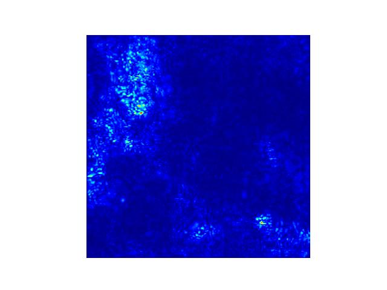
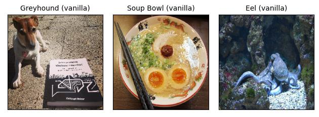
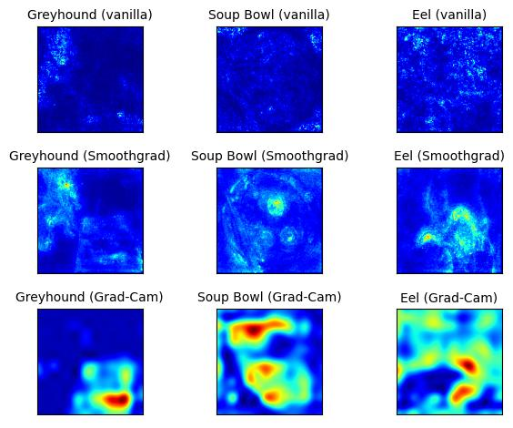

# فصل ۲۸: نقشه‌های برجستگی

> **عنوان اصلی:** Saliency Maps  
> **منبع:** [https://christophm.github.io/interpretable-ml-book/pixel-attribution.html](https://christophm.github.io/interpretable-ml-book/pixel-attribution.html)  
> **نویسنده:** Christoph Molnar  
> **مترجم:** مریم محمودی

---

روش‌های اسناد پیکسلی (pixel attribution) پیکسل‌هایی را که برای یک دسته‌بندی مشخص تصویر توسط یک شبکهٔ عصبی اهمیت داشته‌اند برجسته می‌کنند. شکل ۲۸.۱ نمونه‌ای از یک توضیح است.

> **توضیح مترجم (متن داخل تصویر):** این تصویر متن ندارد. طیف رنگ از آبی تیره (سهم ناچیز) تا آبی روشن، فیروزه‌ای و زرد (سهم بیشتر) می‌رود. رنگ‌های روشن‌تر بیشتر در بالا و گوشهٔ چپ و در چند نقطهٔ پایین تصویر دیده می‌شوند. در ادامهٔ فصل می‌بینید این نقشه چیست.

در ادامهٔ فصل می‌بینید در این تصویر مشخص چه می‌گذرد. روش‌های اسناد پیکسلی با نام‌های گوناگونی دیده می‌شوند: نقشهٔ حساسیت (sensitivity map)، نقشهٔ برجستگی (saliency map)، نقشهٔ اسناد پیکسلی (pixel attribution map)، روش‌های اسناد مبتنی بر گرادیان، ربط ویژگی (feature relevance)، اسناد ویژگی (feature attribution) و مشارکت ویژگی (feature contribution).

> **توضیح مترجم:** در این فصل «اسناد» (attribution) یعنی نسبت‌دادن سهم هر ورودی به خروجی مدل، و «گرادیان» یعنی مشتق خروجی نسبت به ورودی که می‌گوید با تغییر کوچک یک پیکسل، امتیاز کلاس چقدر و در چه جهتی عوض می‌شود. «پس‌انتشار» (backpropagation) همان روش محاسبهٔ این مشتق‌ها از خروجی به سمت ورودی است. عنوان فصل «نقشه‌های برجستگی» است، اما در متن همهٔ نام‌های بالا تقریباً مترادف به کار می‌روند.

اسناد پیکسلی حالت خاصی از اسناد ویژگی است، ولی برای تصاویر. اسناد ویژگی پیش‌بینی‌های منفرد را با نسبت‌دادن هر ویژگی ورودی بر اساس مقداری که پیش‌بینی را تغییر داده (منفی یا مثبت) توضیح می‌دهد. ویژگی‌ها می‌توانند پیکسل‌های ورودی، داده‌های جدولی یا واژه‌ها باشند. [SHAP](18-shap.md)، [مقادیر شپلی](17-shapley.md) و [LIME](14-lime.md) نمونه‌هایی از روش‌های عمومی اسناد ویژگی‌اند.

شبکه‌های عصبی‌ای را در نظر می‌گیریم که در خروجی یک بردار به طول $C$ می‌دهند؛ این شامل رگرسیون هم می‌شود که در آن $C=1$ است. خروجی شبکهٔ عصبی برای تصویر I را $S(\mathbf{x})=[S\_1(\mathbf{x}),\ldots,S\_C(\mathbf{x})]$ می‌نامیم. همهٔ این روش‌ها $\mathbf{x} \in\mathbb{R}^p$ (که می‌تواند پیکسل‌های تصویر، داده‌های جدولی، واژه‌ها و ... باشد) با $p$ ویژگی را ورودی می‌گیرند و در خروجی، به‌عنوان توضیح، یک امتیاز ربط برای هر یک از $p$ ویژگی ورودی می‌دهند: $\mathbf{R}^c=[R\_1^c,\ldots,R\_p^c]$. حرف $c$ نشان می‌دهد این ربط برای $c$-امین خروجی $S\_C(\mathbf{x})$ است.

> **توضیح مترجم:** در متن منبع تصویر ورودی یک بار «I» و یک بار $\mathbf{x}$ نوشته شده و خروجی $c$-ام هم یک بار $S\_C$ (با $C$ بزرگ) آمده است؛ منظور همان $S\_c(\mathbf{x})$، یعنی امتیاز کلاس $c$، است. متن بدون تغییر ترجمه شد.

تعداد گیج‌کننده‌ای رویکرد اسناد پیکسلی وجود دارد. فهمیدن اینکه دو نوع متفاوت از روش‌های اسناد وجود دارد کمک می‌کند:

**مبتنی بر انسداد یا اختلال** (Occlusion- or perturbation-based): روش‌هایی مانند [SHAP](18-shap.md) و [LIME](14-lime.md) بخش‌هایی از تصویر را دستکاری می‌کنند تا توضیح بسازند (مستقل از مدل).

**مبتنی بر گرادیان** (Gradient-based): بسیاری از روش‌ها گرادیان پیش‌بینی (یا امتیاز دسته‌بندی) را نسبت به ویژگی‌های ورودی محاسبه می‌کنند. روش‌های مبتنی بر گرادیان (که بسیارند) عمدتاً در شیوهٔ محاسبهٔ گرادیان با هم تفاوت دارند.

وجه مشترک هر دو رویکرد این است که توضیح هم‌اندازهٔ تصویر ورودی است (یا دست‌کم می‌توان آن را به شکلی معنادار روی تصویر نگاشت کرد) و به هر پیکسل مقداری می‌دهد که می‌توان آن را ربط پیکسل به پیش‌بینی یا دسته‌بندی آن تصویر تفسیر کرد.

یک دسته‌بندی مفید دیگر برای روش‌های اسناد پیکسلی، پرسش خط پایه (baseline) است:

**روش‌های فقط‌گرادیان** (Gradient-only) به ما می‌گویند آیا تغییر در یک پیکسل پیش‌بینی را تغییر می‌دهد. نمونه‌ها Vanilla Gradient و Grad-CAM [(Selvaraju و همکاران ۲۰۱۷)](appendix-D-references.md) هستند. تفسیر اسناد فقط‌گرادیان این است: اگر مقادیر رنگ پیکسل را افزایش دهم، احتمال کلاس پیش‌بینی‌شده بالا می‌رود (برای گرادیان مثبت) یا پایین می‌آید (برای گرادیان منفی). هرچه قدر مطلق گرادیان بزرگ‌تر باشد، اثر تغییر این پیکسل قوی‌تر است.

**روش‌های اسناد مسیری** (Path-attribution) تصویر فعلی را با یک تصویر مرجع مقایسه می‌کنند، که می‌تواند یک تصویر «صفر» مصنوعی مانند یک تصویر کاملاً خاکستری باشد. تفاوت پیش‌بینی واقعی و پیش‌بینی خط پایه بین پیکسل‌ها تقسیم می‌شود. تصویر خط پایه می‌تواند چند تصویر هم باشد: یک توزیع از تصاویر. این دسته شامل روش‌های مبتنی بر گرادیان و وابسته به مدل مانند Deep Taylor و Integrated Gradients [(Sundararajan و همکاران ۲۰۱۷)](appendix-D-references.md) و نیز روش‌های مستقل از مدل مانند LIME و SHAP است. برخی روش‌های اسناد مسیری «کامل» (complete) هستند، یعنی مجموع امتیازهای ربط همهٔ ویژگی‌های ورودی برابر تفاوت پیش‌بینی تصویر با پیش‌بینی یک تصویر مرجع است. نمونه‌ها SHAP و Integrated Gradients هستند. در روش‌های اسناد مسیری، تفسیر همیشه نسبت به خط پایه انجام می‌شود: تفاوت امتیازهای دسته‌بندی تصویر واقعی و تصویر خط پایه به پیکسل‌ها نسبت داده می‌شود.

> **💡 نکته — انتخاب تصویر مرجع**
>
> انتخاب تصویر مرجع (یا توزیع مرجع) اثر بزرگی بر توضیح دارد. فرض معمول استفاده از یک تصویر (یا توزیع) «خنثی» است. البته کاملاً ممکن است از سلفی مورد علاقهٔ خود استفاده کنید، اما باید از خود بپرسید آیا در یک کاربرد واقعی معنا دارد. مطمئناً میان سایر اعضای پروژه سلطه‌ات را نشان می‌دهد.

> **برای درک بهتر (توضیح مترجم):** فرض کنید مدل تصویر یک سگ را با احتمال ۰٫۷ «سگ» می‌داند و برای تصویر خاکستری کاملاً خنثی احتمال «سگ» ۰٫۱ است. روش اسناد مسیری این تفاوت $0{,}7-0{,}1=0{,}6$ را بین پیکسل‌ها تقسیم می‌کند. اگر به‌جای تصویر خاکستری، تصویر یک سگ دیگر را مرجع بگیرید، تفاوت و در نتیجه سهم پیکسل‌ها کاملاً فرق می‌کند؛ به همین دلیل انتخاب مرجع این‌قدر مهم است. اعداد این مثال فقط برای فهم هستند و از کتاب نیامده‌اند.

در این نقطه معمولاً یک توضیح شهودی دربارهٔ نحوهٔ کار این روش‌ها می‌دادم، ولی فکر می‌کنم بهتر است مستقیم از روش Vanilla Gradient شروع کنیم، چون «دستور کار» عمومی‌ای را که بسیاری از روش‌های دیگر دنبال می‌کنند به‌خوبی نشان می‌دهد.

## Vanilla Gradient

ایدهٔ Vanilla Gradient، که [Simonyan و همکاران (۲۰۱۴)](appendix-D-references.md) به‌عنوان یکی از نخستین رویکردهای اسناد پیکسلی معرفی کردند، اگر پس‌انتشار را از قبل بشناسید کاملاً ساده است. (آن‌ها رویکردشان را «برجستگی کلاس مختص تصویر» (Image-Specific Class Saliency) نامیدند، اما من Vanilla Gradient را بیشتر دوست دارم.) گرادیان تابع زیان برای کلاس موردعلاقه را نسبت به پیکسل‌های ورودی محاسبه می‌کنیم. این یک نقشه به اندازهٔ ویژگی‌های ورودی با مقادیر منفی تا مثبت به ما می‌دهد.

دستور کار این رویکرد:

1. یک گذر رو‌به‌جلو (forward pass) برای تصویر موردنظر انجام دهید.
1. گرادیان امتیاز کلاس موردنظر را نسبت به پیکسل‌های ورودی حساب کنید:
   $$E\_{grad}(\mathbf{x}\_0)=\frac{\delta S\_c}{\delta \mathbf{x}}|\_{\mathbf{x}=\mathbf{x}\_0}$$
   در اینجا همهٔ کلاس‌های دیگر را صفر قرار می‌دهیم.
1. گرادیان‌ها را تجسم کنید. می‌توانید یا قدر مطلق‌ها را نشان دهید یا مشارکت‌های منفی و مثبت را جداگانه برجسته کنید.

رسمی‌تر، تصویری $\mathbf{x}$ داریم و شبکهٔ عصبی کانولوشنی برای کلاس $c$ امتیاز $S\_c(\mathbf{x})$ به آن می‌دهد. این امتیاز تابعی بسیار غیرخطی از تصویر ماست. ایدهٔ پشت استفاده از گرادیان این است که می‌توانیم این امتیاز را با یک بسط تیلور مرتبهٔ اول تقریب بزنیم

$$S\_c(\mathbf{x}) \approx \mathbf{w}^T \mathbf{x} + b$$

که در آن $\mathbf{w}$ مشتق امتیاز ماست:

$$\mathbf{w} = \frac{\delta S\_c}{\delta \mathbf{x}}|\_{\mathbf{x}\_0}$$

> **توضیح مترجم:** بسط تیلور مرتبهٔ اول یعنی نزدیک نقطهٔ $\mathbf{x}\_0$ یک تابع پیچیده را با یک تابع خطی تقریب می‌زنیم. وزن $\mathbf{w}$ در این تابع خطی همان گرادیان است، پس هر مؤلفهٔ آن می‌گوید «با تغییر این پیکسل امتیاز کلاس چقدر عوض می‌شود». در متن منبع نماد مشتق جزئی با $\delta$ نوشته شده است و در ترجمه همان حفظ شد.

اکنون در نحوهٔ انجام گذر پس‌رو (backward pass) گرادیان‌ها کمی ابهام وجود دارد، چون واحدهای غیرخطی مانند ReLU (Rectified Linear Unit) علامت را «حذف» می‌کنند. بنابراین هنگام پس‌گذر نمی‌دانیم فعال‌سازی مثبت یا منفی نسبت دهیم. با مهارت باورنکردنی من در هنر ASCII، تابع ReLU این شکل را دارد: \_/ و به‌صورت $\text{ReLU}(\mathbf{x}\_{l}) = \max(0, \mathbf{x}\_l)$ تعریف می‌شود. یعنی وقتی فعال‌سازی یک نورون صفر است، نمی‌دانیم کدام مقدار را پس‌انتشار دهیم. در Vanilla Gradient این ابهام این‌گونه رفع می‌شود:

$$\frac{\delta f}{\delta \mathbf{x}\_l} = \frac{\delta f}{\delta \mathbf{x}\_{l+1}} \cdot I(\mathbf{x}\_l > 0)$$

در اینجا $I$ تابع نشانگر عنصربه‌عنصر است که در جاهایی که فعال‌سازی در لایهٔ پایین‌تر منفی بوده صفر و در جاهایی که مثبت بوده برابر یک است. Vanilla Gradient گرادیانی را که تا لایهٔ $l+1$ پس‌انتشار داده‌ایم می‌گیرد و سپس به‌سادگی گرادیان‌ها را در جاهایی که فعال‌سازی لایهٔ پایین‌تر منفی است صفر می‌کند.

> **توضیح مترجم:** در متن منبع آمده تابع نشانگر برای فعال‌سازی «مثبت یا صفر» برابر یک است، در حالی که فرمول $I(\mathbf{x}\_l > 0)$ برای مقدار صفر مقدار صفر می‌دهد (و در مثال عددی زیر هم همین استفاده شده است). متن بدون تغییر ترجمه شد و فقط این ناهمخوانی جزئی گوشزد می‌شود.

مثالی را ببینیم که در آن لایه‌های $\mathbf{x}\_l$ و $\mathbf{x}\_{l+1} = \text{ReLU}(\mathbf{x}\_{l})$ را داریم. فعال‌سازی فرضی ما در $\mathbf{x}\_l$ این است:

$$
\begin{pmatrix}
1 & 0 \\\\
-1 & -10 \\\\
\end{pmatrix}
$$

و این‌ها گرادیان‌های ما در $\mathbf{x}\_{l+1}$ هستند:

$$
\begin{pmatrix}
0.4 & 1.1 \\\\
-0.5 & -0.1 \\\\
\end{pmatrix}
$$

آنگاه گرادیان‌های ما در $\mathbf{x}\_l$ چنین می‌شوند:

$$
\begin{pmatrix}
0.4 & 0 \\\\
0 & 0 \\\\
\end{pmatrix}
$$

> **برای درک بهتر (توضیح مترجم):** درایه به درایه بررسی کنید: فعال‌سازی ۱ مثبت است، پس گرادیان ۰٫۴ از لایهٔ بالا عبور می‌کند. فعال‌سازی ۰ شرط $>0$ را ندارد، پس گرادیان ۱٫۱ صفر می‌شود. فعال‌سازی‌های $-1$ و $-10$ منفی‌اند، پس گرادیان‌های $-0{,}5$ و $-0{,}1$ هم صفر می‌شوند. نتیجه همان ماتریس بالاست.

Vanilla Gradient مشکل اشباع (saturation) دارد، همان‌طور که در [Shrikumar و همکاران (۲۰۱۷)](appendix-D-references.md) توضیح داده شده است. وقتی ReLU به کار می‌رود و فعال‌سازی از صفر پایین‌تر می‌رود، فعال‌سازی روی صفر بریده می‌شود و دیگر تغییر نمی‌کند. فعال‌سازی اشباع شده است. برای مثال: ورودی لایه دو نورون با وزن‌های $-1$ و $-1$ و بایاس $1$ است. هنگام عبور از لایهٔ ReLU، اگر مجموع هر دو نورون کمتر از ۱ باشد، فعال‌سازی برابر نورون۱ + نورون۲ خواهد بود. اگر مجموع دو ورودی بزرگ‌تر از ۱ باشد، فعال‌سازی روی مقدار ۱ اشباع باقی می‌ماند (چون وزن‌ها منفی‌اند). همچنین گرادیان در این نقطه صفر خواهد بود و Vanilla Gradient می‌گوید این نورون مهم نیست.

> **توضیح مترجم:** نکتهٔ مثال اشباع این است که وقتی ورودی ReLU به ناحیهٔ منفی می‌رود، خروجی ثابت می‌ماند و گرادیان صفر می‌شود؛ پس روش نمی‌تواند اهمیت نورون را ببیند، حتی اگر آن نورون واقعاً مهم باشد. مثال کتاب عددی و کوتاه است و عبارت «نورون۱ + نورون۲» در آن عیناً ترجمه شد؛ جزئیات دقیق‌تر در مقالهٔ Shrikumar و همکاران آمده است.

و اکنون، خوانندگان عزیزم، روش دیگری را کم‌وبیش مفت یاد بگیرید: DeconvNet.

## DeconvNet

DeconvNet از [Zeiler و Fergus (۲۰۱۴)](appendix-D-references.md) تقریباً با Vanilla Gradient یکسان است. هدف DeconvNet وارونه‌کردن یک شبکهٔ عصبی است و مقاله عملیاتی پیشنهاد می‌کند که وارونِ لایه‌های فیلتر، ادغام (pooling) و فعال‌سازی‌اند. اگر نگاهی به مقاله بیندازید، خیلی متفاوت از Vanilla Gradient به نظر می‌رسد، اما جز وارونه‌کردن لایهٔ ReLU، DeconvNet با رویکرد Vanilla Gradient معادل است. Vanilla Gradient را می‌توان تعمیمی از DeconvNet دید. DeconvNet برای پس‌انتشار گرادیان از ReLU انتخاب متفاوتی می‌کند:

$$R\_n = R\_{n+1} I(R\_{n+1} > 0),$$

که در آن $R\_n$ و $R\_{n+1}$ بازسازی‌های لایه‌ها هستند و $I$ تابع نشانگر است. هنگام پس‌گذر از لایهٔ $n$ به لایهٔ $n-1$، DeconvNet «به یاد می‌آورد» که کدام فعال‌سازی‌های لایهٔ $n$ در گذر رو‌به‌جلو صفر شده‌اند و آن‌ها را در لایهٔ $n-1$ صفر می‌کند. فعال‌سازی‌هایی که در لایهٔ $n$ مقدار منفی دارند در لایهٔ $n-1$ صفر می‌شوند. گرادیان $\mathbf{X}\_n$ برای مثال قبلی این می‌شود:

$$
\begin{pmatrix}
0.4 & 1.1 \\\\
0 & 0  \\\\
\end{pmatrix}
$$

> **برای درک بهتر (توضیح مترجم):** تفاوت دو روش در یک قاعده است. Vanilla Gradient به علامت فعال‌سازی روی مسیر رو‌به‌جلو نگاه می‌کند (فقط گرادیان‌های جایی که فعال‌سازی مثبت بوده می‌مانند: ۰٫۴ در سطر اول). DeconvNet به علامت خودِ گرادیان بازسازی‌شده نگاه می‌کند، پس هر مقدار مثبت می‌ماند: ۰٫۴ و ۱٫۱ در سطر اول باقی می‌مانند و مقادیر منفی سطر دوم صفر می‌شوند. به همین دلیل ماتریس‌های نتیجه فرق دارند.

## Grad-CAM

Grad-CAM [(Selvaraju و همکاران ۲۰۱۷)](appendix-D-references.md) توضیح‌های بصری برای تصمیم‌های CNN فراهم می‌کند. بر خلاف روش‌های دیگر، گرادیان تا خود تصویر پس‌انتشار داده نمی‌شود، بلکه (معمولاً) تا آخرین لایهٔ کانولوشنی برده می‌شود تا یک نقشهٔ مکان‌یابی درشت‌دانه تولید کند که نواحی مهم تصویر را برجسته می‌کند.

Grad-CAM مخفف Gradient-weighted Class Activation Map (نقشهٔ فعال‌سازی کلاس وزن‌دهی‌شده با گرادیان) است. و همان‌طور که از نامش پیداست، بر پایهٔ گرادیان شبکه‌های عصبی است. Grad-CAM، مانند فناوری‌های دیگر، به هر نورون یک امتیاز ربط برای تصمیم موردنظر اختصاص می‌دهد. این تصمیم موردنظر می‌تواند پیش‌بینی کلاس باشد (که در لایهٔ خروجی می‌یابیم)، ولی از نظر نظری می‌تواند هر لایهٔ دیگر شبکهٔ عصبی هم باشد. Grad-CAM این اطلاعات را به آخرین لایهٔ کانولوشنی پس‌انتشار می‌دهد. Grad-CAM را می‌توان با CNN‌های مختلف به کار برد: با لایه‌های کاملاً متصل، برای خروجی ساختاریافته مانند زیرنویس‌گذاری (captioning) و در خروجی‌های چندوظیفه‌ای، و برای یادگیری تقویتی.

با یک ملاحظهٔ شهودی دربارهٔ Grad-CAM شروع کنیم. هدف Grad-CAM فهمیدن این است که یک لایهٔ کانولوشنی برای یک دسته‌بندی مشخص به کدام بخش‌های تصویر «نگاه می‌کند». برای یادآوری، اولین لایهٔ کانولوشنی یک CNN تصاویر را ورودی می‌گیرد و نقشه‌های ویژگی‌ای خروجی می‌دهد که ویژگی‌های آموخته‌شده را کدگذاری می‌کنند (فصل [ویژگی‌های آموخته‌شده](27-cnn-features.md) را ببینید). لایه‌های کانولوشنی سطح بالاتر همین کار را می‌کنند، ولی نقشه‌های ویژگی لایه‌های کانولوشنی پیشین را ورودی می‌گیرند. برای فهمیدن اینکه CNN چگونه تصمیم می‌گیرد، Grad-CAM بررسی می‌کند کدام نواحی در نقشه‌های ویژگی آخرین لایه‌های کانولوشنی فعال شده‌اند. در آخرین لایهٔ کانولوشنی $k$ نقشهٔ ویژگی وجود دارد و من آن‌ها را $A\_1, A\_2, \ldots, A\_k$ می‌نامم. چگونه می‌توانیم از روی نقشه‌های ویژگی «ببینیم» شبکهٔ عصبی کانولوشنی یک دسته‌بندی مشخص را چگونه انجام داده است؟ در رویکرد اول می‌توانیم به‌سادگی مقادیر خام هر نقشهٔ ویژگی را تجسم کنیم، روی نقشه‌های ویژگی میانگین بگیریم و آن را روی تصویر قرار دهیم. این مفید نیست، چون نقشه‌های ویژگی اطلاعات **همهٔ کلاس‌ها** را کدگذاری می‌کنند، اما ما به یک کلاس مشخص علاقه‌مندیم. Grad-CAM باید تصمیم بگیرد هر یک از $k$ نقشهٔ ویژگی برای کلاس موردنظر $c$ چقدر مهم بوده است. باید پیش از میانگین‌گیری روی نقشه‌های ویژگی، هر پیکسل از هر نقشهٔ ویژگی را با گرادیان وزن دهیم. این یک نقشهٔ گرمایی (heatmap) به ما می‌دهد که نواحی با اثر مثبت یا منفی بر کلاس موردنظر را برجسته می‌کند. این نقشهٔ گرمایی از تابع ReLU عبور داده می‌شود، که روش شیکی برای گفتن این است که همهٔ مقادیر منفی را صفر می‌کنیم. Grad-CAM همهٔ مقادیر منفی را با ReLU حذف می‌کند، با این استدلال که فقط به بخش‌هایی علاقه داریم که به کلاس انتخاب‌شدهٔ $c$ مشارکت می‌کنند و نه به کلاس‌های دیگر. واژهٔ پیکسل در اینجا ممکن است گمراه‌کننده باشد، چون نقشهٔ ویژگی (به‌خاطر واحدهای ادغام) از تصویر کوچک‌تر است، اما به تصویر اصلی نگاشت می‌شود. سپس برای تجسم، نقشهٔ Grad-CAM را به بازهٔ $[0,1]$ مقیاس‌دهی می‌کنیم و روی تصویر اصلی قرار می‌دهیم.

دستور کار Grad-CAM را ببینیم. هدف ما یافتن نقشهٔ مکان‌یابی است که چنین تعریف می‌شود:

$$L^c\_{\text{Grad-CAM}} \in \mathbb{R}^{U \times V} = \underbrace{\text{ReLU}}\_{\text{Pick positive values}}\left(\sum\_{k} \alpha\_k^c A^k\right)$$

در اینجا $U$ عرض، $V$ ارتفاع توضیح و $c$ کلاس موردنظر است.

1. تصویر ورودی را از شبکهٔ عصبی کانولوشنی رو‌به‌جلو منتشر کنید.
1. امتیاز خام کلاس موردنظر را به دست آورید، یعنی فعال‌سازی نورون پیش از لایهٔ softmax.
1. فعال‌سازی همهٔ کلاس‌های دیگر را صفر کنید.
1. گرادیان کلاس موردنظر را تا آخرین لایهٔ کانولوشنی پیش از لایه‌های کاملاً متصل پس‌انتشار دهید: $\frac{\delta y^c}{\delta A^k}$.
1. هر «پیکسل» نقشهٔ ویژگی را با گرادیان کلاس وزن دهید. اندیس‌های $u$ و $v$ به ابعاد عرض و ارتفاع اشاره دارند:
   $$\alpha\_k^c = \overbrace{\frac{1}{Z}\sum\_{u}\sum\_{v}}^{\text{global average pooling}} \underbrace{\frac{\delta y^c}{\delta A\_{uv}^k}}\_{\text{gradients via backprop}}$$
این یعنی گرادیان‌ها به‌صورت سراسری ادغام (pool) می‌شوند.
1. میانگینی از نقشه‌های ویژگی محاسبه کنید که هر پیکسل آن با گرادیان وزن داده شده است.
1. ReLU را روی نقشهٔ ویژگی میانگین‌گیری‌شده اعمال کنید.
1. برای تجسم: مقادیر را به بازهٔ $[0, 1]$ مقیاس دهید. تصویر را بزرگ‌نمایی کنید و روی تصویر اصلی قرار دهید.
1. گام اضافه برای Guided Grad-CAM: نقشهٔ گرمایی را در پس‌انتشار هدایت‌شده (guided backpropagation) ضرب کنید.

> **توضیح مترجم:** در فرمول، $A^k$ نقشهٔ ویژگی $k$ام است و $\alpha\_k^c$ وزن (اهمیت) آن برای کلاس $c$ است؛ این وزن میانگین گرادیان‌های همان نقشه روی همهٔ موقعیت‌هاست ($Z$ تعداد موقعیت‌هاست، که در متن منبع صراحتاً تعریف نشده است). برچسب‌های زیر و روی فرمول (`Pick positive values`، `global average pooling` و `gradients via backprop`) از خود فرمول در منبع‌اند و ترجمه نشده‌اند؛ معنی‌شان «انتخاب مقادیر مثبت»، «میانگین‌گیری سراسری» و «گرادیان‌ها از طریق پس‌انتشار» است. در متن منبع $y^c$ در گام‌ها و $S\_c$ در جاهای دیگر برای امتیاز کلاس به کار رفته‌اند.

> **برای درک بهتر (توضیح مترجم):** فرض کنید آخرین لایه سه نقشهٔ ویژگی دارد و گرادیان‌های میانگین‌گیری‌شدهٔ آن‌ها برای کلاس «سگ» $\alpha=(0{,}8,\,0{,}1,\,-0{,}5)$ است. نقشهٔ اول (مثلاً حساس به گوش) سهم زیادی می‌گیرد، نقشهٔ دوم سهم کم، و نقشهٔ سوم سهم منفی. جمع وزن‌دار این سه نقشه یک نقشهٔ گرمایی می‌دهد و ReLU مقادیر منفی آن را صفر می‌کند، پس فقط نواحی که به «سگ» کمک می‌کنند باقی می‌مانند. اعداد این مثال برای فهم‌اند و از کتاب نیامده‌اند.

## Guided Grad-CAM

از توصیف Grad-CAM می‌توانید حدس بزنید که مکان‌یابی بسیار درشت‌دانه است، چون نقشه‌های ویژگی آخرین لایهٔ کانولوشنی در مقایسه با تصویر ورودی وضوح بسیار کمتری دارند. در مقابل، فناوری‌های اسناد دیگر تا خود پیکسل‌های ورودی پس‌انتشار می‌دهند. بنابراین بسیار دقیق‌ترند و می‌توانند لبه‌ها یا لکه‌های منفردی را نشان دهند که بیشترین سهم را در پیش‌بینی داشته‌اند. ترکیبی از هر دو روش Guided Grad-CAM نام دارد و فوق‌العاده ساده است. برای یک تصویر هم توضیح Grad-CAM و هم توضیح یک روش اسناد دیگر مانند Vanilla Gradient را محاسبه می‌کنید. سپس خروجی Grad-CAM با درون‌یابی دوخطی (bilinear interpolation) بزرگ‌نمایی می‌شود و بعد هر دو نقشه عنصربه‌عنصر در هم ضرب می‌شوند. Grad-CAM مانند یک عدسی عمل می‌کند که روی بخش‌های مشخصی از نقشهٔ اسناد پیکسلی تمرکز می‌کند.

## SmoothGrad

ایدهٔ SmoothGrad از [Smilkov و همکاران (۲۰۱۷)](appendix-D-references.md) این است که توضیح‌های مبتنی بر گرادیان را با افزودن نویز و میانگین‌گیری روی این گرادیان‌های مصنوعاً نویزی کم‌نویزتر کند. SmoothGrad یک روش توضیح مستقل نیست، بلکه افزونه‌ای برای هر روش توضیح مبتنی بر گرادیان است.

SmoothGrad به این صورت کار می‌کند:

1. با افزودن نویز به تصویر موردنظر، چند نسخه از آن تولید کنید.
1. برای همهٔ تصاویر نقشه‌های اسناد پیکسلی بسازید.
1. از نقشه‌های اسناد پیکسلی میانگین بگیرید.

بله، به همین سادگی. چرا باید جواب بدهد؟ نظریه این است که مشتق در مقیاس‌های کوچک به‌شدت نوسان می‌کند. شبکه‌های عصبی هنگام آموزش انگیزه‌ای برای هموار نگه‌داشتن گرادیان‌ها ندارند؛ هدفشان دسته‌بندی درست تصاویر است. میانگین‌گیری روی چند نقشه این نوسان‌ها را «هموار» می‌کند:

$$R\_{sg}(\mathbf{x})=\frac{1}{N}\sum\_{i=1}^N R(\mathbf{x} + \mathbf{g}\_i),$$

در اینجا $\mathbf{g}\_i \sim N(0, \sigma^2)$ بردارهای نویزی‌اند که از توزیع گاوسی نمونه‌گیری شده‌اند. سطح نویز «ایده‌آل» به تصویر ورودی و شبکه بستگی دارد. نویسندگان سطح نویز ۱۰٪ تا ۲۰٪ پیشنهاد می‌کنند، یعنی $\frac{\sigma}{x\_{max} - x\_{min}}$ باید بین ۰٫۱ و ۰٫۲ باشد. حدود $x\_{min}$ و $x\_{max}$ به کمینه و بیشینهٔ مقادیر پیکسل تصویر اشاره دارند. پارامتر دیگر تعداد نمونه‌هاست، $n$، که پیشنهاد شده $n = 50$ باشد، چون بالاتر از آن بازده نزولی است.

> **توضیح مترجم:** در متن منبع تعداد نمونه‌ها یک بار $N$ (در فرمول) و یک بار $n$ (در متن) نوشته شده است؛ هر دو یک مقدارند. $\sigma$ انحراف معیار نویز گاوسی است، پس مثلاً اگر پیکسل‌ها بین ۰ و ۲۵۵ باشند، سطح نویز ۱۰٪ تا ۲۰٪ یعنی $\sigma$ تقریباً بین ۲۵٫۵ و ۵۱ است. این محاسبهٔ ساده از مترجم است.

## مثال‌ها

بیایید چند مثال ببینیم که این نقشه‌ها چه شکلی هستند و روش‌ها چگونه از نظر کیفی با هم مقایسه می‌شوند. شبکهٔ موردبررسی VGG-16 [(Simonyan و Zisserman ۲۰۱۵)](appendix-D-references.md) است که روی ImageNet آموزش دیده و بنابراین می‌تواند ۱٬۰۰۰ کلاس را از هم تشخیص دهد. برای تصاویر زیر، توضیح‌ها را برای کلاسی می‌سازیم که بیشترین امتیاز دسته‌بندی را دارد.

شکل ۲۸.۲ تصاویر و دسته‌بندی آن‌ها توسط شبکهٔ عصبی را نشان می‌دهد:

> **توضیح مترجم (متن داخل تصویر):** عنوان‌های بالای سه تصویر از چپ به راست: `Greyhound (vanilla)`، `Soup Bowl (vanilla)` و `Eel (vanilla)`؛ یعنی کلاس پیش‌بینی‌شده (سگ تازی، کاسهٔ سوپ، مارماهی) و روش (vanilla). در تصویر اول سگی کوچک کنار کتابی سیاه (کتاب همین مجموعه) دیده می‌شود، در تصویر دوم کاسهٔ رامن با تخم‌مرغ و چاپستیک و در تصویر سوم یک اختاپوس روی صخره‌های کف دریا.

سگ محترمی که در تصویر چپ از کتاب «یادگیری ماشین تفسیرپذیر» نگهبانی می‌کند، با احتمال ۳۵٪ به‌عنوان «Greyhound» دسته‌بندی شده است (به نظر می‌رسد «کتاب یادگیری ماشین تفسیرپذیر» جزو ۲۰ هزار کلاس نبوده). تصویر وسط یک کاسهٔ رامن خوشمزه را نشان می‌دهد و با احتمال ۵۰٪ درست به‌عنوان «Soup Bowl» دسته‌بندی شده است. تصویر سوم اختاپوسی را روی کف اقیانوس نشان می‌دهد که با احتمال بالای ۷۰٪ به‌اشتباه «Eel» دسته‌بندی شده است.

شکل ۲۸.۳ اسنادهای پیکسلی را نشان می‌دهد که هدفشان توضیح این دسته‌بندی‌هاست.

> **توضیح مترجم (متن داخل تصویر):** شبکهٔ ۳×۳ ردیف‌ها روش‌ها و ستون‌ها کلاس‌ها هستند. ردیف اول `(vanilla)`، ردیف دوم `(Smoothgrad)` و ردیف سوم `(Grad-Cam)`؛ ستون‌ها از چپ به راست `Greyhound`، `Soup Bowl` و `Eel`. رنگ‌ها از آبی تیره (کم‌اهمیت) تا قرمز (پراهمیت) می‌روند. در ردیف سوم لکه‌های قرمز درشت‌اند، چون Grad-CAM وضوح پایین دارد.

متأسفانه کمی شلوغ است. اما توضیح‌ها را یکی‌یکی ببینیم، از سگ شروع می‌کنیم. Vanilla Gradient و SmoothGrad هر دو سگ را برجسته می‌کنند، که منطقی است. اما چند ناحیه دور کتاب را هم برجسته می‌کنند، که عجیب است. Grad-CAM فقط ناحیهٔ کتاب را برجسته می‌کند، که اصلاً معنا ندارد. و از اینجا به بعد کمی شلوغ‌تر می‌شود. روش Vanilla Gradient برای کاسهٔ سوپ و اختاپوس (یا همان‌طور که شبکه فکر می‌کند، مارماهی) شکست می‌خورد. هر دو تصویر مثل پس‌تصویرهایی به نظر می‌رسند که بعد از زیادی نگاه‌کردن به خورشید می‌بینید. (لطفاً مستقیم به خورشید نگاه نکنید). SmoothGrad خیلی کمک می‌کند؛ دست‌کم نواحی مشخص‌ترند. در مثال سوپ، برخی مواد مانند تخم‌مرغ‌ها و گوشت برجسته شده‌اند، اما ناحیهٔ دور چاپستیک‌ها هم برجسته است. در تصویر اختاپوس، بیشتر خود جانور برجسته است. برای کاسهٔ سوپ، Grad-CAM بخش تخم‌مرغ و، به دلیلی نامعلوم، بخش بالای کاسه را برجسته می‌کند. توضیح‌های Grad-CAM برای اختاپوس حتی شلوغ‌ترند.

از همین‌جا می‌توانید دشواری سنجیدن اینکه به توضیح‌ها اعتماد کنیم یا نه را ببینید. در گام اول باید در نظر بگیریم کدام بخش‌های تصویر اطلاعاتی مرتبط با دسته‌بندی تصویر دارند. اما بعد باید به این هم فکر کنیم که شبکهٔ عصبی ممکن است برای دسته‌بندی از چه چیزی استفاده کرده باشد. شاید کاسهٔ سوپ بر پایهٔ ترکیب تخم‌مرغ و چاپستیک درست دسته‌بندی شده، همان‌طور که SmoothGrad نشان می‌دهد؟ یا شاید شبکهٔ عصبی شکل کاسه به‌علاوهٔ چند ماده را تشخیص داده، همان‌طور که Grad-CAM پیشنهاد می‌کند؟ ما فقط نمی‌دانیم.

و این مسئلهٔ بزرگ همهٔ این روش‌هاست. برای توضیح‌ها حقیقت پایه (ground truth) نداریم. فقط می‌توانیم، در گام اول، توضیح‌هایی را که آشکارا معنا ندارند رد کنیم (و حتی در همین گام هم اطمینان قوی‌ای نداریم). فرایند پیش‌بینی در شبکهٔ عصبی بسیار پیچیده است.

> **توضیح مترجم:** در متن منبع یک بار از «۲۰ هزار کلاس» و یک بار از «۱٬۰۰۰ کلاس» صحبت شده است و این دو عدد با هم نمی‌خوانند (در همین متن گفته شده VGG-16 ۱٬۰۰۰ کلاس را از هم تشخیص می‌دهد). هر دو عدد بدون تغییر ترجمه شدند. همچنین ترجمهٔ «Soup Bowl» و «Eel» برای خوانایی در شرح شکل آمده و برچسب‌های داخل تصویر انگلیسی ماندند.

## نقاط قوت

توضیح‌ها **بصری** هستند و ما در تشخیص تصاویر سریع‌ایم. به‌ویژه وقتی روش‌ها فقط پیکسل‌های مهم را برجسته می‌کنند، تشخیص بلافاصلهٔ نواحی مهم تصویر آسان است.

روش‌های مبتنی بر گرادیان معمولاً **سریع‌تر از روش‌های مستقل از مدل محاسبه می‌شوند**. برای مثال، [LIME](14-lime.md) و [SHAP](18-shap.md) را هم می‌توان برای توضیح دسته‌بندی تصاویر به کار برد، اما محاسبهٔ آن‌ها پرهزینه‌تر است.

**روش‌های بسیاری برای انتخاب** وجود دارد.

## محدودیت‌ها

مانند بیشتر روش‌های تفسیر، **دانستن اینکه توضیح درست است یا نه دشوار است**، و بخش بزرگی از ارزیابی فقط کیفی است («این توضیح‌ها تقریباً درست به نظر می‌رسند، بیایید مقاله را همین حالا منتشر کنیم»).

روش‌های اسناد پیکسلی می‌توانند بسیار **شکننده** باشند. [Ghorbani و همکاران (۲۰۱۹)](appendix-D-references.md) نشان دادند که وارد کردن اختلال‌های کوچک (خصمانه) به یک تصویر، که همچنان به همان پیش‌بینی می‌انجامد، می‌تواند باعث شود پیکسل‌های بسیار متفاوتی به‌عنوان توضیح برجسته شوند.

[Kindermans و همکاران (۲۰۱۹)](appendix-D-references.md) نیز نشان دادند که این روش‌های اسناد پیکسلی **می‌توانند بسیار غیرقابل‌اعتماد باشند**. آن‌ها یک جابه‌جایی ثابت به داده‌های ورودی اضافه کردند، یعنی تغییرات پیکسلی یکسانی را به همهٔ تصاویر افزودند. آن‌ها دو شبکه را مقایسه کردند: شبکهٔ اصلی و شبکهٔ «جابه‌جاشده» که در آن بایاس لایهٔ اول طوری تغییر کرده که با جابه‌جایی ثابت پیکسل‌ها سازگار شود. هر دو شبکه پیش‌بینی‌های یکسانی تولید می‌کنند. افزون بر این، گرادیان برای هر دو یکسان است. اما توضیح‌ها تغییر کردند، که ویژگی نامطلوبی است. آن‌ها DeepLift، Vanilla Gradient و Integrated Gradients را بررسی کردند.

> **⚠️ هشدار — چند روش را مقایسه کنید**
>
> هنگام تکیهٔ صرف بر روش‌های اسناد پیکسلی برای تفسیر محتاط باشید. اختلال‌های کوچک در ورودی می‌توانند توضیح‌های به‌شدت متفاوتی ایجاد کنند، حتی اگر پیش‌بینی‌ها بدون تغییر بمانند. همیشه توضیح‌ها را با چند روش اعتبارسنجی کنید تا از استحکام آن‌ها مطمئن شوید.

مقالهٔ «Sanity checks for saliency maps» [(Adebayo و همکاران ۲۰۱۸)](appendix-D-references.md) بررسی کرد که آیا روش‌های برجستگی **نسبت به مدل و داده بی‌تفاوت** هستند یا نه. بی‌تفاوتی بسیار نامطلوب است، چون یعنی «توضیح» به مدل و داده ربطی ندارد. روش‌هایی که نسبت به مدل و داده‌های آموزشی بی‌تفاوت‌اند شبیه آشکارسازهای لبه‌اند. آشکارسازهای لبه فقط تغییرات شدید رنگ پیکسل در تصاویر را برجسته می‌کنند و به مدل پیش‌بینی یا ویژگی‌های انتزاعی تصویر ربطی ندارند و آموزش هم نمی‌خواهند. روش‌های آزمایش‌شده Vanilla Gradient، Gradient x Input، Integrated Gradients، Guided Backpropagation، Guided Grad-CAM و SmoothGrad (با Vanilla Gradient) بودند. Vanilla Gradient و Grad-CAM در بررسی بی‌تفاوتی قبول شدند، در حالی که Guided Backpropagation و Guided Grad-CAM رد شدند. با این حال، خود مقالهٔ بررسی‌های سلامت هم با مقاله‌ای از [Tomsett و همکاران (۲۰۲۰)](appendix-D-references.md) با عنوان «Sanity checks for saliency metrics» (البته که این‌طور است) نقد شده است. آن‌ها دریافتند که ثبات معیارهای ارزیابی کم است (می‌دانم، دارد خیلی فرا‌سطحی می‌شود). پس به همان نقطهٔ شروع برگشته‌ایم ... ارزیابی توضیح‌های بصری همچنان دشوار است. این برای یک متخصص عملی کار را بسیار دشوار می‌کند.

در مجموع، این **وضعیتی بسیار نارضایت‌بخش** است. باید کمی برای پژوهش بیشتر دربارهٔ این موضوع صبر کنیم. و لطفاً دیگر روش‌های برجستگی جدید اختراع نکنید، بلکه بیشتر دقت کنید چگونه آن‌ها را ارزیابی کنیم.

> **توضیح مترجم:** «بررسی بی‌تفاوتی» (sanity check) در مقالهٔ Adebayo و همکاران یعنی آزمایشی که مثلاً وزن‌های مدل یا برچسب‌های داده را تصادفی می‌کند؛ اگر توضیح با این تغییرات تقریباً ثابت بماند، یعنی روش به مدل و داده «نگاه نمی‌کند» و فقط لبه‌ها را نشان می‌دهد. شرح این آزمایش در متن منبع نیامده و از مترجم است؛ جزئیات را باید در خود مقاله دید. در متن منبع Guided Backpropagation بدون تعریف مستقل به کار رفته و فقط در دستور کار Guided Grad-CAM به آن اشاره شده است.

## نرم‌افزار

چند پیاده‌سازی نرم‌افزاری برای روش‌های اسناد پیکسلی وجود دارد. برای مثال من از [tf-keras-vis](https://pypi.org/project/tf-keras-vis/) استفاده کردم. یکی از جامع‌ترین کتابخانه‌ها [iNNvestigate](https://github.com/albermax/innvestigate) [(Alber و همکاران ۲۰۱۹)](appendix-D-references.md) است که Vanilla Gradient، SmoothGrad، DeconvNet، Guided Backpropagation، PatternNet، LRP [(Bach و همکاران ۲۰۱۵)](appendix-D-references.md) و موارد دیگر را پیاده‌سازی می‌کند. بسیاری از روش‌ها در [DeepExplain Toolbox](https://github.com/marcoancona/DeepExplain) پیاده‌سازی شده‌اند.
