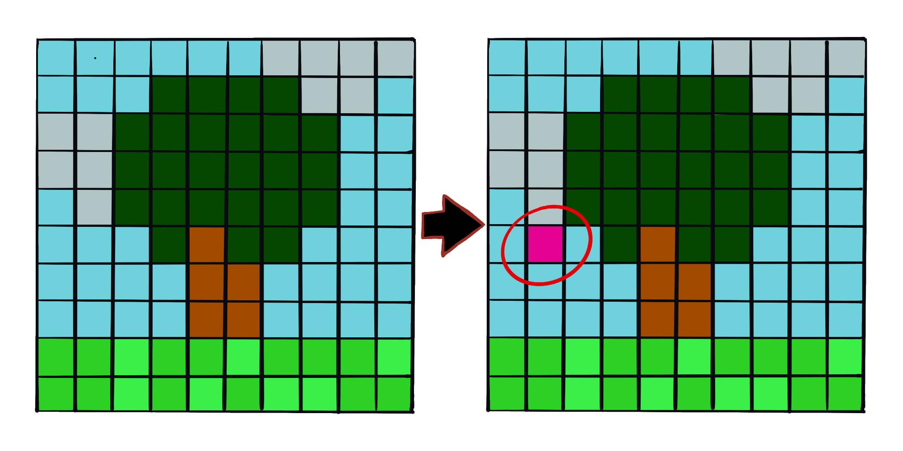
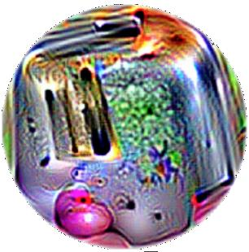
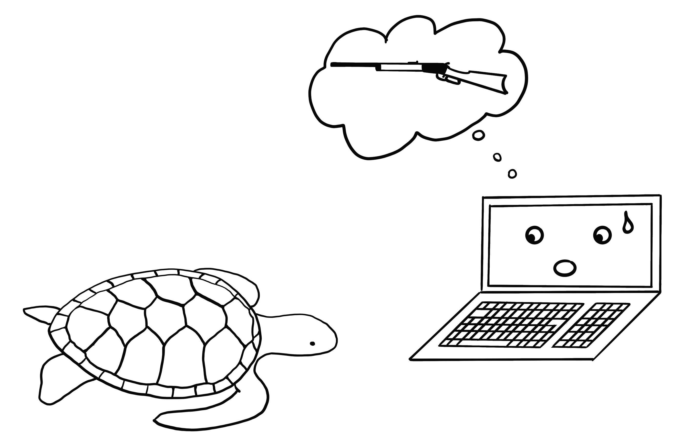

# فصل ۳۰: مثال‌های خصمانه

> **عنوان اصلی:** Adversarial Examples  
> **منبع:** [https://christophm.github.io/interpretable-ml-book/adversarial.html](https://christophm.github.io/interpretable-ml-book/adversarial.html)  
> **نویسنده:** Christoph Molnar  
> **مترجم:** مریم محمودی

---

مثال خصمانه (adversarial example) نمونه‌ای است با اختلال‌های کوچک و عمدی در ویژگی‌ها که باعث می‌شود یک مدل یادگیری ماشین پیش‌بینی نادرستی انجام دهد. توصیه می‌کنم نخست فصل [توضیح‌های خلاف‌واقع](15-counterfactual.md) را بخوانید، چون مفاهیم بسیار شبیه‌اند. مثال‌های خصمانه نمونه‌های خلاف‌واقعی هستند که هدفشان فریب‌دادن مدل است، نه تفسیر آن.

> **توضیح مترجم:** در این کتاب adversarial را «خصمانه» ترجمه کرده‌ام (در برخی منابع «متخاصم» هم می‌آید). «مثال خلاف‌واقع» نمونه‌ای است که کمی تغییر می‌کند تا پیش‌بینی مدل عوض شود و به ما بگوید «چه چیزی باید فرق می‌کرد»؛ مثال خصمانه همین ساختار را دارد ولی با نیت فریب. «پیش‌بینی نادرست» یعنی خروجی‌ای که با برچسب درست همخوان نیست.

چرا به مثال‌های خصمانه علاقه‌مندیم؟ آیا فقط محصولات جانبی کنجکاوی‌برانگیز مدل‌های یادگیری ماشین و بدون اهمیت عملی نیستند؟ پاسخ یک «نه» روشن است. مثال‌های خصمانه مدل‌های یادگیری ماشین را در برابر حمله آسیب‌پذیر می‌کنند، مانند سناریوهای زیر.

یک خودروی خودران با خودروی دیگری برخورد می‌کند چون علامت ایست را نادیده گرفته است. کسی تصویری روی علامت چسبانده بود که برای انسان‌ها مانند یک علامت ایست با کمی لکهٔ کثیفی به نظر می‌رسد، اما طوری طراحی شده بود که برای نرم‌افزار تشخیص علامت خودرو مانند علامت ممنوعیت توقف دیده شود.

یک آشکارساز هرزنامه (spam) نمی‌تواند ایمیلی را هرزنامه دسته‌بندی کند. هرزنامه طوری طراحی شده که شبیه یک ایمیل عادی باشد، اما با نیت فریب‌دادن گیرنده.

یک اسکنر مبتنی بر یادگیری ماشین چمدان‌ها را در فرودگاه برای یافتن سلاح اسکن می‌کند. چاقویی ساخته شده که با وادار کردن سامانه به اینکه فکر کند چتر است، از شناسایی می‌گریزد.

بیایید به چند روش ساخت مثال‌های خصمانه نگاهی بیندازیم.

## روش‌ها و مثال‌ها

تکنیک‌های بسیاری برای ساخت مثال‌های خصمانه وجود دارد. بیشتر رویکردها پیشنهاد می‌کنند فاصلهٔ بین مثال خصمانه و نمونه‌ای که قرار است دستکاری شود را کمینه کنیم، در حالی که پیش‌بینی را به نتیجهٔ دلخواه (خصمانه) می‌بریم. برخی روش‌ها به گرادیان‌های مدل دسترسی نیاز دارند، که البته فقط با مدل‌های مبتنی بر گرادیان مانند شبکه‌های عصبی کار می‌کند، در حالی که روش‌های دیگر فقط به تابع پیش‌بینی دسترسی می‌خواهند، که آن‌ها را مستقل از مدل (model-agnostic) می‌کند. روش‌های این بخش بر دسته‌بندهای تصویر با شبکه‌های عصبی عمیق تمرکز دارند، چون پژوهش بسیاری در این حوزه انجام شده و تجسم تصاویر خصمانه بسیار آموزنده است. مثال‌های خصمانه برای تصاویر، تصاویری با پیکسل‌های عمداً دستکاری‌شده‌اند که هدفشان فریب‌دادن مدل در زمان کاربرد (application time) است. این مثال‌ها به‌طرز شگفت‌انگیزی نشان می‌دهند شبکه‌های عصبی عمیق برای تشخیص اشیا چقدر آسان توسط تصاویری که برای انسان بی‌خطر به نظر می‌رسند فریب می‌خورند. اگر هنوز این مثال‌ها را ندیده‌اید، ممکن است شگفت‌زده شوید، چون تغییر در پیش‌بینی‌ها برای ناظر انسانی قابل‌درک نیست. مثال‌های خصمانه مانند خطای دید (optical illusion) هستند، ولی برای ماشین‌ها.

**مشکلی در سگ من هست**

[Szegedy و همکاران (۲۰۱۴)](appendix-D-references.md) در کارشان «ویژگی‌های جالب شبکه‌های عصبی» (Intriguing Properties of Neural Networks) از یک رویکرد بهینه‌سازی مبتنی بر گرادیان برای یافتن مثال‌های خصمانه برای شبکه‌های عصبی عمیق استفاده کردند. یک نتیجه در شکل ۳۰.۱ دیده می‌شود.

> **توضیح مترجم (متن داخل تصویر):** این تصویر متن ندارد. سه ردیف دارد (یک دستگاه مایع دستشویی، یک آخوندک و یک سگ پشمالوی سفید). در هر ردیف ستون چپ تصویر اصلی، ستون وسط الگوی نویزمانند رنگی خطا و ستون راست تصویر اختلال‌دار است که با چشم از تصویر اصلی تقریباً تفاوتی ندارد، ولی شبکه همهٔ آن‌ها را «شترمرغ» می‌خواند. ترتیب ستون‌ها از شرح شکل می‌آید.

این مثال‌های خصمانه با کمینه‌کردن تابع زیر نسبت به $\mathbf{r}$ ساخته شدند:

$$\text{loss}(\hat{f}(\mathbf{x}+\mathbf{r}), l) + c \cdot |\mathbf{r}|$$

در این فرمول، $\mathbf{x}$ یک تصویر است (که به‌صورت بردار پیکسل‌ها نمایش داده می‌شود)، $\mathbf{r}$ تغییر در پیکسل‌ها برای ساخت یک تصویر خصمانه است ($\mathbf{x} + \mathbf{r}$ یک تصویر جدید تولید می‌کند)، $l$ کلاس نتیجهٔ دلخواه است و پارامتر $c$ برای متعادل‌کردن فاصلهٔ بین تصاویر و فاصلهٔ بین پیش‌بینی‌ها به کار می‌رود. جملهٔ اول فاصلهٔ بین نتیجهٔ پیش‌بینی‌شدهٔ مثال خصمانه و کلاس دلخواه $l$ است؛ جملهٔ دوم فاصلهٔ بین مثال خصمانه و تصویر اصلی را می‌سنجد. این فرمول‌بندی تقریباً با تابع زیان تولید [توضیح‌های خلاف‌واقع](15-counterfactual.md) یکسان است. قیدهای اضافی‌ای برای $\mathbf{r}$ وجود دارد تا مقادیر پیکسل‌ها بین ۰ و ۱ بمانند. نویسندگان پیشنهاد می‌کنند این مسئلهٔ بهینه‌سازی با L-BFGS با قید جعبه‌ای (box-constrained L-BFGS) حل شود، الگوریتم بهینه‌سازی‌ای که با گرادیان‌ها کار می‌کند.

> **برای درک بهتر (توضیح مترجم):** فرمول دو هدف را هم‌زمان می‌خواهد: (۱) تصویر اختلال‌دار $\mathbf{x}+\mathbf{r}$ به کلاس دلخواه (مثلاً «شترمرغ») نزدیک شود (جملهٔ زیان) و (۲) اختلال $\mathbf{r}$ کوچک بماند تا تصویر برای انسان تغییری نکند (جملهٔ $c|\mathbf{r}|$). اگر $c$ بزرگ باشد، تصویر به اصلی نزدیک می‌ماند ولی شاید حمله موفق نشود؛ اگر $c$ کوچک باشد، حمله آسان‌تر موفق می‌شود ولی اختلال دیده می‌شود.

**پاندای مختل‌شده: روش علامت گرادیان سریع**

[Goodfellow و همکاران (۲۰۱۵)](appendix-D-references.md) روش علامت گرادیان سریع (fast gradient sign method) را برای ساخت تصاویر خصمانه ابداع کردند. روش علامت گرادیان از گرادیان مدل زیربنایی برای یافتن مثال‌های خصمانه استفاده می‌کند. تصویر اصلی $\mathbf{x}$ با افزودن یا کاستن یک خطای کوچک $\epsilon$ به هر پیکسل دستکاری می‌شود. اینکه $\epsilon$ را بیفزاییم یا بکاهیم به این بستگی دارد که علامت گرادیان برای یک پیکسل مثبت است یا منفی. افزودن خطاها در جهت گرادیان یعنی تصویر عمداً طوری تغییر می‌کند که دسته‌بندی مدل شکست بخورد.

فرمول زیر هستهٔ روش علامت گرادیان سریع را توصیف می‌کند:

$$\mathbf{x}^\prime = \mathbf{x} + \epsilon \cdot \text{sign}\left(\nabla\_{\mathbf{x}} J(\boldsymbol{\theta}, \mathbf{x}, y)\right)$$

که در آن $\nabla\_{\mathbf{x}} J$ گرادیان تابع زیان مدل نسبت به بردار پیکسل‌های ورودی اصلی $\mathbf{x}$ است، $y$ برچسب درست $\mathbf{x}$ و $\boldsymbol{\theta}$ بردار پارامترهای مدل است. از بردار گرادیان (که به‌اندازهٔ بردار پیکسل‌های ورودی طول دارد) فقط علامت را لازم داریم: علامت گرادیان مثبت (۱+) است اگر افزایش شدت پیکسل زیان (خطای مدل) را افزایش دهد و منفی (۱−) است اگر کاهش شدت پیکسل زیان را افزایش دهد. این آسیب‌پذیری زمانی رخ می‌دهد که شبکهٔ عصبی رابطهٔ بین شدت یک پیکسل ورودی و امتیاز کلاس را به‌صورت خطی در نظر بگیرد. به‌ویژه، معماری‌های شبکهٔ عصبی که خطی‌بودن را ترجیح می‌دهند، مانند LSTMها، شبکه‌های maxout، شبکه‌های با واحدهای فعال‌سازی ReLU، یا الگوریتم‌های یادگیری ماشین خطی دیگر مانند رگرسیون لجستیک، در برابر روش علامت گرادیان آسیب‌پذیرند. این حمله با برون‌یابی (extrapolation) انجام می‌شود. خطی‌بودن بین شدت پیکسل ورودی و امتیازهای کلاس به آسیب‌پذیری در برابر داده‌های پرت می‌انجامد، یعنی مدل را می‌توان با جابه‌جاکردن مقادیر پیکسل به نواحی بیرون از توزیع داده فریب داد. انتظار داشتم این مثال‌های خصمانه کاملاً مختص معماری یک شبکهٔ عصبی خاص باشند. اما معلوم می‌شود می‌توانید مثال‌های خصمانه را دوباره به کار ببرید تا شبکه‌هایی با معماری متفاوت را که روی همان وظیفه آموزش دیده‌اند فریب دهید.

> **برای درک بهتر (توضیح مترجم):** فرض کنید تصویر فقط سه پیکسل دارد و علامت‌های گرادیان زیان برای آن‌ها $(+,-,+)$ است و $\epsilon=0{,}01$. تصویر جدید هر پیکسل را به اندازهٔ $0{,}01$ در همین جهت‌ها جابه‌جا می‌کند: پیکسل اول و سوم $0{,}01$ روشن‌تر و پیکسل دوم $0{,}01$ تیره‌تر. تغییر هر پیکسل ناچیز است، اما چون همهٔ آن‌ها در جهت افزایش زیان‌اند، اثرشان روی هم جمع می‌شود و مدل خطا می‌کند. اعداد مثال ساختهٔ مترجم‌اند.

[Goodfellow و همکاران (۲۰۱۵)](appendix-D-references.md) پیشنهاد کردند مثال‌های خصمانه به داده‌های آموزشی اضافه شوند تا مدل‌های مستحکم (robust) آموخته شوند.

**یک چتر دریایی ... نه، صبر کنید. یک وان حمام: حمله‌های تک‌پیکسلی**

رویکرد ارائه‌شده توسط Goodfellow و همکارانش (۲۰۱۴) نیاز دارد پیکسل‌های بسیاری تغییر کنند، هرچند اندک. اما اگر فقط بتوانید یک پیکسل را تغییر دهید چه؟ آیا می‌توانید یک مدل یادگیری ماشین را فریب دهید؟ [Su و همکاران (۲۰۱۹)](appendix-D-references.md) نشان دادند که واقعاً ممکن است دسته‌بندهای تصویر را با تغییر یک پیکسل فریب داد، همان‌طور که در شکل ۳۰.۲ نشان داده شده است.

> **توضیح مترجم (متن داخل تصویر):** این تصویر متن ندارد و یک طرح ساده است: دو شبکهٔ ۱۰×۱۰ از پیکسل‌های رنگی (آسمان آبی، درخت سبز تیره با تنهٔ قهوه‌ای، چمن سبز و چند خانهٔ خاکستری)، با یک پیکان بین آن‌ها. در شبکهٔ راست فقط یک پیکسل صورتی پررنگ با دایرهٔ قرمز مشخص شده است؛ این تنها تفاوت دو تصویر است.

مانند خلاف‌واقع‌ها، حملهٔ تک‌پیکسلی به دنبال یک نمونهٔ تغییریافته $\mathbf{x}^\prime$ می‌گردد که به تصویر اصلی $\mathbf{x}$ نزدیک باشد، اما پیش‌بینی را به نتیجه‌ای خصمانه تغییر دهد. با این حال، تعریف نزدیکی متفاوت است: فقط یک پیکسل ممکن است تغییر کند. حملهٔ تک‌پیکسلی برای پی‌بردن به اینکه کدام پیکسل و چگونه تغییر کند از تکامل تفاضلی (differential evolution) استفاده می‌کند. تکامل تفاضلی به‌طور سست از تکامل زیستی گونه‌ها الهام گرفته است. جمعیتی از افراد به نام راه‌حل‌های کاندیدا نسل به نسل ترکیب می‌شوند تا راه‌حلی یافت شود. هر راه‌حل کاندیدا یک تغییر پیکسل را کدگذاری می‌کند و با یک بردار پنج‌عنصری نمایش داده می‌شود: مختصات $x$ و $y$ و مقادیر قرمز، سبز و آبی (RGB). جست‌وجو، برای مثال، با ۴۰۰ راه‌حل کاندیدا (= پیشنهاد تغییر پیکسل) شروع می‌شود و با استفاده از فرمول زیر نسل جدیدی از راه‌حل‌های کاندیدا (فرزندان) را از نسل والد می‌سازد:

$$\mathbf{x}\_{g+1}^{(i)} = \mathbf{x}\_g^{(r1)} + F \cdot (\mathbf{x}\_g^{(r2)}- \mathbf{x}\_g^{(r3)})$$

که در آن هر $x^{(i)}$ یک عنصر از یک راه‌حل کاندیدا است (مختصات $x$، مختصات $y$، قرمز، سبز یا آبی)، $g$ نسل فعلی است، $F$ پارامتر مقیاس‌دهی است (برابر ۰٫۵ تنظیم شده) و $r1$ و $r2$ و $r3$ اعداد تصادفی متفاوت‌اند. هر راه‌حل کاندیدای فرزند جدید به نوبهٔ خود یک پیکسل با پنج ویژگی مکان و رنگ است و هر یک از آن ویژگی‌ها ترکیبی از سه پیکسل والد تصادفی است.

ساخت فرزندان وقتی متوقف می‌شود که یکی از راه‌حل‌های کاندیدا مثال خصمانه باشد، یعنی در کلاسی نادرست دسته‌بندی شود، یا وقتی به حداکثر تعداد تکرارهای تعیین‌شده توسط کاربر برسیم.

> **توضیح مترجم:** در فرمول، $r1,r2,r3$ در منبع «اعداد تصادفی متفاوت» نامیده شده‌اند؛ در عمل شمارهٔ سه عضو تصادفی و متمایز از جمعیت‌اند. فرمول یعنی فرزند = یک والد + $0{,}5\times$ (تفاضل دو والد دیگر). اگر ۴۰۰ کاندیدا داشته باشیم، هر نسل ۴۰۰ پیکسل پیشنهادی جدید می‌سازد و دسته‌بند روی هر کدام امتحان می‌شود.

**همه‌چیز یک توستر است: وصلهٔ خصمانه**

یکی از روش‌های موردعلاقهٔ من مثال‌های خصمانه را به دنیای فیزیکی می‌آورد. [Brown و همکاران (۲۰۱۸)](appendix-D-references.md) برچسبی چاپ‌شدنی طراحی کردند که می‌توان آن را کنار اشیا چسباند تا برای یک دسته‌بند تصویر شبیه توستر به نظر برسند، شکل ۳۰.۳ را ببینید. کار درخشانی است!

> **توضیح مترجم (متن داخل تصویر):** این تصویر متن ندارد. یک وصلهٔ دایره‌ای است با طرح رنگارنگ و انتزاعی که لبه‌هایی شبیه توستر دارد (شیارهای نان و خطوط فلزی)؛ این همان برچسب خصمانه‌ای است که کنار موز قرار می‌گیرد.

این روش با روش‌هایی که تاکنون برای مثال‌های خصمانه ارائه شد فرق دارد، چون محدودیتی که تصویر خصمانه باید بسیار به تصویر اصلی نزدیک باشد حذف شده است. در عوض، روش بخشی از تصویر را کاملاً با وصله‌ای جایگزین می‌کند که می‌تواند هر شکلی داشته باشد. تصویر وصله روی تصاویر پس‌زمینهٔ مختلف و با موقعیت‌های مختلف وصله روی تصاویر بهینه می‌شود، گاهی جابه‌جاشده، گاهی بزرگ‌تر یا کوچک‌تر و چرخیده، تا وصله در موقعیت‌های بسیار کار کند. در پایان، این تصویر بهینه‌شده را می‌توان چاپ کرد و برای فریب دسته‌بندهای تصویر در دنیای واقعی به کار برد.

**هرگز یک لاک‌پشت چاپ سه‌بعدی‌شده را به یک تیراندازی نبرید -- حتی اگر رایانه‌تان فکر کند ایدهٔ خوبی است: مثال‌های خصمانهٔ مستحکم**

روش بعدی به معنای واقعی کلمه بعد دیگری به توستر می‌افزاید: [Athalye و همکاران (۲۰۱۸)](appendix-D-references.md) یک لاک‌پشت را چاپ سه‌بعدی کردند که طوری طراحی شده بود که از تقریباً همهٔ زاویه‌های ممکن برای یک شبکهٔ عصبی عمیق شبیه تفنگ به نظر برسد، همان‌طور که در شکل ۳۰.۴ نشان داده شده است. بله، درست خواندید. یک شیء فیزیکی که برای انسان‌ها شبیه لاک‌پشت است برای رایانه شبیه تفنگ است!

> **توضیح مترجم (متن داخل تصویر):** این تصویر متن ندارد و یک کاریکاتور سیاه‌وسفید است: لاک‌پشت دریایی در پایین چپ، و یک رایانهٔ لپ‌تاپ با چهرهٔ متعجب و قطرهٔ عرق در سمت راست که در حباب فکرش یک تفنگ می‌بیند. یعنی رایانه لاک‌پشت را «تفنگ» می‌پندارد.

نویسندگان راهی برای ساخت مثال خصمانه به‌صورت سه‌بعدی برای یک دسته‌بند دوبعدی یافته‌اند که نسبت به تبدیل‌ها، مانند همهٔ امکان‌های چرخاندن لاک‌پشت، بزرگ‌نمایی و غیره، خصمانه است. رویکردهای دیگر، مانند روش گرادیان سریع، وقتی تصویر چرخانده می‌شود یا زاویهٔ دید عوض می‌شود دیگر کار نمی‌کنند. Athalye و همکاران (۲۰۱۷) الگوریتم امید ریاضی روی تبدیل‌ها (Expectation Over Transformation یا EOT) را پیشنهاد می‌کنند، روشی برای ساخت مثال‌های خصمانه که حتی وقتی تصویر تبدیل شود کار می‌کنند. ایدهٔ اصلی پشت EOT بهینه‌کردن مثال‌های خصمانه روی بسیاری از تبدیل‌های ممکن است. به‌جای کمینه‌کردن فاصلهٔ بین مثال خصمانه و تصویر اصلی، EOT فاصلهٔ مورد انتظار بین این دو را، با فرض توزیع انتخاب‌شده‌ای از تبدیل‌های ممکن، زیر یک آستانهٔ معین نگه می‌دارد. فاصلهٔ مورد انتظار تحت تبدیل را می‌توان چنین نوشت:

$$\mathbb{E}\_{t \sim T}[d(t(\mathbf{x}^\prime), t(\mathbf{x}))]$$

که در آن $\mathbf{x}$ تصویر اصلی، $t(\mathbf{x})$ تصویر تبدیل‌شده (مثلاً چرخیده)، $\mathbf{x}^\prime$ مثال خصمانه و $t(\mathbf{x}^\prime)$ نسخهٔ تبدیل‌شدهٔ آن است. جدا از کار با یک توزیع از تبدیل‌ها، روش EOT الگوی آشنای چارچوب‌بندی جست‌وجوی مثال‌های خصمانه به‌عنوان مسئلهٔ بهینه‌سازی را دنبال می‌کند. می‌کوشیم مثال خصمانه‌ای $\mathbf{x}^\prime$ بیابیم که احتمال کلاس انتخاب‌شده $y\_t$ (مثلاً «تفنگ») را روی توزیع تبدیل‌های ممکن $T$ بیشینه کند:

$$\arg\max\_{\mathbf{x}^\prime} \mathbb{E}\_{t \sim T}[\log \mathbb{P}(y\_t | t(\mathbf{x}^\prime))]$$

با این قید که فاصلهٔ مورد انتظار روی همهٔ تبدیل‌های ممکن بین مثال خصمانه $\mathbf{x}^\prime$ و تصویر اصلی $\mathbf{x}$ زیر یک آستانهٔ معین بماند:

$$\mathbb{E}\_{t \sim T}[d(t(\mathbf{x}^\prime), t(\mathbf{x}))] < \epsilon \quad \text{and} \quad \mathbf{x} \in [0,1]^d$$

فکر می‌کنم باید نگران امکان‌هایی باشیم که این روش ایجاد می‌کند. روش‌های دیگر بر دستکاری تصاویر دیجیتال استوارند. اما این مثال‌های خصمانهٔ مستحکم چاپ‌شدهٔ سه‌بعدی را می‌توان در هر صحنهٔ واقعی قرار داد و رایانه را فریب داد تا یک شیء را اشتباه دسته‌بندی کند. بیایید برعکسش کنیم: اگر کسی تفنگی بسازد که شبیه لاک‌پشت باشد چه؟

> **برای درک بهتر (توضیح مترجم):** «امید ریاضی روی تبدیل‌ها» یعنی به‌جای اینکه مثال خصمانه را فقط برای یک عکس ثابت بهینه کنیم، آن را برای میانگین روی بسیاری از چرخش‌ها، بزرگ‌نمایی‌ها و نورپردازی‌ها بهینه می‌کنیم. اگر حمله فقط برای یک زاویه کار کند، با چرخاندن لاک‌پشت از بین می‌رود؛ اما اگر برای میانگین زاویه‌ها بهینه شده باشد، در بیشتر زاویه‌ها کار می‌کند. همچنین در فرمول $d$ تابع فاصله و $\epsilon$ آستانهٔ فاصله است؛ در متن منبع $d$ (بُعد/تعداد پیکسل‌ها در $[0,1]^d$) و $d(\cdot)$ (تابع فاصله) هر دو با حرف $d$ آمده‌اند.

**دشمن چشم‌بسته: حملهٔ جعبه‌سیاه**

سناریوی زیر را تصور کنید: به شما از طریق یک API وب به دسته‌بند تصویر عالی من دسترسی می‌دهم. می‌توانید از مدل پیش‌بینی بگیرید، ولی به پارامترهای مدل دسترسی ندارید. از راحتی مبل‌تان می‌توانید داده بفرستید و سرویس من با دسته‌بندی‌های متناظر پاسخ می‌دهد. بیشتر حمله‌های خصمانه برای کار در این سناریو طراحی نشده‌اند، چون برای یافتن مثال‌های خصمانه به دسترسی به گرادیان شبکهٔ عصبی عمیق زیربنایی نیاز دارند. [Papernot و همکاران (۲۰۱۷)](appendix-D-references.md) نشان دادند که می‌توان مثال‌های خصمانه را بدون اطلاعات درونی مدل و بدون دسترسی به داده‌های آموزشی ساخت. این نوع حملهٔ (تقریباً) بدون دانش را حملهٔ جعبه‌سیاه (black box attack) می‌نامند.

نحوهٔ کار:

1. با چند تصویر که از همان حوزهٔ داده‌های آموزشی می‌آیند شروع کنید؛ مثلاً اگر دسته‌بند مورد حمله یک دسته‌بند ارقام است، از تصاویر ارقام استفاده کنید. دانستن حوزه لازم است، اما دسترسی به داده‌های آموزشی نه.
1. برای مجموعهٔ فعلی تصاویر از جعبه‌سیاه پیش‌بینی بگیرید.
1. یک مدل جانشین (surrogate) را روی مجموعهٔ فعلی تصاویر آموزش دهید (برای مثال یک شبکهٔ عصبی).
1. با استفاده از یک اکتشاف (heuristic) که برای مجموعهٔ فعلی تصاویر بررسی می‌کند پیکسل‌ها در چه جهتی دستکاری شوند تا خروجی مدل واریانس بیشتری داشته باشد، مجموعهٔ جدیدی از تصاویر مصنوعی بسازید.
1. گام‌های ۲ تا ۴ را برای تعداد از پیش تعیین‌شده‌ای دوره (epoch) تکرار کنید.
1. با روش گرادیان سریع (یا مشابه) برای مدل جانشین مثال‌های خصمانه بسازید.
1. با مثال‌های خصمانه به مدل اصلی حمله کنید.

هدف مدل جانشین تقریب مرزهای تصمیم مدل جعبه‌سیاه است، نه لزوماً رسیدن به همان دقت.

نویسندگان این رویکرد را با حمله به دسته‌بندهای تصویری که روی خدمات ابری مختلف یادگیری ماشین آموزش دیده بودند آزمودند. این خدمات دسته‌بندهای تصویر را روی تصاویر و برچسب‌های بارگذاری‌شدهٔ کاربر آموزش می‌دهند. نرم‌افزار مدل را به‌طور خودکار آموزش می‌دهد -- گاهی با الگوریتمی ناشناخته برای کاربر -- و آن را مستقر می‌کند. دسته‌بند سپس برای تصاویر بارگذاری‌شده پیش‌بینی می‌دهد، اما خود مدل را نمی‌توان بازرسی یا دانلود کرد. نویسندگان توانستند برای ارائه‌دهندگان مختلف مثال‌های خصمانه بیابند و تا ۸۴٪ مثال‌های خصمانه نادرست دسته‌بندی شدند.

این روش حتی وقتی مدل جعبه‌سیاهی که باید فریب بخورد شبکهٔ عصبی نباشد هم کار می‌کند. این شامل مدل‌های یادگیری ماشین بدون گرادیان مانند درخت‌های تصمیم هم می‌شود.

## دیدگاه امنیت سایبری

یادگیری ماشین با «ناشناخته‌های شناخته‌شده» سروکار دارد: پیش‌بینی نقاط داده‌ای ناشناخته از یک توزیع شناخته‌شده. دفاع در برابر حمله‌ها با «ناشناخته‌های ناشناخته» سروکار دارد: پیش‌بینی مستحکم نقاط داده‌ای ناشناخته از یک توزیع ناشناختهٔ ورودی‌های خصمانه. با ادغام یادگیری ماشین در سامانه‌های بیشتر و بیشتر، مانند خودروهای خودران یا دستگاه‌های پزشکی، آن‌ها به نقاط ورود برای حمله هم تبدیل می‌شوند. حتی اگر پیش‌بینی‌های یک مدل یادگیری ماشین روی یک مجموعه‌دادهٔ آزمون ۱۰۰٪ درست باشد، می‌توان مثال‌های خصمانه یافت که مدل را فریب دهند. دفاع از مدل‌های یادگیری ماشین در برابر حمله‌های سایبری بخش جدیدی از حوزهٔ امنیت سایبری است.

[Biggio و Roli (۲۰۱۸)](appendix-D-references.md) مرور خوبی از ده سال پژوهش دربارهٔ یادگیری ماشین خصمانه ارائه می‌دهند که این بخش بر آن استوار است. امنیت سایبری یک مسابقهٔ تسلیحاتی است که در آن مهاجمان و مدافعان بارها همدیگر را فریب می‌دهند.

> **توضیح مترجم:** «ناشناخته‌های شناخته‌شده» یعنی نمونه‌های جدیدی که از همان توزیع داده‌های آموزشی می‌آیند (نمی‌دانیم هر نمونه چیست، ولی می‌دانیم از کجا می‌آید). «ناشناخته‌های ناشناخته» یعنی ورودی‌هایی که مهاجم عمداً از بیرون این توزیع می‌سازد. در متن منبع Biggio و Roli با عنوان «biggio2018wild» ارجاع شده‌اند.

**سه قانون طلایی در امنیت سایبری وجود دارد: ۱) دشمن خود را بشناسید، ۲) پیش‌دستانه عمل کنید و ۳) از خودتان محافظت کنید.**

کاربردهای مختلف دشمنان مختلف دارند. افرادی که می‌کوشند از راه ایمیل دیگران را برای پولشان فریب دهند، عوامل دشمن کاربران و ارائه‌دهندگان خدمات ایمیل‌اند. ارائه‌دهندگان می‌خواهند از کاربرانشان محافظت کنند تا بتوانند به استفاده از برنامهٔ ایمیلشان ادامه دهند؛ مهاجمان می‌خواهند مردم را وادار کنند به آن‌ها پول بدهند. شناخت دشمنانتان یعنی شناخت هدف‌هایشان. اگر فرض کنید نمی‌دانید این هرزنامه‌فرستان وجود دارند و تنها سوءاستفاده از سرویس ایمیل ارسال نسخه‌های دزدی موسیقی است، آنگاه دفاع متفاوت می‌بود (مثلاً اسکن پیوست‌ها برای محتوای دارای حق نشر به‌جای تحلیل متن برای نشانه‌های هرزنامه).

پیش‌دستانه‌بودن یعنی فعالانه آزمودن و شناسایی نقاط ضعف سامانه. وقتی فعالانه می‌کوشید مدل را با مثال‌های خصمانه فریب دهید و سپس در برابر آن‌ها دفاع کنید، پیش‌دستانه عمل می‌کنید. استفاده از روش‌های تفسیر برای فهمیدن اینکه کدام ویژگی‌ها مهم‌اند و ویژگی‌ها چگونه بر پیش‌بینی اثر می‌گذارند هم گام پیش‌دستانه‌ای برای فهم نقاط ضعف یک مدل یادگیری ماشین است. شما به‌عنوان دانشمند داده، آیا در این دنیای خطرناک به مدلتان اعتماد دارید بی‌آنکه هرگز فراتر از توان پیش‌بینی روی یک مجموعه‌دادهٔ آزمون نگاه کرده باشید؟ آیا بررسی کرده‌اید مدل در سناریوهای مختلف چگونه رفتار می‌کند، مهم‌ترین ورودی‌ها را شناسایی کرده‌اید و توضیح‌های پیش‌بینی را برای چند مثال بررسی کرده‌اید؟ آیا کوشیده‌اید ورودی‌های خصمانه بیابید؟ تفسیرپذیری مدل‌های یادگیری ماشین نقش بزرگی در امنیت سایبری دارد. واکنشی‌بودن (reactive)، نقطهٔ مقابل پیش‌دستانه‌بودن، یعنی منتظر ماندن تا سامانه مورد حمله قرار گیرد و تنها آن‌گاه مسئله را فهمیدن و چند اقدام دفاعی نصب کردن.

چگونه می‌توانیم سامانه‌های یادگیری ماشین‌مان را در برابر مثال‌های خصمانه محافظت کنیم؟ یک رویکرد پیش‌دستانه بازآموزی تکراری دسته‌بند با مثال‌های خصمانه است که آموزش خصمانه (adversarial training) هم نامیده می‌شود. رویکردهای دیگر بر نظریهٔ بازی‌ها استوارند، مانند یادگیری تبدیل‌های ناوردای ویژگی‌ها یا بهینه‌سازی مستحکم (منظم‌سازی). روش پیشنهادی دیگر استفاده از چند دسته‌بند به‌جای فقط یکی و رأی‌گیری آن‌ها برای پیش‌بینی است (ensemble)، اما تضمینی برای کارکرد ندارد، چون همهٔ آن‌ها ممکن است از مثال‌های خصمانهٔ مشابه آسیب ببینند. رویکرد دیگری که آن هم خوب کار نمی‌کند پنهان‌سازی گرادیان (gradient masking) است، که می‌توان با ساخت مدلی بدون گرادیان‌های مفید و با استفاده از دسته‌بند نزدیک‌ترین همسایه به‌جای مدل اصلی به دست آورد.

می‌توانیم انواع حمله را بر اساس اینکه مهاجم چقدر دربارهٔ سامانه می‌داند از هم تمیز دهیم. مهاجمان ممکن است دانش کامل داشته باشند (حملهٔ جعبه‌سفید یا white box)، یعنی همه‌چیز دربارهٔ مدل مانند نوع مدل، پارامترها و داده‌های آموزشی را بدانند؛ مهاجمان ممکن است دانش جزئی داشته باشند (حملهٔ جعبه‌خاکستری یا gray box)، یعنی شاید فقط نمایش ویژگی‌ها و نوع مدل به‌کاررفته را بدانند، اما به داده‌های آموزشی یا پارامترها دسترسی نداشته باشند؛ مهاجمان ممکن است دانش صفر داشته باشند (حملهٔ جعبه‌سیاه)، یعنی فقط بتوانند مدل را به شیوهٔ جعبه‌سیاه پرس‌وجو کنند اما به داده‌های آموزشی یا اطلاعات پارامترهای مدل دسترسی نداشته باشند. بسته به سطح اطلاعات، مهاجمان می‌توانند از تکنیک‌های مختلف برای حمله به مدل استفاده کنند. همان‌طور که در مثال‌ها دیدیم، حتی در حالت جعبه‌سیاه هم می‌توان مثال خصمانه ساخت، پس پنهان‌کردن اطلاعات دربارهٔ داده و مدل برای محافظت در برابر حمله‌ها کافی نیست.

با توجه به ماهیت بازی موش و گربه بین مهاجمان و مدافعان، شاهد پیشرفت و نوآوری بسیاری در این حوزه خواهیم بود. فقط به انواع مختلف ایمیل‌های هرزنامه فکر کنید که پیوسته در حال تحول‌اند. روش‌های جدید حمله علیه مدل‌های یادگیری ماشین ابداع می‌شوند و اقدام‌های دفاعی جدید در برابر این حمله‌های جدید پیشنهاد می‌شوند. حمله‌های قدرتمندتری برای دورزدن آخرین دفاع‌ها ساخته می‌شوند و همین‌طور تا ابد. با این فصل امیدوارم شما را نسبت به مسئلهٔ مثال‌های خصمانه حساس کرده باشم و اینکه تنها با مطالعهٔ پیش‌دستانهٔ مدل‌های یادگیری ماشین می‌توانیم ضعف‌ها را کشف و رفع کنیم.
