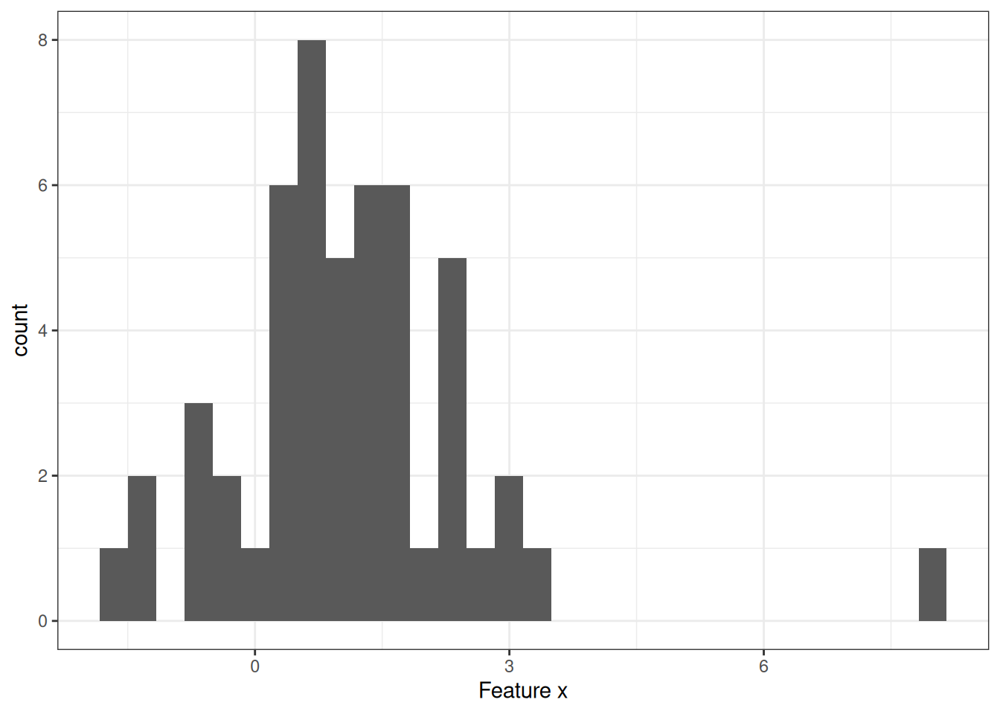
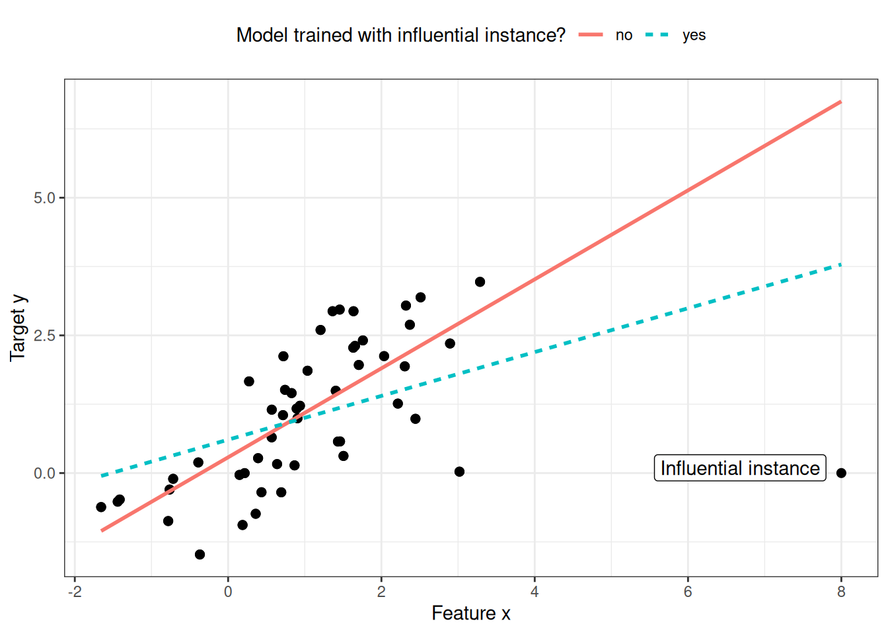
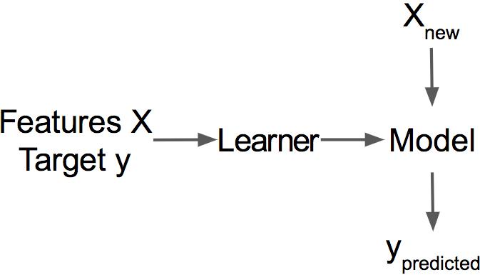
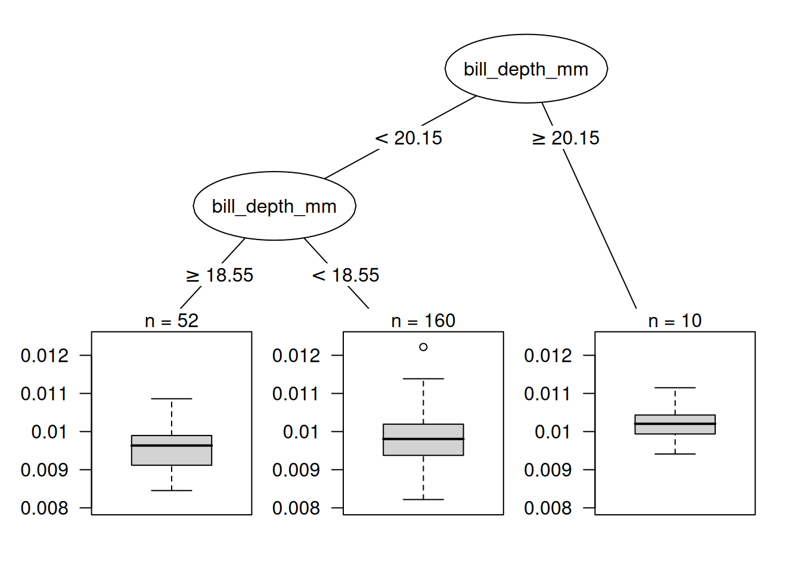
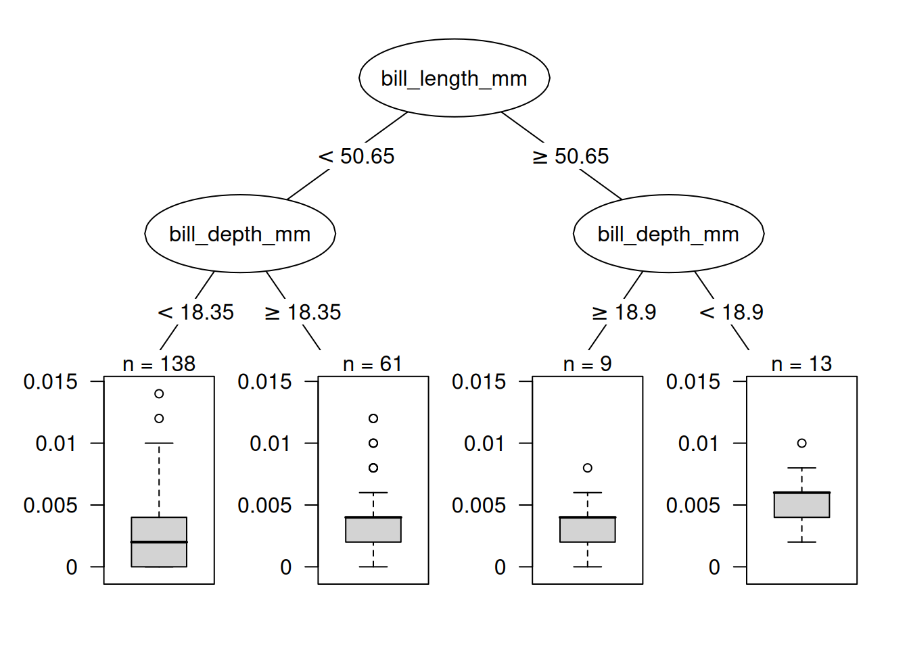

# فصل ۳۱: نمونه‌های تأثیرگذار

> **عنوان اصلی:** Influential Instances  
> **منبع:** [https://christophm.github.io/interpretable-ml-book/influential.html](https://christophm.github.io/interpretable-ml-book/influential.html)  
> **نویسنده:** Christoph Molnar  
> **مترجم:** مریم محمودی

---

مدل‌های یادگیری ماشین در نهایت محصول داده‌های آموزشی‌اند و حذف یکی از نمونه‌های آموزشی می‌تواند مدل حاصل را تغییر دهد. یک نمونهٔ آموزشی را «تأثیرگذار» (influential) می‌نامیم وقتی حذفش از داده‌های آموزشی پارامترها یا پیش‌بینی‌های مدل را به‌طور قابل‌توجهی تغییر دهد. با شناسایی نمونه‌های آموزشی تأثیرگذار می‌توانیم مدل‌های یادگیری ماشین را «اشکال‌زدایی» (debug) کنیم و رفتار و پیش‌بینی‌های آن‌ها را بهتر توضیح دهیم.

این فصل دو رویکرد برای شناسایی نمونه‌های تأثیرگذار نشان می‌دهد: تشخیص‌های حذفی (deletion diagnostics) و توابع تأثیر (influence functions). هر دو رویکرد بر آمار استوار (robust statistics) مبتنی‌اند، که روش‌های آماری‌ای فراهم می‌کند که کمتر تحت تأثیر داده‌های پرت یا نقض مفروضات مدل قرار می‌گیرند. آمار استوار همچنین روش‌هایی برای اندازه‌گیری میزان استواری برآوردهای حاصل از داده (مانند برآورد میانگین یا وزن‌های یک مدل پیش‌بینی) فراهم می‌کند.

> **توضیح مترجم:** «نمونه» (instance) در این فصل یک ردیف از داده‌های آموزشی است. «آمار استوار» شاخه‌ای از آمار است که روش‌هایی می‌سازد که با چند داده‌ٔ غیرعادی به‌سادگی خراب نشوند؛ میانه از این نظر از میانگین استوارتر است. «اشکال‌زدایی مدل» یعنی یافتن علت رفتار نادرست مدل، که اینجا به داده‌های آموزشی مسئول بازمی‌گردد.

تصور کنید می‌خواهید میانگین درآمد مردم شهرتان را برآورد کنید و از ده نفر تصادفی در خیابان می‌پرسید چقدر درآمد دارند. جدا از این واقعیت که نمونهٔ شما احتمالاً واقعاً بد است، برآورد میانگین درآمد شما چقدر می‌تواند تحت تأثیر یک نفر قرار گیرد؟ برای پاسخ به این پرسش، می‌توانید با حذف پاسخ‌های منفرد میانگین را دوباره حساب کنید، یا از راه ریاضی با «توابع تأثیر» استنتاج کنید میانگین چگونه می‌تواند تحت تأثیر قرار گیرد. با رویکرد حذف، میانگین را ده بار دوباره حساب می‌کنیم و هر بار یکی از اظهارات درآمد را کنار می‌گذاریم و می‌سنجیم برآورد میانگین چقدر تغییر کرده است. تغییر بزرگ یعنی یک نمونه بسیار تأثیرگذار بوده است. رویکرد دوم یکی از افراد را با وزن بی‌نهایت کوچک افزایش وزن می‌دهد (upweight)، که معادل محاسبهٔ مشتق اول یک آماره یا مدل است. این رویکرد «رویکرد بی‌نهایت‌کوچک» یا «تابع تأثیر» هم نامیده می‌شود. پاسخ، به‌هرحال، این است که برآورد میانگین شما می‌تواند به‌شدت تحت تأثیر یک پاسخ منفرد قرار گیرد، چون میانگین به‌طور خطی با مقادیر منفرد مقیاس می‌شود. انتخاب استوارتر میانه است (مقداری که نیمی از مردم بیشتر و نیم دیگر کمتر از آن درآمد دارند)، چون حتی اگر فردی با بالاترین درآمد نمونهٔ شما ده برابر بیشتر درآمد داشته باشد، میانهٔ حاصل تغییر نخواهد کرد.

> **برای درک بهتر (توضیح مترجم):** فرض کنید درآمد پنج نفر (به میلیون) ۲۰، ۲۲، ۲۵، ۲۸ و ۳۰ است. میانگین ۲۵٫۰ و میانه ۲۵ است. اگر نفر پنجم ۳۰ را به ۳۰۰ تغییر دهد، میانگین به ۷۹٫۰ می‌رسد، ولی میانه همان ۲۵ می‌ماند. این یعنی میانگین به یک نمونه بسیار حساس (کم‌استوار) و میانه استوار است. اعداد مثال ساختهٔ مترجم‌اند.

تشخیص‌های حذفی و توابع تأثیر را می‌توان برای پارامترها یا پیش‌بینی‌های مدل‌های یادگیری ماشین هم به کار برد تا رفتارشان بهتر فهمیده شود یا پیش‌بینی‌های منفرد توضیح داده شوند. پیش از بررسی این دو رویکرد برای یافتن نمونه‌های تأثیرگذار، تفاوت بین یک داده‌پرت و یک نمونهٔ تأثیرگذار را بررسی می‌کنیم.

**داده‌پرت**

داده‌پرت (outlier) نمونه‌ای است که از نمونه‌های دیگر مجموعه‌داده دور است. «دور» یعنی فاصله، مثلاً فاصلهٔ اقلیدسی، تا همهٔ نمونه‌های دیگر بسیار بزرگ است. در مجموعه‌دادهٔ نوزادان، نوزادی با وزن ۵ کیلوگرم داده‌پرت به شمار می‌آید. در مجموعه‌دادهٔ حساب‌های بانکی که بیشتر حساب جاری‌اند، یک حساب وام اختصاصی (موجودی منفی بزرگ، تراکنش کم) داده‌پرت به شمار می‌آید. شکل ۳۱.۱ یک داده‌پرت را برای توزیع یک‌بعدی نشان می‌دهد.

> **توضیح مترجم (متن داخل تصویر):** نمودار هیستوگرام است. محور افقی `Feature x` (ویژگی x) و محور عمودی `count` (تعداد) است. بیشتر داده‌ها حول مقدار ۱ تا ۲ تجمع دارند و یک ستون تک‌نمونه‌ای جدا در حدود x=۸ دیده می‌شود، که همان داده‌پرت است.

داده‌پرت‌ها می‌توانند نقاط داده‌ای جالب باشند (مثلاً [انتقادها](26-prototypes.md)). وقتی یک داده‌پرت بر مدل اثر می‌گذارد، نمونهٔ تأثیرگذار هم هست.

**نمونهٔ تأثیرگذار**

نمونهٔ تأثیرگذار نمونهٔ داده‌ای است که حذفش اثر قوی بر مدل آموزش‌دیده دارد. هرچه پارامترها یا پیش‌بینی‌های مدل بیشتر تغییر کنند، وقتی مدل با حذف یک نمونهٔ مشخص از داده‌های آموزشی دوباره آموزش داده می‌شود، آن نمونه تأثیرگذارتر است. اینکه یک نمونه برای یک مدل آموزش‌دیده تأثیرگذار باشد یا نه، به مقدار آن برای هدف $y$ هم بستگی دارد. شکل ۳۱.۲ یک نمونهٔ تأثیرگذار برای یک مدل رگرسیون خطی را نشان می‌دهد.

> **توضیح مترجم (متن داخل تصویر):** محور افقی `Feature x` و محور عمودی `Target y` (هدف y) است. عنوان راهنما `Model trained with influential instance?` (مدلی که با نمونهٔ تأثیرگذار آموزش دیده؟) است: خط ممتد قرمز با برچسب `no` (خیر) مدل بدون نمونه و خط خط‌چین فیروزه‌ای با برچسب `yes` (بله) مدل با نمونه است. برچسب جعبه‌ای `Influential instance` (نمونهٔ تأثیرگذار) به نقطهٔ پایین راست در x=۸ اشاره دارد. این یک نقطه شیب خط را به‌طرز چشمگیری کم می‌کند.

> **توضیح مترجم:** داده‌پرت‌بودن (دوربودن از بقیه در فضای ویژگی) و تأثیرگذاربودن (اثر بر مدل) یکی نیستند. در شکل ۳۱.۱ نقطهٔ x=۸ داده‌پرت است؛ اگر مقدار $y$ آن با روند بقیه همخوان باشد (مثلاً بالای خط)، مدل را تقریباً تغییر نمی‌دهد و تأثیرگذار نیست. در شکل ۳۱.۲ مقدار $y$ آن ($0$) با روند ناهمخوان است و به همین دلیل شیب را به‌شدت عوض می‌کند. به همین دلیل متن می‌گوید تأثیرگذاربودن به $y$ هم بستگی دارد.

**چرا نمونه‌های تأثیرگذار به فهم مدل کمک می‌کنند؟**

ایدهٔ کلیدی پشت نمونه‌های تأثیرگذار برای تفسیرپذیری، ردیابی پارامترها و پیش‌بینی‌های مدل به جایی است که همه‌چیز از آنجا شروع شد: داده‌های آموزشی. یادگیرنده (learner)، یعنی الگوریتمی که مدل یادگیری ماشین را تولید می‌کند، تابعی است که داده‌های آموزشی متشکل از ویژگی‌های $\mathbf{X}$ و بردار هدف $\mathbf{y}$ را می‌گیرد و یک مدل یادگیری ماشین تولید می‌کند، همچنین شکل ۳۱.۳ را ببینید. برای مثال، یادگیرندهٔ یک درخت تصمیم الگوریتمی است که ویژگی‌های شکست و مقادیری را که در آن‌ها شکست انجام می‌شود انتخاب می‌کند. یادگیرنده برای شبکهٔ عصبی از پس‌انتشار برای یافتن بهترین وزن‌ها استفاده می‌کند.

> **توضیح مترجم (متن داخل تصویر):** متن‌های تصویر: `Features X` (ویژگی‌های X) و `Target y` (هدف y) با پیکان به `Learner` (یادگیرنده)، سپس به `Model` (مدل). `X_new` (X جدید) از بالا به مدل وارد می‌شود و `y_predicted` (y پیش‌بینی‌شده) از پایین خارج می‌شود.

می‌پرسیم اگر نمونه‌ها را در فرایند آموزش از داده‌های آموزشی حذف کنیم، پارامترها یا پیش‌بینی‌های مدل چگونه تغییر می‌کردند. این در تقابل با رویکردهای تفسیرپذیری دیگر است که تحلیل می‌کنند وقتی ویژگی‌های نمونه‌هایی را که باید پیش‌بینی شوند دستکاری می‌کنیم پیش‌بینی چگونه تغییر می‌کند، مانند [نمودارهای وابستگی جزئی](19-pdp.md) یا [اهمیت ویژگی](23-feature-importance.md). با نمونه‌های تأثیرگذار، مدل را ثابت در نظر نمی‌گیریم، بلکه تابعی از داده‌های آموزشی می‌دانیم. نمونه‌های تأثیرگذار به ما کمک می‌کنند به پرسش‌هایی دربارهٔ رفتار سراسری مدل و پیش‌بینی‌های منفرد پاسخ دهیم. کدام نمونه‌ها در مجموع برای پارامترها یا پیش‌بینی‌های مدل بیشترین تأثیر را داشتند؟ کدام نمونه‌ها برای یک پیش‌بینی مشخص بیشترین تأثیر را داشتند؟ نمونه‌های تأثیرگذار به ما می‌گویند مدل برای کدام نمونه‌ها ممکن است مشکل داشته باشد، کدام نمونه‌های آموزشی باید برای خطا بررسی شوند، و تصوری از استواری مدل می‌دهند. اگر یک نمونه تأثیر قوی بر پیش‌بینی‌ها و پارامترهای مدل داشته باشد، ممکن است به مدل اعتماد نکنیم. دست‌کم این ما را وا می‌دارد بیشتر بررسی کنیم.

چگونه می‌توانیم نمونه‌های تأثیرگذار را بیابیم؟ دو راه برای اندازه‌گیری تأثیر داریم: گزینهٔ نخست حذف نمونه از داده‌های آموزشی، آموزش دوبارهٔ مدل روی مجموعه‌دادهٔ آموزشی کاهش‌یافته و مشاهدهٔ تفاوت در پارامترها یا پیش‌بینی‌های مدل است (چه به‌طور منفرد چه روی کل مجموعه‌داده). گزینهٔ دوم افزایش وزن یک نمونهٔ داده با تقریب تغییرات پارامتر بر پایهٔ گرادیان‌های پارامترهای مدل است. رویکرد حذف فهمش آسان‌تر است و انگیزه‌ای برای رویکرد افزایش وزن فراهم می‌کند، پس با آن شروع می‌کنیم.

## تشخیص‌های حذفی

آماردانان پیش‌تر پژوهش‌های بسیاری در حوزهٔ نمونه‌های تأثیرگذار انجام داده‌اند، به‌ویژه برای مدل‌های رگرسیون خطی (تعمیم‌یافته). وقتی «مشاهدات تأثیرگذار» را جست‌وجو می‌کنید، نخستین نتایج دربارهٔ معیارهایی مانند DFBETA و فاصلهٔ کوک (Cook's distance) هستند. **DFBETA** اثر حذف یک نمونه بر پارامترهای مدل را می‌سنجد. **فاصلهٔ کوک** [(Cook ۱۹۷۷)](appendix-D-references.md) اثر حذف یک نمونه بر پیش‌بینی‌های مدل را می‌سنجد. برای هر دو معیار باید مدل را بارها از نو آموزش دهیم و هر بار نمونه‌های منفرد را کنار بگذاریم. پارامترها یا پیش‌بینی‌های مدل با همهٔ نمونه‌ها با پارامترها یا پیش‌بینی‌های مدلی مقایسه می‌شوند که یکی از نمونه‌ها از داده‌های آموزشی حذف شده است.

DFBETA این‌گونه تعریف می‌شود:

$$DFBETA\_{i}=\boldsymbol{\beta}-\boldsymbol{\beta}^{(-i)}$$

که در آن $\boldsymbol{\beta}$ بردار وزن‌هاست وقتی مدل روی همهٔ نمونه‌های داده آموزش می‌بیند و $\boldsymbol{\beta^{(-i)}}$ بردار وزن‌هاست وقتی مدل بدون نمونهٔ $i$ آموزش می‌بیند. می‌توانم بگویم کاملاً شهودی است. DFBETA فقط برای مدل‌هایی با پارامتر وزن، مانند رگرسیون لجستیک یا شبکه‌های عصبی، کار می‌کند، اما برای مدل‌هایی مانند درخت‌های تصمیم، گروه‌های درختی (tree ensembles)، برخی ماشین‌های بردار پشتیبان و مانند آن‌ها نه.

فاصلهٔ کوک برای مدل‌های رگرسیون خطی ابداع شد و تقریب‌هایی برای مدل‌های رگرسیون خطی تعمیم‌یافته وجود دارد. فاصلهٔ کوک برای یک نمونهٔ آموزشی به‌صورت مجموع (مقیاس‌شدهٔ) مربع تفاوت‌ها در نتیجهٔ پیش‌بینی‌شده تعریف می‌شود وقتی نمونهٔ $i$-ام از آموزش مدل حذف شود.

$$D\_i=\frac{\sum\_{j=1}^n(\hat{y}\_j-\hat{y}\_{j}^{(-i)})^2}{p\cdot{}MSE}$$

که در آن صورت کسر مربع تفاوت پیش‌بینی مدل با و بدون نمونهٔ $i$-ام است که روی مجموعه‌داده جمع زده شده است. مخرج تعداد ویژگی‌ها $p$ ضرب در میانگین مربعات خطا (MSE) است. مخرج برای همهٔ نمونه‌ها یکسان است، مهم نیست کدام نمونهٔ $i$ حذف شود. فاصلهٔ کوک به ما می‌گوید وقتی نمونهٔ $i$-ام را از آموزش حذف می‌کنیم، خروجی پیش‌بینی‌شدهٔ یک مدل خطی چقدر تغییر می‌کند.

> **برای درک بهتر (توضیح مترجم):** فرض کنید مدلی با ۳ نمونه برای هر نمونه پیش‌بینی $(10, 20, 30)$ می‌دهد و پس از حذف نمونهٔ اول پیش‌بینی‌ها $(11, 19, 30)$ می‌شوند. تفاوت‌ها $(-1, +1, 0)$ هستند، مجموع مربعاتشان ۲ و صورت کسر فاصلهٔ کوک ۲ است. تقسیم بر $p\cdot MSE$ فقط این عدد را مقیاس می‌کند. اعداد مثال ساختهٔ مترجم‌اند.

آیا می‌توانیم فاصلهٔ کوک و DFBETA را برای هر مدل یادگیری ماشین به کار ببریم؟ DFBETA به پارامترهای مدل نیاز دارد، پس این معیار فقط برای مدل‌های پارامتری کار می‌کند. فاصلهٔ کوک به هیچ پارامتر مدلی نیاز ندارد. جالب است که فاصلهٔ کوک معمولاً بیرون از زمینهٔ مدل‌های خطی و مدل‌های خطی تعمیم‌یافته دیده نمی‌شود، اما ایدهٔ گرفتن تفاوت بین پیش‌بینی‌های مدل پیش و پس از حذف یک نمونهٔ مشخص بسیار عمومی است. مشکلی که در تعریف فاصلهٔ کوک هست MSE است، که برای همهٔ انواع مدل‌های پیش‌بینی (مثلاً دسته‌بندی) معنادار نیست.

ساده‌ترین معیار تأثیر برای اثر بر پیش‌بینی‌های مدل را می‌توان چنین نوشت:

$$\text{Influence}^{(-i)}=\frac{1}{n}\sum\_{k=1}^{n}\left|\hat{y}\_k-\hat{y}\_{k}^{(-i)}\right|$$

این عبارت اساساً صورت کسر فاصلهٔ کوک است، با این تفاوت که به‌جای مربع تفاوت‌ها قدر مطلق تفاوت‌ها جمع زده می‌شود. این انتخابی بود که من کردم چون برای مثال‌های بعدی معنا دارد. شکل کلی معیارهای تشخیص حذفی شامل انتخاب یک معیار (مانند نتیجهٔ پیش‌بینی‌شده) و محاسبهٔ تفاوت آن معیار برای مدل آموزش‌دیده روی همهٔ نمونه‌ها و هنگامی است که نمونه حذف شده است.

می‌توانیم به‌آسانی تأثیر را تجزیه کنیم تا برای پیش‌بینی نمونهٔ $k$ توضیح دهیم تأثیر نمونهٔ آموزشی $i$-ام چه بوده است:

$$\text{Influence}\_{k}^{(-i)}=\left|\hat{y}\_k - \hat{y}\_{k}^{(-i)}\right|$$

این برای تفاوت در پارامترهای مدل یا تفاوت در زیان هم کار می‌کند. در مثال زیر از همین معیارهای ساده تأثیر استفاده خواهیم کرد.

**مثال تشخیص‌های حذفی**

در مثال زیر، یک جنگل تصادفی (random forest) آموزش می‌دهیم تا [جنسیت یک پنگوئن](05-data.md) را با توجه به اندازه‌گیری‌های بدن پیش‌بینی کند و می‌سنجیم کدام نمونه‌های آموزشی در مجموع و برای یک پیش‌بینی مشخص بیشترین تأثیر را داشتند. چون این یک مسئلهٔ دسته‌بندی است، تأثیر را به‌صورت تفاوت در احتمال پیش‌بینی‌شده برای ماده (female) می‌سنجیم. یک نمونه تأثیرگذار است اگر احتمال پیش‌بینی‌شده، وقتی نمونه از آموزش مدل حذف شود، به‌طور میانگین در مجموعه‌داده به‌شدت افزایش یا کاهش یابد. اندازه‌گیری تأثیر برای همهٔ نمونه‌های آموزشی نیاز دارد مدل یک بار روی همهٔ داده‌ها و سپس به تعداد نمونه‌های آموزشی (= اندازهٔ داده‌های آموزشی) هر بار با حذف یکی از نمونه‌ها دوباره آموزش داده شود.

> **توضیح مترجم:** در متن منبع تعداد نمونه‌های آموزشی و برخی اعداد بعدی با کد R در لحظهٔ ساخت کتاب محاسبه و درج می‌شوند و در فایل خام وجود ندارند. تعداد نمونه‌های آموزشی را از شکل ۳۱.۴ به دست می‌آوریم: برگ‌های درخت ۵۲، ۱۶۰ و ۱۰ نمونه دارند، یعنی ۲۲۲ نمونهٔ آموزشی؛ پس برای این مثال مدل ۲۲۲ بار دوباره آموزش داده می‌شود. همچنین بیشینهٔ تأثیر از محور جعبه‌نمودارهای همان شکل حدود ۰٫۰۱۲ خوانده می‌شود. در متن منبع جملهٔ «whether a penguin's sex» هم ناقص است («جنسیت پنگوئن» ترجمه شد).

بیشینهٔ تأثیر برای تأثیرگذارترین نمونه حدود ۰٫۰۱۲ است. تأثیر ۰٫۰۱۲ یعنی اگر آن نمونه را حذف کنیم، احتمال پیش‌بینی‌شده به‌طور میانگین حدود ۱٫۲ نقطهٔ درصد تغییر می‌کند. این زیاد به نظر نمی‌رسد، اما میانگینی روی کل داده است که فقط از حذف ۱ نقطهٔ داده به دست می‌آید. اکنون می‌دانیم کدام نمونه‌های داده برای مدل بیشترین تأثیر را داشتند. این برای اشکال‌زدایی داده‌ها همین حالا مفید است. آیا نمونهٔ مشکل‌داری هست؟ آیا خطاهای اندازه‌گیری هست؟ نمونه‌های تأثیرگذار اولین نمونه‌هایی‌اند که باید برای خطا بررسی شوند، چون هر خطا در آن‌ها به‌شدت بر پیش‌بینی‌های مدل اثر می‌گذارد.

> **💡 نکته — داده‌های تأثیرگذار را مرور کنید**
>
> برای اشکال‌زدایی، ابتدا تأثیرگذارترین نمونه‌ها را مرور کنید تا زمانتان را به‌طور مؤثر روی داده‌هایی صرف کنید که برای پیش‌بینی‌ها بیشترین اهمیت را دارند.

فراتر از اشکال‌زدایی مدل، آیا می‌توانیم چیزی برای درک بهتر مدل بیاموزیم؟ فقط چاپ کردن ۱۰ نمونهٔ تأثیرگذار برتر چندان مفید نیست، چون فقط جدولی از نمونه‌ها با ویژگی‌های فراوان است. همهٔ روش‌هایی که نمونه‌ها را به‌عنوان خروجی برمی‌گردانند فقط وقتی معنا دارند که راه خوبی برای نمایش آن‌ها داشته باشیم. اما می‌توانیم بهتر بفهمیم چه نوع نمونه‌هایی تأثیرگذارند اگر بپرسیم: چه چیزی نمونهٔ تأثیرگذار را از نمونهٔ غیرتأثیرگذار متمایز می‌کند؟ می‌توانیم این پرسش را به یک مسئلهٔ رگرسیون تبدیل کنیم و تأثیر یک نمونه را به‌صورت تابعی از مقادیر ویژگی‌هایش مدل کنیم. آزادیم هر مدل تفسیرپذیری را انتخاب کنیم. برای این مثال یک درخت تصمیم انتخاب کردم (شکل ۳۱.۴) که نشان می‌دهد داده‌های پنگوئن‌های با منقار عمیق برای ماشین بردار پشتیبان بیشترین تأثیر را داشتند.

> **توضیح مترجم (متن داخل تصویر):** ریشه و گره‌های داخلی `bill_depth_mm` (عمق منقار به میلی‌متر) هستند. ریشه بر مرز `< 20.15` و `≥ 20.15` شکسته می‌شود و گرهٔ چپ بر `≥ 18.55` و `< 18.55`. سه برگ جعبه‌نمودار تأثیر هستند با `n = 52`، `n = 160` و `n = 10` نمونه، و محور عمودی از ۰٫۰۰۸ تا ۰٫۰۱۲ می‌رود. جعبه‌نمودار برگ سمت راست (`n = 10`، یعنی عمق منقار ≥ ۲۰٫۱۵) بالاترین میانهٔ تأثیر را دارد. توجه: متن منبع می‌گوید این مثال برای «ماشین بردار پشتیبان» است، در حالی که مدل این مثال جنگل تصادفی است؛ این ناهمخوانی منبع بدون تغییر ترجمه شد.

این نخستین تحلیل تأثیر، تأثیرگذارترین نمونهٔ *کلی* را آشکار کرد. اکنون یکی از نمونه‌ها را انتخاب می‌کنیم، یعنی نمونهٔ ۸ام، که می‌خواهیم پیش‌بینی‌اش را با یافتن تأثیرگذارترین نمونه‌های داده آموزشی توضیح دهیم. این مانند یک پرسش خلاف‌واقع است: اگر نمونهٔ $i$ را از فرایند آموزش کنار بگذاریم، پیش‌بینی برای نمونهٔ ۸ام چگونه تغییر می‌کند؟ این حذف را برای همهٔ نمونه‌ها تکرار می‌کنیم. سپس نمونه‌های آموزشی‌ای را که هنگام کنارگذاشتن از آموزش بزرگ‌ترین تغییر را در پیش‌بینی نمونهٔ ۸ام ایجاد می‌کنند انتخاب می‌کنیم و از آن‌ها برای توضیح پیش‌بینی مدل برای آن نمونه استفاده می‌کنیم. می‌توانستیم ۱۰ نمونهٔ تأثیرگذار برتر را برای پیش‌بینی نمونهٔ ۸ام به‌صورت جدول چاپ کنیم. چندان مفید نیست، چون چیز زیادی نمی‌بینیم. باز هم منطقی‌تر است بفهمیم چه چیزی نمونه‌های تأثیرگذار را از غیرتأثیرگذار متمایز می‌کند، با تحلیل ویژگی‌هایشان. از یک درخت تصمیم استفاده می‌کنیم که برای پیش‌بینی تأثیر با توجه به ویژگی‌ها آموزش دیده است، اما در واقع از آن سوءاستفاده می‌کنیم تا فقط ساختاری بیابیم و نه اینکه واقعاً چیزی پیش‌بینی کنیم. درخت تصمیم در شکل ۳۱.۵ نشان می‌دهد چه نوع نمونه‌های آموزشی بیشترین تأثیر را در پیش‌بینی نمونهٔ ۸ام داشتند. داده‌های پنگوئن‌هایی با جرم بدن بالا و منقار عمیق تأثیر بزرگ‌تری بر پیش‌بینی نمونهٔ ۸ام داشتند.

> **توضیح مترجم (متن داخل تصویر):** ریشه `bill_length_mm` (طول منقار) با مرزهای `< 50.65` و `≥ 50.65` است؛ گرهٔ چپ و راست هر دو `bill_depth_mm` (عمق منقار) هستند با مرزهای `< 18.35` / `≥ 18.35` در چپ و `≥ 18.9` / `< 18.9` در راست. چهار برگ جعبه‌نمودار تأثیر با `n = 138`، `n = 61`، `n = 9` و `n = 13` نمونه‌اند و محور عمودی تا ۰٫۰۱۵ می‌رود. جعبه‌نمودار برگ آخر (`n = 13`) میانهٔ بالاتری دارد. نکته: در درخت، «جرم بدن» (body mass) هیچ‌جا ظاهر نشده و فقط طول و عمق منقار می‌آیند؛ پس جملهٔ منبع دربارهٔ «جرم بدن بالا» با شکل نمی‌خواند. این ناهمخوانی منبع بدون تغییر ترجمه و فقط گوشزد شد.

این مثال‌ها نشان دادند شناسایی نمونه‌های تأثیرگذار برای بررسی استواری مدل چقدر مفید است. یک مشکل رویکرد پیشنهادی این است که مدل باید برای هر نمونهٔ آموزشی دوباره آموزش داده شود. کل آموزش دوباره می‌تواند بسیار کند باشد، چون اگر هزاران نمونهٔ آموزشی دارید، باید مدلتان را هزاران بار دوباره آموزش دهید. فرض کنید آموزش مدل یک روز طول می‌کشد و ۱٬۰۰۰ نمونهٔ آموزشی دارید؛ آنگاه محاسبهٔ نمونه‌های تأثیرگذار -- بدون موازی‌سازی -- تقریباً ۳ سال طول می‌کشد. هیچ‌کس برای این وقت ندارد. در بقیهٔ این فصل روشی نشانتان می‌دهم که نیازی به آموزش دوبارهٔ مدل ندارد.

> **برای درک بهتر (توضیح مترجم):** حساب ساده: ۱٬۰۰۰ بار آموزش، هر بار ۱ روز، می‌شود ۱٬۰۰۰ روز، یعنی حدود $1000/365\approx 2{,}7$ سال، که همان «تقریباً ۳ سال» متن است.

## توابع تأثیر

*شما*: می‌خواهم بدانم یک نمونهٔ آموزشی چه تأثیری بر یک پیش‌بینی مشخص دارد.  
*پژوهش*: می‌توانید نمونهٔ آموزشی را حذف کنید، مدل را دوباره آموزش دهید و تفاوت پیش‌بینی را بسنجید.  
*شما*: عالی! اما روشی برایم دارید که بدون آموزش دوباره کار کند؟ این‌قدر زمان می‌برد.  
*پژوهش*: آیا مدلی با تابع زیان دارید که نسبت به پارامترهایش دو بار مشتق‌پذیر باشد؟  
*شما*: یک شبکهٔ عصبی با زیان لجستیک آموزش داده‌ام. پس بله.  
*پژوهش*: پس می‌توانید تأثیر نمونه را بر پارامترهای مدل و بر پیش‌بینی با **توابع تأثیر** تقریب بزنید. تابع تأثیر معیاری است که نشان می‌دهد پارامترها یا پیش‌بینی‌های مدل چقدر به یک نمونهٔ آموزشی وابسته‌اند. به‌جای حذف نمونه، این روش نمونه را در زیان با گامی بسیار کوچک افزایش وزن می‌دهد. این روش شامل تقریب زیان پیرامون پارامترهای فعلی مدل با استفاده از گرادیان و ماتریس هسین (Hessian) است. افزایش وزن زیان شبیه حذف نمونه است.  
*شما*: عالی، همین را می‌خواستم!  

[Koh و Liang (۲۰۱۷)](appendix-D-references.md) پیشنهاد کردند از توابع تأثیر، روشی از آمار استوار، برای سنجش اینکه یک نمونه چگونه بر پارامترها یا پیش‌بینی‌های مدل اثر می‌گذارد استفاده شود. مانند تشخیص‌های حذفی، توابع تأثیر پارامترها و پیش‌بینی‌های مدل را به نمونهٔ آموزشی مسئول ردیابی می‌کنند. با این حال، به‌جای حذف نمونه‌های آموزشی، این روش تقریب می‌زند وقتی نمونه در ریسک تجربی (empirical risk؛ مجموع زیان روی داده‌های آموزشی) افزایش وزن می‌یابد مدل چقدر تغییر می‌کند.

روش توابع تأثیر به دسترسی به گرادیان زیان نسبت به پارامترهای مدل (یا نسبت به پیش‌بینی‌ها) نیاز دارد، که فقط برای زیرمجموعه‌ای از مدل‌های یادگیری ماشین کار می‌کند. رگرسیون لجستیک، شبکه‌های عصبی و ماشین‌های بردار پشتیبان واجد شرایط‌اند؛ روش‌های مبتنی بر درخت مانند جنگل‌های تصادفی نیستند. توابع تأثیر به درک رفتار مدل، اشکال‌زدایی مدل و شناسایی خطاها در مجموعه‌داده کمک می‌کنند.

بخش بعد شهود و ریاضیات پشت توابع تأثیر را توضیح می‌دهد.

**ریاضیات پشت توابع تأثیر**

ایدهٔ کلیدی پشت توابع تأثیر افزایش وزن زیان یک نمونهٔ آموزشی با گامی بی‌نهایت کوچک $\epsilon$ است، که به پارامترهای جدید مدل می‌انجامد:

$$\hat{\boldsymbol{\theta}}\_{\epsilon, \mathbf{z}} = \arg\min\_{\boldsymbol{\theta} \in \Theta} \left(\frac{1}{n}\sum\_{i=1}^n L(\mathbf{z}^{(i)}, \boldsymbol{\theta}) + \epsilon L(\mathbf{z}, \boldsymbol{\theta}) \right)$$

که در آن $\theta$ بردار پارامترهای مدل است و $\hat{\boldsymbol{\theta}}\_{\epsilon, \mathbf{z}}$ بردار پارامتر پس از افزایش وزن $\mathbf{z}$ با عدد بسیار کوچک $\epsilon$ است. $L$ تابع زیانی است که مدل با آن آموزش دیده، $\mathbf{z}^{(i)}$ داده‌های آموزشی و $\mathbf{z}$ نمونهٔ آموزشی‌ای است که می‌خواهیم برای شبیه‌سازی حذفش افزایش وزن دهیم. شهود پشت این فرمول این است: اگر نمونهٔ خاصی $\mathbf{z}^{(i)}$ را از داده‌های آموزشی کمی ($\epsilon$) افزایش وزن دهیم و نمونه‌های داده دیگر را متناسب کاهش وزن دهیم، زیان چقدر تغییر می‌کند؟ بردار پارامتر برای بهینه‌کردن این زیان ترکیبی جدید چگونه خواهد بود؟ تابع تأثیر پارامترها، یعنی تأثیر افزایش وزن نمونهٔ آموزشی $\mathbf{z}$ بر پارامترها، را می‌توان به‌صورت زیر محاسبه کرد.

$$I\_{\text{up,params}}(\mathbf{z}) = \left.\frac{d \hat{\boldsymbol{\theta}}\_{\epsilon, \mathbf{z}}}{d\epsilon}\right|\_{\epsilon=0} = -H\_{\hat{\boldsymbol{\theta}}}^{-1} \nabla\_{\boldsymbol{\theta}} L(\mathbf{z}, \hat{\boldsymbol{\theta}})$$

آخرین عبارت $\nabla\_{\boldsymbol{\theta}}L(\mathbf{z}, \hat{\boldsymbol{\theta}})$ گرادیان زیان نسبت به پارامترها برای نمونهٔ آموزشی افزایش‌وزن‌یافته است. گرادیان نرخ تغییر زیان نمونهٔ آموزشی است. به ما می‌گوید وقتی پارامترهای مدل $\hat{\boldsymbol{\theta}}$ را کمی تغییر می‌دهیم زیان چقدر تغییر می‌کند. یک درایهٔ مثبت در بردار گرادیان یعنی افزایش کوچک پارامتر متناظر زیان را افزایش می‌دهد؛ درایهٔ منفی یعنی افزایش پارامتر زیان را کاهش می‌دهد. بخش اول $H^{-1}\_{\hat{\boldsymbol{\theta}}}$ ماتریس هسین وارون (مشتق دوم زیان نسبت به پارامترهای مدل) است. ماتریس هسین نرخ تغییر گرادیان است، یا اگر بر حسب زیان بیان شود، نرخ تغییرِ نرخ تغییر زیان است. می‌توان آن را با این برآورد کرد:

$$H\_{\boldsymbol{\theta}} = \frac{1}{n}\sum\_{i=1}^n \nabla^2\_{\hat{\boldsymbol{\theta}}}L(\mathbf{z}^{(i)}, \hat{\boldsymbol{\theta}})$$

غیررسمی‌تر: ماتریس هسین ثبت می‌کند زیان در یک نقطهٔ مشخص چقدر خمیده است. هسین یک ماتریس است و نه فقط یک بردار چون خمیدگی زیان را توصیف می‌کند و خمیدگی به جهتی که در آن نگاه می‌کنیم بستگی دارد. محاسبهٔ واقعی ماتریس هسین اگر پارامترهای بسیار داشته باشید زمان‌بر است. Koh و Liang چند ترفند برای محاسبهٔ کارآمد آن پیشنهاد کردند، که از دامنهٔ این فصل فراتر می‌رود. به‌روزرسانی پارامترهای مدل، همان‌طور که در فرمول بالا توصیف شد، معادل برداشتن یک گام نیوتن (Newton step) پس از تشکیل بسط درجه‌دوم پیرامون پارامترهای برآوردشدهٔ مدل است.

> **توضیح مترجم:** «گام نیوتن» یعنی از روی شیب (گرادیان) و خمیدگی (هسین) در نقطهٔ فعلی، یک پرش به سمت کمینهٔ تقریبیِ تابع انجام می‌دهیم؛ هسین مشخص می‌کند در هر جهت چقدر باید قدم بزرگ یا کوچک باشد. در متن منبع $\theta$ و $\boldsymbol{\theta}$ و $\hat{\boldsymbol{\theta}}$ گاهی به‌جای هم نوشته شده‌اند؛ همگی بردار پارامتر مدل‌اند.

شهود پشت این فرمول تابع تأثیر چیست؟ فرمول از تشکیل یک بسط درجه‌دوم پیرامون پارامترهای $\hat{\boldsymbol{\theta}}$ می‌آید. یعنی ما واقعاً نمی‌دانیم، یا محاسبه‌اش بسیار پیچیده است که زیان نمونهٔ $\mathbf{z}$ هنگام حذف/افزایش وزن دقیقاً چگونه تغییر می‌کند. تابع را به‌طور محلی با استفاده از اطلاعات دربارهٔ تندی (= گرادیان) و خمیدگی (= ماتریس هسین) در تنظیم فعلی پارامتر مدل تقریب می‌زنیم. با این تقریب زیان می‌توانیم محاسبه کنیم اگر نمونهٔ $\mathbf{z}$ را افزایش وزن می‌دادیم پارامترهای جدید تقریباً چگونه می‌شدند:

$$\hat{\boldsymbol{\theta}}\_{-\mathbf{z}} \approx \hat{\boldsymbol{\theta}} - \frac{1}{n} I\_{\text{up,params}}(\mathbf{z})$$

بردار پارامتر تقریبی اساساً پارامتر اصلی منهای گرادیان زیان $\mathbf{z}$ است (چون می‌خواهیم زیان را کاهش دهیم) که با خمیدگی مقیاس شده (= ضرب در ماتریس هسین وارون) و با $\frac{1}{n}$ مقیاس شده، چون این وزن یک نمونهٔ آموزشی منفرد است.

شکل ۳۱.۶ نشان می‌دهد افزایش وزن چگونه کار می‌کند. محور x مقدار پارامتر $\boldsymbol{\theta}$ و محور y مقدار متناظر زیان با نمونهٔ افزایش‌وزن‌یافتهٔ $\mathbf{z}$ را نشان می‌دهد. پارامتر مدل در اینجا برای نمایش یک‌بعدی است، اما در واقعیت معمولاً بعد بالایی دارد. ما فقط $\frac{1}{n}$ در جهت بهبود زیان نمونهٔ $\mathbf{z}$ حرکت می‌کنیم. نمی‌دانیم هنگام حذف $\mathbf{z}$ زیان واقعاً چگونه تغییر می‌کند، اما با مشتق‌های اول و دوم زیان این تقریب درجه‌دوم را پیرامون پارامتر فعلی مدل می‌سازیم و وانمود می‌کنیم زیان واقعی چنین رفتار می‌کند.

> **توضیح مترجم (متن داخل تصویر):** محور افقی `Model parameter` (پارامتر مدل) و محور عمودی `Loss with upweighted instance z` (زیان با نمونهٔ افزایش‌وزن‌یافتهٔ z) است و عددی روی محورها نیست. راهنمای `type` دو منحنی را نشان می‌دهد: `Actual loss` (زیان واقعی؛ خط ممتد قرمز) و `Quadratic expansion` (بسط درجه‌دوم؛ خط‌چین فیروزه‌ای). نقطهٔ سمت چپ با $\hat{\theta}$ و نقطهٔ سمت راست با $\hat{\theta}\_{-z}$ برچسب خورده‌اند و پیکان بالای آن‌ها $-\frac{1}{n}I\_{up\,\theta}(z)$ را نشان می‌دهد؛ یعنی گام تقریبی از پارامتر فعلی به پارامتر پس از حذف $z$. منحنی بسط درجه‌دوم نزدیک $\hat\theta$ بر زیان واقعی منطبق است و دورتر از آن فاصله می‌گیرد.

لازم نیست پارامترهای جدید را واقعاً محاسبه کنیم، بلکه می‌توانیم تابع تأثیر را به‌عنوان معیاری از تأثیر $\mathbf{z}$ بر پارامترها به کار ببریم.

وقتی نمونهٔ آموزشی $\mathbf{z}$ را افزایش وزن دهیم، *پیش‌بینی‌ها* چگونه تغییر می‌کنند؟ می‌توانیم یا پارامترهای جدید را محاسبه کنیم و سپس با مدل پارامترگذاری‌شدهٔ جدید پیش‌بینی کنیم، یا می‌توانیم تأثیر نمونهٔ $\mathbf{z}$ بر پیش‌بینی‌ها را مستقیم هم محاسبه کنیم، چون می‌توانیم تأثیر را با استفاده از قاعدهٔ زنجیره‌ای (chain rule) محاسبه کنیم:

$$
\begin{aligned}
I\_{up,loss}(\mathbf{z}, \mathbf{z}\_{test}) & = \left.\frac{d L(\mathbf{z}\_{test},\hat{\boldsymbol{\theta}}\_{\epsilon, \mathbf{z}})}{d\epsilon}\right|\_{\epsilon=0} \\\\
& = \left.\nabla\_{\boldsymbol{\theta}}L(\mathbf{z}\_{test},\hat{\boldsymbol{\theta}})^T \frac{d\hat{\boldsymbol{\theta}}\_{\epsilon,\mathbf{z}}}{d \epsilon}\right|\_{\epsilon=0} \\\\
& = -\nabla\_{\boldsymbol{\theta}}L(\mathbf{z}\_{test}, \hat{\boldsymbol{\theta}})^T H^{-1}\_{\boldsymbol{\theta}} \nabla\_{\boldsymbol{\theta}} L(\mathbf{z},\hat{\boldsymbol{\theta}})
\end{aligned}
$$

خط اول این معادله یعنی تأثیر یک نمونهٔ آموزشی بر یک پیش‌بینی مشخص $\mathbf{z}\_{test}$ را به‌صورت تغییر در زیان نمونهٔ آزمون می‌سنجیم، وقتی نمونهٔ $\mathbf{z}$ را افزایش وزن می‌دهیم و پارامترهای جدید $\hat{\theta}\_{\epsilon,z}$ را می‌گیریم. در خط دوم معادله قاعدهٔ زنجیره‌ای مشتق‌ها را اعمال کرده‌ایم و مشتق زیان نمونهٔ آزمون نسبت به پارامترها ضرب در تأثیر $z$ بر پارامترها را می‌گیریم. در خط سوم، عبارت را با تابع تأثیر برای پارامترها جایگزین می‌کنیم. جملهٔ اول در خط سوم $\nabla\_{\boldsymbol{\theta}} L(\mathbf{z}\_{test},\hat{\boldsymbol{\theta}})^T$ گرادیان نمونهٔ آزمون نسبت به پارامترهای مدل است.

داشتن یک فرمول عالی است و راه علمی و دقیق نشان‌دادن چیزهاست. اما فکر می‌کنم بسیار مهم است کمی شهود دربارهٔ معنی فرمول داشته باشیم. فرمول $I\_{\text{up,loss}}$ می‌گوید تابع تأثیر نمونهٔ آموزشی $\mathbf{z}$ بر پیش‌بینی نمونهٔ $\mathbf{z}\_{test}$ برابر است با «نمونه چقدر به تغییر پارامترهای مدل واکنش نشان می‌دهد» ضرب در «پارامترها چقدر تغییر می‌کنند وقتی نمونهٔ $\mathbf{z}$ را افزایش وزن می‌دهیم». راه دیگر خواندن فرمول: تأثیر متناسب است با اینکه گرادیان‌های زیان آموزشی و آزمون چقدر بزرگ‌اند. هرچه گرادیان زیان آموزشی بالاتر باشد، تأثیرش بر پارامترها و تأثیرش بر پیش‌بینی آزمون بیشتر است. هرچه گرادیان پیش‌بینی آزمون بالاتر باشد، نمونهٔ آزمون تأثیرپذیرتر است. کل این ساختار را می‌توان معیاری از شباهت (آن‌گونه که مدل آموخته) بین نمونهٔ آموزشی و آزمون هم دید.

> **برای درک بهتر (توضیح مترجم):** فرض کنید پارامتر مدل فقط دو عدد است. اگر گرادیان زیان نمونهٔ آموزشی $\mathbf{z}$ و گرادیان زیان نمونهٔ آزمون در یک جهت باشند (شبیه به هم)، حاصل‌ضرب نقطه‌ای بزرگ و تأثیر (با علامت مناسب) زیاد است؛ یعنی «این نمونهٔ آموزشی شبیه نمونهٔ آزمون است و مدل از آن برای پیش‌بینی آزمون استفاده کرده». اگر دو گرادیان تقریباً عمود باشند، حاصل‌ضرب نزدیک صفر است و تأثیر ناچیز. این توضیح از مترجم است.

این بود نظریه و شهود. بخش بعد توضیح می‌دهد توابع تأثیر چگونه به کار می‌روند.

**کاربرد توابع تأثیر**

توابع تأثیر کاربردهای بسیاری دارند که برخی از آن‌ها پیش‌تر در این فصل ارائه شدند.

**فهم رفتار مدل**

مدل‌های یادگیری ماشین مختلف راه‌های مختلفی برای پیش‌بینی دارند. حتی اگر دو مدل عملکرد یکسانی داشته باشند، راهی که از روی ویژگی‌ها پیش‌بینی می‌کنند می‌تواند بسیار متفاوت باشد و بنابراین در سناریوهای مختلف شکست بخورند. فهم ضعف‌های خاص یک مدل با شناسایی نمونه‌های تأثیرگذار به شکل‌دادن یک «مدل ذهنی» از رفتار مدل یادگیری ماشین در ذهنتان کمک می‌کند.

**مدیریت ناهمخوانی حوزه / اشکال‌زدایی خطاهای مدل**

مدیریت ناهمخوانی حوزه (domain mismatch) ارتباط نزدیکی با فهم بهتر رفتار مدل دارد. ناهمخوانی حوزه یعنی توزیع داده‌های آموزشی و آزمون متفاوت است، که می‌تواند باعث شود مدل روی داده‌های آزمون عملکرد ضعیفی داشته باشد. توابع تأثیر می‌توانند نمونه‌های آموزشی‌ای را که خطا را ایجاد کرده‌اند شناسایی کنند. فرض کنید یک مدل پیش‌بینی برای پیامد بیمارانی که تحت جراحی قرار گرفته‌اند آموزش داده‌اید. همهٔ این بیماران از یک بیمارستان هستند. اکنون مدل را در بیمارستان دیگری به کار می‌برید و می‌بینید برای بسیاری از بیماران خوب کار نمی‌کند. البته فرض می‌کنید دو بیمارستان بیماران متفاوتی دارند و اگر به داده‌هایشان نگاه کنید، می‌بینید در ویژگی‌های بسیاری فرق دارند. اما کدام ویژگی‌ها یا نمونه‌ها مدل را «شکسته‌اند»؟ در اینجا هم نمونه‌های تأثیرگذار راه خوبی برای پاسخ به این پرسش‌اند. یکی از بیماران جدید را که مدل برایش پیش‌بینی نادرست کرده انتخاب می‌کنید و تأثیرگذارترین نمونه‌ها را می‌یابید و تحلیل می‌کنید. برای مثال، این می‌تواند نشان دهد بیمارستان دوم به‌طور میانگین بیماران مسن‌تری دارد و تأثیرگذارترین نمونه‌های داده‌های آموزشی همان چند بیمار مسن بیمارستان اول‌اند و مدل به‌سادگی داده‌ای برای آموختن پیش‌بینی خوب این زیرگروه نداشته. نتیجه این می‌شد که مدل باید روی بیماران مسن‌تر بیشتری آموزش ببیند تا در بیمارستان دوم خوب کار کند.

**اصلاح داده‌های آموزشی**

اگر محدودیتی در تعداد نمونه‌های آموزشی‌ای دارید که می‌توانید برای درستی بررسی کنید، چگونه انتخاب کارآمدی می‌کنید؟ بهترین راه انتخاب تأثیرگذارترین نمونه‌هاست، چون -- طبق تعریف -- بیشترین تأثیر را بر مدل دارند. حتی اگر نمونه‌ای با مقادیر آشکارا نادرست داشته باشید، اگر آن نمونه تأثیرگذار نباشد و فقط برای مدل پیش‌بینی به داده نیاز داشته باشید، انتخاب بهتر بررسی نمونه‌های تأثیرگذار است. برای مثال، مدلی برای پیش‌بینی اینکه بیمار باید در بیمارستان بماند یا زودتر ترخیص شود آموزش می‌دهید. واقعاً می‌خواهید مطمئن شوید مدل استوار است و پیش‌بینی‌های درست می‌کند، چون ترخیص نادرست یک بیمار می‌تواند پیامدهای بدی داشته باشد. پرونده‌های بیماران می‌توانند بسیار آشفته باشند، پس به کیفیت داده‌ها اطمینان کامل ندارید. اما بررسی اطلاعات بیمار و اصلاح آن می‌تواند بسیار زمان‌بر باشد، چون پس از اینکه گزارش کردید کدام بیماران را باید بررسی کنید، بیمارستان واقعاً باید کسی را بفرستد تا پرونده‌های بیماران انتخاب‌شده را دقیق‌تر ببیند، که ممکن است دست‌نویس باشند و در آرشیوی افتاده باشند. بررسی داده‌های یک بیمار می‌تواند یک ساعت یا بیشتر طول بکشد. با توجه به این هزینه‌ها، منطقی است فقط چند نمونهٔ مهم داده را بررسی کنیم. بهترین راه انتخاب بیمارانی است که تأثیر زیادی بر مدل پیش‌بینی داشته‌اند. [Koh و Liang (۲۰۱۷)](appendix-D-references.md) نشان دادند این نوع انتخاب بسیار بهتر از انتخاب تصادفی یا انتخاب نمونه‌هایی با بیشترین زیان یا دسته‌بندی نادرست کار می‌کند.

## نقاط قوت

رویکردهای تشخیص‌های حذفی و توابع تأثیر با رویکردهای مبتنی بر اختلال ویژگی مانند SHAP بسیار متفاوت‌اند. نگاه به نمونه‌های تأثیرگذار بر نقش داده‌های آموزشی در فرایند یادگیری تأکید می‌کند. این توابع تأثیر و تشخیص‌های حذفی را **یکی از بهترین ابزارهای اشکال‌زدایی برای مدل‌های یادگیری ماشین** می‌کند. از میان تکنیک‌هایی که در این کتاب ارائه شد، آن‌ها تنها روش‌هایی‌اند که مستقیماً به شناسایی نمونه‌هایی که باید برای خطا بررسی شوند کمک می‌کنند.

**تشخیص‌های حذفی مستقل از مدل هستند**، یعنی این رویکرد را می‌توان برای هر مدلی به کار برد. همچنین توابع تأثیر مبتنی بر مشتق‌ها را می‌توان برای دستهٔ گسترده‌ای از مدل‌ها به کار برد.

می‌توانیم از این روش‌ها برای **مقایسهٔ مدل‌های یادگیری ماشین مختلف** و فهم بهتر رفتارهای متفاوتشان استفاده کنیم، فراتر از مقایسهٔ صرف عملکرد پیش‌بینی.

دربارهٔ این موضوع در این فصل صحبت نکرده‌ایم، اما **توابع تأثیر از راه مشتق‌ها را می‌توان برای ساخت داده‌های آموزشی خصمانه هم به کار برد**. این‌ها نمونه‌هایی‌اند که طوری دستکاری شده‌اند که مدل نتواند برخی نمونه‌های آزمون را درست پیش‌بینی کند وقتی مدل روی آن نمونه‌های دستکاری‌شده آموزش ببیند. تفاوت با روش‌های [فصل مثال‌های خصمانه](30-adversarial.md) این است که حمله در زمان آموزش رخ می‌دهد، که به حمله‌های مسموم‌سازی (poisoning attacks) هم معروف است. اگر علاقه‌مندید، مقالهٔ Koh و Liang (۲۰۱۷) را بخوانید.

برای تشخیص‌های حذفی و توابع تأثیر، تفاوت در پیش‌بینی و برای تابع تأثیر افزایش زیان را در نظر گرفتیم. اما در واقع، **این رویکرد قابل‌تعمیم است** به هر پرسشی به شکل: «وقتی نمونهٔ $\mathbf{z}$ را حذف یا افزایش وزن می‌دهیم چه بر سر ... می‌آید؟»، که می‌توانید «...» را با هر تابعی از مدلتان که بخواهید پر کنید. می‌توانید تحلیل کنید یک نمونهٔ آموزشی چقدر بر زیان کلی مدل اثر می‌گذارد. می‌توانید تحلیل کنید یک نمونهٔ آموزشی چقدر بر اهمیت ویژگی اثر می‌گذارد. می‌توانید تحلیل کنید یک نمونهٔ آموزشی چقدر بر اینکه کدام ویژگی برای نخستین شکست هنگام آموزش یک [درخت تصمیم](09-decision-tree.md) انتخاب شود اثر می‌گذارد.

همچنین ممکن است **گروه‌هایی از نمونه‌های تأثیرگذار را شناسایی کرد** [(Koh و همکاران ۲۰۱۹)](appendix-D-references.md).

## محدودیت‌ها

تشخیص‌های حذفی **محاسبهٔ بسیار پرهزینه‌ای** دارند چون آموزش دوباره می‌خواهند. اما تاریخ نشان داده منابع رایانه‌ای پیوسته افزایش می‌یابند. محاسباتی که ۲۰ سال پیش از نظر منابع غیرقابل‌تصور بود، اکنون به‌آسانی با گوشی هوشمندتان انجام می‌شود. می‌توانید مدل‌هایی با هزاران نمونهٔ آموزشی و صدها پارامتر را روی یک لپ‌تاپ در ثانیه/دقیقه آموزش دهید. بنابراین جهش بزرگی نیست که فرض کنیم تشخیص‌های حذفی در ۱۰ سال آینده حتی با شبکه‌های عصبی بزرگ بدون مشکل کار خواهد کرد.

**توابع تأثیر جایگزین خوبی برای تشخیص‌های حذفی‌اند، اما فقط برای مدل‌هایی با تابع زیان مشتق‌پذیر مرتبهٔ دوم نسبت به پارامترهایش**، مانند شبکه‌های عصبی. برای روش‌های مبتنی بر درخت مانند جنگل‌های تصادفی، درخت‌های تقویت‌شده (boosted trees) یا درخت‌های تصمیم کار نمی‌کنند. حتی اگر مدل‌هایی با پارامتر و تابع زیان داشته باشید، ممکن است زیان مشتق‌پذیر نباشد. اما برای مشکل آخر یک ترفند هست: از یک زیان مشتق‌پذیر به‌عنوان جانشین برای محاسبهٔ تأثیر استفاده کنید، مثلاً وقتی مدل زیربنایی به‌جای یک زیان مشتق‌پذیر از زیان لولایی (Hinge loss) استفاده می‌کند. زیان برای توابع تأثیر با نسخهٔ هموارشدهٔ زیان مشکل‌ساز جایگزین می‌شود، اما مدل همچنان می‌تواند با زیان ناهموار آموزش ببیند.

**توابع تأثیر فقط تقریبی‌اند**، چون رویکرد یک بسط درجه‌دوم پیرامون پارامترها تشکیل می‌دهد. تقریب می‌تواند نادرست باشد و تأثیر یک نمونه هنگام حذف واقعاً بالاتر یا پایین‌تر باشد. Koh و Liang (۲۰۱۷) برای چند مثال نشان دادند تأثیر محاسبه‌شده با تابع تأثیر به معیار تأثیری که وقتی مدل پس از حذف نمونه واقعاً دوباره آموزش داده شد به دست آمد نزدیک بود. اما تضمینی نیست که تقریب همیشه این‌قدر نزدیک باشد.

**هیچ آستانهٔ روشنی از معیار تأثیر وجود ندارد که در آن بگوییم نمونه‌ای تأثیرگذار است یا غیرتأثیرگذار.** مرتب‌کردن نمونه‌ها بر اساس تأثیر مفید است، اما عالی می‌بود اگر ابزاری داشتیم که نه فقط نمونه‌ها را مرتب کند بلکه واقعاً بین تأثیرگذار و غیرتأثیرگذار تمایز بگذارد. برای مثال، اگر ۱۰ نمونهٔ آموزشی تأثیرگذار برتر را برای یک نمونهٔ آزمون شناسایی کنید، ممکن است برخی از آن‌ها تأثیرگذار نباشند چون مثلاً فقط ۳ نمونهٔ برتر واقعاً تأثیرگذار بودند.

## نرم‌افزار و جایگزین‌ها

تشخیص‌های حذفی پیاده‌سازی بسیار ساده‌ای دارند.

برای مدل‌های خطی و مدل‌های خطی تعمیم‌یافته، بسیاری از معیارهای تأثیر، مانند فاصلهٔ کوک، در R در بستهٔ `stats` پیاده‌سازی شده‌اند.

Koh و Liang کد پایتون توابع تأثیر را از مقالهٔشان [در یک مخزن](https://github.com/kohpangwei/influence-release) منتشر کردند. عالی است! متأسفانه این «فقط» کد مقاله است و یک ماژول پایتون نگهداری‌شده و مستندشده نیست. کد بر کتابخانهٔ TensorFlow متمرکز است، پس نمی‌توانید مستقیم برای مدل‌های جعبه‌سیاه با چارچوب‌های دیگر مانند `scikit-learn` از آن استفاده کنید.
