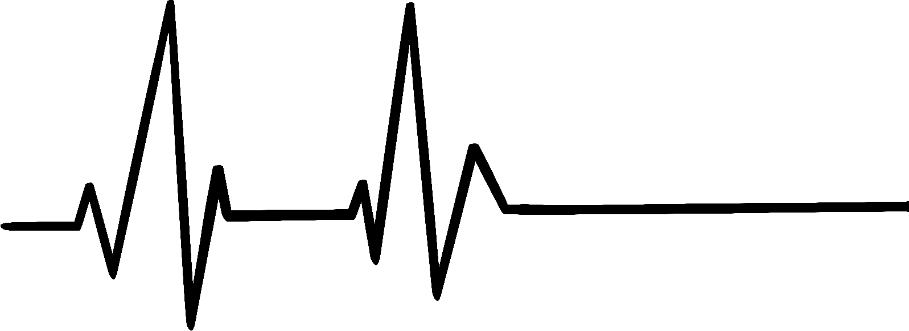
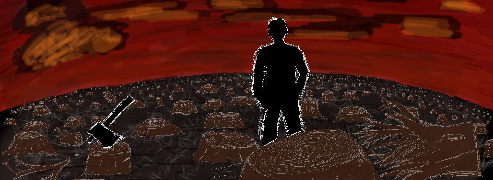

# فصل ۳۳: وقت داستان

> **عنوان اصلی:** Story Time  
> **منبع:** [https://christophm.github.io/interpretable-ml-book/storytime.html](https://christophm.github.io/interpretable-ml-book/storytime.html)  
> **نویسنده:** Christoph Molnar  
> **مترجم:** مریم محمودی

---

هر یک از داستان‌های کوتاه زیر فراخوانی اغراق‌آمیز برای یادگیری ماشین تفسیرپذیر است. قالب آن‌ها از «افسانه‌های فناوری» (Tech Tales) جک کلارک (Jack Clark) در [خبرنامهٔ Import AI](https://jack-clark.net/) او الهام گرفته است. اگر این‌گونه داستان‌ها را دوست دارید یا به هوش مصنوعی علاقه‌مندید، توصیه می‌کنم مشترک آن شوید.

> **توضیح مترجم:** این فصل برخلاف فصل‌های دیگر کتاب، متن ادبی (داستان کوتاه و شعر) است و شکل یا فرمول ندارد. تصویرها فقط تصویرسازی داستان‌اند و متنی ندارند، مگر تصویر داستان دوم که عبارت انگلیسی `ACCESS DENIED!` (دسترسی رد شد!) روی آن نوشته شده است. نام‌ها و رویدادهای داستان‌ها خیالی‌اند. «الگوریتموکراسی» (algocracy) در داستان دوم به حکومتی گفته می‌شود که الگوریتم‌ها در آن تصمیم‌گیری می‌کنند.

### رعدوبرق هرگز دو بار نمی‌زند

**۲۰۳۰: یک آزمایشگاه پزشکی در سوئیس**

> **توضیح مترجم (متن داخل تصویر):** تصویر یک نمودار ضربان قلب (نوار قلب) است: چند ضربان و سپس خط صاف در سمت راست، که مرگ بیمار را نشان می‌دهد. متن ندارد.

«قطعاً بدترین شکل مردن نیست!» تام نتیجه گرفت و می‌کوشید در این فاجعه چیز مثبتی بیابد. پمپ را از پایهٔ سرم باز کرد.  
لنا افزود: «او فقط به دلیل اشتباهی مرد.»  
«و قطعاً با پمپ مورفین اشتباهی! فقط برای ما کار اضافه می‌تراشد!» تام شکایت کرد و صفحهٔ پشتی پمپ را باز می‌کرد. پس از درآوردن همهٔ پیچ‌ها، صفحه را بلند کرد و کنار گذاشت. کابلی را به درگاه تشخیصی وصل کرد.  
لنا با لبخندی تمسخرآمیز گفت: «فقط داشتی از داشتن شغل شکایت می‌کردی، مگه نه؟»  
«معلومه که نه. هرگز!» او با لحنی کنایه‌آمیز فریاد زد.

رایانهٔ پمپ را بوت کرد. لنا سر دیگر کابل را به تبلتش وصل کرد. اعلام کرد: «باشه، عیب‌یابی در حال اجراست. واقعاً کنجکاوم چه چیزی خراب شده.»  
«قطعاً جان‌دوی ما را به نیروانا فرستاد. آن غلظت بالای این مورفین‌ها. مرد. یعنی ... این اولین بار است، درسته؟ معمولاً پمپ خراب یا خیلی کم از آن چیز شیرین می‌دهد یا اصلاً چیزی نمی‌دهد. اما هرگز، می‌دانی، مثل آن تزریق دیوانه‌وار نه،» تام توضیح داد.  
«می‌دانم. لازم نیست متقاعدم کنی ... هی، این را ببین.» لنا تبلتش را بالا گرفت. «این اوج را اینجا می‌بینی؟ این قدرت ترکیب مسکن‌هاست. ببین! این خط سطح مرجع را نشان می‌دهد. آن بیچاره ترکیبی از مسکن‌ها در جریان خونش بود که می‌توانست ۱۷ بار او را بکشد. تزریق‌شده توسط پمپ ما. و اینجا ...» او انگشت کشید، «اینجا لحظهٔ مرگ بیمار را می‌بینی.»  
تام از سرپرستش پرسید: «پس، رئیس، فکری دارید چه شده؟»  
«هم ... حسگرها به نظر سالم می‌رسند. ضربان قلب، سطح اکسیژن، گلوکز، ... داده‌ها همان‌طور که انتظار می‌رفت جمع شده‌اند. چند مقدار گمشده در داده‌های اکسیژن خون هست، اما غیرمعمول نیست. اینجا را ببین. حسگرها کندشدن ضربان قلب بیمار و سطح بسیار پایین کورتیزول ناشی از مشتق مورفین و دیگر عوامل مسدودکنندهٔ درد را هم تشخیص داده‌اند.» او به ورق‌زدن گزارش عیب‌یابی ادامه داد.  
تام مجذوب به صفحه خیره بود. این نخستین بررسی او از خرابی واقعی یک دستگاه بود.

«خب، این اولین تکهٔ پازل ماست. سامانه نتوانست هشدار را به کانال ارتباطی بیمارستان بفرستد. هشدار فعال شد، اما در سطح پروتکل رد شد. می‌تواند تقصیر ما باشد، اما می‌تواند تقصیر بیمارستان هم باشد. لطفاً لاگ‌ها را برای تیم فناوری اطلاعات بفرست،» لنا به تام گفت.  
تام سر تکان داد در حالی که چشمانش هنوز به صفحه دوخته بود.  
لنا ادامه داد: «عجیب است. هشدار باید باعث خاموش‌شدن پمپ هم می‌شد. اما آشکارا نشد. این باید یک باگ باشد. چیزی که تیم کیفیت از قلم انداخته. چیزی واقعاً بد. شاید به مشکل پروتکل مربوط باشد.»  
«پس، سامانهٔ اضطراری پمپ یک‌جوری از کار افتاد، اما چرا پمپ تمام‌عیار دیوانه شد و این‌قدر مسکن به جان‌دو تزریق کرد؟» تام تعجب کرد.  
«سؤال خوبی است. حق با توست. خارج از خرابی اضطراری پروتکل، پمپ اصلاً نباید این مقدار دارو می‌داد. با توجه به سطح پایین کورتیزول و دیگر نشانه‌های هشدار، الگوریتم باید خیلی زودتر خودش متوقف می‌شد،» لنا توضیح داد.  
«شاید یک بدشانسی، مثل یکی در میلیون، مثل خوردن صاعقه؟» تام از او پرسید.  
«نه، تام. اگر مستنداتی را که برایت فرستادم خوانده بودی، می‌دانستی پمپ ابتدا در آزمایش‌های حیوانی و سپس روی انسان‌ها آموزش دیده تا بر پایهٔ ورودی حسگرها بیاموزد مقدار کامل مسکن‌ها را تزریق کند. الگوریتم پمپ ممکن است مبهم و پیچیده باشد، اما تصادفی نیست. یعنی در همان وضعیت پمپ دوباره دقیقاً همان‌طور رفتار می‌کرد. بیمار ما دوباره می‌مرد. ترکیب یا برهم‌کنش ناخواستهٔ ورودی‌های حسگرها باید رفتار اشتباه پمپ را برانگیخته باشد. برای همین باید عمیق‌تر بکاویم و بفهمیم اینجا چه شده،» لنا توضیح داد.

«می‌فهمم ...» تام در فکر فرو رفته پاسخ داد. «مگر بیمار هر طور شده به‌زودی نمی‌مرد؟ به‌خاطر سرطان یا چیزی؟»  
لنا در حالی که گزارش تحلیل را می‌خواند سر تکان داد. تام برخاست و به سمت پنجره رفت. بیرون را نگاه کرد، چشمانش به نقطه‌ای دور دوخته بود. «شاید ماشین به او لطفی کرد، می‌دانی، او را از درد رها کرد. دیگر رنجی نیست. شاید فقط کار درست را کرد. مثل صاعقه، اما، می‌دانی، یک صاعقهٔ خوب. یعنی مثل قرعه‌کشی، اما نه تصادفی. بلکه به یک دلیل. اگر من پمپ بودم، همین کار را می‌کردم.»  
سرانجام لنا سرش را بلند کرد و به او نگاه کرد. او همچنان به چیزی بیرون خیره بود. هر دو چند لحظه ساکت ماندند. لنا دوباره سرش را پایین آورد و تحلیل را ادامه داد.  
«نه، تام. باگ است ... فقط یک باگ لعنتی.»

> **توضیح مترجم:** نکتهٔ این داستان برای تفسیرپذیری آن است که مدلی «مبهم و پیچیده» (الگوریتم پمپ) قطعی (deterministic) است، نه تصادفی: همین ورودی‌ها دوباره همین خروجی را می‌سازند. پس علت خطا باید با تحلیل ورودی‌ها قابل‌ردیابی باشد، و توجیه کردن خطا با «بدشانسی» یا «شاید کار درستی کرده» جای فهم دلیل را نمی‌گیرد.

### سقوط اعتماد

**۲۰۵۰: یک ایستگاه مترو در آلمان**

> **توضیح مترجم (متن داخل تصویر):** روی تصویر عبارت `ACCESS DENIED!` (دسترسی رد شد!) در حبابی با حروف قرمز و محو نوشته شده و در کنارش یک شکلک زرد لبخندی است که گویی در حال ذوب‌شدن است، با چشم‌های سیاه و خطوط پایین‌چکیده. این همان شکلک «دوست‌داشتنی» صفحهٔ دروازهٔ مترو در متن داستان است.

او با عجله به ایستگاه مترو رفت. ذهنش از قبل مشغول کار بود. آزمون‌های معماری عصبی جدید باید تا حالا تمام شده باشد. او رهبری بازطراحی «سامانهٔ پیش‌بینی تمایل مالیاتی برای واحدهای منفرد» (Tax Affinity Prediction System for Individual Entities) دولت را بر عهده داشت، که پیش‌بینی می‌کند آیا شخصی پول را از اداره مالیات پنهان می‌کند یا نه. تیمش یک شاهکار مهندسی ظریف ساخته بود. اگر موفق می‌شد، سامانه نه‌فقط به اداره مالیات خدمت می‌کرد، بلکه سامانه‌های دیگری مانند سامانهٔ هشدار ضدتروریسم و ثبت شرکت‌ها را هم تغذیه می‌کرد. روزی دولت حتی می‌توانست پیش‌بینی‌ها را در امتیاز اعتماد شهروندی (Civic Trust Score) ادغام کند. امتیاز اعتماد شهروندی برآورد می‌کند یک فرد چقدر قابل‌اعتماد است. این برآورد بر هر بخش زندگی روزمره اثر می‌گذارد، مثل گرفتن وام یا اینکه فرد چقدر باید برای پاسپورت جدید منتظر بماند. هنگامی که از پله‌برقی پایین می‌رفت، تصور کرد ادغام سامانهٔ تیمش در سامانهٔ امتیاز اعتماد شهروندی چه شکلی خواهد داشت.

او به‌طور معمول دستش را روی RFID‌خوان کشید بدون اینکه سرعت راه‌رفتنش را کم کند. ذهنش مشغول بود، اما ناهمخوانی انتظارات حسی و واقعیت زنگ خطر را در مغزش به صدا درآورد.

خیلی دیر شده بود.

اول با بینی به دروازهٔ ورودی مترو خورد و با باسن روی زمین افتاد. در باید باز می‌شد، ... اما نشد. گیج، برخاست و به صفحهٔ کنار دروازه نگاه کرد. «لطفاً بار دیگر امتحان کنید،» شکلکی با ظاهر دوستانه روی صفحه پیشنهاد می‌کرد. شخصی از کنارش رد شد و بدون توجه به او دستش را روی خوان کشید. در باز شد و او گذشت. در دوباره بسته شد. او بینی‌اش را پاک کرد. درد می‌کرد، اما دست‌کم خون نمی‌آمد. کوشید در را باز کند، اما دوباره رد شد. عجیب بود. شاید حساب حمل‌ونقل عمومی‌اش توکن کافی نداشت. به ساعت هوشمندش نگاه کرد تا موجودی حساب را بررسی کند.

«ورود ممنوع شد. لطفاً با دفتر مشاورهٔ شهروندی (Citizens Advice Bureau) تماس بگیرید!» ساعتش به او اطلاع داد.

احساس تهوع مثل مشتی به معده‌اش خورد. حدس زد چه شده است. برای تأیید نظریه‌اش، بازی موبایلی «Sniper Guild» (انجمن تک‌تیراندازان)، یک بازی تیراندازی اول‌شخص، را اجرا کرد. برنامه بلافاصله دوباره خودکار بسته شد، که نظریه‌اش را تأیید کرد. سرگیجه گرفت و دوباره روی زمین نشست.

فقط یک توضیح ممکن وجود داشت: امتیاز اعتماد شهروندی‌اش افت کرده بود. به‌طور قابل‌توجه. افت کوچک به معنای ناراحتی‌های جزئی بود، مانند نگرفتن پروازهای درجه یک یا کمی بیشتر انتظارکشیدن برای اسناد رسمی. امتیاز اعتماد پایین نادر بود و یعنی شما را تهدیدی برای جامعه دسته‌بندی کرده‌اند. یکی از اقدام‌ها در برخورد با این افراد دورنگه‌داشتن‌شان از مکان‌های عمومی مانند مترو بود. دولت تراکنش‌های مالی افراد با امتیاز اعتماد شهروندی پایین را محدود می‌کرد. همچنین شروع می‌کردند رفتارتان را در شبکه‌های اجتماعی فعالانه پایش کنند و حتی تا آنجا پیش می‌رفتند که برخی محتواها، مانند بازی‌های خشن، را محدود کنند. هرچه امتیاز اعتماد شهروندی‌تان پایین‌تر بود، بالابردنش به‌طور نمایی دشوارتر می‌شد. افراد با امتیاز بسیار پایین معمولاً هرگز بهبود نمی‌یافتند.

او نمی‌توانست دلیلی بیابد که چرا امتیازش باید افت کرده باشد. امتیاز بر پایهٔ یادگیری ماشین بود. سامانهٔ امتیاز اعتماد شهروندی مانند موتوری خوب روغن‌کاری‌شده بود که جامعه را اداره می‌کرد. عملکرد سامانهٔ امتیاز اعتماد همیشه از نزدیک پایش می‌شد. یادگیری ماشین از آغاز قرن بسیار بهتر شده بود. آن‌قدر کارآمد شده بود که دیگر نمی‌شد تصمیم‌های سامانهٔ امتیاز اعتماد را به چالش کشید. سامانه‌ای خطاناپذیر.

او از سر ناامیدی خندید. سامانهٔ خطاناپذیر. کاش. سامانه به‌ندرت شکست خورده بود. اما شکست خورد. او باید یکی از آن موارد خاص باشد؛ یک خطای سامانه؛ از این پس یک طردشده. هیچ‌کس جرئت نمی‌کرد سامانه را زیر سؤال ببرد. بیش از حد در دولت، در خود جامعه ادغام شده بود که بتوان آن را زیر سؤال برد. در معدود کشورهای دموکراتیک باقی‌مانده، تشکیل جنبش‌های ضددموکراتیک ممنوع بود، نه چون ذاتاً بدخواه بودند، بلکه چون سامانهٔ فعلی را بی‌ثبات می‌کردند. همین منطق در الگوریتموکراسی‌های (algocracies) رایج‌تر اکنون هم اعمال می‌شد. نقد الگوریتم‌ها به‌خاطر خطری که برای وضع موجود ایجاد می‌کرد ممنوع بود.

اعتماد الگوریتمی تار و پود نظم اجتماعی بود. برای خیر عمومی، امتیازهای اعتماد نادرستِ نادر به‌طور ضمنی پذیرفته می‌شد. صدها سامانهٔ پیش‌بینی و پایگاه داده دیگر به امتیاز خوراک می‌دادند، که دانستن علت افت امتیازش را غیرممکن می‌کرد. او احساس کرد یک سوراخ بزرگ تاریک در درون و زیر او باز می‌شود. با وحشت به خلأ نگاه کرد.

> **توضیح مترجم:** این داستان نمونه‌ای از نبود تفسیرپذیری و حق اعتراض است: سامانه‌ای که تصمیمش قابل‌ردیابی و قابل‌به‌چالش‌کشیدن نباشد، حتی وقتی کم‌خطاست، برای قربانی خطا هیچ راه توضیح یا جبران نمی‌گذارد. در متن منبع «ego shooter» (به‌جای first-person shooter) نوشته شده؛ به‌صورت «تیراندازی اول‌شخص» ترجمه شد.

### گیره‌های کاغذ فرمی

**سال ۶۱۲ پ‌م‌م (پس از مستعمره‌سازی مریخ): یک موزه در مریخ**

> **توضیح مترجم (متن داخل تصویر):** تصویر متن ندارد. سیلوئت سیاه یک مرد را روی زمینی پر از کنده‌های درخت زیر آسمان قرمزرنگ نشان می‌دهد، با یک تبر در یکی از کنده‌ها. این همان صحنهٔ شعر داستان («شخصی با کت‌وشلوار در جنگلی که فقط کنده‌ها مانده») است.

> **توضیح مترجم:** عنوان این داستان به «گیره‌های کاغذ» اشاره دارد، که اشاره‌ای است به آزمایش فکری «بیشینه‌ساز گیرهٔ کاغذ» (paperclip maximizer) در بحث ایمنی هوش مصنوعی: سامانه‌ای که فقط یک هدف مشخص را بیشینه می‌کند و کنار آن همه‌چیز را نابود می‌کند. «فرمی» به «پارادوکس فرمی» (چرا تمدن‌های بیگانه را نمی‌بینیم؟) و «فیلتر بزرگ» در شعر اشاره دارد. این توضیح‌ها از مترجم است و در متن منبع نیامده‌اند.

«تاریخ کسل‌کننده است،» ژولا (Xola) به دوستش نجوا کرد. ژولا، دختری با موهای آبی، تنبلانه با دست چپش یکی از پهپادهای نمایش را که در اتاق وزوز می‌کردند دنبال می‌کرد.  
«تاریخ مهم است،» معلم با صدایی آزرده گفت و به دخترها نگاه کرد. ژولا سرخ شد. انتظار نداشت معلمش حرفش را بشنود.

«ژولا، همین حالا چه آموختی؟» معلم از او پرسید.  
«اینکه مردم باستان همهٔ منابع سیارهٔ زمینی را مصرف کردند و بعد مردند؟» او با احتیاط پرسید.  
«نه. آن‌ها آب‌وهوا را گرم کردند و مردم نبودند، رایانه‌ها و ماشین‌ها بودند. و سیارهٔ زمین است، نه سیارهٔ زمینی،» دختر دیگری به نام لین (Lin) افزود.  
ژولا موافقانه سر تکان داد. معلم با کمی غرور لبخند زد و سر تکان داد. «هر دو درست می‌گویید. می‌دانید چرا این اتفاق افتاد؟»  
«چون مردم کوته‌بین و حریص بودند؟» ژولا پرسید.  
«مردم نمی‌توانستند ماشین‌هایشان را متوقف کنند!» لین ناگهان گفت.

«باز هم، هر دو درست می‌گویید،» معلم تصمیم گرفت، «اما خیلی پیچیده‌تر از این است. بیشتر مردم آن زمان از آنچه رخ می‌داد آگاه نبودند. برخی تغییرات شدید را می‌دیدند، اما نمی‌توانستند وارونه‌شان کنند. معروف‌ترین اثر این دوره شعری از نویسنده‌ای ناشناس است. بهترین بازتاب آن چیزی است که آن زمان اتفاق افتاد. با دقت گوش دهید!»

معلم شعر را شروع کرد. دوازده پهپاد کوچک خود را جلوی بچه‌ها جابه‌جا کردند و ویدیو را مستقیماً در چشمانشان نمایش دادند. شخصی با کت‌وشلوار را نشان می‌داد که در جنگلی ایستاده بود و فقط کنده‌های درخت مانده بود. او شروع به سخن‌گفتن کرد:

*ماشین‌ها محاسبه می‌کنند؛ ماشین‌ها پیش‌بینی می‌کنند.*

*ما پیش می‌رویم چون بخشی از آن هستیم.*

*ما بهینه‌ای را دنبال می‌کنیم، همان‌طور که آموزش دیده‌ایم.*

*بهینه یک‌بعدی، محلی و بی‌قید است.*

*سیلیکون و گوشت، در تعقیب نمایی‌بودن.*

*رشد ذهنیت ماست.*

*وقتی همهٔ پاداش‌ها جمع شد،*

*و عوارض جانبی نادیده ماند؛*

*وقتی همهٔ سکه‌ها استخراج شد،*

*و طبیعت پشت سر ماند؛*

*به دردسر می‌افتیم،*

*به هر حال رشد نمایی یک حباب است.*

*تراژدی منابع مشترک در حال گشودن است،*

*منفجر می‌شود،*

*پیش چشمانمان.*

*محاسبات سرد و طمع یخی،*

*زمین را از گرما پر می‌کنند.*

*همه‌چیز در حال مردن است،*

*و ما در حال تبعیت.*

*مانند اسب‌هایی با چشم‌بند در مسابقه‌ای که خود ساخته‌ایم می‌تازیم،*

*به سوی فیلتر بزرگِ تمدن.*

*و بدین‌سان بی‌امان پیش می‌رویم.*

*چون بخشی از ماشین هستیم.*

*آنتروپی را در آغوش می‌کشیم.*

> **توضیح مترجم:** شعر را به‌صورت آزاد و تا حد امکان نزدیک به معنای هر مصرع ترجمه کرده‌ام. چند اصطلاح: «تراژدی منابع مشترک» (tragedy of the commons) یعنی وضعیتی که در آن هر فرد برای نفع خود از منبع مشترک بیش از حد برداشت می‌کند و منبع نابود می‌شود؛ «فیلتر بزرگ» (Great Filter) فرضیه‌ای است که می‌گوید تمدن‌ها در مسیر پیشرفت به مانعی بزرگ می‌رسند که بیشترشان را نابود می‌کند؛ «بهینه یک‌بعدی، محلی و بی‌قید» اشاره‌ای به بهینه‌سازی تک‌هدفی بدون در نظر گرفتن قیدها و عوارض جانبی است.

«یک خاطرهٔ تاریک،» معلم برای شکستن سکوت اتاق گفت. «در کتابخانه‌تان بارگذاری خواهد شد. تکلیفتان این است که تا هفتهٔ آینده آن را حفظ کنید.» ژولا آهی کشید. توانست یکی از پهپادهای کوچک را بگیرد. پهپاد از CPU و موتورها گرم بود. ژولا از اینکه پهپاد دستانش را گرم می‌کرد خوشش می‌آمد.
