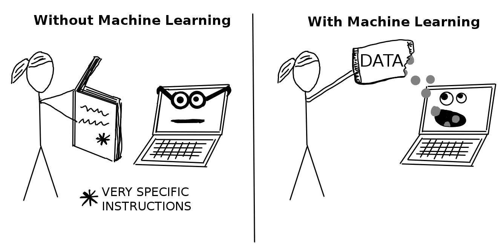
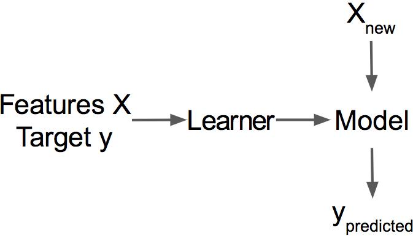
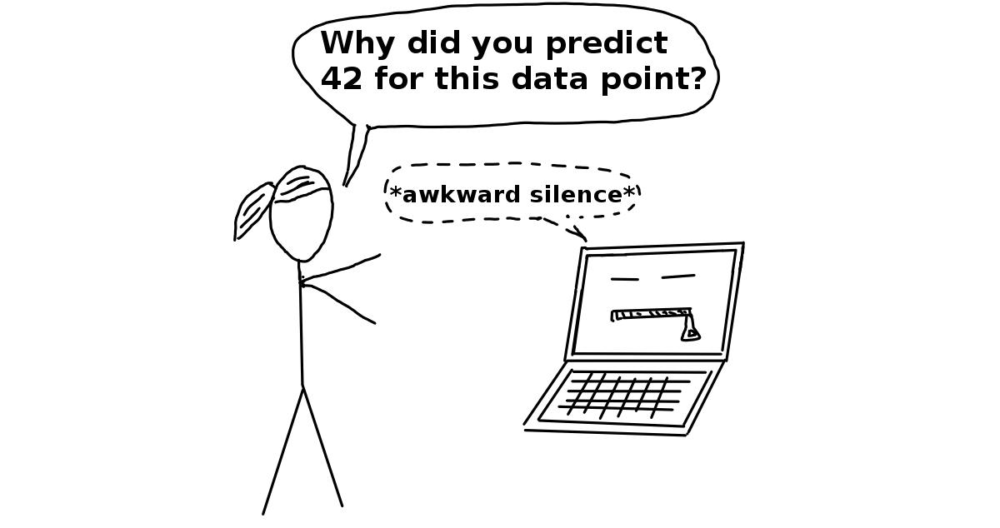

# پیوست الف — اصطلاحات یادگیری ماشین

> **عنوان اصلی:** Machine Learning Terms  
> **منبع:** [https://christophm.github.io/interpretable-ml-book/what-is-machine-learning.html](https://christophm.github.io/interpretable-ml-book/what-is-machine-learning.html)  
> **نویسنده:** Christoph Molnar  
> **مترجم:** مریم محمودی

---

برای پرهیز از سردرگمی ناشی از ابهام، در اینجا چند تعریف از اصطلاحات به‌کاررفته در این کتاب آمده است:

**الگوریتم** (Algorithm) مجموعه‌ای از قواعد است که یک ماشین برای رسیدن به هدفی مشخص از آن‌ها پیروی می‌کند [(Merriam-Webster ۲۰۱۷)](appendix-D-references.md). الگوریتم را می‌توان دستورپختی دانست که ورودی‌ها، خروجی و همهٔ گام‌های لازم برای رسیدن از ورودی‌ها به خروجی را تعریف می‌کند. دستور پخت‌های آشپزی الگوریتم‌اند که در آن‌ها مواد اولیه ورودی‌ها هستند، غذای پخته‌شده خروجی است و گام‌های آماده‌سازی و پخت دستورالعمل‌های الگوریتم‌اند.

**یادگیری ماشین** (Machine Learning) مجموعه‌ای از روش‌هاست که به رایانه‌ها امکان می‌دهد از داده بیاموزند تا پیش‌بینی کنند و پیش‌بینی‌ها را بهبود دهند (برای مثال پیش‌بینی سرطان، فروش هفتگی، نکول اعتباری). یادگیری ماشین تغییر الگو (paradigm shift) است، از «برنامه‌نویسی عادی» که در آن همهٔ دستورالعمل‌ها باید صریحاً به رایانه داده شوند، به «برنامه‌نویسی غیرمستقیم» که از راه فراهم‌کردن داده انجام می‌شود.

> **توضیح مترجم (متن داخل تصویر):** تصویر دو نیمه دارد. نیمهٔ چپ با عنوان `Without Machine Learning` (بدون یادگیری ماشین): فردی کتاب دستورالعملی را برای رایانه‌ای که عینک دارد باز کرده و کنارش نوشته `VERY SPECIFIC INSTRUCTIONS` (دستورالعمل‌های بسیار مشخص). نیمهٔ راست با عنوان `With Machine Learning` (با یادگیری ماشین): همان فرد از یک کیسه با برچسب `DATA` (داده) دانه‌هایی را به دهان باز رایانه می‌ریزد، یعنی رایانه از داده «تغذیه» می‌شود.

**یادگیرنده** (Learner) یا **الگوریتم یادگیری ماشین** (Machine Learning Algorithm) برنامه‌ای است که برای آموختن یک مدل یادگیری ماشین از داده به کار می‌رود. نام دیگر آن «استقراگر» (inducer) است (مثلاً «tree inducer» یعنی استقراگر درخت).

**مدل یادگیری ماشین** (Machine Learning Model) برنامهٔ آموخته‌شده‌ای است که ورودی‌ها را به پیش‌بینی‌ها نگاشت می‌کند. این می‌تواند مجموعه‌ای از وزن‌ها برای یک مدل خطی یا یک شبکهٔ عصبی باشد. نام‌های دیگر برای واژهٔ نسبتاً نامشخص «مدل» عبارت‌اند از «پیش‌بین» (predictor) یا -- بسته به وظیفه -- «دسته‌بند» (classifier) یا «مدل رگرسیون». در فرمول‌ها، مدل یادگیری ماشین آموزش‌دیده را $\hat{f}$ یا $\hat{f}(\mathbf{x})$ می‌نامند.

> **توضیح مترجم (متن داخل تصویر):** متن‌های تصویر: `Features X` (ویژگی‌های X) و `Target y` (هدف y) با پیکان به `Learner` (یادگیرنده) و سپس `Model` (مدل). `X_new` (X جدید) از بالا وارد مدل می‌شود و `y_predicted` (y پیش‌بینی‌شده) از پایین خارج می‌شود.

**مدل جعبه‌سیاه** (Black Box Model) سامانه‌ای است که سازوکارهای درونی‌اش را آشکار نمی‌کند. در یادگیری ماشین، اصطلاح «جعبه‌سیاه» مدل‌هایی را توصیف می‌کند که با نگاه‌کردن به پارامترهایشان قابل‌فهم نیستند (مثلاً یک شبکهٔ عصبی). نقطهٔ مقابل جعبه‌سیاه گاهی **جعبه‌سفید** (White Box) نامیده می‌شود و در این کتاب «مدل تفسیرپذیر» خوانده می‌شود. روش‌های تفسیرپذیری مستقل از مدل (model-agnostic) مدل‌های یادگیری ماشین را جعبه‌سیاه در نظر می‌گیرند، حتی اگر نباشند.

> **توضیح مترجم (متن داخل تصویر):** در حباب گفتار فرد نوشته شده `Why did you predict 42 for this data point?` (چرا برای این نقطهٔ داده ۴۲ را پیش‌بینی کردی؟) و در حباب خط‌چین کنار رایانه `*awkward silence*` (*سکوت معذب*) آمده است؛ یعنی مدل جعبه‌سیاه توضیحی برای پیش‌بینی‌اش ندارد.

**یادگیری ماشین تفسیرپذیر** (Interpretable Machine Learning) به روش‌ها و مدل‌هایی اشاره دارد که رفتار و پیش‌بینی‌های سامانه‌های یادگیری ماشین را برای انسان قابل‌فهم می‌کنند.

**مجموعه‌داده** (Dataset) جدولی است با داده‌هایی که ماشین از آن می‌آموزد. مجموعه‌داده شامل ویژگی‌ها و هدفی است که باید پیش‌بینی شود. وقتی برای استقرای یک مدل (induce) به کار رود، مجموعه‌داده را داده‌های آموزشی (training data) می‌نامند.

**نمونه** (Instance) یک سطر در مجموعه‌داده است. نام‌های دیگر «نمونه» عبارت‌اند از: نقطهٔ (داده)، مثال (example)، مشاهده (observation). یک نمونه از مقادیر ویژگی $\mathbf{x}^{(i)}$ و، اگر معلوم باشد، نتیجهٔ هدف $y^{(i)}$ تشکیل می‌شود.

**ویژگی‌ها** (Features) ورودی‌هایی‌اند که برای پیش‌بینی یا دسته‌بندی به کار می‌روند. یک ویژگی یک ستون در مجموعه‌داده است. در سراسر کتاب فرض می‌شود ویژگی‌ها تفسیرپذیرند، یعنی فهمیدن معنایشان آسان است، مانند دمای یک روز مشخص یا قد یک فرد. تفسیرپذیری ویژگی‌ها یک فرض بزرگ است. اما اگر فهمیدن ویژگی‌های ورودی دشوار باشد، فهمیدن کاری که مدل می‌کند دشوارتر است. ماتریس همهٔ ویژگی‌ها $\mathbf{X}$ نامیده می‌شود و $\mathbf{x}^{(i)}$ برای یک نمونهٔ منفرد. بردار یک ویژگی منفرد برای همهٔ نمونه‌ها $\mathbf{x}\_j$ است و مقدار ویژگی $j$ برای نمونهٔ $i$ برابر $x^{(i)}\_j$ است.

**هدف** (Target) اطلاعاتی است که ماشین پیش‌بینی آن را می‌آموزد. در فرمول‌های ریاضی، هدف معمولاً $y$ یا برای یک نمونهٔ منفرد $y^{(i)}$ نامیده می‌شود.

**وظیفهٔ یادگیری ماشین** (Machine Learning Task) ترکیب یک مجموعه‌داده با ویژگی‌ها و یک هدف است. بسته به نوع هدف، وظیفه می‌تواند دسته‌بندی، رگرسیون، تحلیل بقا (survival analysis)، خوشه‌بندی یا تشخیص داده‌پرت باشد.

**پیش‌بینی** (Prediction) «حدس» مدل یادگیری ماشین برای مقدار هدف بر پایهٔ ویژگی‌های داده‌شده است. در این کتاب، پیش‌بینی مدل با $\hat{f}(\mathbf{x}^{(i)})$ یا $\hat{y}$ نشان داده می‌شود.

> **برای درک بهتر (توضیح مترجم):** یک مثال واحد برای همهٔ اصطلاحات: فرض کنید می‌خواهید قیمت خانه را پیش‌بینی کنید. **مجموعه‌داده** جدولی با ۱٬۰۰۰ خانه است. هر **نمونه** یک سطر (یک خانه) است. **ویژگی‌ها** ستون‌هایی مانند متراژ و تعداد اتاق‌اند و **هدف** ستون قیمت. **یادگیرنده** الگوریتمی است که از این جدول یک **مدل** می‌سازد. **وظیفه** «رگرسیون قیمت خانه» است. برای خانهٔ جدید، مدل یک **پیش‌بینی** $\hat{y}$ می‌دهد. اگر مدل شبکهٔ عصبی بزرگی باشد که نتوانید وزن‌هایش را بخوانید، **جعبه‌سیاه** است و روش‌های این کتاب برای تفسیرش به کار می‌آیند. این مثال از مترجم است.
